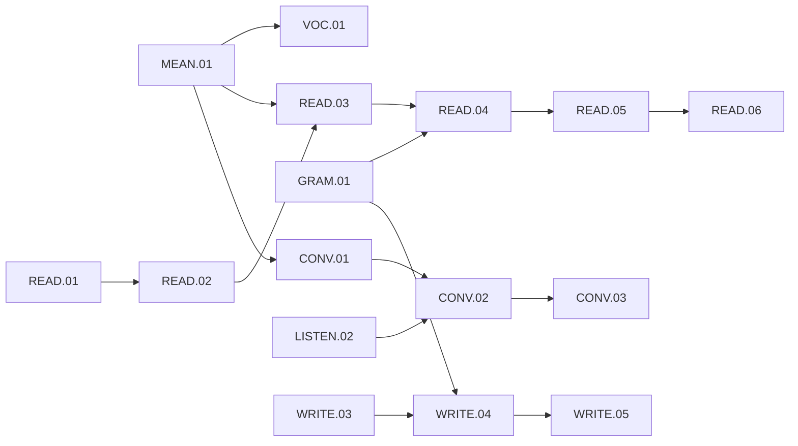

# 06 — Skill Tree

**Version:** DRAFT_V2 — reviewed complete specification; owner approval pending
**Date:** 20 November 2026  
**Authority:** [Vision FINAL_V1](01-Vision.md), approved and unchanged. All other sections are working specifications awaiting owner approval.  
**Primary dependencies:** Sections 02–05; forward contracts to 07 task evidence, 14 state, and 15 typed dependencies.  
**Context:** All existing sections 01–05 read before this section was written. Later references are forward contracts reconciled in the whole-Bible review.  
**Evidence:** [Learning model and research](02-How-Humans-Learn.md); [source register](RESEARCH-REGISTER.md). Numerical targets, budgets, and thresholds below are design hypotheses unless explicitly sourced. No new Tigrinya teaching content or native approval is supplied.

## 1. A graph with different kinds of dependency

The skill tree is a directed objective graph, not a game ladder or one global proficiency score. Separate **hard prerequisites** required for a valid independent task, **recommended preparation**, **content dependencies** required for delivery, and **related skills** that may develop together. Do not make a font asset, family membership, or story category an educational prerequisite by accident.

Scope each node to a language pack, capability, objective, and context. Literacy and oral ability can develop unevenly. The graph should allow a heritage learner to demonstrate relevant prior knowledge rather than repeat every spoken foundation before approaching script.

## 2. Canonical node catalogue

The node IDs below define reusable capability families. A concrete curriculum expands each into reviewed objectives and variants. The catalogue is a complete domain framework, not every possible word or situation.

| Node | Capability | Independent-task prerequisites / important relationships |
| --- | --- | --- |
| ACC.01 | Understand the interaction and use an accessible response. | Delivery condition; failure blocks interpretation, not learning access. |
| MEAN.01 | Understand a selected target meaning. | Reviewed context; can be demonstrated without print. |
| VOC.01 | Recognise a spoken lexical sense. | MEAN.01; listening model available. |
| VOC.02 | Retrieve a relevant word/meaning without answer help. | Target taught; appropriate modality specified. |
| VOC.03 | Use words in reviewed combinations. | Relevant senses; related GRAM.01. |
| VOC.04 | Select sense/register under context. | Appropriate contrast/context taught. |
| PRON.01 | Perceive a reviewed sound distinction. | Accessible audio and task comprehension. |
| PRON.02 | Produce a familiar target understandably. | Target meaning/model; qualified assessment when claimed. |
| PRON.03 | Use reviewed rhythm/prosodic distinctions. | Relevant phrase model and purpose. |
| PRON.04 | Maintain understandable connected speech. | Task-specific oral repertoire; not accent elimination. |
| READ.01 | Distinguish selected Fidäl forms visually. | Appropriate glyph presentation; no oral score inferred. |
| READ.02 | Connect forms/family orders to reviewed sounds. | READ.01 plus appropriate sound access; related PRON.01. |
| READ.03 | Interpret selected written words. | Relevant mappings and MEAN.01; control picture cues. |
| READ.04 | Understand phrases and sentences. | Relevant words/patterns and reference. |
| READ.05 | Understand connected narrative/informational text. | Relevant language knowledge, sequence/reference. |
| READ.06 | Compare stance, evidence, and sources. | Appropriate connected reading and topic knowledge. |
| WRITE.01 | Explore/copy a shape with an appropriate medium. | Suitable model; stroke-order claim requires verified data. |
| WRITE.02 | Produce a taught form without the guide. | Relevant form model; motor access not a language ranking. |
| WRITE.03 | Produce suitable written words. | Relevant form/spelling knowledge and target meaning. |
| WRITE.04 | Compose and revise a short message. | Reviewed patterns/meaning and access; typing can be distinct from handwriting. |
| WRITE.05 | Organise connected writing for a purpose. | Relevant language, planning, and reference. |
| WRITE.06 | Revise argument/register for a demanding audience. | Appropriate extended writing and rubric. |
| LISTEN.01 | Identify meaning in a short spoken target. | Accessible model and relevant meaning. |
| LISTEN.02 | Follow a short message and key detail. | Relevant vocabulary/patterns; no answer-revealing transcript. |
| LISTEN.03 | Follow a sequence or narrative. | Appropriate connected language and background. |
| LISTEN.04 | Follow turns, intent, and repair in an exchange. | Relevant listening and interaction models. |
| LISTEN.05 | Interpret stance/detail in authentic material. | Topic/context knowledge and suitable recorded input. |
| GRAM.01 | Understand a reviewed pattern–meaning relationship. | Appropriate examples; terminology not required. |
| GRAM.02 | Use the pattern under a changed detail. | Pattern taught, relevant vocabulary. |
| GRAM.03 | Select constructions for extended meaning/register. | Appropriate pattern network and discourse. |
| CULT.01 | Interpret an appropriate reviewed cultural situation. | Context and evidence; not identity conformity. |
| CULT.02 | Explain contextual variation and perspectives. | Relevant sources and language; avoid universalising. |
| CONV.01 | Make a purposeful familiar contribution. | Meaning and an appropriate expression model. |
| CONV.02 | Respond to a changed contribution and clarify. | Relevant comprehension/production; genuinely contingent task. |
| CONV.03 | Sustain a discussion with repair and audience awareness. | Appropriate interaction repertoire and context. |
| STORY.01 | Follow a sequence and relevant reference. | Suitable input mode; reading/listening evidence separate. |
| STORY.02 | Retell or construct a coherent account. | Meaning/sequence and appropriate expressive repertoire. |
| STORY.03 | Explain perspective, inference, and evidence. | Appropriate connected input and discourse. |
| FLU.01 | Reuse familiar language with less disruptive effort. | Relevant accurate/understood task repertoire. |
| FLU.02 | Maintain purposeful performance under suitable variation. | Task-specific prior evidence; no mandatory countdown. |
| PROF.01 | Execute a bounded professional task. | Task-specific language criteria plus domain readiness; human rubric. |

“Prerequisite” refers to what makes a particular task interpretable. It does not mean every activity in a capability family must be completed or that oral production is required to access reading for every learner.

## 3. Example dependency paths

An educator must instantiate the exact dependencies for a concrete objective. For example, a word whose meaning is unfamiliar cannot support a pure decoding inference without meaning being addressed, but a visual form comparison can remain valid without knowing a word. Model access and ACC.01 are delivery/interpretation guards around every branch.

## 4. What unlocks what

Use three distinct states: **available to explore**, **recommended**, and **eligible for an independent task**. Approved supported content may remain explorable before all prerequisite evidence exists. Recommendation favours a manageable useful next step. Independent eligibility requires the critical prerequisite/model conditions for the particular assessment.

A successful recognition task unlocks an appropriate next recognition/reading opportunity; it does not unlock a claim of speech or handwriting competence. A story heard with audio can support narrative understanding while print decoding remains unassessed. A professional task requires a specific language profile and domain context, not merely every beginner badge.

No stage depends on attendance, payment, a streak, collection completion, or an unrelated physical gesture. Entitlements may govern optional services under Section 17 but never masquerade as educational prerequisites.

## 5. Evidence and progression

Each objective has skill-specific evidence under Section 14. A node can hold separate supported, independent, delayed, and parallel evidence. Do not use one average score to erase a missing critical criterion. An objective can be provisionally recommended for extension while a stronger mastery claim remains unavailable.

A checkpoint lists required nodes, alternatives/accommodations, acceptable task evidence, coverage, and a qualified rubric. A teacher can add contextual judgment within authorised scope, with reasons and version; no anonymous override creates a false independent response. A learner can challenge placement and request a model without shame.

## 6. Graph validation and authoring rules

Store edge type, objective version, rationale, and applicability. Reject hard-prerequisite cycles, self-edges, dangling nodes, cross-language links without an explicit reviewed purpose, and edges that silently equate recognition with production. Soft related-skill edges can be cyclic because they are not unlock rules.

A Fidäl family containing letters and a letter belonging to that family is a structural relationship, not two reciprocal hard prerequisites. Shared assets and contextual references form a content-dependency graph separately. Publication verifies approved required assets without requiring every related item to precede every other item.

Test that a learner can enter through oral knowledge, through early literacy, and through a supported exploration route. Test that missing data yields unassessed rather than zero. Test that adapting a presentation never resets evidence or alters the language standard.

## 7. Language-pack responsibilities and scaling

A generic node family can be shared; specific script decomposition, word segmentation, sound mappings, constructions, variants, and rubrics must belong to qualified language content. Supporting a future language means providing extension points, not claiming a universal seven-form family or Latin word boundary.

Version concrete objectives independently of the engine. A semantic change may invalidate relevant dependent evidence; a cosmetic change may preserve it with documented equivalence. Section 15 governs lineage and Section 14 governs scheduler migration. Keep the first graph small enough for a qualified educator to inspect before adding hundreds of nodes.

## 8. Acceptance and unresolved work

The graph is ready for a reviewed foundation slice when every independent task has explicit justified prerequisites, every asset dependency resolves, every critical claim has a valid observation, and accessible exploration remains possible. Native educators still must populate exact contrasts and mappings. Advanced nodes are complete design contracts, not authored teaching or certification.

## 9. Reviewed alternative routes

A sound-mapping task genuinely assesses a sound relationship and requires suitable access; it must not be silently relabelled after failure. Reading and meaning goals may also have reviewed alternative routes that do not require demonstrating hearing or vocal production. Represent those routes explicitly with objective, acceptable response, preserved criterion, and qualified rationale. Do not infer auditory evidence from a visual alternative or make absent hearing evidence a global literacy lock. The graph validator must test at least one alternative route where the claimed supported audience requires it (RV04).
