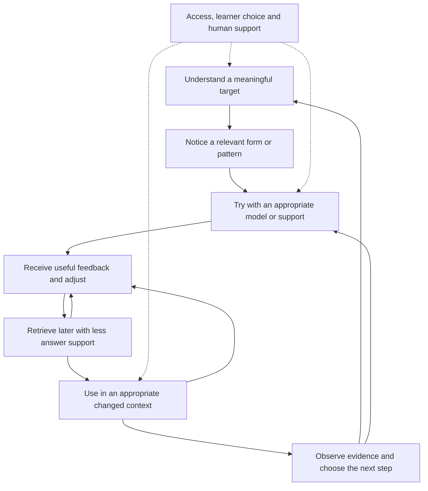
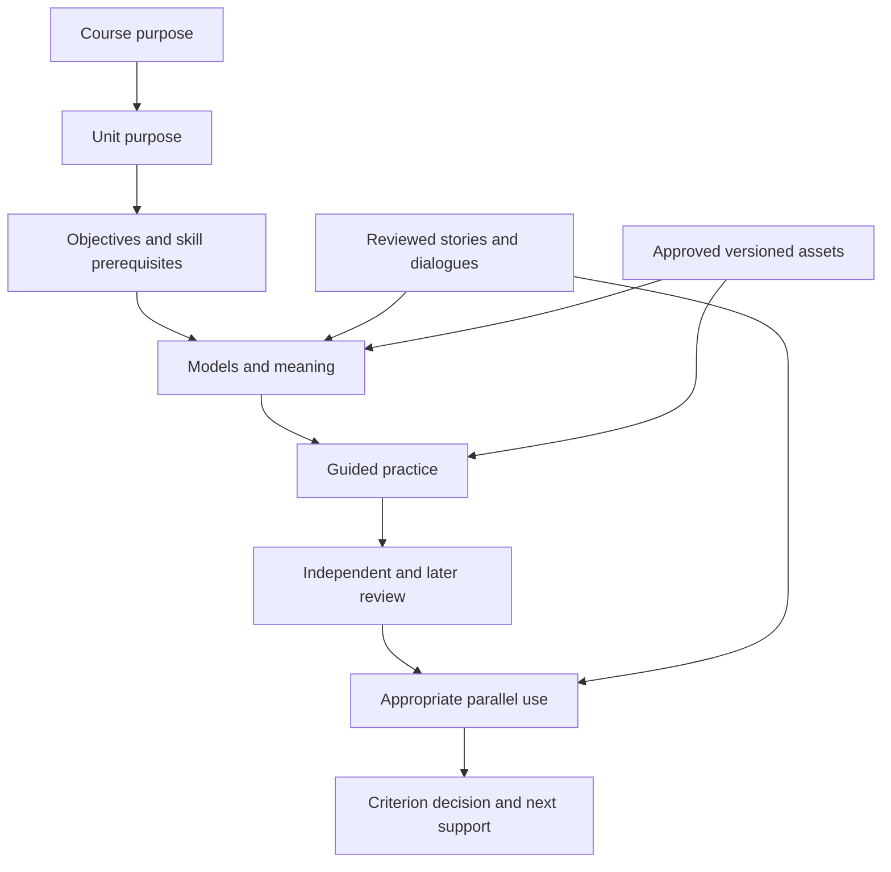
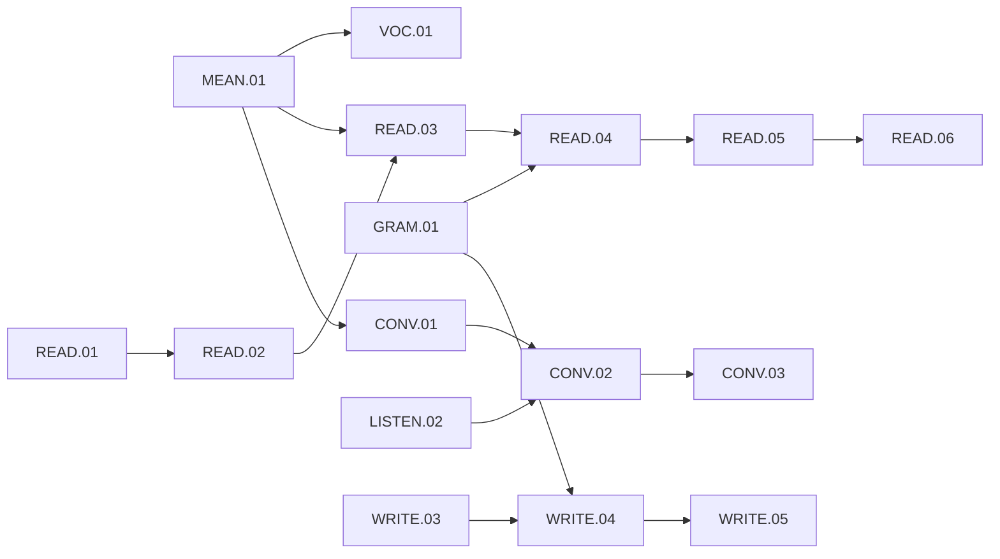

# Product Bible — Version 2.0

**Edition:** Complete review-ready consolidation, 20 November 2026.  
**Approval:** Section 01 retains FINAL_V1; Sections 02–20 are DRAFT_V2, owner approval pending.  
**Scope:** This is a full blueprint, not a claim that teaching content, learning outcomes, service configuration, or release readiness is complete.

[Operating guide](00-Master-Vision.md) · [Improvements only](V2.0-IMPROVEMENTS.md) · [Approval/workflow register](README.md) · [Exact-source manifest](V2.0-MANIFEST.json)

## Contents
- [01 — Official Company Vision](01-Vision.md)
- [02 — How Humans Become Fluent](02-How-Humans-Learn.md)
- [03 — User Archetypes](03-User-Archetypes.md)
- [04 — Learning Framework](04-Learning-Framework.md)
- [05 — Curriculum Framework](05-Curriculum-Framework.md)
- [06 — Skill Tree](06-Skill-Tree.md)
- [07 — Activity System](07-Activity-System.md)
- [08 — Game System](08-Game-System.md)
- [09 — Story System](09-Story-System.md)
- [10 — Speaking System](10-Speaking-System.md)
- [11 — Listening System](11-Listening-System.md)
- [12 — Writing System](12-Writing-System.md)
- [13 — Culture System](13-Culture-System.md)
- [14 — Spaced Repetition and Learning Evidence](14-Spaced-Repetition.md)
- [15 — Content Architecture](15-Content-Architecture.md)
- [16 — AI Strategy](16-AI-Strategy.md)
- [17 — Business Strategy](17-Business-Strategy.md)
- [18 — MVP Strategy and Release Gates](18-MVP.md)
- [19 — Ten-Year Roadmap](19-Roadmap.md)
- [20 — Final Decisions and Recommendations](20-Final-Decisions.md)


---

<!-- Source: 01-Vision.md; full text, not a summary. -->

# 01 — Official Company Vision

**Product:** Tigrinya learning platform  
**Version:** FINAL_V1  
**Status:** APPROVED — LOCKED BASELINE  
**Approval authority:** Project owner, through the instruction to finalise and lock the company vision  
**Effective date:** 20 November 2026  
**Canonical document:** `Product-Bible/01-Vision.md`  
**Frozen version:** [01-Vision-FINAL_V1.md](versions/01-Vision-FINAL_V1.md)  
**Scope:** Section 1 only: Mission, Vision, Purpose, Values, Educational Philosophy, Learning Philosophy, Product Principles, and 10-Year Vision.

This is the official company vision. It merges the original vision's educational and cultural purpose with the reviewed version's sharper strategy, bounded promises, evidence requirements, and sustainability responsibilities. It governs subsequent product strategy, curriculum, design, content, engineering, and commercial decisions. Earlier drafts and the critique are historical inputs, not competing sources of authority.

The company exists to make meaningful Tigrinya literacy and language use more approachable. Its first commitment is to children beginning to read and write Tigrinya, especially children growing up in diaspora families. Its long-term purpose includes understanding, expression, confidence, family connection, and cultural participation, chosen by the learner rather than imposed as a test of belonging.

We will first deliver a coherent foundation experience, then earn the right to broaden it through evidence of useful learning, trustworthy content, and sustainable delivery. The first sequence will connect understandable spoken language with Tigrinya Fidäl through accurate models, clear teaching, purposeful practice, later independent performance, and manageable family support.

Tigrinya is the first language commitment. Polyglot Core is supporting infrastructure. A character library, dictionary bank, or extensible architecture provides resources; the company must turn those resources into a trustworthy learning experience. Technical breadth cannot substitute for educational completeness.

**What approval establishes:** The mission, values, priorities, initial strategic focus, and decision rules in this document are company commitments. Demand, learning effectiveness, delivery economics, and the suitability of particular teaching methods remain hypotheses requiring evidence. This approval does not approve individual Tigrinya assets, certify learning outcomes, authorise data collection, or declare the current app ready for every intended learner.

**Change control:** Preserve FINAL_V1 as a frozen historical baseline. Do not silently amend it during implementation, routine documentation maintenance, or later Product Bible drafting. A substantive change requires an explicit owner-approved successor version with its rationale, affected commitments, evidence, approval date, and impact on dependent documents. Update the canonical document only when that successor is approved; retain prior frozen versions. New evidence may refine tactics within this vision, but may not silently change its audience, promises, values, or release gates. The checksum beside the frozen version detects changes; the lock is a documented governance rule, not a filesystem access restriction.

## 1. Mission

**Help learners build meaningful Tigrinya literacy and communication through accurate, accessible, culturally grounded learning—beginning with children developing early reading and writing.**

The enduring mission includes reading, writing, understanding, and expression. The first delivery promise is deliberately narrower: early literacy for children. Communication, family connection, and cultural participation give that work a purpose; they do not imply that the first release teaches every language skill or replaces interaction with people.

### 1.1 The first learner situation

The primary audience remains children ages 4–8. Within that audience, the first learning sequence prioritises children beginning Fidäl literacy who already understand some everyday spoken Tigrinya and can participate in a brief modelled activity. Their families want a clearer route from oral familiarity to written language.

This is the approved starting focus, with demand and instructional suitability still to be validated. It is not an exclusion rule for other learners. It gives the first course a specific teaching problem. Children with little spoken Tigrinya need additional meaning and oral-language support; they must not be placed into a literacy-only path and blamed for difficulty. The product should identify and explain that limitation while an appropriate route is developed.

Age determines neither oral ability nor reading readiness. Navigation, language comprehension, script knowledge, and motor/input support must be considered separately. The youngest children may need co-use even when an older beginner can manage an activity independently.

Adult beginners and heritage learners can use suitable material in respectful presentation. Dedicated adult courses, advanced proficiency, and additional languages are not part of the first educational promise. Existing working functionality remains intact; a narrower strategic focus does not require deleting it.

**Reasoning:** A specific starting situation makes teaching and evaluation interpretable. Serving every beginner immediately would require several different courses concealed behind one simple interface.

### 1.2 The bounded promise

The first complete sequence must help its intended learner connect a defined, reviewed set of Fidäl forms with sounds and meanings, read suitable taught words, and begin supported writing. It must also provide opportunities to show what remains accessible without the original model or picture cues.

The exact target set and writing expectations belong in the curriculum and require qualified Tigrinya educational judgment. The promise is not full literacy, fluent speech, all character families, or independent use by every four-year-old.

The family-facing promise is equally specific: **an understandable next step, accurate teaching, and an honest account of what the child can do and what still needs support.** The child should not need to read long English instructions. The adult should not need to invent lessons or decode a dashboard.

**Reasoning:** A narrow promise can be tested and fulfilled. A broad promise can generate impressive screens while leaving the learner without a complete educational experience.

### 1.3 The adult relationship

The child is the learner. A caregiver is usually the access decision-maker and a possible future purchaser. Qualified educators and reviewers are essential contributors and potential distribution partners. These roles have different needs and should not be collapsed into one persona.

Adult help with setup, permissions, or finding a quiet place is different from teaching every response. Independent use means completing the supported learning interaction without continuous navigation coaching; it does not mean learning without relationships, supervision, or any request for help.

**Reasoning:** Family value depends partly on reducing orchestration burden. Positive shared language activity is still valuable and should never be counted as a product failure merely because an adult participated.

## 2. Vision

**A future in which learning to read, write, understand, and use Tigrinya is approachable wherever a learner lives, and learners, families, and educators can trust the language and the teaching.**

### 2.1 What the successful experience feels like

The learner can begin, understand the task through the available model, try, receive useful feedback, and choose to continue or stop. A returning learner receives an appropriate next step rather than an overwhelming catalogue or overdue-work warning.

Difficulty leads to a better explanation, relevant model, adjusted task, or safe exit. Help remains available. Confidence grows through achievable challenges and visible capability, while progress reports remain precise about assistance and uncertainty.

The experience has its own identity: warm, clear, culturally considered, and comfortable for repeated use. Stories, curiosity, choice, and playful practice can make it enjoyable. Quiet design does not mean lifeless design, and excitement does not require pressure or constant animation.

### 2.2 The distinctive contribution

Our chosen differentiation is a system of capabilities that must work together:

- Tigrinya-specific teaching that respects Fidäl and meaningful language use.
- Reviewed, traceable language and media with dependable correction processes.
- Clear child interaction and support that does not depend on English reading.
- Evidence that distinguishes exposure, assisted practice, independent performance, and later reuse.
- A manageable role for families and educators beyond the screen.

These are commitments to earn, not an established competitive advantage. Defensibility would come from trusted contributor relationships, reusable approved content, tested teaching, and reliable operations. A large codebase, generic AI, or a visual resemblance to another app is not sufficient.

The family can see what the learner encountered, what they can do with help, and what they demonstrated independently. The educator can inspect the activity's goal and the limits of its evidence. The reviewer can approve or correct the exact language and assets being delivered. These perspectives must agree about what the product is claiming.

Tigrinya will be represented as a living language in contemporary and heritage settings. No single national, religious, regional, or diaspora identity is a condition of belonging. Where qualified review establishes variation, teach it with useful context rather than flattening differences or overwhelming beginners with every alternative at once.

**Reasoning:** Trust depends on consistent claims across the child experience, family reporting, educational interpretation, and content operations. Cultural richness matters when it makes language meaningful and representation more faithful.

### 2.3 What we will decline initially

We will not use the vision as permission to build every language-learning feature at once. Broad advanced curricula, open social interaction, autonomous child-facing AI, competitive ranking, and simultaneous language launches are outside the first promise.

Reviewable prototypes may explore future ideas. They do not count as delivered learning capability, and their existence does not require promoting them into the child journey.

**Reasoning:** Every new feature introduces content, review, accessibility, privacy, and maintenance obligations. A focused sequence protects the time and money needed to make the core promise real.

## 3. Purpose

**Turn a family's intention to support Tigrinya learning into a useful, achievable next step for the child.**

### 3.1 The problem hypothesis

Some families may have access to characters, vocabulary, videos, relatives, or occasional teaching but struggle to organise a coherent progression. The child may encounter materials without enough modelling, suitable practice, or useful revisiting. The adult may be doing the work of selecting and explaining everything.

These are hypotheses to investigate with intended families. Different households may face different barriers: unfamiliar spoken language, limited adult time, access conditions, unsuitable materials, or a child who does not want the proposed activity. Software is not automatically the right answer to all of them.

The platform is justified where it makes accurate teaching easier to access and reduces avoidable coordination. If existing resources already solve the need well, the product must offer a demonstrable improvement in a defined situation.

### 3.2 The theory of change to evaluate

| Product contribution | Expected learning mechanism | Evidence needed | Main failure risk |
| --- | --- | --- | --- |
| Reviewed meaning, sounds, and form models | Learner connects the target to understandable language. | Understanding and discrimination in appropriate tasks. | Child imitates without understanding. |
| Guided practice with specific feedback | Learner notices a useful distinction and adjusts a response. | Improvement with the type of help recorded. | Hints effectively provide every answer. |
| Later independent attempts | Learner retrieves or reconstructs what was taught. | Responses before answer-revealing support. | Familiar layout or picture supplies the answer. |
| Suitable variation and connected use | Learner applies learning beyond the exact practice item. | Reviewed parallel tasks with the relevant cues changed. | Task tests new vocabulary instead of transfer. |
| Optional shared and off-screen use | Learning has a meaningful destination. | Feasible examples of use and family feedback. | Adult burden outweighs the benefit. |

This is a testable product model, not a proven causal account of this app. A failure at any connection should lead to a teaching or access investigation before adding more rewards or repetition.

### 3.3 What counts as success

The primary educational outcome is **change in a specified reading or writing capability, demonstrated with appropriate independence after a delay and on a suitable parallel task**. Initial writing evidence may remain descriptive or human-reviewed; an unvalidated trace score must not become a literacy judgment.

Reports distinguish the following:

| Evidence | Permitted interpretation | Unsupported interpretation |
| --- | --- | --- |
| Viewed a model | Encountered the target. | Learned or remembered it. |
| Responded correctly with help | Practised with support. | Independent mastery. |
| Responded without answer-revealing help | Demonstrated this task at this time. | Durable learning across all contexts. |
| Succeeded after a delay | Evidence of retention under the recorded conditions. | Permanent mastery. |
| Succeeded on a reviewed parallel task | Evidence of transfer to that task. | General literacy or fluency. |

Educational value, learner comfort, family burden, content trust, and delivery sustainability must be reviewed together. Activity completion and return visits can inform usability and demand. They cannot substitute for evidence of learning. Retention of customers and retention of language knowledge are different measures.

### 3.4 Evidence before larger claims

Evaluation separates three questions: can intended learners use the experience; do they show the targeted learning change; and can that change reasonably be attributed to the product? A small formative observation can answer usability questions without establishing causal effectiveness.

Before a learning pilot, define target capabilities, parallel tasks, help coding, follow-up intervals, inclusion criteria, missing-data treatment, and an appropriate sample and analysis plan. Where writing judgment is involved, check reviewer agreement. Record outside teaching and prior exposure where justified and feasible. Establish decision thresholds before looking at results.

The existing product specification proposes 7- and 30-day follow-ups. Those are candidate evaluation intervals, not Tigrinya-specific scientific standards. A comparison condition or stronger design is required before making comparative or causal effectiveness claims. Independent use must be observed across relevant readiness and support profiles, including learners who struggle or stop.

Optional evaluation must have a separate, proportionate permission and data plan. Ordinary practice should not silently become a child research dataset.

## 4. Values

Values are non-negotiable constraints on delivery. They must also be workable enough to guide a small team.

### 4.1 Truthfulness

Describe exactly what the content, software, and evidence support. Never invent Tigrinya spellings, meanings, pronunciations, grammar, examples, reviewer credentials, or stroke orders. A dictionary candidate is not approved teaching material; software tests are not language review.

If required media or models are missing, hold the affected activity or offer a different activity with its own honest goal. Never silently turn a listening assessment into a reading assessment.

**Why:** Learners should not have to detect errors or hidden limitations that the product team already knows about.

### 4.2 Dignity and belonging

Mistakes, slower progress, help requests, and gaps in heritage-language knowledge do not reduce a learner's standing. Cultural participation is an invitation, not a test of whether a family is authentic enough.

Represent contemporary and heritage contexts with qualified input. Where usage varies, adopt a documented teaching convention and introduce alternatives when useful. Seek an appropriate second opinion when a disagreement could change meaning, pronunciation, suitability, or representation.

**Why:** A confident interface can accidentally turn one person's preference into supposed universal authority. Careful governance protects both clarity and belonging.

### 4.3 Child wellbeing and agency

Children can pause, refuse an activity, ask for help, and stop without losing access or receiving shame. Rewards never make mistakes costly. Sessions have natural stopping points, and optional off-screen activity is a positive outcome.

A caregiver's ambition does not override a child's distress. Persistent frustration should lead to a change of task, support, or setting, rather than more pressure to finish.

**Why:** Continued participation should be compatible with the learner's wellbeing. Compliance is not the same as learning.

### 4.4 Accessibility with accountable boundaries

Provide usable text, glyphs, contrast, touch targets, focus, keyboard support, reduced motion, and relevant alternatives. Determine where each alternative preserves the learning target and where it changes the modality being assessed.

Document unresolved barriers and supported paths. Do not claim universal accessibility from a checklist or use uncertainty as a reason to ignore known obstacles.

**Why:** An input or perception barrier must not be reported as a language deficit. Practical access needs testing with the people affected.

### 4.5 Privacy and restraint

Basic practice should require neither a public identity nor collection of a child's voice, face, or detailed behavioural history. Collect only what a defined feature needs, under an appropriate permission model. Prefer explicit minimal preferences and progress over speculative profiling.

Commercial pressure must not introduce behavioural advertising, public child profiles, unnecessary tracking, or manipulative purchases. A desire for better evaluation does not justify indiscriminate data collection.

**Why:** Data creates obligations and risks. Trust should not depend on families accepting collection unrelated to the educational promise.

### 4.6 Sustainable quality

Compensated expertise, licensed assets, corrections, support, and maintenance belong in the operating model. A release is affordable only if the team can also maintain it.

Reduce scope before reducing the integrity of approval or shifting invisible work onto families and unpaid contributors. Contributor goodwill can complement a sustainable system; it cannot be its sole continuity plan.

**Why:** The product's promises continue after a release. Funding software while leaving content quality unfunded does not sustain an educational service.

### 4.7 Evidence, humility, and accountable ambition

Distinguish verified language facts, approved strategic choices, instructional hypotheses, and observed outcomes. Invite correction from learners, families, educators, and qualified contributors. Revise ineffective methods without overstating what a small study or enthusiastic feedback establishes.

Confidence means willingness to try, seek help, and return after difficulty. Support it with achievable challenges and meaningful progress while keeping capability claims precise. A comforting interface must still teach; a demanding task must still respect the learner.

**Why:** Ambition provides direction. Evidence disciplines the claims made in its name. Neither a cautious document nor an impressive demo establishes educational effectiveness.

## 5. Educational Philosophy

### 5.1 Language understanding and literacy are related but distinct

Children may understand spoken Tigrinya without reading it, recognise written forms without understanding their meaning, or need support in both. Placement and feedback must preserve those distinctions.

The first literacy sequence connects to language the learner can understand. Where meaning is unfamiliar, teach it appropriately before interpreting a reading response. Do not assume that a familiar-looking picture or translation supplies adequate understanding.

**Reasoning:** A failed response can have several causes. The product needs enough diagnostic humility to choose useful support rather than assign an unsupported ability label.

### 5.2 Fidäl requires language-specific teaching

Treat Tigrinya Fidäl in the Ge’ez/Ethiopic script as an abugida, with related consonant-vowel forms and vowel orders. Use left-to-right text and appropriate Ethiopic rendering. Do not import a Latin alphabet sequence or assume Amharic models are automatically valid for Tigrinya.

Show relationships within families while keeping the immediate learning demand manageable. Qualified educators must determine the appropriate sequence of contrasts, sounds, forms, words, and connected language. Transliteration may provide explicit temporary support; it cannot replace the script in evidence claimed as script reading.

**Reasoning:** A reusable engine must adapt to the language. Forcing the language into a convenient software template undermines the educational purpose of reuse.

### 5.3 Teach clearly, then gradually reduce support

New material receives an understandable model and guided participation. Learners with relevant prior knowledge may demonstrate it without compulsory reteaching. Later retrieval should occur before answer-revealing support, while help remains available on request.

The sequence must include appropriate connected meaning and cumulative reuse. A single main goal is a focus for attention, not permission to fragment the course into disconnected symbols forever.

General research supports several candidate mechanisms, including spaced learning, worked examples, and retrieval practice. It does not determine this course's ideal timing, content sequence, or dosage. Those require Tigrinya expertise and evaluation. [IES instruction and study guide](https://ies.ed.gov/ncee/wwc/PracticeGuide/1)

### 5.4 Reading includes meaning and connected use

Character recognition is a foundation, not the final reading outcome. Plan a route toward understanding suitable words and connected text, with vocabulary and comprehension demands appropriate to the learner.

The IES foundational reading guide addresses language, sound–print connections, word reading/writing, and connected reading in its own educational context. It provides a useful reference; it does not validate a direct transfer of English-oriented instructional details to Tigrinya. [IES foundational reading guide](https://ies.ed.gov/ncee/wwc/PracticeGuide/21)

### 5.5 Writing models require verification and modest claims

Provide stroke demonstrations, starting points, and direction only when reliable teaching sources and qualified review establish them. Until then, use clearly scoped shape exploration or free writing without pretending to teach verified stroke order.

Tracing demonstrates supported movement on a guide. Writing without the guide, producing a form from memory, and writing meaningful language are different capabilities. Input-device precision must not become a language score. Paper or another suitable medium may be a better route for some goals.

**Reasoning:** Attractive animation and automated scoring can appear more authoritative than their evidence warrants. Writing support should make the task clearer without manufacturing assessment validity.

### 5.6 Content constraints do not define difficulty

Preserve Unit 2's requirement that candidate words contain exactly two Ethiopic letter graphemes. Retain the full sourced candidate bank for review. The learner sequence uses a selected subset approved for meaning, familiarity, usage, visual representation, and teaching purpose.

Two characters do not guarantee an easy word. Do not truncate, manufacture, or choose unsuitable words to fill a pattern. If the constraint leaves a teaching gap, document it and choose an appropriate activity within current requirements; any change to the constraint needs a separate explicit decision.

### 5.7 Families support learning without becoming unpaid course designers

Offer optional shared language experiences and a clear explanation of what the child practised. Do not require a fluent adult to repair unclear prompts or missing explanations.

Early-years guidance emphasises high-quality adult–child interaction in language development. This supports preserving a positive role for people, while providing no direct proof of this app's effectiveness. [EEF Preparing for Literacy](https://educationendowmentfoundation.org.uk/education-evidence/guidance-reports/literacy-early-years)

## 6. Learning Philosophy

### 6.1 Small steps must lead somewhere

Each activity has a manageable goal, a model when needed, one main next action, and a coherent stopping point. The existing 3–5 minute lesson target remains a design estimate, not a universal attention limit or prescription for daily use.

Across activities, familiar material returns in meaningful combinations. The team should inspect whether the sequence creates cumulative capability or simply repeats isolated successes.

### 6.2 Kindness includes useful correction

A wrong answer receives a relevant model or specific cue, with another achievable attempt. Praise can recognise participation, but it cannot replace information about the distinction the learner missed.

Repeated errors trigger investigation: unfamiliar language, an unclear prompt, confusing choices, input barriers, missing prerequisites, or excessive difficulty. Repeating the same question and louder encouragement is not a complete response.

### 6.3 Assistance changes the evidence, not the learner's worth

Keep help available and record its educational significance only where necessary. Supported practice remains valuable. It simply does not justify the same inference as an independent response.

Avoid fixed ability labels. Present a task-specific next step and allow a placement or support choice to be corrected. A learner's prior experience is information for teaching, not a judgment of identity or potential.

### 6.4 Review serves memory rather than compliance

Revisit relevant material after suitable gaps and vary context when the learner is ready. A due date is a recommendation, not an overdue debt. Resuming after a break should be manageable.

An algorithm cannot create accurate content, diagnose every difficulty, or establish durable knowledge from an assisted tap. Review scheduling must remain subordinate to the teaching goal and the quality of evidence.

### 6.5 Enjoyment comes from worthwhile participation

Use discovery, meaningful stories, achievable challenge, expression, and choice to make learning inviting. Offer calm celebration and feedback without requiring sensory stimulation, competition, or prolonged screen time.

Voluntary return can indicate that the experience is useful or enjoyable. Investigate it alongside learning, burden, and alternatives; do not optimise repeated use independently of educational value.

## 7. Product Principles

### 7.1 Make the principles inspectable

| Principle | Practical decision test |
| --- | --- |
| One obvious next action | Can the intended learner begin and recover without navigation coaching? |
| Accurate models before claims | Are required language, media, and teaching models approved for the released version? |
| Meaning before misleading scores | Does the task measure its stated skill rather than picture cues, motor control, or English reading? |
| Help without penalty | Can the learner request a model, retry, pause, or leave safely? |
| Evidence proportionate to the claim | Are skill, support, timing, and task limits visible in the interpretation? |
| Clear boundaries | Are draft content, unsupported modalities, and unavailable features represented honestly? |
| Privacy by necessity | Can each stored item and external service be justified by an explicit benefit? |
| Sustainable operation | Can this feature's review, correction, accessibility, and support work actually be funded and performed? |

### 7.2 Decision rights and conflict handling

The product owner is accountable for promise, scope, resources, and commercial claims. An instructional lead is accountable for objective–task alignment and assessment interpretation. Qualified Tigrinya reviewers approve exact language/media versions independently of authorship. A technical owner is accountable for runtime, data boundaries, accessibility implementation, and correction delivery.

These are responsibilities to assign, not claims that staff have been hired. One person may hold several responsibilities where competent, but an author cannot self-approve language content. Missing required expertise blocks the affected release rather than transferring authority to AI.

Scope and schedule cannot override failed language or child-safety gates. Material disagreement is recorded and escalated for an appropriate independent view. If resolution is unavailable, narrow or withhold the affected material while continuing unaffected work.

When decisions conflict, protect language accuracy, child wellbeing, and privacy first; preserve access and educational integrity; then find the simplest sustainable implementation. Narrow scope before weakening a release gate. Features and growth must justify their ongoing obligations, not merely their initial appeal.

The company will develop an original product identity. Inspiration from beginner-friendly products may inform clarity, small steps, feedback, and visible progress. It must not become copied branding, characters, distinctive screen designs, wording, or an exact lesson structure.

Later Product Bible sections must identify any conflict with FINAL_V1 rather than overwrite its decisions implicitly. Existing briefs and specifications supply operational detail where compatible. A conflict requiring a change to this baseline goes through the explicit owner approval process stated above.

### 7.3 Sustainability is part of the strategy

The initial distribution hypothesis is to reach a defined group of families through trusted community or educator relationships and assess whether the experience solves a recurring problem. This channel may reduce trust barriers; it may also introduce partner work, support costs, or slow adoption. It must be tested rather than treated as free acquisition.

The initial value hypothesis for an adult purchaser or funder is reduced coordination burden plus trustworthy, visible literacy progress. Payment, grants, sponsorship, and institutional support are possible later choices, not activated services or established demand. A socially valuable resource may fit a sustainable small organisation better than venture financing.

Measure cost and lead time per complete approved learning objective, asset reuse, re-review and correction burden, support effort, and cost of reaching an active family. Compare plausible income or committed funding with those obligations before expanding. Do not fabricate market size, willingness to pay, or break-even figures.

### 7.4 Scale the complete learning unit

The meaningful unit of scale is an objective with accurate content, required media, usable activities, valid interpretation, rights, review, and correction support. A new word or generated exercise is not necessarily a new teachable unit.

Reuse approved models and authoring patterns where appropriate. Maintain exact-version approvals and a process for withdrawing or correcting releases, including downloaded material. Build reviewer capacity and reduce dependence on a single contributor before catalogue expansion.

### 7.5 Conditions to proceed, narrow, or stop

| Evidence or condition | Decision |
| --- | --- |
| Required native media, language review, or verified teaching models are missing. | Hold affected learner release; reduce scope or obtain the missing expertise. |
| Children repeatedly need navigation coaching. | Redesign the interaction before claiming independent use. |
| Improvement appears only with pictures, prompts, or identical repeated items. | Revise teaching and evaluation before claiming reading gains. |
| No useful delayed or parallel-task change is observed under the agreed evaluation. | Investigate the cause and redesign the sequence before adding breadth. |
| Children show persistent distress or families report excessive burden. | Pause the affected approach and change the task or support model. |
| Review and support costs exceed credible delivery capacity. | Reduce scope, change operations or funding, and defer expansion. |
| Families do not value the identified problem enough to use the solution. | Revisit the audience or problem; do not interpret more features as the automatic remedy. |

Passing these tests is necessary for expansion but does not establish broad effectiveness. Detailed thresholds and evaluation procedures belong in later specifications. The owner must approve consequential changes to audience or promise after reviewing evidence.

## 8. 10-Year Vision

**Ten years after sustained development begins, the platform should have earned a place as a trusted, culturally authentic, accessible Tigrinya learning resource, connecting foundational literacy with increasingly independent language use and supported by credible evidence and durable operations.**

This is a direction, not a calendar commitment or a promise of universal reach. Its scale must remain proportionate to expertise, funding, access, and demonstrated benefit.

### 8.1 Educational depth

Learners can follow a coherent progression from supported beginnings toward increasingly independent reading, writing, and practical language use. Oral understanding, speech, reading, and writing remain distinct in placement and evidence. Advanced labels or certification require appropriate external alignment and evaluation rather than a long list of completed activities.

**Reasoning:** Educational depth is demonstrated through what learners can understand and do. Catalogue size cannot establish it.

### 8.2 A durable Tigrinya content institution

A supported network of qualified contributors maintains reviewed language, native recordings, culturally considered stories, and verified writing guidance. Attribution, rights, variation, and corrections remain traceable. No individual becomes an irreplaceable approval bottleneck or unquestionable authority.

**Reasoning:** Long-term trust depends on continuity and accountable expertise. A repository of files is only one part of that institution.

### 8.3 Practical access and useful relationships

Families and educators can choose appropriate ways to combine independent practice, shared learning, and real language use. Devices, access conditions, and disability-related needs are addressed through tested paths rather than universal claims. Learners returning after long breaks remain welcome.

**Reasoning:** Access means successful participation in real conditions. More downloads or registrations alone cannot establish it.

### 8.4 Financial and operational continuity

The organisation can fund accurate content, maintain software, support users, correct mistakes, and protect learner data. Its operating model is compatible with child wellbeing and contributor fairness. It can continue serving a focused audience even if it never becomes a mass-market company.

**Reasoning:** Longevity depends on a viable promise and delivery system. Ambition should not make the organisation dependent on surveillance, manipulative engagement, or unsupported expansion.

### 8.5 Expansion earned through evidence

Additional languages or audience-specific courses become reasonable only when the first commitment has demonstrated useful outcomes, manageable support burden, sustainable content production, and reliable correction operations. Each new language requires its own qualified expertise and language-specific pedagogy.

**Reasoning:** Reusable infrastructure can lower engineering effort. It cannot manufacture linguistic authority, demand, or educational validity.

### 8.6 The standard for the decade

The decade is worthwhile if learners can use Tigrinya more independently in situations that matter to them, families and educators understand the product's claims, contributors can sustain its accuracy, and the organisation can keep its commitments.

The product may change its activities, presentation, technology, and funding as evidence develops. It should retain the responsibilities that justify its existence: accurate Tigrinya, understandable teaching, child dignity, useful capability, and sustainable care.


---

<!-- Source: 02-How-Humans-Learn.md; full text, not a summary. -->

# 02 — How Humans Become Fluent

**Product:** Tigrinya learning platform  
**Document:** `02-How-Humans-Learn.md`  
**Version:** DRAFT_V2 — reviewed complete specification; owner approval pending
**Research checked:** 20 November 2026  
**Authority:** Derived from the locked [Official Company Vision — FINAL_V1](01-Vision.md). This section does not amend that vision or inherit its approval status.  
**Scope:** Section 2 only. Explains the mechanisms, conditions, teaching responses, and evidence of language and literacy development. Learner archetypes, the detailed curriculum, activity specifications, and repetition algorithm remain for their own sections.

## 1. The central proposition

People become more capable language users when they build meaningful language knowledge, gain increasingly reliable access to that knowledge, and use it successfully across appropriate situations. Language input, purposeful action, feedback, memory, literacy, social experience, and learner agency must work together. None of them is a complete method by itself.

This document proposes an integrated educational model for the company. It combines research findings with explicit product decisions. It is not a newly validated scientific theory, a guarantee of fluency, or evidence that the current app already produces the outcomes described.

For this product, the immediate application is early Tigrinya literacy for children ages 4–8, initially prioritising beginners in Fidäl who understand some everyday spoken Tigrinya. Broader communication is the destination established in Section 1. Describing that destination does not expand the first release into a complete speaking course or advanced curriculum.

### 1.1 Define fluency before trying to produce it

Everyday speech often uses “fluent” to mean generally proficient. Research also uses a narrower sense involving the timing and flow of language performance. The 2026 review by Kahng distinguishes fluency frameworks and highlights measurement problems; a fast response is not a complete proficiency measure. [R1 — Kahng, 2026](https://onlinelibrary.wiley.com/doi/10.1002/tesq.70117)

Our operational definition is **increasingly independent, understandable, appropriately accurate language use that meets a meaningful purpose under the demands of the particular task**. This is a product definition, not a universal research consensus. The demands differ between reading a word, following a short message, writing an idea, and participating in conversation.

A 2025 meta-analysis treats fluency, intelligibility, comprehensibility, and accentedness as related but distinguishable dimensions. We therefore refuse to equate effective communication with accent elimination. [R2 — Chau and Huensch, 2025](https://doi.org/10.1017/S0272263125000014)

### 1.2 Keep separate dimensions visible

| Dimension | What the learner is developing | What it must not be confused with |
| --- | --- | --- |
| Understanding | Accessing intended meaning in speech or text. | Recognising a familiar picture or interface layout. |
| Language knowledge | Useful sound patterns, vocabulary, word forms, constructions, and contextual conventions. | Being able to explain a grammar term. |
| Reading | Interpreting written language through the script and relevant language knowledge. | Reciting a character chart or guessing from pictures. |
| Writing | Producing appropriate written forms and meaningful language with suitable tools. | Tracing precisely on a touchscreen. |
| Spoken expression | Expressing an intended meaning understandably. | Repeating a recording immediately or matching a prestige accent. |
| Interaction | Following another person's contribution, responding, and repairing misunderstanding. | Delivering a memorised monologue. |
| Efficient access | Using familiar knowledge with less disruptive effort. | Racing, tapping faster, or using fewer accessibility supports. |
| Transfer | Using learning under a specified changed condition. | Broad mastery inferred from one successful task. |

This is the company's reporting model. It describes capabilities rather than a single developmental ladder. A heritage learner may have strong oral understanding and little script knowledge; another learner may recognise written forms without understanding their associated language.

## 2. How to interpret the research

### 2.1 Evidence has boundaries

This is a targeted synthesis, not a systematic review of every study. Searches covered language acquisition, language fluency, retrieval and spacing, multilingual literacy, abugidas, cognition, feedback, and motivation. Recent 2024–2026 research was sought alongside relevant foundational syntheses. Sources were checked on publisher, research-archive, or evidence-agency pages. No post-cutoff publication is used.

Meta-analyses summarise included studies rather than prove that a method works for every age, language, outcome, or comparison. Review conclusions can overlap because they include some of the same primary studies. Effect sizes from different reviews are not a ranking of methods and are not predicted gains for this app.

Some available pages provide publisher abstracts rather than full articles. Claims from those sources are restricted to the accessible abstract; no uninspected subgroup result or intervention detail is treated as established. Section 21 identifies the access basis.

### 2.2 Three labels govern this model

**Research finding:** A bounded statement supported by a cited study or synthesis.

**Design decision:** A company choice informed by evidence, learner needs, and FINAL_V1. Its exact implementation may still fail and require revision.

**Validation question:** An unresolved question requiring qualified Tigrinya input, intended-learner observation, or an appropriately designed evaluation.

The remainder uses these distinctions. Sections describing the integrated loop, evidence states, adaptation, and task examples are design proposals, not claims that researchers validated this exact system.

### 2.3 The research most relevant to our decisions

| Research area | Finding used here | Boundary that matters |
| --- | --- | --- |
| Fluency | Recent reviews distinguish processing, observable performance, and listener judgments. [R1](https://onlinelibrary.wiley.com/doi/10.1002/tesq.70117) | Timing alone does not establish communication or literacy. |
| Interaction | Input, output, negotiation, and interlocutor/task conditions matter in instructed language learning. [R3](https://doi.org/10.1017/S0261444818000125) | A fixed-response activity is not equivalent to a responsive partner. |
| Automatization | A 2025 synthesis examines how practice supports more efficient language processing. [R4](https://doi.org/10.1017/S026144482500059X) | Research tasks do not justify a timer or a brain-derived app score. |
| Spacing | L2 research supports distributed practice, with outcomes varying by schedule and learning conditions. [R5](https://onlinelibrary.wiley.com/doi/abs/10.1111/lang.12479) | There is no single research-prescribed interval schedule for this course. |
| Classroom memory strategies | A 2026 synthesis finds average benefits alongside important moderators. [R6](https://link.springer.com/article/10.1007/s10648-026-10225-5) | General classroom findings do not validate preschool Tigrinya instruction. |
| Retrieval versus elaboration | A 2025 review finds that relative benefits depend on the comparison activity. [R7](https://link.springer.com/article/10.1007/s10648-025-10076-6) | Retrieval does not make meaningful explanation or elaboration obsolete. |
| Multilingual reading | A 2024 synthesis includes oral language, sound awareness, decoding/reading fluency, and comprehension. [R8](https://doi.org/10.1007/s10648-024-09942-6) | Primarily U.S. K–5 English-reading contexts; not a Tigrinya sequence. |
| Abugida literacy | A 2024 review addresses Indic and Ethiopic scripts and multilingual/biscriptal contexts. [R9](https://ila.onlinelibrary.wiley.com/doi/10.1002/rrq.555) | Broad script comparison does not approve a particular Tigrinya mapping. |
| Corrective feedback | Classroom L2 evidence supports a role for oral feedback. [R10](https://doi.org/10.1017/S0272263109990520) | No universal correction style follows for every child or error. |
| Motivation | A 2026 synthesis reports associations between motivation types and L2 achievement. [R11](https://doi.org/10.1017/S0272263126101958) | Correlation does not prove that a reward or interface causes learning. |
| Word memory | A 2024 review examines consolidation and integration of lexical experience. [R12](https://pmc.ncbi.nlm.nih.gov/articles/PMC11607850/) | No sleep tracking, sleep-learning claim, or biological score follows. |
| Cognitive science in education | EEF reviews classroom applications and their practical limitations. [R13](https://educationendowmentfoundation.org.uk/education-evidence/evidence-reviews/cognitive-science-approaches-in-the-classroom) | Translating a mechanism into instruction still requires evaluation. |
| Early literacy and relationships | EEF emphasises language-rich adult–child interaction in early education. [R14](https://educationendowmentfoundation.org.uk/education-evidence/guidance-reports/literacy-early-years) | App independence is not the same as learning without human relationships. |

## 3. The integrated learning model

The company's model has five interacting components. They operate together; they are not five age stages or five separate courses.

| Component | Educational responsibility | Typical failure if neglected |
| --- | --- | --- |
| Meaningful language knowledge | Connect forms to understandable meanings, patterns, and purposes. | Accurate imitation without understanding. |
| Attention and access | Make the relevant information perceptible and the task understandable. | Interface failure is misread as language failure. |
| Memory and retrieval | Make learning accessible beyond immediate exposure. | Success vanishes when the model disappears. |
| Practice and communication | Develop appropriate independent use under varied demands. | Familiar exercises succeed; changed tasks fail. |
| Agency and social support | Sustain willing participation and useful human connection. | Completion depends on pressure or constant adult rescue. |

Literacy connects all five. It requires appropriate script knowledge, language understanding, supported and independent practice, and interpretation of what the learner actually demonstrates.



The diagram is a teaching-and-evidence loop, not a mechanistic diagram of the brain. A learner can enter at a later point when prior knowledge is established, request a model, or return to an earlier step. An inaccessible or unsupported task exits without being interpreted as a language failure.

## 4. Begin with what the learner brings

### 4.1 Determine relevant starting knowledge

Before interpreting difficulty, establish enough about the learner's understanding of the target meaning, familiarity with its spoken form, script experience, and ability to use the interaction. Use brief supported observations rather than a long placement exam.

The literacy design draws on the multilingual-reading review's attention to both language and reading skills. Its English-oriented evidence informs the distinction, not the exact Tigrinya tasks. [R8](https://doi.org/10.1007/s10648-024-09942-6)

**Design decision:** Keep oral understanding, script familiarity, activity familiarity, and input support separate. A child who can answer through pointing but not dragging needs a different interaction, not necessarily easier language. Someone who reads another script may bring useful experience, but the app must not assume the same form–sound relationships transfer.

### 4.2 Route support without permanent labels

| Observation | Initial teaching response | Interpretation to avoid |
| --- | --- | --- |
| Understands spoken target; unfamiliar with Fidäl. | Connect known meaning and reviewed sound to written forms. | Treating all language knowledge as beginner-level. |
| Does not understand the target meaning. | Establish meaning through an appropriate reviewed explanation or context. | Calling a later reading error a decoding deficit. |
| Understands task after demonstration. | Continue with that model available. | Assuming the original unaided failure measured language. |
| Can recognise but cannot produce. | Offer supported production and later an appropriate independent attempt. | Reporting recognition as expressive ability. |
| Needs another input or presentation method. | Change access while preserving the target where possible. | Equating motor, hearing, vision, or speech differences with low potential. |
| Declines or becomes distressed. | Pause, offer a choice or different activity, or stop. | Recording refusal as evidence of inability. |

These are provisional teaching responses, not diagnoses. Persistent needs may warrant discussion with an educator or caregiver; the app must not diagnose a learning, language, or developmental condition.

## 5. Make language understandable and worth attending to

### 5.1 Meaning precedes interpretable testing

A target needs a referent, situation, or explanation that the learner can understand. An illustration may clarify a concrete meaning but may also support several interpretations. A recording may be accurate yet incomprehensible to a particular beginner.

**Design decision:** Review the association between the prompt, media, and intended meaning. When the meaning is uncertain, teach or clarify it before claiming the response measures reading, listening, or memory. Avoid assuming that an English translation helps a child who cannot read English.

### 5.2 Input is necessary but exposure is not an achievement claim

The interaction research reviewed by Loewen and Sato includes input, negotiation of meaning, and output, with effectiveness depending on task and interlocutor conditions. This supports connecting comprehensible models with responsive use rather than treating passive exposure as sufficient instruction. [R3](https://doi.org/10.1017/S0261444818000125)

**Design decision:** Distinguish “encountered” from “understood.” After a model, use a small relevant action or response to check interpretation. A video completing or an audio file playing proves delivery, not attention or comprehension.

### 5.3 Direct attention selectively

Highlight the contrast or relationship relevant to the goal. In a Fidäl activity this might be a reviewed relationship between related forms, paired with the appropriate language model. Do not introduce multiple new meanings, an unfamiliar gesture, and a new contrast simultaneously unless the goal requires that combination and it is usable.

**Validation question:** Which visual cues help the intended children notice a meaningful distinction, and which merely teach them to follow a colour or highlight? Recheck the target after answer-revealing cues are removed.

## 6. Build connected language knowledge

### 6.1 A word is more than a label

For the company's teaching model, lexical knowledge includes the spoken form, written form where appropriate, intended sense, useful contextual patterns, and a route to understanding or producing it. Each relationship may develop unevenly.

**Design decision:** Revisit a reviewed item through more than a fixed picture-label pair. Use approved alternate contexts when available. Record which sense was taught and preserve regional or contextual distinctions; one dictionary entry may not support every intended use.

### 6.2 Patterns, constructions, and grammar belong in meaningful use

Learners need opportunities to notice how reviewed language changes or combines. Brief explanations can support an appropriate learner, while repeated meaningful examples and use give the pattern a purpose. No promise is made that explaining a rule automatically creates spontaneous command of it.

The automatization synthesis examines explicit/implicit knowledge, practice, and development across language domains. It supports treating efficient use as a developmental question rather than equating rule explanation with fluent performance. [R4](https://doi.org/10.1017/S026144482500059X)

**Design decision:** For young learners, begin with reviewed models and use, adding a concise explanation only when it helps. Do not require grammar terminology to demonstrate understanding. For adult support views, fuller explanations may be appropriate. All Tigrinya rules, forms, and example variations need qualified review.

### 6.3 Familiar expressions support participation without proving generative skill

A memorised expression can be useful. It does not demonstrate that the learner can change its meaning, interpret a new response, or combine its parts productively.

**Design decision:** When curriculum goals extend beyond a fixed expression, include a suitable reviewed change of detail or context. Preserve a meaningful role for familiar language while distinguishing rehearsal from flexible use. The model does not require beginners to generate unsupported language prematurely.

## 7. Manage cognitive demands

### 7.1 Reduce demands unrelated to the goal

The EEF cognitive-science review discusses translating approaches such as cognitive-load management into classroom practice, including gaps and conditions in the evidence. It supports careful instructional design rather than a universal formula for screen complexity. [R13](https://educationendowmentfoundation.org.uk/education-evidence/evidence-reviews/cognitive-science-approaches-in-the-classroom)

**Design decisions:** Keep the model close to the response when it is needed, demonstrate unfamiliar controls without scoring, use one main next action, avoid irrelevant animation, and let the learner replay. These are interface hypotheses to test, not proven effects of a particular number of buttons.

“One main goal” is a focus for attention. The learner may still coordinate meaning, script, and action within that goal. Reducing every activity to a single isolated feature could destroy the relationship the lesson is meant to teach.

### 7.2 Use visual and auditory information intentionally

Use images to clarify meaning, script to support the relevant reading goal, and reviewed recordings to model or assess sound. More simultaneous information is not automatically more helpful.

**Design decision:** Do not make captions reveal the answer during a listening check or let a picture supply the answer during a reading check. Preserve accessible alternatives with their actual skill labels. Where a recording is unavailable or a modality cannot be accessed, select a different appropriate objective or leave that evidence unassessed.

### 7.3 Support should be available and can change

A learner may need a model now and less support later. Another may continue to need an access accommodation even while becoming highly capable in the language.

**Design decision:** Fade answer-revealing instructional support when evidence warrants it; do not remove necessary access accommodations to manufacture independence. Reintroduce teaching help after difficulty. Separate the two types of support in evaluation.

## 8. Build memory beyond the current screen

### 8.1 Encoding, consolidation, and retrieval are different questions

The product must ask what was understood during teaching, what is accessible after a gap, and what can be used under changed cues. These are educational observations, not direct measurements of brain processes.

Gaskell's 2024 review examines how recent lexical experience and more stable knowledge interact, including consolidation and sleep. The relevant implication here is that immediate word performance is not the complete story of word learning. [R12](https://pmc.ncbi.nlm.nih.gov/articles/PMC11607850/)

**Design decision:** Provide natural stopping points and later revisiting. Do not collect sleep data, prescribe bedtime practice, claim overnight mastery, or offer sleep-learning features on this basis.

### 8.2 Retrieval must require retrieval

A response made while the answer is displayed can be useful supported practice. It is not the same event as attempting to retrieve the target before seeing the model.

The 2026 classroom meta-analysis reports average retrieval benefits but moderator differences in knowledge, assessment format, and outcomes. It argues for context-dependent application. Its school evidence does not establish the same effect for every four-year-old or a Tigrinya app. [R6](https://link.springer.com/article/10.1007/s10648-026-10225-5)

**Design decision:** Make independent attempts brief and low pressure. Let the learner request help; record the attempt as supported if the answer is revealed. After feedback, a correct retry is valuable practice, not a new independent retention result.

### 8.3 Space revisiting; do not sanctify a schedule

Kim and Webb's L2 meta-analysis found benefits of spacing, differences between immediate and delayed outcomes, and no statistically established overall advantage of expanding over equal spacing in its comparison. That does not identify a universal schedule or validate SM-2, FSRS, or a fixed daily routine for this product. [R5](https://onlinelibrary.wiley.com/doi/abs/10.1111/lang.12479)

**Design decision:** Revisit previously taught targets on later opportunities. Adjust recommendations using interpretable performance and support evidence. A return after a long gap prompts a manageable check and model where needed, without deleting prior achievement or presenting a debt. Algorithm details belong in the spaced-repetition section.

### 8.4 Interleave for a reason

Mixing relevant contrasts may help reveal which response fits, but random switching can also introduce unnecessary task demands. The 2026 classroom synthesis found that interleaving outcomes varied with feedback conditions. [R6](https://link.springer.com/article/10.1007/s10648-026-10225-5)

**Design decision:** First establish usable models. Then mix selected familiar distinctions when comparison serves the objective. Do not switch controls, subject, sound contrast, and script family at once merely to claim varied practice.

### 8.5 Retrieval complements meaningful elaboration

A 2025 review comparing retrieval with elaborative encoding found that relative benefits depended on the comparison; retrieval was not uniformly superior to all elaborative tasks. [R7](https://link.springer.com/article/10.1007/s10648-025-10076-6)

**Design decision:** Keep explanation, meaningful association, connected language, and use alongside retrieval. A course composed only of recall prompts can omit the meaning-building that makes recall worthwhile.

## 9. Use output, interaction, and feedback to improve performance

### 9.1 Purposeful output

Give the learner a reason to select, say, write, or act on language. Different responses provide different evidence. An oral response can support a spoken-expression objective; it cannot by itself establish reading, and a selected answer cannot establish pronunciation.

**Design decision:** Accept a response appropriate to the goal and access needs. Do not require microphone use for every activity. Where the product cannot reliably judge an utterance, offer reviewed models and optional comparison or qualified human feedback without inventing automated accuracy.

### 9.2 Interaction has another person's contribution

A genuine communicative task requires attention to another contribution or an information gap. Fixed dialogues can model and rehearse language, but a fixed script alone does not show that a learner can follow an unexpected reply.

**Design decision:** Use approved rehearsal within current scope and optional human participation where feasible. Future interactive evaluation must check understanding, response relevance, and repair. Do not describe a canned response or an unvalidated AI exchange as equivalent to qualified human interaction.

### 9.3 Correct the relevant error

Lyster and Saito's classroom meta-analysis found durable benefits of oral corrective feedback across its included studies, with differences by feedback and measure. This is a foundational finding, not a guarantee that one correction style works best for this app's youngest learners. [R10](https://doi.org/10.1017/S0272263109990520)

**Design decision:** In focused practice, show or explain the relevant distinction promptly, retain the learner's response where useful, and offer an achievable retry. In a meaning-focused exchange, avoid interrupting every minor issue; choose feedback that serves the stated goal. Never reinforce an error because the system cannot assess it reliably—represent uncertainty instead.

### 9.4 Separate correction from subsequent assessment

An immediate imitation of a correction shows participation in repair. Later, use an appropriate independent prompt or parallel task to investigate whether learning is accessible without that correction.

**Validation question:** Does the learner understand the cue, and can they act on it? A kind tone does not rescue incomprehensible feedback. Observe whether the same misunderstanding persists after different forms of support.

## 10. Develop Tigrinya literacy as literacy in an abugida

### 10.1 Connect script, language, and meaning

Lai and colleagues' 2024 review explicitly includes Ethiopic and Indic abugidas and discusses multilingual and biscriptal contexts. It challenges alphabet-centred assumptions, while not supplying an approved Tigrinya teaching sequence or handwriting curriculum. [R9](https://ila.onlinelibrary.wiley.com/doi/10.1002/rrq.555)

**Design decision:** Teach Tigrinya Fidäl in the Ge’ez/Ethiopic script, left to right. Help learners compare related consonant-vowel forms and vowel orders using verified models. Do not assume every family is identical or that a Latin alphabet progression transfers unchanged. Do not infer pronunciation or writing order from Unicode position or font shape.

### 10.2 Develop interacting strands

| Strand | Suitable educational focus | Evidence boundary |
| --- | --- | --- |
| Oral meaning | Understand relevant vocabulary or context. | Spoken understanding is not script reading. |
| Sound awareness | Notice reviewed sound units or distinctions relevant to the target. | Imported English phoneme exercises need not fit Tigrinya. |
| Form–sound relationships | Connect reviewed Fidäl forms with appropriate sounds. | Matching two visual glyphs alone does not assess sound knowledge. |
| Word reading | Interpret suitable written words and connect them with meaning. | A repeated pictured item can conceal guessing. |
| Connected reading | Follow appropriate reviewed phrases or text. | Accurate oral recitation can coexist with weak comprehension. |
| Written production | Form characters and produce meaningful language at an appropriate level. | Copying, tracing, memory writing, and composition are distinct. |

The strands interact and can be developed together. They are not a requirement to finish every sound exercise before encountering a real word or story. A child's oral knowledge can support literacy while literacy adds a new route into language.

### 10.3 Writing is both language and physical production

A model can support shape exploration, but verified stroke order requires reliable teaching evidence and qualified approval. Without it, provide an accurately labelled alternative rather than a persuasive invented animation.

**Design decision:** Offer relevant ways to observe, copy, trace, or write as content permits. Judge shape only within the task's valid scope. Record input mode where it changes interpretation; touchscreen movement, keyboard entry, and paper writing demonstrate different things. Never label an unvalidated geometric similarity score as handwriting mastery.

### 10.4 Apply existing content constraints responsibly

Unit 2 retains the exactly-two-Ethiopic-grapheme candidate rule. Keep the full sourced bank for review, but teach only an appropriate approved sequence. Character count does not establish familiarity, concreteness, frequency, ease of pronunciation, or child suitability.

**Design decision:** Do not manufacture short words or distort a sense to fill the sequence. If no suitable reviewed example exists, use an appropriate form/pattern activity or hold the language-dependent task. Dictionary sourcing, native approval, pedagogical suitability, and media rights remain separate checks.

## 11. Develop efficient use without turning learning into a race

The automatization review describes a transition from controlled, effortful processing toward more efficient use through practice across language domains. It does not justify judging all learners by speed or assuming that repeated tapping creates automatic language access. [R4](https://doi.org/10.1017/S026144482500059X)

**Design decision:** Begin fluency-oriented practice with language the learner can already understand and use with reasonable accuracy. Provide familiar material with a meaningful purpose, then appropriate variation. Observe accuracy, understanding, support, and task completion together. Increased speed with falling comprehension is not the intended gain.

Do not place a countdown on a child's response or use device latency as cognitive evidence. For any later timing-based evaluation, standardise the task, distinguish response planning from input time, consider access accommodations, and establish that the measure is valid for the intended population. For early literacy, timing may be unnecessary.

Use reading, writing, speaking, and interaction evidence separately. A learner may become more efficient at one without an equivalent change in another. A different accent or a deliberate pause is not automatically a breakdown in communication.

## 12. Support motivation, agency, and relationships

### 12.1 Create conditions for willing participation

Jiang and colleagues' 2026 meta-analysis reports positive associations between L2 achievement and intrinsic or autonomous forms of motivation, while controlled dimensions were not significantly associated in the pooled analysis. These are associations, not proof that a particular interface causes achievement. [R11](https://doi.org/10.1017/S0272263126101958)

**Design decision:** Make progress understandable, offer manageable choices, preserve the ability to stop, and give help without penalty. Use meaningful challenge, curiosity, stories, and expression where they support learning. Avoid treating coercion, consecutive-day pressure, or screen time as instructional mechanisms.

### 12.2 Preserve human participation

EEF's early-years literacy guidance emphasises high-quality adult–child interaction and varied language activity. Its focus includes ages three to five and informs, rather than validates, this product's use by older children. [R14](https://educationendowmentfoundation.org.uk/education-evidence/guidance-reports/literacy-early-years)

**Design decision:** Independent navigation is useful, but shared reading or conversation can be a successful learning outcome. Offer feasible family participation without requiring a fluent adult to repair every activity. Basic access must not assume a particular family structure, uninterrupted adult availability, or a willingness to record a child.

### 12.3 Treat emotional and access signals carefully

A pause, refusal, repeated help request, or changed pace may signal many things. Do not infer motivation, anxiety, attention disorder, or learning capacity from such events alone.

**Design decision:** Offer a pause, replay, alternative, or end. Ask caregivers for contextual input only where useful and appropriate. Do not introduce emotion recognition, biometric monitoring, or covert inference to make the model appear adaptive.

## 13. The complete teaching-and-evidence loop

This is the proposed default loop for a target. It is flexible across sessions and must not become a compulsory seven-screen template.

| Step | Teaching responsibility | Learner opportunity | What can be recorded or inferred |
| --- | --- | --- | --- |
| Establish meaning | Provide appropriate reviewed context and models. | Understand or request clarification. | Exposure and a bounded comprehension observation. |
| Focus the target | Make the relevant form or relationship clear. | Notice or compare it. | Supported discrimination, not broad mastery. |
| Model and guide | Demonstrate the response or interaction. | Try with help. | Practice with the support identified. |
| Respond and repair | Give specific feedback and adjust support. | Compare, retry, or stop. | Correction participation; retries remain supported. |
| Retrieve later | Ask before displaying the answer. | Attempt independently or request help. | Evidence tied to prompt, gap, and support. |
| Apply appropriately | Change a relevant condition while controlling new demands. | Use or interpret the learning. | Transfer evidence bounded to the changed task. |
| Choose the next step | Interpret the evidence and access context. | Continue, revisit, explore, or finish. | A recommendation with uncertainty, not a fixed ability label. |

An established learner can skip an unnecessary introduction through a suitable check. A beginner should not be forced into repeated unsupported guessing. A content or media failure stops the affected inference; it is not an incorrect answer.

## 14. Diagnose the task before diagnosing the learner

The following matrix defines educational hypotheses to investigate. It is not automated clinical diagnosis and should not create permanent learner labels.

| Observed difficulty | Plausible explanations | Useful response | Evidence to seek next |
| --- | --- | --- | --- |
| Correct only while the model is visible. | Support dependence or incomplete initial understanding. | Re-model the key relation; later reduce one cue. | A separate attempt before the model appears. |
| Confuses related forms. | Visual contrast, font size, sound mapping, or instruction ambiguity. | Use a reviewed comparison and check rendering. | Relevant distinction without colour-position cues. |
| Can read aloud but cannot show meaning. | Recitation, unfamiliar vocabulary, or comprehension demand. | Establish meaning and use another suitable response. | Comprehension without requiring the same recitation. |
| Understands meaning but cannot read the word. | Missing script mapping or unfamiliar written form. | Connect the known language to reviewed forms. | Appropriate word/form task without picture guessing. |
| Successful immediately, difficult after a gap. | Weak access, insufficient practice, changed context, or original cue dependence. | Refresh, then provide a manageable later check. | Repeated appropriately spaced observations. |
| Successful in practice, difficult in a changed task. | Narrow learning or extra unlearned demands in the transfer task. | Inspect both teaching and task equivalence. | A better controlled parallel task. |
| Struggles only with tracing or dragging. | Input or motor demands, not necessarily language. | Change response method where the goal allows. | Language evidence through an accessible response. |
| No response or repeated random selections. | Unclear task, fatigue, disinterest, access barriers, or uncertainty. | Demonstrate, offer help, pause, or stop. | Voluntary participation in a comprehensible task. |

A useful adaptive system first asks whether it delivered a fair learning opportunity. It should not intensify repetition based solely on an error count.

## 15. Represent learning evidence without fake precision

### 15.1 Track a capability in a context

The conceptual unit is a **specific objective in a particular skill**, not a universal score for a word or learner. An item can be familiar in listening and still unassessed in writing. A single answer may inform several hypotheses, but it must not automatically update unrelated skills.

For eligible saved evidence, the minimum interpretation needs the objective and content version, task type, modality, timing of the attempt, interval since relevant learning, first response, support used, feedback/retry status, and access conditions that materially affect interpretation. These are conceptual requirements, not permission to persist every interaction. Storage remains optional and minimal under FINAL_V1.

### 15.2 Use descriptive evidence states

| State | Meaning | Suitable next response |
| --- | --- | --- |
| Not assessed | No interpretable evidence for this skill. | Offer a model or appropriate optional check. |
| Encountered | Material was presented. | Check meaning and provide guided practice. |
| Practising with support | Evidence depends on a model or answer help. | Continue teaching and later reduce instructional cues. |
| Demonstrated independently | A suitable unaided task succeeded. | Revisit after a gap and vary context appropriately. |
| Demonstrated after a delay | A later independent task succeeded under recorded conditions. | Consolidate and investigate suitable use elsewhere. |
| Demonstrated in a changed context | A reviewed parallel task succeeded. | Extend the capability without claiming unlimited transfer. |

These are evidence descriptions, not mutually exclusive lifetime ranks. Maintain recency and conditions. A later difficulty can prompt review without erasing an earlier genuine achievement. No fixed mastery percentage, predicted retention probability, or stage threshold is scientifically established here.

### 15.3 The recommendation logic

1. Confirm that content, language models, and the interaction are valid for the objective.
2. If access or task comprehension is uncertain, address that uncertainty before interpreting language performance.
3. If meaning is unfamiliar, establish it before assessing another capability through it.
4. If instructional support was used, recommend appropriate practice rather than inflating independence.
5. If independent evidence exists, choose a manageable delayed or parallel opportunity where relevant.
6. After difficulty, inspect likely causes, offer a useful model, and avoid repeated unsupported failure.
7. Respect stopping, topic choices, and reasonable caregiver context. Leave unsupported evidence unassessed.

This is an explainable decision policy. It does not authorise profiling a child's intelligence, emotion, or future potential.

## 16. Organise time around a coherent learning purpose

A short session should make progress on a small goal and end cleanly. It need not contain every part of the model. Delayed retrieval, by definition, often belongs to a later session.

**Design decision:** A first encounter can focus on meaning, a model, and supported participation. A later encounter can start with a brief independent attempt, then correction and use. A more experienced learner may begin with connected material and investigate a particular gap. No fixed percentage allocation or session length is prescribed by the research cited here.

Retain the existing approximate 3–5 minute lesson design target, without countdowns or a mandatory daily dosage. Allow flexible pacing and quiet exits. Do not pack several demanding skills into a short lesson merely to demonstrate a complete feature catalogue.

A session conclusion should say what was practised, what help was available or used where relevant, and one sensible optional next step. Celebrations and completion badges remain distinct from learning judgments.

## 17. Assess retention, transfer, and real use fairly

### 17.1 Design the evidence before setting success claims

Define the capability, suitable response, acceptable support, approved content, task conditions, and interpretation limits before release. For later evaluations, define criteria before looking at results. Do not tune thresholds until the course appears successful.

Use baseline, immediate, and delayed evidence where the evaluation question requires them. The 7- and 30-day follow-ups in the existing product specification are candidate evaluation intervals, not universal memory milestones. Justify the actual intervals against the capability and intended use.

### 17.2 A parallel task must be fair

Change a condition relevant to the transfer question while keeping other demands appropriately controlled. A changed font can test robustness of form recognition; an unfamiliar sentence may also introduce untaught grammar and vocabulary. Those tasks do not support the same inference.

**Design decision:** Have qualified reviewers inspect equivalence and the required language knowledge. Use multiple appropriate observations rather than one trick item. Where novelty itself is the target, state exactly what prerequisite knowledge makes the task interpretable.

### 17.3 Control obvious cue and measurement problems

Check answer position, picture availability, repeated layouts, transliteration, captions, audio cues, immediate model exposure, and caregiver assistance. Control them where necessary without removing access accommodations.

Do not score a media outage, interruption, refusal, or missing follow-up as an incorrect language response. Report follow-up participation and denominators; analyse missingness rather than silently counting it as success or failure. Distinguish learning under independent, supported, and shared conditions.

### 17.4 Separate learning evaluation from causal claims

A child's improvement may reflect the app, family interaction, other teaching, growing familiarity with tasks, or several factors together. A before-and-after result is useful but does not by itself establish attribution.

A causal or comparative claim needs a suitable design, comparator, sample planning, outcome measures, and ethical data plan. Qualified evaluation expertise should determine the details. A small usability round cannot establish effectiveness or a universally appropriate age range.

## 18. A worked application without invented Tigrinya

This example demonstrates the proposed model through content roles. It is not an authored lesson and supplies no new Tigrinya word, sound, spelling, or stroke order.

**Objective:** Connect a previously understood spoken word with its approved two-grapheme written form, then investigate later reading under controlled cues.

**Required material:** An approved dictionary sense, child-suitable reviewed meaning, appropriate image/context, licensed native recording, approved written form and segmentation, suitable contrasts, and a reviewer-approved parallel task. If any essential material is unavailable, the dependent step remains blocked.

| Encounter | Learning action | Evidence interpretation |
| --- | --- | --- |
| Establish oral meaning | Present an appropriate model/context and check understanding through an accessible action. | Bounded meaning evidence; not reading. |
| Connect writing | Show the approved written word with its spoken model, with a relevant form relationship highlighted if reviewed. | Exposure and supported form–sound association. |
| Practise | Offer reviewed comparisons and feedback; let the learner replay. | Practice; model use remains visible in interpretation. |
| First independent reading check | Present suitable written choices or a production task before replay, controlling picture and position cues. | Recognition or production evidence according to the actual task. |
| Later revisit | Ask again after a justified gap; offer help on request. | Retention evidence only if conditions support that inference. |
| Parallel use | Use an appropriate changed presentation or reviewed context with controlled language demands. | Specific transfer evidence, not general fluency. |
| Optional writing | Offer copying or another reviewed writing task if suitable models exist. | Separate writing evidence; reading success does not approve handwriting. |

If the child answers correctly only with the picture present, preserve that success as supported association. Teach the written connection more clearly rather than reporting independent reading. If the later task fails because its vocabulary is unfamiliar, revise the task rather than concluding that the original word was forgotten.

## 19. Common mistakes this model rejects

| Mistake | Why it undermines interpretation or teaching | Required alternative |
| --- | --- | --- |
| Exposure totals equal vocabulary learned. | Presentation does not show comprehension or access. | Use appropriately bounded response evidence. |
| One score represents all skills. | Recognition, writing, listening, and speaking differ. | Report the assessed capability and conditions. |
| Two characters means an easy word. | Length omits meaning, familiarity, and usage demands. | Review suitability and teach a deliberate subset. |
| Every error requires more identical practice. | The cause may be instruction, access, or content. | Inspect the learning opportunity and change support. |
| Spacing software creates fluency. | Scheduling does not supply meaning or communicative use. | Connect review to accurate teaching and relevant application. |
| Independent use means no adult role. | Navigation independence and human language interaction differ. | Reduce rescue work while supporting meaningful shared use. |
| Native-like accent is the goal for everyone. | Accent and effective communication are not interchangeable. | Use purpose-appropriate, reviewed communication criteria. |
| Tracing or speech AI gives objective mastery. | A numerical output may lack population and task validity. | Use scoped descriptive or qualified human evidence. |
| A preferred modality fixes a learner's teaching style. | Preference is not proof of what instruction produces learning. | Choose modalities by target and access; evaluate outcomes. |
| A brain analogy validates a feature. | Biological plausibility is not product effectiveness evidence. | Test the educational claim directly. |
| Calm design must remove challenge. | Easy recognition can conceal shallow learning. | Offer manageable effort with useful help and recovery. |
| More time always means more learning. | Time includes confusion, repetition, and burden. | Inspect worthwhile participation and later capability. |

These are company guardrails for claims and design. They are not a diagnosis of individual learners or a claim that one activity format is inherently ineffective.

## 20. What must be validated for this product

| Open question | Appropriate investigation | Decision consequence |
| --- | --- | --- |
| Can intended children understand prompts and controls? | Observed formative use across relevant readiness and access needs. | Redesign before claiming independent use. |
| Does meaning remain clear without an adult explaining each item? | Reviewed associations plus observation of interpretation. | Clarify context or add appropriate teaching support. |
| Which Fidäl contrasts and sequence are appropriate? | Qualified Tigrinya educators, sources, and learner evaluation. | Set the curriculum from evidence and expertise, not chart order. |
| Does reduced support preserve successful performance? | Appropriate cue-controlled independent attempts. | Adjust teaching before raising independence claims. |
| Does learning remain accessible later? | Predefined delayed evaluation with suitable tasks and missing-data reporting. | Change teaching or revisiting if gains are narrow or transient. |
| Does it extend to a meaningful changed condition? | Reviewer-approved parallel tasks controlling new demands. | Improve generalisation without disguising new teaching as transfer. |
| Do writing judgments reflect the intended skill? | Verified models, input-mode checks, and qualified scoring agreement. | Keep feedback descriptive where validity is absent. |
| Is participation comfortable and practically useful? | Child observation, optional family feedback, burden and access investigation. | Change the approach or stop an unsuitable task. |
| Is the system sustainable to teach and maintain? | Review/media/correction effort and operational evidence. | Narrow scope before weakening quality. |

No exact Tigrinya curriculum, fully verified sound inventory, approved native recordings, handwriting stroke library, or validated mastery thresholds are created by this document. Those remain content and evaluation responsibilities. The research does not establish an app-specific fluency timeline or a universal number of repetitions.

Before a learner release, assign responsibility for instructional interpretation, native review, accessibility, technical behaviour, and claims. Before a child learning study, define an appropriate permission, safeguarding, data-minimisation, and analysis process. This section itself enables no data collection or external service.

## 21. Research references and access basis

The entries below identify the sources used, including recent syntheses and older foundational material still relevant to the model. Access descriptions state the basis for this synthesis, not a claim of unrestricted access to every cited study.

| Ref | Source | Publication and contribution | Access basis |
| --- | --- | --- | --- |
| R1 | Kahng, J. — [Fluency](https://onlinelibrary.wiley.com/doi/10.1002/tesq.70117) | TESOL Quarterly, 2026. Contemporary conceptual and measurement overview. | Publisher abstract. |
| R2 | Chau, T., and Huensch, A. — [The relationships among L2 fluency, intelligibility, comprehensibility, and accentedness](https://doi.org/10.1017/S0272263125000014) | Studies in Second Language Acquisition, 2025. Meta-analysis of related pronunciation/performance dimensions. | Publisher article page and abstract. |
| R3 | Loewen, S., and Sato, M. — [Interaction and instructed second language acquisition](https://doi.org/10.1017/S0261444818000125) | Language Teaching, 2018. Research synthesis on interaction and conditions. | Publisher full-text review. |
| R4 | Suzuki, Y., Maie, R., and Hui, B. — [Research timeline: Automatization in second language learning](https://doi.org/10.1017/S026144482500059X) | Language Teaching, 2025. Synthesis connecting processing, practice, and measurement. | Publisher open-access PDF. |
| R5 | Kim, S. K., and Webb, S. — [The Effects of Spaced Practice on Second Language Learning](https://onlinelibrary.wiley.com/doi/abs/10.1111/lang.12479) | Language Learning, 2022. Meta-analysis of L2 practice distribution. | Publisher abstract. |
| R6 | Ruitenburg, S. K., et al. — [Effectiveness and Boundary Conditions of Retrieval, Distributed, and Interleaved Practice in Authentic School Classrooms](https://link.springer.com/article/10.1007/s10648-026-10225-5) | Educational Psychology Review, 29 October 2026. Meta-analysis of 53 studies; implementation moderators. | Publisher open-access full text. |
| R7 | [Retrieval Practice Versus Elaborative Encoding: A Systematic and Meta-analytic Review](https://link.springer.com/article/10.1007/s10648-025-10076-6) | Educational Psychology Review, 2025. Active comparison conditions and limits to superiority claims. | Publisher article page and abstract. |
| R8 | Kittle, J. M., Amendum, S. J., and Budde, C. M. — [What Does Research Say About the Science of Reading for K-5 Multilingual Learners?](https://doi.org/10.1007/s10648-024-09942-6) | Educational Psychology Review, 2024. Systematic review of 30 systematic reviews. | Full-text author/institutional PDF through University of Delaware. |
| R9 | Lai, J., Quinonez-Beltran, J. F., and Joshi, R. M. — [A Bigger Picture of Early Literacy and Biliteracy Acquisition in Abugidas](https://ila.onlinelibrary.wiley.com/doi/10.1002/rrq.555) | Reading Research Quarterly, 2024. Review including Indic and Ethiopic scripts. | Publisher open-access text. |
| R10 | Lyster, R., and Saito, K. — [Oral Feedback in Classroom SLA](https://doi.org/10.1017/S0272263109990520) | Studies in Second Language Acquisition, 2010. Foundational classroom feedback meta-analysis. | Publisher abstract. |
| R11 | Jiang, Y., Wang, X., and Oga-Baldwin, W. L. Q. — [The relationship between self-determination theory–based L2 motivation and L2 achievement](https://doi.org/10.1017/S0272263126101958) | Studies in Second Language Acquisition, 29 September 2026. Multilevel correlational meta-analysis. | Publisher open-access full text. |
| R12 | Gaskell, M. G. — [An integrated framework for the learning, recognition and interpretation of words](https://pmc.ncbi.nlm.nih.gov/articles/PMC11607850/) | Quarterly Journal of Experimental Psychology, 2024. Review and theoretical account of lexical learning/consolidation. | Full-text article in PubMed Central. |
| R13 | Education Endowment Foundation — [Cognitive science approaches in the classroom](https://educationendowmentfoundation.org.uk/education-evidence/evidence-reviews/cognitive-science-approaches-in-the-classroom) | 2021 evidence review, with subsequent linked materials. Classroom translation and limitations. | Agency page and review-summary PDF. |
| R14 | Education Endowment Foundation — [Preparing for Literacy](https://educationendowmentfoundation.org.uk/education-evidence/guidance-reports/literacy-early-years) | 2018 evidence-based early-years guidance. Language-rich interaction and literacy preparation. | Agency overview and recommendations summary. |

The learning model remains subject to review. Approval of this document, if later requested, would approve the company's educational commitments and validation responsibilities; it would not convert research-informed hypotheses into demonstrated Tigrinya learning outcomes.

## 22. The requested sounds-to-mastery map

The conceptual map is **Sounds ↔ Symbols ↔ Words ↔ Phrases ↔ Sentences ↔ Stories ↔ Conversation ↔ increasingly fluent use ↔ sustained, task-specific mastery evidence**. The arrows describe connections to develop, not a scientifically established one-way staircase. Oral conversation may precede literacy; a heritage speaker may enter through written words; stories may establish meaning before individual forms are isolated. Sound and symbol knowledge are related but distinct.

| Connection | Teaching responsibility | Evidence boundary |
| --- | --- | --- |
| Sounds and symbols | Link verified spoken forms with the relevant Fidäl forms and families. | Visual matching alone cannot establish a sound relationship. |
| Words and phrases | Establish intended sense and useful reviewed combinations. | Knowing one word does not establish the whole expression. |
| Phrases and sentences | Connect patterns to meaningful messages with appropriate support. | A repeated sentence is not generative grammar evidence. |
| Sentences and stories | Maintain reference, sequence, and meaning across connected language. | Oral recitation alone is not comprehension. |
| Stories and conversation | Retell, respond, ask, clarify, and adapt to another contribution. | Rehearsal does not establish spontaneous interaction. |
| Practice and fluent use | Reuse known language accurately and meaningfully with less disruptive effort. | Speed is not a general proficiency score. |
| Fluent use and mastery evidence | Demonstrate a defined capability later and in controlled changed conditions. | Mastery is scoped, revisitable evidence rather than permanent or native-like status. |

This map completes the master brief's requested conceptual coverage without replacing the literacy-first release scope in FINAL_V1.

## 23. Shared support and claims contract

For all subsequent systems, use these support categories: **access accommodation** (changes access without necessarily providing the answer), **interaction guidance** (explains the control), **meaning/model help** (supplies the target relationship), **answer-revealing help**, **feedback retry**, and **unknown support**. Categories can coexist. Decide their effect per objective; never remove an access need to manufacture independence.

Distinguish observed in-app conditions from unobserved off-device assistance. A no-help flag means only that the recorded task conditions did not reveal relevant help, not that no person or other device supplied it. Keep usability, learning change, causal attribution, and operational readiness as separate evaluations. This addition implements RV01/RV14; it does not change the research findings or approve a mastery threshold.


---

<!-- Source: 03-User-Archetypes.md; full text, not a summary. -->

# 03 — User Archetypes

**Product:** Tigrinya learning platform  
**Document:** `03-User-Archetypes.md`  
**Version:** DRAFT_V2 — reviewed complete specification; owner approval pending
**Date:** 20 November 2026  
**Authority:** The [Official Company Vision — FINAL_V1](01-Vision.md) governs this section. [Section 2 — How Humans Become Fluent](02-How-Humans-Learn.md) supplies the draft learning model used here; its research-informed proposals remain subject to review.  
**Scope:** Section 3 only. Defines whom the product serves, their goals and circumstances, differences that affect teaching and use, and how to validate these distinctions. It does not create Section 4 or prescribe a complete curriculum, feature catalogue, pricing model, or account architecture.

## 1. Purpose and evidence status

The product needs archetypes that change decisions. A useful archetype explains why a person needs a particular entry point, model, amount of help, interaction, or interpretation of progress. A decorative biography with a name, photograph, and invented favourite activity provides less value if it leaves those decisions unchanged.

These archetypes are **design hypotheses derived from the approved vision and the draft learning model**. They are not interview findings, measured market segments, prevalence estimates, or claims about all Tigrinya-speaking families. No user interviews, observations, or surveys were performed to produce this document. The job statements below are constructed descriptions, not quotations from participants.

The primary audience remains children ages 4–8. Within it, the first sequence prioritises children beginning Fidäl literacy who understand some everyday spoken Tigrinya. Other learners deserve clear boundaries, respectful access, and appropriate support; identifying them here does not broaden the first release promise.

### 1.1 Separate four questions

| Question | What it determines | What it does not determine |
| --- | --- | --- |
| Who is learning, and what are they trying to do? | Educational goal and relevant prior knowledge. | Purchasing authority or family identity. |
| What support or access do they need now? | Presentation, response method, and available guidance. | Intelligence, potential, or a permanent learner category. |
| Who helps them participate? | Setup, supervision, shared use, or teaching assistance. | Automatic entitlement to private learner information. |
| Who decides, pays, teaches, or reviews? | Adoption requirements, professional responsibilities, and trust needs. | A right to override child wellbeing or content release gates. |

A person can occupy several roles. A parent can be a learner and a supporter; a teacher can contribute content; a qualified reviewer can also teach. Responsibilities and permissions remain separate even when the person is the same.

### 1.2 How to use this section

Use archetypes to test a proposed experience against a concrete need and failure risk. Start with the core learner and the adult who enables access. Apply relevant context needs, inspect what evidence the activity actually produces, and check any claim made to the learner or adult.

Do not display internal archetype names to children, force users to adopt an identity label, or convert the framework into an obligatory questionnaire. A brief observation or explicit preference may be enough to offer useful support.

## 2. The dimensions that matter

The company should understand the following dimensions separately. They are a design checklist, not a requirement to collect or retain a profile containing every field.

| Dimension | Relevant distinctions | Product consequence | Interpretation to avoid |
| --- | --- | --- | --- |
| Understanding of target language | Meaning understood, unfamiliar, or not yet assessed. | Connect known language to script, or teach meaning first. | A familiar family language means every word is understood. |
| Spoken expression | Comfortable responding, relies on familiar expressions, needs models, or unassessed. | Offer appropriate expression support and separate evidence. | Quiet participation means poor comprehension. |
| Fidäl knowledge | New to script, recognises some forms, reads some words, uneven or unassessed. | Choose an appropriate starting point and contrasts. | Age or oral fluency establishes literacy. |
| Writing experience | Observing, copying, tracing, memory writing, meaningful writing, or unassessed. | Offer suitable models and response modes. | Tracing success establishes independent writing. |
| Other literacy experience | Reads another script, beginning literacy generally, or unknown. | Choose explanations carefully and check transfer assumptions. | Latin-script literacy supplies Tigrinya mappings. |
| Instruction comprehension | Understands the model/prompt independently or needs another explanation. | Demonstrate controls and provide understandable directions. | Reading English is a prerequisite for child participation. |
| Access and input | Needs text, audio, contrast, motion, input, or pacing adjustments. | Preserve access while representing the assessed skill honestly. | An accommodation makes the learner less independent. |
| Adult involvement | Setup only, occasional help, shared use, teaching help, or unavailable now. | Make the session usable and distinguish support types. | Adult presence means the child received answer help. |
| Available resources | Shared device, unreliable connection, quiet space, audio access, or limited time. | Offer a feasible path and honest unavailable states. | Interrupted participation means weak motivation. |
| Immediate goal | Start, understand, read, write, revisit, or use something meaningful. | Recommend an appropriate next step. | Every user wants an entire course today. |

These dimensions can change between targets and visits. A child may understand one word and need meaning support for the next. A confident reader may need help with an unfamiliar control. Persistent categories must not replace current evidence.

## 3. Archetype map and strategic priority

### 3.1 Learners

| ID | Archetype | Main need | Strategic position |
| --- | --- | --- | --- |
| L1 | Child connecting familiar speech to Fidäl | A clear bridge from understood language to written forms. | Primary design and validation focus for the first sequence. |
| L2 | Child building oral meaning and script together | Understand the target language as well as its writing. | Adjacent need; requires additional reviewed support beyond a literacy-only path. |
| L3 | Child with partial or uneven literacy | Locate the real gap without restarting everything. | Within the primary audience; appropriate support where existing content allows. |
| L4 | Older heritage learner developing literacy | Respectful script learning that recognises existing oral knowledge. | Secondary access; a dedicated age-specific course is not an initial promise. |
| L5 | Adult beginner or returning beginner | Clear explanations and an honest route through relevant foundations. | Secondary access; broader adult instruction requires separate validation and content. |

L1 and L3 can overlap. L2 can move toward the same written-language goal after meaning support. L4 and L5 describe different entry situations, not claims that age predicts capability. None is a lifetime identity or an account role.

### 3.2 Supporters and professional users

| ID | Archetype | Main need | Strategic position |
| --- | --- | --- | --- |
| C1 | Caregiver who can support Tigrinya learning | Reduce planning and rescue work while preserving meaningful shared use. | Primary adoption and support perspective. |
| C2 | Caregiver learning alongside the child | Help participation without being expected to supply correct language models. | Essential inclusion case for the same family promise. |
| E1 | Educator or community facilitator | Understand goals, available support, and limits of learning evidence. | Consultation and possible pilot partner; institutional services need separate scope. |
| R1 | Qualified Tigrinya reviewer | Inspect and approve exact content and media with clear accountability. | Required release responsibility for language-dependent material. |
| A1 | Content author or learning designer | Produce teachable, reviewable material and repair issues efficiently. | Required operational perspective; no automatic approval authority. |

The adult may decide whether to adopt or fund access, but the child is the learner. Reviewers and authors enable quality; they do not become a reason to clutter the learner experience with production controls.

## 4. Learner archetypes

### 4.1 L1 — Child connecting familiar speech to Fidäl

**Situation and goal.** A child in the primary age range understands some familiar spoken Tigrinya but is beginning to connect it with written forms. Their useful goal is to read or begin writing meaningful language they can already understand, with progressively less answer support.

**Constructed job statement.** When I recognise the language but the writing is unfamiliar, help me connect them and show me one thing I can try.

**Entry evidence.** Establish understanding of the particular target, then observe script familiarity through a brief supported task. Do not infer either from family background, accent, or a caregiver describing the child as fluent.

**Likely friction to investigate.** Long interface instructions, too many forms at once, pictures that reveal every answer, unfamiliar gestures, and a celebration that hides the next action. These are plausible design risks, not observed findings from this project.

**Suitable first experience.** Present one approved meaningful target, its usable spoken model, the relevant writing, and a demonstrated response. Offer replay, help, a clear continuation, and an easy stopping point. Required recordings and associations must be reviewed; a silent preview is not the promised independent course.

**Evidence of value.** The child understands the interaction without continuous navigation coaching, participates willingly, and later demonstrates the targeted written-language relationship under appropriate independent conditions. Supported practice remains valuable but is labelled accordingly.

**Boundary.** The first activity does not establish full literacy, pronunciation, writing mastery, or an ability to read unfamiliar connected text.

**Validation question.** Can the child respond when answer-revealing picture and layout cues are controlled, and what help remains necessary?

### 4.2 L2 — Child building oral meaning and script together

**Situation and goal.** The child is interested in Tigrinya or the family wants an entry point, but some target words or instructions are unfamiliar. They need understandable meaning and spoken models alongside appropriate script exposure.

**Constructed job statement.** When I do not yet understand what this language means, show me what is happening before asking me to recognise or use the writing.

**Entry evidence.** Check the target meaning through a suitable accessible response. Distinguish unfamiliar vocabulary from unfamiliar instructions or response methods. A caregiver's language preference alone does not establish the child's comprehension.

**Likely friction to investigate.** A literacy-first path that assumes known spoken language, unclear illustrations, instructions delivered only in unfamiliar Tigrinya or unreadable English, and success achievable through guessing.

**Suitable first experience.** Establish a reviewed meaning in a comprehensible context, demonstrate the action, and let the learner participate without scoring unfamiliar language as failure. Use an understood support language only where an appropriate reviewed option exists. Do not invent translations or imply support for languages the product does not actually provide.

**Evidence of value.** The child shows understanding of a taught meaning and can participate in the intended interaction. Later literacy evidence must be collected separately.

**Boundary.** The approved first strategic focus does not yet promise a complete oral-language foundation for this learner. If essential support is unavailable, offer an honestly scoped alternative or explain the gap to the adult. Do not frame the child as unready for learning in general.

**Validation question.** What minimal reviewed meaning and instruction support makes the experience interpretable without requiring a fluent caregiver?

### 4.3 L3 — Child with partial or uneven literacy

**Situation and goal.** The child recognises some Fidäl forms, recalls a chart, or reads a few familiar words, yet finds a particular distinction or new context difficult. They want useful progress without repeating every introduction or being pushed into unsupported tasks.

**Constructed job statement.** When I know some of this already, help me practise the part I need and show me how to use it elsewhere.

**Entry evidence.** Observe the target skill separately from chart recitation and oral understanding. A familiar word answered with a picture is not equivalent to reading it independently. Writing and reading need separate observations.

**Likely friction to investigate.** An all-or-nothing beginner label, rigid unlocks, repeated familiar items, a placement check that tests untaught vocabulary, and progress that combines unrelated skills into one level.

**Suitable first experience.** Offer an appropriate short check with a model available on request. Recognise existing evidence, provide a focused comparison or teaching step, and revisit it later under suitable conditions. Requesting help changes the interpretation of that attempt without becoming a penalty.

**Evidence of value.** The identified relationship becomes more accessible with less answer support or under an appropriate changed condition. Unassessed skills remain unassessed rather than receiving a borrowed score.

**Boundary.** A gap in one task does not justify demoting all earlier learning or assigning a fixed ability label.

**Validation question.** Does the selected support address the actual distinction, or was the original task confusing, inaccessible, or linguistically unsuitable?

### 4.4 L4 — Older heritage learner developing literacy

**Situation and goal.** A learner beyond the primary child range understands or speaks some Tigrinya and wants access to writing. Their purpose could involve family communication, personal interest, or cultural participation; none should be presumed mandatory.

**Constructed job statement.** When my spoken knowledge is ahead of my reading, recognise what I know and help me build literacy without embarrassment.

**Entry evidence.** Check the relevant oral and written capabilities separately. Do not equate heritage identity with fluency or assume that every heritage learner has the same regional usage or exposure.

**Likely friction to investigate.** Infantilising presentation, retesting familiar spoken basics, an identity-based deficit narrative, or being expected to read English transliteration as the only bridge to script.

**Suitable experience.** Make appropriate existing foundations available with respectful presentation and concise optional explanation. Preserve help and replay while avoiding unnecessary primary-child framing. Any placement or appearance options described here are requirements to evaluate, not declarations that a dedicated route is complete today.

**Evidence of value.** The learner can use suitable literacy material, understand their next step, and demonstrate growth in the targeted written capability without being misrepresented as an oral beginner.

**Boundary.** The first course is not a complete teen, adult, academic, or advanced heritage-language curriculum. Adapting presentation does not create missing content.

**Validation question.** Which existing material is genuinely useful and respectful, and where does the need justify a separately scoped learning sequence?

### 4.5 L5 — Adult beginner or returning beginner

**Situation and goal.** An adult wants to begin or resume Tigrinya learning. They may know little of the language, remember some earlier learning, or read another script. Their immediate goal may be modest and specific.

**Constructed job statement.** When I want to start or return, give me a clear explanation, a useful next action, and an honest account of what this material can teach.

**Entry evidence.** Establish target meaning, script familiarity, and preferred support without assuming that adult literacy transfers the required sound or writing knowledge. Returning learners can show existing capability rather than replay every introduction.

**Likely friction to investigate.** Child-directed wording, unexplained teaching choices, a course that promises conversation but provides only recognition, transliteration dependence, or a backlog that turns returning into a reprimand.

**Suitable experience.** Offer appropriate foundation content, reviewed models, optional explanations, adjustable support where available, and calm re-entry. State which broader goals remain unsupported. A preference for detail does not mean every adult wants long instructions.

**Evidence of value.** The learner understands the target and the course boundary, completes a relevant step, and can demonstrate the specific capability under suitable conditions.

**Boundary.** Access to the same foundations does not establish a validated adult programme, travel course, or professional pathway. Adult-oriented expansion needs its own content and evidence.

**Validation question.** Is the existing foundation useful enough to serve this learner respectfully without distracting resources from the primary child promise?

## 5. Caregiver archetypes

### 5.1 C1 — Caregiver who can support Tigrinya learning

**Situation and goal.** A caregiver can provide some relevant language support and wants to help the child learn. They may have limited time, uncertainty about teaching order, or a desire for a resource the child can use with less continuous coaching. Do not assume spoken fluency includes literacy or expertise in early education.

**Constructed job statement.** Help me offer accurate, worthwhile practice without planning every session or answering every tap for my child.

**Practical requirements.** Show the current purpose, required adult role, and a sensible next step. Explain what the child practised and what was actually demonstrated. Make optional shared activity feasible without presenting it as homework debt.

**Trust requirements.** The caregiver needs clarity about language models, cultural suitability, missing assets, saving, and evidence limits. They should be able to understand whether a task was independent, supported, or not assessed. No dashboard should imply more progress merely because the adult supplied more answers.

**Adoption hypothesis.** Reduced planning burden and trustworthy literacy progress may motivate continued use or future funding. Willingness to pay, preferred price, and acquisition channel are unvalidated. A caregiver should not be treated as a purchaser simply because they express cultural interest.

**Boundary.** Family expertise is valuable input but is not automatic authority to approve released content or access another person's cloud records.

**Validation question.** How much setup, navigation rescue, explanation, and optional co-use does the experience actually require, and which of those does the family value?

### 5.2 C2 — Caregiver learning alongside the child

**Situation and goal.** A caregiver wants the child to access Tigrinya but cannot confidently supply the necessary meaning, pronunciation, literacy models, or interface-language support. They may also be learning themselves. This can overlap with C1 for different targets.

**Constructed job statement.** Let me help my child take part even when I cannot be the language teacher or judge whether an answer sounds right.

**Practical requirements.** Provide reviewed models and understandable directions that do not depend on the adult correcting the content. Clearly distinguish setup help from teaching help. Explain missing support plainly rather than forcing the adult to improvise pronunciation or translate instructions.

**Trust requirements.** Make uncertainty visible in the adult view, maintain an honest content boundary, and offer a safe alternative when an essential model is missing. Avoid making a claim of independent learning that is true only in a fluent household.

**Adoption hypothesis.** Dependable teaching support may be especially valuable here, but its value and burden require observation. Do not assume lower language confidence means lower educational commitment, less cultural connection, or willingness to accept inaccurate automation.

**Boundary.** The platform cannot claim to solve this need simply by supplying pictures or a speaker icon. Suitable recorded models and comprehensible guidance must exist and be usable.

**Validation question.** Can the child and adult understand what to do without either having to invent the missing language instruction?

## 6. Educators, reviewers, and authors

### 6.1 E1 — Educator or community facilitator

**Situation and goal.** An educator or facilitator wants to select suitable practice, understand its teaching purpose, and combine it with human instruction. A community facilitator and a qualified early-literacy teacher may have different expertise; the product must not treat the role label as a credential.

**Constructed job statement.** Show me what this resource teaches, how it supports the learner, and what evidence I can reasonably use in my own judgment.

**Requirements.** Explain objectives, prerequisite meaning, reviewed content, support used, and interpretation limits. Make it possible to identify a useful activity without implying that every available item belongs in the same lesson. Preserve the difference between child-directed material and adult teaching notes.

**Evidence of value.** The educator can select an appropriate task, recognise its limits, and identify a useful next teaching response. An existing relationship with a learner can inform context, but any product access to private evidence needs separately verified authority.

**Boundary.** This archetype does not authorise class accounts, rosters, assignment sharing, leaderboards, or institutional deployment. Those services create additional obligations and require their own scope.

**Validation question.** Does the resource reduce useful preparation work, or simply add another tool that the educator has to explain, correct, and maintain?

### 6.2 R1 — Qualified Tigrinya reviewer

**Situation and goal.** A reviewer has relevant expertise for a defined approval scope and must decide whether exact language and media are suitable for release. Native language ability alone does not automatically establish expertise in every domain, age group, regional convention, or handwriting tradition.

**Constructed job statement.** Let me inspect the exact material and its intended use, make an accountable decision, and see that required corrections reach the released version.

**Requirements.** Provide source provenance, sense/context, target audience, intended learning goal, related prompt, visual association, audio or writing model where applicable, rights information, and version history. Record reviewer identity, qualification scope, decision, date, and revisions. Give sufficient context to judge the association, not just the isolated word.

**Evidence of value.** Decisions can be traced to the released revision; disputed usage is contextualised or withheld; corrections are actionable and do not disappear into an unstructured comment list. Review effort and the need for a second opinion are visible operating responsibilities.

**Boundary.** Authors cannot self-approve their own language content. Expertise and independence are established through appropriate records, not an archetype label. AI can assist review but cannot manufacture credentials or native approval.

**Validation question.** Can the reviewer reliably detect meaningful issues and resolve them without missing context or becoming an irreplaceable bottleneck?

### 6.3 A1 — Content author or learning designer

**Situation and goal.** A contributor develops learning material from reliable sources, approved constraints, and an explicit objective. Their challenge is to produce a complete teachable item rather than fill a vocabulary spreadsheet or maximise exercise count.

**Constructed job statement.** Help me prepare accurate, teachable material, show what still needs expertise or assets, and make review corrections straightforward.

**Requirements.** Keep language content separate from activity state, preserve provenance and sense distinctions, identify required models and access alternatives, and expose missing approval dependencies. Describe what an answer would demonstrate and which cues could undermine that inference.

**Evidence of value.** A draft can be reviewed in context, revised, and maintained without losing its source, rights, or approval history. A complete released objective includes the models and interpretation needed to teach it.

**Boundary.** Generating material does not approve it. No invented words, examples, pronunciation, transliteration, or stroke order can be used to make a production pipeline look complete. Code correctness and schema validity do not establish language accuracy.

**Validation question.** Which authoring information improves review and reuse, and which fields add work without changing quality or teaching decisions?

## 7. Contexts that apply across archetypes

These are circumstances to support, not separate demographic personas. They should not trigger assumptions about identity, ability, purchasing power, or home life.

| Context | Design responsibility | What must remain honest |
| --- | --- | --- |
| A shared household device | Make the current learning context clear; avoid silent mixing of saved evidence. | No-account or unsaved practice may not support individual long-term reporting. |
| Intermittent connection | Handle unavailable media and interruptions gracefully. | Offline or cached availability must not be claimed for assets that are not present or approved. |
| Little opportunity to play audio aloud | Offer an appropriate alternative or postpone a sound-dependent goal. | Silent visual practice is not a completed listening assessment. |
| Hearing, vision, speech, motor, or other access needs | Provide relevant presentation and response alternatives where practical. | An alternative may assess a different modality; do not copy scores across skills. |
| Sensitivity to motion or sound | Make unnecessary effects avoidable and preserve the teaching information. | Animation is not required evidence of attention. |
| An unfamiliar interface language | Use demonstrated interactions and only supported reviewed directions. | A locale preference is not evidence of language understanding. |
| Different reviewed language varieties | Explain the taught convention where useful and respect family input. | A mismatch is not automatically a learner error or a universal content rule. |
| A break from learning | Offer a manageable restart with help available. | No backlog shame or automatic loss of all earlier achievement. |
| Limited caregiver availability | Reduce unnecessary setup and rescue demands. | The product cannot assume supervision or language coaching it has not communicated. |

The same learner may move between these contexts within a day. An access accommodation can be a stable need even while language support decreases. Necessary access support must not be removed to make a progress metric appear more independent.

## 8. Entry and routing without a long questionnaire

### 8.1 Start from a useful opportunity

Offer an understandable introduction and a small appropriate activity, with an adult setup route where needed. Do not ask children to select among internal archetype names, estimate their proficiency, or disclose identity information to reach basic practice.

The routing questions are practical: is the target meaning understood; is the written relationship familiar; is the interaction usable; and what support is needed now? Use explicit choices, a model, and brief observations rather than assumptions from age, name, nationality, or accent.

### 8.2 Keep the observations separate

| Observation | Proposed routing response | Scope condition |
| --- | --- | --- |
| Target meaning understood; script unfamiliar. | Offer the relevant literacy model and guided attempt. | Required language and media are approved and available. |
| Meaning unfamiliar. | Establish meaning before interpreting the literacy attempt. | If required support is missing, offer another scoped task or explain the gap. |
| Target already demonstrated. | Offer a suitable next challenge or later revisit. | Do not skip unrelated skills or claim full placement from one answer. |
| Interaction unfamiliar. | Demonstrate without scoring language failure. | Recheck participation after the control is understood. |
| Input method unsuitable. | Change the access route while retaining the goal where possible. | Record the actual modality if the goal changes. |
| Learner wants help or a pause. | Provide the model, a manageable alternative, or a safe exit. | Help is not a penalty; refusal is not low-ability evidence. |

Routing remains provisional and reversible. Caregiver context can inform it without becoming a permanent label. Automatic recommendations should be explainable through the task evidence they use.

### 8.3 Do not overstate product readiness

Archetypes define who needs what; they do not establish that every route already exists. Missing reviewed spoken directions, recordings, content, handwriting guidance, or access paths remain explicit release gaps. A visual prototype can still be useful for review, but cannot be presented as a complete independent course for non-readers.

## 9. Critical journeys to understand

These journeys frame observation and design decisions. They are not screen specifications or a fixed lesson structure.

### 9.1 L1 with C1 — From first access to a useful later attempt

The adult understands the purpose and required involvement, the child sees an understandable model, and the child tries with help available. The session ends with a clear account of what was practised. On a later opportunity, the child receives an appropriate independent attempt before answer-revealing help.

Observe navigation coaching, teaching assistance, input help, child willingness, and what the later response actually demonstrates. The success case is not simply that the child reached the finish screen.

### 9.2 L2 with C2 — A fair encounter with unfamiliar language

The product establishes a meaning the child can understand and supplies reviewed models without relying on the adult to correct them. If it cannot provide that support, it makes the limitation clear and offers a genuinely suitable alternative.

Observe whether both child and adult understand the task, whether guessing is sufficient to complete it, and whether the missing support changes the promise. A transparent limitation is preferable to a misleading pass score.

### 9.3 L3 — Getting past a specific gap

The child can show existing knowledge, receives a focused comparison or explanation, and has a later chance to use it without the same cues. The app preserves genuine earlier evidence and does not turn one difficulty into a complete restart.

Observe whether the chosen task addresses the real gap and whether a changed presentation or context adds unintended new demands.

### 9.4 A shared device and a returning learner

An adult and two children may use the same device, or a learner may return after a long gap. The experience must avoid assuming that all responses belong to one person. Offer unsaved practice or an explicit supported context choice where available; do not silently invent separate cloud profiles.

Observe evidence isolation where saving is enabled, clarity about unsaved mode, and whether returning feels manageable. Do not collect real child identities merely to test these boundaries.

### 9.5 A1 with R1 — From draft to a trustworthy release

The author supplies context, sources, models, rights, and the intended inference. The qualified independent reviewer can inspect the complete association, request changes, and approve an exact revision. The released material and subsequent corrections retain that history.

Observe whether a missed dependency could let a technically complete but educationally incomplete item reach learners. A smooth workflow cannot override a failed language or safety gate.

## 10. Shared experience principles and differences

| Concern | Shared responsibility | Appropriate variation |
| --- | --- | --- |
| Clarity | Make the goal and next action understandable. | Spoken/demonstrated prompts, concise labels, or optional fuller explanation according to need. |
| Respect | Correct specifically without shame or false praise. | Presentation suited to the learner without stereotypes or infantilising adults. |
| Support | Keep help available and distinguish instructional help from access. | Model frequency, comparison, response mode, and adult involvement. |
| Progress | Report only evidenced capabilities and relevant conditions. | Child-facing simplicity and fuller adult interpretation. |
| Choice | Permit help, replay, exploration where suitable, and stopping. | Amount of choice depends on whether consequences are understandable. |
| Culture | Use reviewed contexts and avoid identity tests. | Meaningful topics and contextualised variants where approved material exists. |
| Trust | State content and service limits honestly. | Adults and professionals need more provenance and operating detail than the child activity. |

Archetype variation should change the necessary support or presentation, not redefine correctness opportunistically. Different tasks and accommodations may generate different evidence; that is a reason to label the evidence, not hide the difference behind a universal score.

## 11. Privacy, authority, and data boundaries

### 11.1 Archetypes are not stored identities by default

The framework does not authorise collecting exact birth dates, nationality, religion, immigration history, household income, voice recordings, face images, disability diagnoses, or cultural identity. Do not infer them from names, accents, mistakes, or behaviour.

Use a relevant explicit preference or a temporary task observation when it is sufficient. A presentation choice is not proof of age. Choosing an archetype or describing oneself as an adult does not verify account authority, consent, or access to child records.

### 11.2 Roles do not grant permissions by themselves

| Role description | Useful educational contribution | Authority still required where applicable |
| --- | --- | --- |
| Caregiver | Context, setup, shared use, and learner support. | Verified relationship for access to protected records. |
| Educator | Task selection and qualified interpretation within their expertise. | Explicit authorised relationship and scope for private learner evidence. |
| Reviewer | Approval within established qualifications. | Verified qualification, independent approval, and exact revision records. |
| Author | Preparation and revision. | Separate approval and publication authority. |
| Adult learner | Preferences and evidence for their own learning. | Appropriate account and permission controls for protected services. |

These are boundaries for any such services, not a requirement to add accounts. Basic practice should remain possible without unnecessary identity disclosure or tracking, consistent with FINAL_V1.

### 11.3 Separate product use from research participation

A family may use the product without participating in a study. Any observation, recording, longitudinal evaluation, or sharing needs its own appropriate permission and safeguarding process. A child can decline a task or stop participating; adult enthusiasm does not override distress.

Research can often begin with de-identified notes about task barriers. Do not record everything merely because later analysis might be convenient. No collection or recruitment is activated by this document.

## 12. Priority and scope decisions

| Decision | Priority classification | Impact, effort, and risk | Simplest appropriate response |
| --- | --- | --- | --- |
| Design and test L1 with its enabling caregiver. | MVP | High value; content/media and observation effort; risk of claiming independence too early. | One complete reviewed foundation experience with observed support needs. |
| Address relevant L3 differences within that experience. | MVP | Avoids unnecessary reteaching; risk of inflated placement from narrow tasks. | Brief checks and available models; preserve per-skill uncertainty. |
| Identify L2 meaning needs honestly. | MVP boundary; broader route needs separate scope. | Essential fairness; supplying a complete oral foundation is substantial work. | Check meaning, use existing approved support, and disclose missing provision. |
| Include C2 when testing the family promise. | MVP | Exposes hidden dependence on fluent adults. | Observe participation without expecting the adult to repair content. |
| Apply access and shared-device needs across the core flow. | MVP | Necessary for fair use; implementation depends on the target and environment. | Test relevant alternatives and saving boundaries; retain honest unassessed states. |
| Make compatible existing foundations respectful for L4 and L5. | Secondary access within current scope. | Useful inclusion; risk of implying complete parallel courses. | Clear boundaries and proportionate presentation; no new course promise. |
| Develop dedicated older-learner or adult pathways. | Future, subject to explicit prioritisation. | New content, teaching, and validation costs. | Test the unmet need before committing to breadth. |
| Consult E1 and support qualified content operations. | MVP quality input. | Expertise is necessary; expanding into school administration creates separate obligations. | Objective clarity, reviewer-ready context, and exact-version decisions. |
| Add institutional services or commercial plans. | Future decision. | Permissions, support, and economic uncertainty. | Validate need and sustainability separately; no incidental activation. |

These priorities interpret the existing vision; they do not publish features or constitute the later roadmap. Necessary accessibility and accuracy work cannot be deferred merely because a learner is classified as secondary.

## 13. Evidence of value by role

| Perspective | Evidence worth investigating | Misleading substitute |
| --- | --- | --- |
| L1 | Understandable participation and later suitable literacy performance. | Fast taps or a completed session. |
| L2 | Understanding of taught meaning and a fair next opportunity. | Passing a literacy task through visual guessing. |
| L3 | Progress on a specified gap while preserving existing capability. | A newly assigned global level. |
| L4/L5 | Relevant foundations, respectful use, and bounded skill evidence. | A child screen relabelled as an advanced adult course. |
| C1 | Less avoidable planning/rescue and a credible account of learning. | More minutes of unsupervised screen use. |
| C2 | Dependable models and participation without supplying unknown answers. | Adult satisfaction masking content the child did not understand. |
| E1 | Appropriate task selection and usable interpretation. | Number of assignments or accounts created. |
| R1 | Decisions traceable to exact releases, actionable corrections, and sustainable review effort. | A high volume of approval clicks. |
| A1 | Complete, reviewable teaching material that can be maintained. | Words imported or exercises generated. |

No numeric thresholds or claims of effectiveness are established here. Small formative sessions can reveal usability and content problems. They cannot establish prevalence, durable learning, willingness to pay, or comparative effectiveness without an appropriate investigation.

## 14. Validation plan for the archetypes

### 14.1 Begin with decision-changing questions

| Hypothesis | Investigation | Evidence that would challenge it |
| --- | --- | --- |
| L1 is a useful first focus. | Discuss recent learning attempts with families and observe target-specific oral/script knowledge. | Families' main unmet need is elsewhere or the assumed spoken knowledge is absent for the selected material. |
| The child can navigate with less adult rescue. | Observe a modelled activity, help use, recovery, and stopping. | Repeated coaching is needed despite usable language models. |
| C1 values reduced orchestration. | Explore current preparation and support work, then compare observed use. | The product adds coordination or replaces valued shared activity without benefit. |
| C2 can support use without becoming a language instructor. | Observe required explanations and corrections with a non-fluent supporter. | Successful use depends on language judgments the supporter cannot supply. |
| L3 needs can be addressed without a full restart. | Compare task evidence and the next teaching response. | A short check misclassifies the gap or introduces unrelated language. |
| Context requirements change actual use. | Observe relevant access methods, shared-device boundaries, or interruptions. | The supposedly supported path is unusable or generates misleading scores. |
| Professional workflows support quality. | Walk through a draft, disagreement, revision, approval, and correction. | Missing context or single-person dependencies undermine the gate. |

### 14.2 Recruit for useful contrasts

Seek variation in spoken understanding, Fidäl familiarity, caregiver language support, and practical access within the primary audience. Include families whose current resources work well, people who struggled or stopped, and learners who require alternative interactions. Do not sample only enthusiastic, fluent, well-equipped households.

Record which contexts were and were not represented. A small convenience sample can help redesign a task but cannot estimate the size of an archetype or justify a claim about all diaspora families. Research language and recruitment materials must be comprehensible to participants; any translated material needs appropriate review.

### 14.3 Ask about behaviour before selling a solution

Ask adults about the last occasion they tried to support learning, what they used, where the child needed help, and what they did when difficulty arose. Ask what a useful result would look like. For children, use appropriate activities and observation rather than requiring abstract proficiency explanations.

During use, distinguish setup help, navigation help, access support, teaching help, and answer provision. Observe the child's interpretation of feedback and the adult's interpretation of progress. Give participants the opportunity to stop and avoid coaching solely to obtain a successful session.

For later commercial questions, distinguish interest, stated willingness to pay, actual adoption, and sustainable funding. No sales or payment experiment is authorised by this section.

### 14.4 Revise archetypes when evidence warrants it

For each proposed change, record the observed pattern, the context and limitations, the decision it changes, and any conflict with FINAL_V1. Merge archetypes that do not lead to different decisions. Split one only when a meaningful difference in teaching, access, or adoption requires it.

Do not preserve a persona because its story is appealing. Do not quietly narrow the primary audience to those who passed an inaccessible flow. A change to the locked vision's audience or promise requires an explicit approved successor; this section cannot make that change indirectly.

## 15. Strategic and educational risks

| Risk | Consequence | Control |
| --- | --- | --- |
| Demographic stereotyping | Cultural or age labels replace individual learning evidence. | Use relevant abilities and context; validate assumptions. |
| Only designing for fluent households | A supposedly independent course hides adult teaching labour. | Include C2 and distinguish support types. |
| Treating every adjacent user as a launch commitment | Content and review capacity are spread too thinly. | Preserve the bounded primary promise and explicit secondary limits. |
| Excluding a learner through an access problem | An interface barrier is mistaken for low ability. | Investigate access first and test appropriate alternatives. |
| Overconfident progress | Families believe supported recognition proves literacy or fluency. | Use Section 2's skill-specific evidence distinctions. |
| Excessive profiling | The framework becomes an unnecessary child data model. | Collect only justified minimal information, with suitable authority. |
| Adult priorities override child agency | Completion is obtained through pressure or distress. | Preserve help, choice, stopping, and appropriate human judgment. |
| Unqualified or dependent approval | Incorrect or unsuitable language reaches learners. | Verify scope, separate authorship and approval, and preserve review history. |
| Research overreach | A few successful sessions are presented as market or efficacy proof. | Match the claim to the study and report missing representation. |
| Frozen archetypes | New evidence no longer changes the product. | Maintain these as revisable hypotheses within the approved vision. |

## 16. Working decisions and limits

The first design and validation focus is L1 with its enabling caregiver, within the approved 4–8 audience. L3 variation, C2 support needs, and relevant access contexts must be considered in the core experience. L2 receives a fair assessment of meaning needs and honest boundaries; its broader language foundation is not silently promised. L4 and L5 can use appropriate existing foundations without implying complete parallel courses.

Professional perspectives protect the learner promise. Authors need reviewable context; qualified reviewers need exact-version accountability; educators need understandable objectives and evidence. None of these roles automatically creates an account, permission, service, or launch commitment.

The archetypes remain provisional until relevant user evidence supports or changes them. No learner identity, clinical label, family stereotype, market size, or purchase preference has been validated by this document. All learning content still requires the established native-review process.

This section defines audience and support requirements. The detailed learning framework and subsequent systems are specified in their own Product Bible sections; no archetype grants authority to change the locked vision or bypass content and implementation gates.

## 17. Complete audience coverage from the master brief

This extension makes the broad company audience explicit without expanding the first release. Advanced learners, professional learners, and institutional buyers are **future validation archetypes**, not additional MVP commitments. Teen learners include relevant L4 needs and may also need oral-language foundations; heritage identity does not determine proficiency.

“Learning styles” below means adjustable supports, preferences, and access needs. It does not classify a learner as a fixed visual, auditory, or kinaesthetic type, and it does not justify assigning teaching solely from a preference. All behaviours, motivations, fears, and usage patterns in this table are hypotheses to investigate, not observations of actual participants.

| Audience / ID | Goals | Fears to investigate | Motivation hypothesis | Pain points | Behaviour hypotheses | Learning supports and preferences | Usage-pattern hypothesis |
| --- | --- | --- | --- | --- | --- | --- | --- |
| Children L1–L3 | Understand meaningful writing, participate, and express something worthwhile. | Public error, incomprehensible instructions, losing access after a mistake. | Curiosity, successful action, choice, shared language. | Unreadable instructions, guessing, difficult controls. | Replay, explore, ask for help, or stop; none alone diagnoses knowledge. | Demonstrated actions, reviewed spoken directions, access alternatives, flexible pace. | Brief independent or shared visits; interruptions are normal possibilities. |
| Parents/caregivers C1–C2 | Offer trustworthy learning with manageable involvement. | Incorrect teaching, privacy loss, excessive burden. | Visible useful capability and family goals. | Planning, rescuing unclear tasks, judging unfamiliar language. | Compare resources, co-use, seek explanations; validate rather than assume. | Plain-language evidence, explicit saving choices, optional teaching notes. | Setup, occasional support, shared activity, periodic review. |
| Teen learners L4 and relevant L2/L3 | Literacy, self-expression, participation in chosen topics. | Infantilisation, identity judgment, public comparison. | Agency and personally relevant communication. | Rigid beginner labels or age-inappropriate topics. | Explore goals or practise privately; not every teen seeks social features. | Respectful presentation, optional explanations, private rehearsal. | Variable study/project sessions; schedule preference needs research. |
| Adult beginners L5 | Functional foundations and understandable progression. | Wasted time, misleading fluency promises, embarrassment. | Chosen practical, relational, or personal purpose. | Missing oral foundations, unexplained forms, child-directed presentation. | Request detail or prefer quick models; no universal adult pattern. | Concise guidance with optional depth and appropriate reviewed language support. | Flexible goal-oriented visits, including returning after gaps. |
| Heritage learners L4 and relevant L1/L3 | Fill particular oral, literacy, or register gaps. | Being treated as culturally deficient or forced to repeat known language. | Chosen connection and useful access to language. | Uneven ability and one-dimensional placement. | Know some contexts well and others poorly. | Separate skill checks, contextualised variants, dignity. | Targeted practice mixed with real-life language use. |
| Advanced learners L6 | Interpret complex input, argue, write, and revise with precision. | Shallow exercises or unsupported proficiency labels. | Intellectual, creative, cultural, or practical goals. | Lack of authentic licensed material and expert feedback. | Compare sources, request nuanced explanations, produce longer work. | Extended input, reference tools, qualified analytic feedback. | Longer tasks with revision across visits; not an MVP promise. |
| Professionals L7 | Perform specific work tasks appropriately and understandably. | Harmful ambiguity, confidentiality loss, false credentialing. | Reliable performance in a defined domain. | Generic vocabulary and unreviewed specialist scenarios. | Rehearse meetings, messages, interviews, or presentations. | Domain-reviewed material, human rubrics, confidential practice options. | Planned rehearsal and feedback cycles around actual needs. |
| Teachers E1 | Choose appropriate learning and interpret evidence. | Invalid scoring, extra work, inappropriate content. | Better teaching decisions and useful learner participation. | Missing context, rosters without learning value, unsupported reports. | Select, observe, accommodate, and revise teaching. | Clear objectives, evidence context, manageable review workload. | Preparation, facilitated sessions, review; no automatic cloud access. |
| Schools / programme decision-makers S1 | Deliver a suitable programme with accountable quality and operations. | Unsupported efficacy, safeguarding gaps, unsustainable cost. | Demonstrable educational fit and dependable support. | Procurement, implementation effort, permission and device constraints. | Pilot, compare evidence, and assess responsibilities; no purchase assumed. | Accessible materials, operational documentation, permitted aggregate evaluation. | Term-based planning and periodic review, subject to local research. |

### 17.1 L6 — Advanced learner

The relevant unit is a demanding task, not a global “advanced” identity. Establish reading, listening, interaction, and writing needs separately. A suitable future journey combines licensed authentic input, a purpose, independent interpretation or production, qualified feedback, and revision. Evaluate task achievement, discourse organisation, relevant accuracy, and interpretation of evidence. Do not infer professional qualification, universal cultural competence, or C1/C2 certification from an advanced library label. Research whether the task and feedback supply enough value to justify their content and reviewer cost.

### 17.2 L7 — Professional learner

Identify a concrete domain and intended task before authoring content. General language ability and professional expertise are separate prerequisites. A future presentation pathway should include purpose, audience, structure, clarification, and response to questions, not just reciting a script faster. Domain experts and qualified language reviewers must validate specialist material. Do not use clinical, legal, financial, or safety-critical practice as authority for real professional decisions. No professional credential or employment outcome is promised. Validate confidentiality expectations, realistic feedback workload, and whether the learner needs institutional or personal access.

### 17.3 S1 — School or programme decision-maker

The institution is a buyer/operator perspective, not a child-learning archetype or an automatic data owner. Establish the curriculum fit, staffing, device access, support, accessibility, and authorised evidence needs before proposing school services. A future institutional pilot needs clear responsibility for consent/authority, permitted data use, review, incidents, and exit/export. It must demonstrate that administrative work does not overwhelm educational value. Do not build accounts, rosters, procurement plans, or institutional analytics solely because this archetype exists.

### 17.4 Transitions without identity labels

A child can gain oral meaning without changing family identity; a heritage learner can develop literacy while remaining less familiar with a specialist register; a professional may need beginner reading support. Change recommendations according to relevant evidence, goals, and access needs. Never use the table to infer income, religion, migration history, or a permanent learning style. The core launch priority and all permissions remain those established earlier in this section and in FINAL_V1.

## 18. Scope and support reconciliation

Use Section 02's shared support categories rather than an archetype-specific definition of independence. Relevant caregiver help can be useful without implying answer provision; record unknowns rather than infer assistance from adult presence. Advanced, professional, and school profiles remain future validation contracts. They grant no launch entitlement, institution-wide claim, data permission, or automatic paid offer. These additions implement RV01/RV23 and preserve the primary child promise.


---

<!-- Source: 04-Learning-Framework.md; full text, not a summary. -->

# 04 — Learning Framework

**Version:** DRAFT_V2 — reviewed complete specification; owner approval pending
**Date:** 20 November 2026  
**Authority:** [Vision FINAL_V1](01-Vision.md), approved and unchanged. All other sections are working specifications awaiting owner approval.  
**Primary dependencies:** Sections 02 learning model and 03 archetypes; forward contracts to 06 skills, 14 evidence, and 18 release scope.  
**Context:** All existing sections 01–03 read before this section was written. Later references are forward contracts reconciled in the whole-Bible review.  
**Evidence:** [Learning model and research](02-How-Humans-Learn.md); [source register](RESEARCH-REGISTER.md). Numerical targets, budgets, and thresholds below are design hypotheses unless explicitly sourced. No new Tigrinya teaching content or native approval is supplied.

## 1. A framework of capabilities, not age ranks

The eight stages describe increasing task demands. They are not a compulsory staircase for every skill. Keep oral-language, literacy, interaction, and presentation needs separate. A heritage speaker may begin at an advanced oral task while learning early written forms. A child is never assigned a low potential because a motor action or instruction was inaccessible.

Use the [CEFR descriptors](https://www.coe.int/en/web/common-european-framework-reference-languages/cefr-descriptors) as an external reference for communicative purposes, mediation, and differentiated profiles, not as automatic certification or a Tigrinya curriculum. The custom stage names below are not validated CEFR equivalences. Pre-literacy is a literacy condition, not a claim that someone has no language.

**Release choice:** Only a reviewed foundation slice belongs in the first release. The complete framework below defines the intended direction for authoring and evaluation; it does not imply that advanced materials exist.

## 2. Stage contracts

### PL — Pre Literacy

**Skills and vocabulary:** Establish meaning for the selected target, participate in an understandable exchange, notice relevant reviewed sounds and visual forms. Select concrete or experientially understandable language with qualified review; do not prescribe a universal word count.

**Listening:** Respond appropriately to a short familiar spoken model in a meaningful context. **Speaking:** Voluntary sounds, familiar words, gesture-supported participation, and repetition where appropriate; speech production is not a prerequisite for all literacy access. **Reading:** Explore print and distinguish forms without pretending this is word comprehension. **Writing:** Observe, mark, or explore shapes with a suitable medium; no unverified stroke order. **Culture:** Familiar, inclusive situations with no identity test.

**Milestone:** Understand the activity and connect a selected meaning with a reviewed model. **Criterion:** An appropriate task demonstrates the stated understanding, with support recorded; neither speech nor drawing precision can stand in for it. **Transition:** Offer an emergent reading relationship when its meaning and model are accessible. A learner can remain on an oral strand while beginning print.

### ER — Emergent Reader

**Skills and vocabulary:** Connect selected Fidäl forms/family relationships with reviewed sounds and known meanings; introduce suitable two-grapheme words for Unit 2. Vocabulary is selected for sense, familiarity, teachability, and rights, not short spelling alone.

**Listening:** Distinguish the taught relevant model through an appropriate response. **Speaking:** Try familiar targets with replay and no unvalidated numerical pronunciation score. **Reading:** Identify taught forms and begin interpreting selected written words. **Writing:** Copy or trace suitable forms, then an appropriate independent opportunity where verified models allow. **Culture:** Recognise the language in meaningful reviewed family/everyday contexts.

**Milestone:** A taught relationship is demonstrated without the answer-revealing model. **Criterion:** Separate form recognition, sound mapping, word meaning, and writing evidence. A family table recited correctly cannot satisfy every strand. **Transition:** Reading growth requires delayed and appropriate changed-context evidence; missing sound or writing content remains unassessed, not silently passed.

### BG — Beginner

**Skills and vocabulary:** Understand and use useful reviewed words, short expressions, and basic sentence meanings; expand beyond the two-grapheme authoring constraint only in later units explicitly designed for that purpose.

**Listening:** Extract a relevant meaning from a clear short model. **Speaking:** Produce a purposeful familiar response and request help with approved language. **Reading:** Understand short reviewed messages using taught relationships. **Writing:** Produce a familiar form/word and a short supported message, with copying distinguished from generation. **Culture:** Participate appropriately in selected everyday situations, with variants contextualised.

**Milestone:** Handle a changed detail rather than only repeat a displayed answer. **Criterion:** Meet the criterion-level rubric on a suitable parallel task; do not require perfect speech or label choice questions as speaking. **Transition:** Follow and produce connected meanings with less support in each assessed strand.

### EL — Elementary

**Skills and vocabulary:** Combine familiar expressions into short connected messages, follow simple narratives, and use reviewed patterns for common purposes. Lexical breadth includes useful senses and combinations, not just a cumulative headword total.

**Listening:** Follow a short sequence with appropriate delivery and context. **Speaking:** Sustain a brief purposeful exchange and clarify a changed detail. **Reading:** Understand a short connected text, sequence, and explicit reference. **Writing:** Compose and revise a short connected message. **Culture:** Compare an approved convention with context without treating one usage as universal.

**Milestone:** Complete a modest connected task with support that does not supply the answer. **Criterion:** Comprehension and production rubrics identify which criteria are independent, supported, or unassessed. **Transition:** Broaden topics and contextual demands rather than merely lengthening a memorised script.

### IN — Intermediate

**Skills and vocabulary:** Understand and explain familiar experiences, sequence events, support a view, and cope with some unfamiliar information. Teach lexical relationships, reference, morphology, and discourse patterns through reviewed examples.

**Listening:** Identify main points and selected details in extended suitable input. **Speaking:** Retell, exchange information, and repair misunderstanding. **Reading:** Interpret connected narrative/informational texts with appropriate reference tools. **Writing:** Organise a longer message or account and revise in response to feedback. **Culture:** Explain contextual variation and distinguish description from stereotype.

**Milestone:** A purposeful project combines input and output without collapsing the skill scores. **Criterion:** A qualified rubric assesses meaning, organisation, relevant accuracy, and repair. Record tool/help use. **Transition:** Interpret competing ideas and communicate with greater precision in suitable tasks.

### UI — Upper Intermediate

**Skills and vocabulary:** Compare perspectives, infer justified meaning, sustain explanation, and adapt a message to its audience. Select topic-specific lexical networks and register contrasts.

**Listening:** Follow arguments and identify evidence or uncertainty in licensed material. **Speaking:** Discuss, justify, summarise another contribution, and respond to clarification. **Reading:** Compare sources and distinguish claims from support. **Writing:** Develop a structured argument or explanation and edit for purpose. **Culture:** Discuss differing perspectives with provenance and care.

**Milestone:** Complete a reviewed comparison or problem-solving task under appropriately changed conditions. **Criterion:** Demonstrate interpretation, relevance, organisation, and appropriate language control across multiple tasks, with rater agreement checked. **Transition:** More nuanced meaning, sustained discourse, and independent source use; no automatic professional entitlement.

### AD — Advanced

**Skills and vocabulary:** Manage nuance, ambiguity, extended discourse, register, and revision in explicitly defined contexts. Teach specialist vocabulary only where reviewed expertise exists.

**Listening:** Interpret stance and detail in demanding suitable input. **Speaking:** Sustain an extended contribution and respond meaningfully to unfamiliar follow-up. **Reading:** Evaluate complex texts and source limitations. **Writing:** Produce and revise a coherent extended text for a defined audience. **Culture:** Interpret context without claiming one universal cultural viewpoint.

**Milestone:** Portfolio evidence shows independent task performance and response to feedback across contexts. **Criterion:** Qualified human rubrics and sufficient observations establish each claimed capability; a library label is not C1/C2 certification. **Transition:** Professional tasks require separate domain and confidentiality readiness.

### PR — Professional

**Skills and vocabulary:** Execute a bounded work task appropriately: meeting contribution, briefing, interview, presentation, correspondence, or domain-specific interpretation. Domain knowledge is distinct from language ability.

**Listening:** Follow relevant technical input, detect ambiguity, and seek clarification. **Speaking:** Present, answer questions, and repair consequential misunderstanding. **Reading:** Interpret relevant reviewed documents with appropriate sources. **Writing:** Produce purposeful professional material and revision history. **Culture:** Consider audience, register, and contextual norms without substituting stereotypes for expertise.

**Milestone:** A realistic reviewed task is performed against a domain-appropriate rubric. **Criterion:** Language and domain experts check the intended criteria; no professional licence, employment outcome, or safety-critical competence is certified. **Continuation:** Maintain and extend task-specific capabilities rather than declare a final universal mastery state.

## 3. Estimated study hours: a planning instrument only

No evidence reviewed here establishes Tigrinya time-to-fluency by stage. The following **incremental content/workload envelopes** help estimate authoring and pilot burden; they are not researched completion-time predictions, child screen-time prescriptions, minimum attendance, or CEFR hour equivalents.

| Stage | Provisional guided-learning workload | What can change the estimate |
| --- | --- | --- |
| PL | 10–30 hours spread across suitable shared/off-screen and digital opportunities | Existing oral knowledge and activity access. |
| ER | 20–60 hours | Script familiarity, verified models, and target-set size. |
| BG | 60–120 hours | Oral foundation, senses taught, and independent practice opportunities. |
| EL | 100–180 hours | Connected-text demands and supported production. |
| IN | 150–250 hours | Topic breadth and quality of interaction/feedback. |
| UI | 180–300 hours | Source complexity and revision demands. |
| AD | 250–450 hours | Portfolio scope and specialist feedback. |
| PR | 80–200 hours per bounded domain pathway after relevant language prerequisites | Domain, prior expertise, and task risk. |

Do not add these ranges into a public fluency promise. The curriculum lead must replace them with observed distributions and clearly defined scope after pilots. A learner can bypass familiar objectives through evidence; the youngest learners are not asked to complete an adult workload on a timetable.

## 4. Milestone and mastery policy

Use the evidence states from Section 2. Section 14 defines the proposed M0–M3 interpretation: exposure, supported practice, independent demonstration, and retained/changed-context evidence. Those bands are internal criterion descriptions, not overall learner ranks. Stage advancement is per skill, with required objective coverage, later independent evidence, and an appropriate parallel task; exact rubrics must be qualified and piloted before consequential use.

Do not block access to suitable supported material simply because an unrelated modality is unassessed. Do not certify a stage when a required criterion lacks valid evidence. Distinguish **may explore with support**, **ready for a dependent independent task**, and **criterion demonstrated**.

## 5. Feedback and recovery

On difficulty, inspect meaning, instructions, content/model availability, access, and prerequisites before intensifying repetition. A media failure is an operational event, not an incorrect language answer. Restore relevant models, offer another appropriate task, or finish safely. On return, recommend a manageable check rather than a full reset.

## 6. Release and validation responsibilities

The instructional lead owns task–criterion alignment; qualified Tigrinya reviewers own exact-language decisions; accessibility work owns usable alternatives; the technical owner owns truthful state and persistence. Confirm objective coverage, separate skill evidence, rubric agreement, delayed follow-up, parallel-task fairness, and child comfort before stronger claims. All stages beyond the initial foundation slice remain authoring/evaluation contracts until reviewed content exists.

## 7. Critical criterion coverage

For each stage/skill profile, identify critical capability criteria, supporting criteria, acceptable reviewed alternatives, and the interpretation of unassessed conditions. A high average cannot compensate for a missing critical criterion. Use M3 only where the proposed policy is appropriate and piloted; otherwise retain descriptive evidence and a qualified decision. Exploration and supported learning remain available even when stage assessment is incomplete. Keep the usability, learning-change, and attribution gates separate (RV02/RV14).


---

<!-- Source: 05-Curriculum-Framework.md; full text, not a summary. -->

# 05 — Curriculum Framework

**Version:** DRAFT_V2 — reviewed complete specification; owner approval pending
**Date:** 20 November 2026  
**Authority:** [Vision FINAL_V1](01-Vision.md), approved and unchanged. All other sections are working specifications awaiting owner approval.  
**Primary dependencies:** Sections 02–04; forward contracts to 06 objective graph, 09 story system, 14 review, 15 content versions, and 18 MVP.  
**Context:** All existing sections 01–04 read before this section was written. Later references are forward contracts reconciled in the whole-Bible review.  
**Evidence:** [Learning model and research](02-How-Humans-Learn.md); [source register](RESEARCH-REGISTER.md). Numerical targets, budgets, and thresholds below are design hypotheses unless explicitly sourced. No new Tigrinya teaching content or native approval is supplied.

## 1. Curriculum is a connected teaching system

Organise content around observable objectives and meaningful purposes. Do not equate a large collection of dictionary entries or generated lessons with a curriculum. Each authoring assignment must say what it teaches, which prior language is understood, how it models the target, what practice is useful, what later evidence is needed, and which approved assets make it deliverable.

The complete architecture covers all eight Section 04 stages. Only a bounded reviewed slice is a launch commitment. The existing 224 assignments in `docs/product/curriculum.json` are authoring specifications, not 224 released Tigrinya lessons. This Bible does not silently approve or replace that material.

## 2. The hierarchy and reusable relationships

| Object | Responsibility | Boundary |
| --- | --- | --- |
| Course | A coherent learner goal and target profile across skills. | Not every language or audience in one compulsory path. |
| Stage | Section 04 capability/demand contract. | Not an age rank or automatic CEFR label. |
| Unit | Meaningful purpose connecting a small set of objectives. | Not an arbitrary equal word count. |
| Module | Related teaching sequence within a unit. | Does not duplicate language content for every presentation. |
| Lesson | A manageable encounter with one main goal. | Can span visits; no forced timer. |
| Activity | A task instance serving an objective. | Task format alone does not define the assessed skill. |
| Story/dialogue | Connected input/use with segment and reference structure. | Can support several lessons without being copied. |
| Review opportunity | Revisiting a specific objective and skill. | Not a second curriculum or a required backlog. |
| Assessment | Valid task(s), rubric/key, conditions, and interpretation. | Not merely a quiz score. |
| Project/challenge | Purposeful integration and revision. | Does not merge evidence into unearned global mastery. |
| Checkpoint | A decision about particular criteria and next support. | Never substitutes attendance for capability. |



## 3. Whole-course scope by stage

| Stage | Unit purposes for authoring | Module pattern | Evidence/project destination |
| --- | --- | --- | --- |
| PL | Understand selected meanings; participate; explore print and sound. | Context → model → supported action → optional return. | An interpretable comprehension/action observation. |
| ER | Fidäl relationships; selected known words; beginning writing. | Known meaning → form/sound relation → guided comparison → independent revisit. | A small reviewed reading/writing portfolio with modalities distinct. |
| BG | Familiar exchanges; short meaningful messages; basic connected input. | Scenario → model → use → changed detail. | A brief exchange or message with appropriate independence. |
| EL | Everyday sequences; simple narratives; connected personal meaning. | Input → target pattern → rehearsal → connected response. | An illustrated/recorded/written account with help labelled. |
| IN | Explain experiences; solve a familiar problem; compare information. | Longer input → analysis → exchange → revision. | A purposeful project assessed by separate criteria. |
| UI | Compare sources; justify a choice; adapt audience/register. | Competing input → planning → production → response. | A source-aware explanation and follow-up. |
| AD | Interpret nuanced texts; sustain argument; revise extended discourse. | Authentic input → inquiry → extended performance → analytic revision. | A multi-task portfolio and independent interpretation. |
| PR | Bounded work communication with explicit domain. | Domain briefing → language model → realistic rehearsal → questions/revision. | A domain-reviewed presentation/message/task, without professional certification. |

These are complete programme categories and progression contracts, not fabricated Tigrinya text or a claim that every topic is available. The content team fills the framework using actual sources and qualified approval.

## 4. Initial two-unit mapping

**Unit 1 — Fidäl Foundations:** Teach reviewed relationships among selected forms and associated sounds/meanings where models exist. Provide reference access to the wider library without making every form a first lesson. Shape exploration has its own honest goal when sounds or stroke data are absent.

**Unit 2 — First Words:** Maintain the exact two-Ethiopic-grapheme rule for candidates. Start from the full sourced bank, then choose a child-suitable subset with senses, visual associations, recordings, and use reviewed together. Do not import every candidate into the child path merely to satisfy catalogue completeness.

The first release boundary is one complete reviewed foundation sequence, not every future course or every current prototype form. Selection must balance source validity, meaning, visual clarity, pronunciation model availability, and teachable contrasts. Record why candidates are withheld rather than silently losing source data.

## 5. Required lesson authoring contract

For every lesson, provide: objective ID and skill; intended learner/readiness; understood target meaning or meaning-teaching plan; prerequisite IDs; exact content revisions; model and prompt; planned support; practice purpose; feedback; an independent opportunity; a delayed/parallel opportunity where required; stopping/recovery; access alternatives; rights and review scopes; and a release owner.

A lesson may not fit all opportunities in three minutes. Keep the first encounter compact, and schedule later evidence separately. “One main goal” does not mean never use connected language. A picture-first child introduction can still require a later text-only reading check to avoid picture guessing.

## 6. Stories, dialogues, and projects

Stories carry meaning across segments. Each story has target objectives, necessary background, linguistic demands, text/audio/illustration relationships, and age/context suitability. A story may serve comprehension even before the learner can decode it; record listening rather than independent reading in that mode.

Dialogues model purposes, roles, turns, and repair. Rehearsal and live interaction are different evidence. Never provide an apparently responsive partner that only pretends to evaluate the learner.

Projects integrate taught skills: a picture sequence with a reviewed response, a short message, a retelling, a comparison, or a professional briefing as stage-appropriate. Projects can allow reference tools and revision. Record those conditions; reserve independent criteria for tasks that genuinely provide that opportunity.

## 7. Progression logic

1. Select a meaningful goal compatible with the learner's current evidence and access.
2. Satisfy hard prerequisites for an independent assessed task; use missing prerequisites as teaching targets rather than permanent content locks.
3. Resolve approved content/model dependencies before displaying the activity.
4. Teach meaning and relevant forms; demonstrate any unfamiliar interaction.
5. Offer supported practice, specific correction, and help without penalty.
6. Collect an eligible independent attempt when appropriate, and later delayed evidence.
7. Offer a reviewed parallel task that changes a relevant condition without introducing uncontrolled language.
8. Recommend extension, consolidation, support, or stopping based on criterion evidence.

Exploration can bypass a recommendation but not make an invalid assessment valid. A learner choosing an advanced text can view it with support while the product correctly leaves prerequisite claims unassessed.

## 8. Assessment and checkpoint design

Each checkpoint references a blueprint: objectives, evidence modes, item/rubric coverage, acceptable support, recency, delayed conditions, parallel-task conditions, rater responsibility, and the decision rule. An example operational proposal is one later independent criterion plus an appropriate changed-context criterion for each critical target; Section 14 supplies the shared evidence rule. Piloting determines suitability before promotion becomes consequential.

Do not infer spoken accuracy from a multiple-choice question, handwriting from text entry, or comprehension from oral recitation. Declining, missing follow-up, inaccessible input, and an unavailable recording are not incorrect language answers. A result must permit “not assessed” and a safe next step.

## 9. Content production and capacity

Use the sequence source discovery → candidate record → teaching draft → model/media preparation → language/teaching/rights/access review → revision → approval of exact revision → release bundle → observed use → correction. Authoring and independent approval remain separate. A founder, developer, writer, and designer do not automatically provide all native, domain, or access expertise.

Budget complete objectives, not word counts. Track how often an approved asset is reused, which review scopes need renewal after a change, and how long corrections take. A spelling or sound change can affect dependent activities and assessments; Section 15 defines revision lineage, and Section 14 defines treatment of old evidence.

## 10. Coverage and acceptance

Maintain a matrix of stage × skill × objective × model × activity × later evidence × parallel task × approvals. A blank cell is an authoring/release gap, not an invitation to invent material. Before a unit is advertised as complete, confirm the stated objective coverage, functioning required media, appropriate assessment conditions, access/recovery, and the validity of every learner-facing language association.

Validate sequencing with qualified Tigrinya educators and intended learners. Check whether examples teach the intended relation, whether difficulty comes from meaning or interaction, and whether later performance survives removed cues. Expansion follows capability and delivery capacity, not an arbitrary deadline.

## 11. Whole-course authoring map

The following named units are **planning briefs**, not newly authored Tigrinya content or an automatic remapping of the earlier 224 assignments. The writer must reconcile actual objective IDs, sources, and coverage before adoption. Each unit uses two module responsibilities: **A, meaning/models and focused relationships; B, purposeful practice, feedback, and appropriately later/parallel use**. A module can contain a variable number of manageable lessons; do not manufacture equal counts.

| Stage | Unit 1 | Unit 2 | Unit 3 | Unit 4 |
| --- | --- | --- | --- | --- |
| PL | PL.01 Understand a familiar situation | PL.02 Participate and choose | PL.03 Notice relevant sound/form | PL.04 Explore print and marks |
| ER | ER.01 Fidäl Foundations | ER.02 First Words, exactly two-grapheme candidates | ER.03 Connect forms and meanings in use | ER.04 Begin supported writing |
| BG | BG.01 Purposeful familiar exchanges | BG.02 Short messages | BG.03 Describe and locate in reviewed contexts | BG.04 Follow a short story |
| EL | EL.01 Everyday sequences | EL.02 Personal accounts | EL.03 Clarify a changed detail | EL.04 Connected messages and revision |
| IN | IN.01 Explain an experience | IN.02 Exchange information | IN.03 Solve a familiar problem | IN.04 Compare and retell |
| UI | UI.01 Compare sources | UI.02 Justify a choice | UI.03 Adapt audience/register | UI.04 Discuss and respond |
| AD | AD.01 Interpret perspective and nuance | AD.02 Sustained argument | AD.03 Extended creation and revision | AD.04 Independent source-aware portfolio |
| PR | PR.01 Meetings and briefings | PR.02 Professional messages | PR.03 Presentations and questions | PR.04 Interviews and clarification |

Every unit names objectives/skills, actual source and reviewed content, model/media dependencies, taught meanings, the A/B module tasks, appropriate review, an assessment blueprint, a project/challenge where useful, and critical-criterion checkpoint. No unit passes through an aggregate score that hides missing criteria. Stage-level contracts in Section 04 supply the reading/listening/speaking/writing/culture expectations. Domain variants require new reviewed material rather than a mere title change (RV02/RV03).


---

<!-- Source: 06-Skill-Tree.md; full text, not a summary. -->

# 06 — Skill Tree

**Version:** DRAFT_V2 — reviewed complete specification; owner approval pending
**Date:** 20 November 2026  
**Authority:** [Vision FINAL_V1](01-Vision.md), approved and unchanged. All other sections are working specifications awaiting owner approval.  
**Primary dependencies:** Sections 02–05; forward contracts to 07 task evidence, 14 state, and 15 typed dependencies.  
**Context:** All existing sections 01–05 read before this section was written. Later references are forward contracts reconciled in the whole-Bible review.  
**Evidence:** [Learning model and research](02-How-Humans-Learn.md); [source register](RESEARCH-REGISTER.md). Numerical targets, budgets, and thresholds below are design hypotheses unless explicitly sourced. No new Tigrinya teaching content or native approval is supplied.

## 1. A graph with different kinds of dependency

The skill tree is a directed objective graph, not a game ladder or one global proficiency score. Separate **hard prerequisites** required for a valid independent task, **recommended preparation**, **content dependencies** required for delivery, and **related skills** that may develop together. Do not make a font asset, family membership, or story category an educational prerequisite by accident.

Scope each node to a language pack, capability, objective, and context. Literacy and oral ability can develop unevenly. The graph should allow a heritage learner to demonstrate relevant prior knowledge rather than repeat every spoken foundation before approaching script.

## 2. Canonical node catalogue

The node IDs below define reusable capability families. A concrete curriculum expands each into reviewed objectives and variants. The catalogue is a complete domain framework, not every possible word or situation.

| Node | Capability | Independent-task prerequisites / important relationships |
| --- | --- | --- |
| ACC.01 | Understand the interaction and use an accessible response. | Delivery condition; failure blocks interpretation, not learning access. |
| MEAN.01 | Understand a selected target meaning. | Reviewed context; can be demonstrated without print. |
| VOC.01 | Recognise a spoken lexical sense. | MEAN.01; listening model available. |
| VOC.02 | Retrieve a relevant word/meaning without answer help. | Target taught; appropriate modality specified. |
| VOC.03 | Use words in reviewed combinations. | Relevant senses; related GRAM.01. |
| VOC.04 | Select sense/register under context. | Appropriate contrast/context taught. |
| PRON.01 | Perceive a reviewed sound distinction. | Accessible audio and task comprehension. |
| PRON.02 | Produce a familiar target understandably. | Target meaning/model; qualified assessment when claimed. |
| PRON.03 | Use reviewed rhythm/prosodic distinctions. | Relevant phrase model and purpose. |
| PRON.04 | Maintain understandable connected speech. | Task-specific oral repertoire; not accent elimination. |
| READ.01 | Distinguish selected Fidäl forms visually. | Appropriate glyph presentation; no oral score inferred. |
| READ.02 | Connect forms/family orders to reviewed sounds. | READ.01 plus appropriate sound access; related PRON.01. |
| READ.03 | Interpret selected written words. | Relevant mappings and MEAN.01; control picture cues. |
| READ.04 | Understand phrases and sentences. | Relevant words/patterns and reference. |
| READ.05 | Understand connected narrative/informational text. | Relevant language knowledge, sequence/reference. |
| READ.06 | Compare stance, evidence, and sources. | Appropriate connected reading and topic knowledge. |
| WRITE.01 | Explore/copy a shape with an appropriate medium. | Suitable model; stroke-order claim requires verified data. |
| WRITE.02 | Produce a taught form without the guide. | Relevant form model; motor access not a language ranking. |
| WRITE.03 | Produce suitable written words. | Relevant form/spelling knowledge and target meaning. |
| WRITE.04 | Compose and revise a short message. | Reviewed patterns/meaning and access; typing can be distinct from handwriting. |
| WRITE.05 | Organise connected writing for a purpose. | Relevant language, planning, and reference. |
| WRITE.06 | Revise argument/register for a demanding audience. | Appropriate extended writing and rubric. |
| LISTEN.01 | Identify meaning in a short spoken target. | Accessible model and relevant meaning. |
| LISTEN.02 | Follow a short message and key detail. | Relevant vocabulary/patterns; no answer-revealing transcript. |
| LISTEN.03 | Follow a sequence or narrative. | Appropriate connected language and background. |
| LISTEN.04 | Follow turns, intent, and repair in an exchange. | Relevant listening and interaction models. |
| LISTEN.05 | Interpret stance/detail in authentic material. | Topic/context knowledge and suitable recorded input. |
| GRAM.01 | Understand a reviewed pattern–meaning relationship. | Appropriate examples; terminology not required. |
| GRAM.02 | Use the pattern under a changed detail. | Pattern taught, relevant vocabulary. |
| GRAM.03 | Select constructions for extended meaning/register. | Appropriate pattern network and discourse. |
| CULT.01 | Interpret an appropriate reviewed cultural situation. | Context and evidence; not identity conformity. |
| CULT.02 | Explain contextual variation and perspectives. | Relevant sources and language; avoid universalising. |
| CONV.01 | Make a purposeful familiar contribution. | Meaning and an appropriate expression model. |
| CONV.02 | Respond to a changed contribution and clarify. | Relevant comprehension/production; genuinely contingent task. |
| CONV.03 | Sustain a discussion with repair and audience awareness. | Appropriate interaction repertoire and context. |
| STORY.01 | Follow a sequence and relevant reference. | Suitable input mode; reading/listening evidence separate. |
| STORY.02 | Retell or construct a coherent account. | Meaning/sequence and appropriate expressive repertoire. |
| STORY.03 | Explain perspective, inference, and evidence. | Appropriate connected input and discourse. |
| FLU.01 | Reuse familiar language with less disruptive effort. | Relevant accurate/understood task repertoire. |
| FLU.02 | Maintain purposeful performance under suitable variation. | Task-specific prior evidence; no mandatory countdown. |
| PROF.01 | Execute a bounded professional task. | Task-specific language criteria plus domain readiness; human rubric. |

“Prerequisite” refers to what makes a particular task interpretable. It does not mean every activity in a capability family must be completed or that oral production is required to access reading for every learner.

## 3. Example dependency paths



An educator must instantiate the exact dependencies for a concrete objective. For example, a word whose meaning is unfamiliar cannot support a pure decoding inference without meaning being addressed, but a visual form comparison can remain valid without knowing a word. Model access and ACC.01 are delivery/interpretation guards around every branch.

## 4. What unlocks what

Use three distinct states: **available to explore**, **recommended**, and **eligible for an independent task**. Approved supported content may remain explorable before all prerequisite evidence exists. Recommendation favours a manageable useful next step. Independent eligibility requires the critical prerequisite/model conditions for the particular assessment.

A successful recognition task unlocks an appropriate next recognition/reading opportunity; it does not unlock a claim of speech or handwriting competence. A story heard with audio can support narrative understanding while print decoding remains unassessed. A professional task requires a specific language profile and domain context, not merely every beginner badge.

No stage depends on attendance, payment, a streak, collection completion, or an unrelated physical gesture. Entitlements may govern optional services under Section 17 but never masquerade as educational prerequisites.

## 5. Evidence and progression

Each objective has skill-specific evidence under Section 14. A node can hold separate supported, independent, delayed, and parallel evidence. Do not use one average score to erase a missing critical criterion. An objective can be provisionally recommended for extension while a stronger mastery claim remains unavailable.

A checkpoint lists required nodes, alternatives/accommodations, acceptable task evidence, coverage, and a qualified rubric. A teacher can add contextual judgment within authorised scope, with reasons and version; no anonymous override creates a false independent response. A learner can challenge placement and request a model without shame.

## 6. Graph validation and authoring rules

Store edge type, objective version, rationale, and applicability. Reject hard-prerequisite cycles, self-edges, dangling nodes, cross-language links without an explicit reviewed purpose, and edges that silently equate recognition with production. Soft related-skill edges can be cyclic because they are not unlock rules.

A Fidäl family containing letters and a letter belonging to that family is a structural relationship, not two reciprocal hard prerequisites. Shared assets and contextual references form a content-dependency graph separately. Publication verifies approved required assets without requiring every related item to precede every other item.

Test that a learner can enter through oral knowledge, through early literacy, and through a supported exploration route. Test that missing data yields unassessed rather than zero. Test that adapting a presentation never resets evidence or alters the language standard.

## 7. Language-pack responsibilities and scaling

A generic node family can be shared; specific script decomposition, word segmentation, sound mappings, constructions, variants, and rubrics must belong to qualified language content. Supporting a future language means providing extension points, not claiming a universal seven-form family or Latin word boundary.

Version concrete objectives independently of the engine. A semantic change may invalidate relevant dependent evidence; a cosmetic change may preserve it with documented equivalence. Section 15 governs lineage and Section 14 governs scheduler migration. Keep the first graph small enough for a qualified educator to inspect before adding hundreds of nodes.

## 8. Acceptance and unresolved work

The graph is ready for a reviewed foundation slice when every independent task has explicit justified prerequisites, every asset dependency resolves, every critical claim has a valid observation, and accessible exploration remains possible. Native educators still must populate exact contrasts and mappings. Advanced nodes are complete design contracts, not authored teaching or certification.

## 9. Reviewed alternative routes

A sound-mapping task genuinely assesses a sound relationship and requires suitable access; it must not be silently relabelled after failure. Reading and meaning goals may also have reviewed alternative routes that do not require demonstrating hearing or vocal production. Represent those routes explicitly with objective, acceptable response, preserved criterion, and qualified rationale. Do not infer auditory evidence from a visual alternative or make absent hearing evidence a global literacy lock. The graph validator must test at least one alternative route where the claimed supported audience requires it (RV04).


---

<!-- Source: 07-Activity-System.md; full text, not a summary. -->

# 07 — Activity System

**Version:** DRAFT_V2 — reviewed complete specification; owner approval pending
**Date:** 20 November 2026  
**Authority:** [Vision FINAL_V1](01-Vision.md), approved and unchanged. All other sections are working specifications awaiting owner approval.  
**Primary dependencies:** Sections 02–06; forward contracts to 08 game wrappers, 09–12 modalities, 14 eligibility, and 18 selected subset.  
**Context:** All existing sections 01–06 read before this section was written. Later references are forward contracts reconciled in the whole-Bible review.  
**Evidence:** [Learning model and research](02-How-Humans-Learn.md); [source register](RESEARCH-REGISTER.md). Numerical targets, budgets, and thresholds below are design hypotheses unless explicitly sourced. No new Tigrinya teaching content or native approval is supplied.

## 1. A complete activity ecosystem is a grammar of tasks

Do not pursue an arbitrary total of exercises. Define the full space through **objective × input mode × response mode × support × context × feedback × evidence condition**. A new picture, topic, or word is a content variant, not automatically a new learning mechanism. The catalogue below covers the reusable mechanisms; a new combination requires a valid objective and assessment interpretation before release.

Input modes include meaningful physical/visual context, print, audio, connected text, human turns, and mixed models. Responses include pointing/selection, ordering, construction, typing, handwriting, speech, interpretation, revision, and purposeful action. Conditions include modelled, supported, independent, delayed, and controlled transfer. Use only combinations the language content and access method can support.

## 2. Catalogue conventions

**Age:** C = primary children 4–8 with appropriate models and access; O = older learners using age-appropriate material; A = adult; domain tasks require domain readiness. These describe design audiences, not validated developmental cutoffs. **Difficulty:** low/moderate/high refers to intended task demand after prerequisites, not a learner trait.

**Retention value:** the contribution proposed is association, retrieval, discrimination, connected meaning, production, revision, or transfer—not a measured effect-size ranking. **Engagement:** the named appeal is a hypothesis, never a substitute for learning. **Build cost:** S ≈ 1–3 developer days, M ≈ 4–10, L ≈ 11–20+, assuming shared state/access components exist; these planning estimates exclude language, assets, human review, and uncertainty. Validate before scheduling. **Priority:** E essential mechanism, R recommended expansion, F future specialist capability. Only the bounded E subset selected in Section 18 is a launch deliverable.

## 3. Mechanism catalogue

| ID / activity | Learning objective | Age; difficulty | Proposed retention contribution | Engagement hypothesis | Cost | Priority |
| --- | --- | --- | --- | --- | --- | --- |
| ACT.01 Meaning reveal | Establish the reviewed target sense in context. | C/O/A; low | Association before retrieval. | Discovery and clarity. | S | E |
| ACT.02 Worked demonstration | Understand the target action or relation. | C/O/A; low | Accurate initial model. | Safe successful start. | S | E |
| ACT.03 Guided visual comparison | Notice a relevant form distinction. | C/O/A; low–moderate | Discrimination. | Finding a meaningful difference. | S | E |
| ACT.04 Form–sound choice | Link a taught form with reviewed sound. | C/O/A; moderate | Cue-controlled retrieval. | Responsive sound exploration. | M | E |
| ACT.05 Word–meaning choice | Interpret a suitable written word. | C/O/A; moderate | Recognition/association. | Meaningful connection. | S | E |
| ACT.06 Find a taught form | Recognise a form without position/colour clues. | C/O/A; low–moderate | Discrimination across presentation. | Search with a clear purpose. | S | E |
| ACT.07 Build a taught word | Reconstruct an appropriate written form sequence. | C/O/A; moderate | Supported production. | Making something meaningful. | M | E |
| ACT.08 Free shape exploration | Explore an accurately displayed shape without stroke claims. | C/O/A; low | Familiarity, not proof of memory. | Agency and movement. | M | E |
| ACT.09 Verified guided writing | Follow reviewed stroke/shape models. | C/O/A; moderate | Supported motor/form practice. | Visible construction. | L | R |
| ACT.10 Write from memory | Produce a taught form without the guide. | C/O/A; moderate | Production retrieval. | Visible personal work. | L | R |
| ACT.11 Cold recall | Retrieve a previously taught target before help. | C/O/A; moderate | Retrieval evidence. | Noticing remembered capability. | M | E |
| ACT.12 Correct and retry | Use a specific model/cue after difficulty. | C/O/A; low–moderate | Repair and re-encoding. | Safe recovery. | S | E |
| ACT.13 Parallel-context check | Apply a taught relationship under controlled change. | C/O/A; moderate | Bounded transfer. | New useful situation. | M | E |
| ACT.14 Picture-sequence listening | Follow events in reviewed audio. | C/O/A; moderate | Connected meaning. | Narrative curiosity. | M | R |
| ACT.15 Short message response | Extract meaning/detail without a transcript giving the answer. | C/O/A; moderate | Listening retrieval/use. | Purposeful action. | M | R |
| ACT.16 Audio segment replay | Inspect a difficult segment with intended pace preserved. | C/O/A; low–moderate | Model refinement. | Learner control. | M | R |
| ACT.17 Modelled speaking | Attempt a taught target with replay. | C/O/A; moderate | Supported production. | Hearing/expressing meaning. | M | R |
| ACT.18 Private record–compare | Compare an optional local recording with a model. | O/A or appropriate supported C; moderate | Self-observation, not automated grading. | Ownership. | L | R |
| ACT.19 Reading-aloud rehearsal | Connect written language and oral delivery. | C/O/A; moderate | Integrated practice. | Performing a meaningful text. | M | R |
| ACT.20 Phrase construction | Select a reviewed combination for a purpose. | C/O/A; moderate | Pattern/meaning retrieval. | Message building. | M | R |
| ACT.21 Sentence ordering | Interpret sequence and form a valid reviewed message. | C/O/A; moderate | Pattern discrimination. | Solving a meaningful arrangement. | M | R |
| ACT.22 Pattern contrast | Distinguish a reviewed grammar–meaning relationship. | C/O/A; moderate | Relevant discrimination. | Discovering a change in meaning. | M | R |
| ACT.23 Changed-detail response | Adapt a taught pattern to a reviewed change. | C/O/A; moderate | Productive transfer. | Agency within a safe model. | M | R |
| ACT.24 Story comprehension | Follow reference, sequence, and meaning. | C/O/A; moderate–high | Connected interpretation. | Narrative purpose. | M | R |
| ACT.25 Read-along | Coordinate reviewed text with audio support. | C/O/A; low–moderate | Supported reading exposure. | Shared narrative. | L | R |
| ACT.26 Retelling | Produce a coherent account using appropriate support. | C/O/A; moderate–high | Retrieval and organisation. | Personal expression. | L | R |
| ACT.27 Dialogue rehearsal | Practise roles, turns, and a familiar purpose. | C/O/A; moderate | Prepared interaction. | Role and situation. | M | R |
| ACT.28 Information-gap exchange | Respond to a genuinely changed contribution. | O/A; high; C with suitable facilitation | Interaction/repair. | Cooperative purpose. | L | F |
| ACT.29 Clarification choice/use | Recognise or produce an appropriate repair move. | C/O/A; moderate | Functional repertoire. | Regaining control. | M | R |
| ACT.30 Caption/message creation | Express a suitable meaning in writing. | C/O/A; moderate–high | Generative production. | Useful creation. | L | R |
| ACT.31 Guided revision | Improve one criterion using feedback. | C/O/A; moderate | Error noticing and reformulation. | Visible improvement. | M | R |
| ACT.32 Private journal | Develop meaningful written expression over visits. | O/A; moderate–high | Reuse and organisation. | Personal relevance. | L | F |
| ACT.33 Source comparison | Interpret claims and evidence in reviewed sources. | O/A; high | Integrative transfer. | Inquiry. | L | F |
| ACT.34 Cultural interpretation | Explain a contextualised convention or perspective. | C/O/A; suitable demand | Meaning and contextual links. | Curiosity/belonging by choice. | M | R |
| ACT.35 Collaborative story | Create a shared reviewed-language product. | C/O/A with appropriate facilitation; high | Generative use. | Shared authorship. | L | F |
| ACT.36 Presentation and questions | Explain a purpose and handle follow-up. | O/A; high | Sustained use and repair. | Authentic achievement. | L | F |
| ACT.37 Debate/position response | Justify a view and address another view. | O/A; high | Discourse/transfer. | Meaningful disagreement. | L | F |
| ACT.38 Professional simulation | Perform a bounded domain task. | A/domain-ready; high | Task-specific transfer. | Practical relevance. | L | F |
| ACT.39 Human portfolio review | Judge multiple outputs with a qualified rubric. | O/A or suitable C; high | Feedback-driven extension. | Recognition of real capability. | L | F |
| ACT.40 Family off-screen action | Use reviewed language with a willing person or physical context. | C/O/A; variable | Real-context use. | Relationship and purpose. | S–M | R |

## 4. Activity instance contract

Every instance references a primary objective and skill, target meaning, prerequisites, exact language/media revisions, intended audience, response method, key or human rubric, supported/independent conditions, feedback, access alternative, stopping/recovery, and review status. Add estimated demand and authoring cost separately from runtime complexity. A task cannot claim speaking merely because its subject is pronunciation.

The same mechanism can be used for teaching or assessment only if its conditions are explicit. A word-building activity with all target letters visible is supported reconstruction, not free writing from memory. A read-along with audio supplies the spoken model; a captioned listening task may primarily assess reading.

## 5. Interaction lifecycle

Resolve assets and guards before presenting the task. Show one understandable goal, a model when needed, and one main next action. Demonstrate a new control without scoring. Accept one first response idempotently; preserve it through a network retry. Give specific feedback once, let help remain available, and record retry support honestly. Finish or pause without punitive loss.

Required states are loading, ready, model, response, submitting, feedback, supported retry, complete, paused, unavailable, and recoverable failure. A failed save must not appear saved. A content failure leaves evidence unassessed. A recording permission refusal must offer a safe alternative rather than block unrelated literacy.

## 6. Accessibility and measurement

Use keyboard and suitable pointer paths; a non-drag alternative must support reorder/build tasks. Preserve legible Ethiopic glyphs, meaningful focus, and non-colour feedback. The internal 48 CSS-pixel control target is a design convention, not the WCAG minimum. See [WCAG 2.2](https://www.w3.org/TR/WCAG22/) for the actual standard and exceptions. Conformance requires evaluation of complete paths, not a checklist claim.

Measure objective coverage, valid later performance, burden, and error causes. Engagement and retention columns are hypotheses to test. Record no child behaviour merely to populate an activity analytics table. Activity families should be extended when an objective genuinely needs a new mechanism, not to increase catalogue size.

## 7. Release-scoped mechanism selection

Essential describes a reusable educational responsibility, not a mandate to implement every E row before launch. Section 18 selects the actual MVP subset and source dependencies. Assemble the smallest set that completes meaning → model → practice/correction → later/parallel use. Estimate content, media, rights, review, integration, and maintenance separately from developer-day mechanics; a reusable component does not make a new objective free (RV05).


---

<!-- Source: 08-Game-System.md; full text, not a summary. -->

# 08 — Game System

**Version:** DRAFT_V2 — reviewed complete specification; owner approval pending
**Date:** 20 November 2026  
**Authority:** [Vision FINAL_V1](01-Vision.md), approved and unchanged. All other sections are working specifications awaiting owner approval.  
**Primary dependencies:** Sections 02–07; forward references to 09 stories, 13 culture, 14 review, and 18 MVP.  
**Context:** All existing sections 01–07 read before this section was written. Later references are forward contracts reconciled in the whole-Bible review.  
**Evidence:** [Learning model and research](02-How-Humans-Learn.md); [source register](RESEARCH-REGISTER.md). Numerical targets, budgets, and thresholds below are design hypotheses unless explicitly sourced. No new Tigrinya teaching content or native approval is supplied.

## 1. Games must preserve the learning goal

A game wraps purposeful practice in an intelligible challenge. Its rules must make the relevant language relationship useful, not optional beside faster guessing. The first release can use a small number of reusable games; the concepts below cover the requested ecosystem without promising simultaneous construction.

Every game declares objective, rules, success condition, eligible content, support, what is actually measured, session exit, access alternatives, and review costs. Collections and story rewards are separate from capability. No lives, gambling, random paid rewards, forced waiting, streak pressure, or public child ranking.

## 2. Original game concepts

| Concept / system | Educational loop and objective | Success and progression | Main risk and access response | Priority |
| --- | --- | --- | --- | --- |
| Shape Workshop / solo | Compare and build selected taught forms or words to complete a clear model. | Finish one appropriate construction; later vary presentation and remove answer support. | Copying can be mistaken for recall; label support. Provide tap/select and keyboard alternatives. | MVP candidate; choose one mechanism. |
| Message Garden / collection | Interpret a reviewed word/message to select a meaningful scene element. | A coherent scene emerges; collected elements are optional and never block practice. | Reward-only tapping; compare without predictable picture/position clues. | V1. |
| Story Lantern / story | Follow a short reviewed narrative, identify a relevant event, then choose the next meaningful action. | Understand and reconstruct the sequence; later explain a changed detail. | Choice branch reveals the answer or fabricates grammar. Review every branch. | V1. |
| Listening Trail / listening | Follow a reviewed spoken instruction through a simple illustrated route. | Reach a destination through understood language, not a timer. | Visual path solves the task without listening. Provide another labelled goal where sound is inaccessible. | V1. |
| Word Studio / creative | Make a caption or short reviewed-language product with available supports. | Share privately with a willing caregiver or keep locally; revision earns visible improvement. | Free content cannot be automatically marked correct; use appropriate human/descriptive feedback. | V1–V2. |
| Family Relay / family | Two willing participants exchange a meaning or reconstruct a small story using reviewed prompts. | Joint purpose completed; roles can swap, with support visible. | Fluent adult supplies all answers. Observe child contribution without competition. | V1 facilitated. |
| Quiet Explorer / exploration | Explore a small curated setting, uncover reviewed meanings, and later use a selected relation. | Discovery plus an optional meaningful task; no collection completion requirement. | Exposure masquerades as learning. Keep discovery evidence separate. | V2. |
| Bridge Quest / adventure | Solve a sequence of reviewed communication situations with repair/help available. | Appropriate language action advances the story; alternatives preserve agency. | Content branches outgrow review capacity. Start with a small authored branch set. | V2. |
| Voice Postcard / speaking | Prepare a meaningful short response, hear a native model, optionally record and compare. | An understandable response under stated support; no synthetic accuracy badge. | Microphone/coercion or invalid scoring. Optional capture and human feedback only where justified. | V2. |
| Context Detective / culture | Compare licensed reviewed situations and identify what context changes interpretation. | Explain a context-based distinction, not guess which family is culturally correct. | Stereotype or trivia dominance. Review perspectives and allow contextual answers. | V2. |
| Meeting Room / professional | Rehearse a bounded briefing, listen to questions, clarify, and revise. | Meet an expert rubric for this task. | False certification/confidentiality exposure. Domain review and private practice boundaries. | Future. |

Names are working original concepts, not cleared trademarks or implemented assets. Select by objective, production cost, and observed use rather than the appeal of the title.

## 3. Progression without coercion

Increase demand through relevant distinctions, reduced answer support, meaningful combinations, and changed context. Do not increase speed pressure or require a child to grind easier items for currency. A learner can leave after a coherent small step, replay, choose a quieter presentation, or return later without losing collected artwork.

Where skill evidence supports a harder task, offer it. Where a prerequisite is missing, provide a suitable model or supported alternative. A collected object cannot unlock an assessment claim, and a failed challenge cannot erase prior genuine evidence.

## 4. Feedback design

The game world should demonstrate the distinction after difficulty: return to the relevant form, replay the approved segment, or show the intended meaning. Keep feedback brief and specific. Avoid a loud failure cue, character disappointment, or a reward animation that obscures correction. A correct retry records supported practice; later independent evidence belongs in Section 14.

The player should understand the rule before the language judgment. Demonstrate the non-language interaction without a score. If a pattern of random taps can complete the game, revise the task rather than label high completion as success.

## 5. Multiplayer and sharing boundary

Family systems can be in-person, facilitated, and device-local. They do not require chat, public discovery, friend lists, or a server that stores child recordings. Any later sharing or classroom collaboration needs a separately approved permission, moderation, safeguarding, and removal plan. Do not introduce it indirectly through a game mechanic.

## 6. Content and operations

Use Section 07 activity instances, Section 15 approved content revisions, and Section 09 authored story nodes. Game logic cannot generate new Tigrinya branches at runtime. A context or illustration change may alter meaning and therefore requires review, even if the underlying word stays the same.

Build shared help, response, feedback, focus, reduced-motion, and save/error states before multiple game wrappers. Budget artwork, audio, review, and correction separately. Pilot the simplest game first; compare learning opportunities and later evidence against an equivalent straightforward activity, not against doing nothing.

## 7. Release criteria

A game is suitable when the rule is understood, language is necessary for the intended action, the content is approved, mistakes lead to useful recovery, access alternatives preserve honest skill labels, and stopping is comfortable. Observe intended children and caregivers rather than infer usability from developer completion. Retention or enjoyment advantages remain hypotheses until evaluated.

## 8. Guessing and equivalent-task review

Inspect whether random choice, fixed position, animation timing, or collected artwork can supply successful completion without the intended language. Review response consequences and vary irrelevant cues appropriately. In evaluation, compare with an equally taught non-game activity addressing the same target under comparable conditions. More replay or completion alone is not evidence that the game improves retention. Maintain the same help, correction, and access opportunities in the comparison (RV06).


---

<!-- Source: 09-Story-System.md; full text, not a summary. -->

# 09 — Story System

**Version:** DRAFT_V2 — reviewed complete specification; owner approval pending
**Date:** 20 November 2026  
**Authority:** [Vision FINAL_V1](01-Vision.md), approved and unchanged. All other sections are working specifications awaiting owner approval.  
**Primary dependencies:** Sections 02–08, especially 05 connected curriculum, 06 STORY nodes, and 07 task conditions; forward links to 10–13 modalities and culture.  
**Context:** All existing sections 01–08 read before this section was written. Later references are forward contracts reconciled in the whole-Bible review.  
**Evidence:** [Learning model and research](02-How-Humans-Learn.md); [source register](RESEARCH-REGISTER.md). Numerical targets, budgets, and thresholds below are design hypotheses unless explicitly sourced. No new Tigrinya teaching content or native approval is supplied.

## 1. Stories connect language across time and meaning

A story is a coherent communicative experience, not a reward appended after disconnected questions. It can supply context, recurring reviewed language, reference, perspective, and a reason to interpret what happens. These are design purposes grounded in Section 02's meaning and connected-use model; they do not establish an automatic retention advantage for every narrative.

Separate **listening to a story**, **supported reading**, **independent reading**, **retelling**, and **creating**. One story can serve several modes with distinct objectives and evidence. Age suitability, decoding demands, language understanding, and topic interest must be considered separately.

## 2. Progression of story forms

| Form | Intended preparation and purpose | Model/support | Assessment or response | Release constraint |
| --- | --- | --- | --- | --- |
| Picture story | Understand a meaningful sequence before independent print. | Reviewed images and native narration/directions. | Point/order/interpret; listening or visual narrative evidence. | Image association and every spoken segment approved. |
| Early reader | Read selected familiar relationships in connected meaning. | Controlled reviewed text, optional model/glossary. | Interpret an appropriate sentence/detail; control picture guessing for reading claims. | Language demands mapped to taught objectives. |
| Read-along | Access a text with segment-linked audio. | Native recording, timing/alignment, replay. | Supported interpretation; independent check occurs without answer model. | Captions/highlights cannot be described as unaided reading. |
| Interactive story | Use meaning to choose among authored plausible branches. | Small reviewed branch set and accessible choices. | Explain consequence or interpret a changed detail. | All branches, feedback, and endings reviewed. |
| Audiobook | Sustain listening over longer segments. | Chapters, pause/resume, optional separate text. | Main idea, sequence, perspective at suitable demand. | No reading claim from audio playback. |
| Chapter book | Follow longer reference, motivation, and structure. | Glossary/reference as needed, flexible pacing. | Summarise or support an interpretation across chapters. | Rights, language demand, age/context suitability. |
| Native-authored story | Interpret authentic licensed language and perspectives. | Context and optional commentary, labelled adaptations. | Evidence-grounded interpretation and response. | Authenticity does not remove suitability or rights review. |
| Article | Read informational structure and compare claims/support. | Source metadata and appropriate context. | Identify purpose, evidence, uncertainty, and reference. | Source/date and permissions recorded. |
| News | Interpret a dated report and distinguish reporting from opinion. | Source comparison and age-appropriate explanation. | Evaluate a claim using supplied evidence. | Editorial review, sensitive-topic care, expiry/refresh process. |

These are progression options, not a promise that advanced text is suitable for every child or that every learner must read a chapter book before conversation.

## 3. Story content model

Each story has stable identity, language/variety, purpose, intended audience, objective/skill links, required background, source/rights, review scopes, version, and release status. Segments have text, optional audio/time alignment, image association, speaker/reference links, and structural relationships. Dialogue turns identify role and purpose without fabricating cultural authority.

Each question references a segment or evidence span, objective, response type, key/rubric, allowed support, feedback, and parallel-use conditions. A branch edge includes the intended interpretation and next node. Reject dead ends except intentional reviewed endings, unreachable branches, inconsistent references, and unpublished asset dependencies.

Adaptations retain the original source and an explicit adaptation record. Do not silently simplify a native text and continue presenting it as the author's unchanged original. A new translation or recording is a new reviewable asset/version.

## 4. The teaching experience

Start with an intelligible purpose or situation, not a large preview of every unknown word. Offer a manageable segment, replay and reference support, then a meaningful response. Do not interrupt every sentence with a quiz. Let the learner enjoy a coherent passage and revisit a selected target afterward.

If a glossary or narration reveals a target, keep that help available but describe the resulting evidence as supported. Later offer an appropriate independent prompt before the model. Reading aloud, listening comprehension, silent reading, and retelling remain separately tagged.

Provide a useful stop at a segment/chapter boundary and resume accurately when saving is explicitly enabled. In unsaved mode, say so plainly without inventing recovery. A missing segment preserves the last safe place and offers another path or exit without a failed score.

## 5. Review through stories

Link recurring language to its objective and skill, not merely a word string. A word encountered passively is exposure. A learner's first eligible response before help may inform review. Replaying a story or choosing an obvious ending does not inflate delayed retrieval counts.

A parallel task might change a relevant illustration, viewpoint, or message detail while controlling vocabulary and grammar. An unfamiliar article with many new demands is not automatically a fair transfer test for a beginner story word. Reviewer-approved equivalence is required for consequential claims.

## 6. Story authoring brief

Before writing Tigrinya, specify target meaning and objectives, intended stage/profile, known language, desired connected-use task, length/demand estimate, narrator/roles, context, access modes, review needs, and illustration purpose. Draft in a planning language if useful but keep learner-facing Tigrinya absent until a qualified contributor supplies it.

Use a small reusable cast or settings only after cultural and rights review; avoid competitor characters. Do not promise that a universal word-frequency list makes a story decodable. The writer and language reviewer must inspect exact forms, senses, and references.

## 7. Safety, culture, and editorial care

Avoid treating one region, faith, family structure, or migration story as universal. Provide context for reviewed variants and sensitive historical material. Learners need not reveal family history or retell a distressing personal event to complete a story task.

A culture specialist or appropriate additional reviewer may be needed. News requires dated provenance and ongoing editorial capacity; defer it if this cannot be maintained. Child-facing stories use approved authored content, not unmoderated submissions or live AI generation.

## 8. Production and release plan

MVP may use one short connected-use item only when the required reviewed assets exist; it does not need a story library to launch a sound foundation slice. V1 can add early readers/read-alongs and controlled interactive branches. V2 adds longer and more varied authored material; advanced articles/news depend on editorial rights and review capacity.

Release only when text/audio/image associations, alignment, questions, branches, alternative paths, focus, language metadata, and resume/error states are checked. Evaluate comprehension and reading claims separately. Maintain the ability to withdraw a faulty story version and preserve the history of what a learner actually saw.

## 9. Cue-controlled story evidence

A familiar narrative or illustration may supply a reading answer without decoding. Keep narrative comprehension, audio-supported understanding, and print decoding as different observations. Where reading is claimed, design an appropriate check whose contextual cues do not answer it; where context is the goal, preserve it rather than artificially removing meaning. Record which text/audio/glossary models were available. Qualify parallel-task equivalence before using an unfamiliar story as transfer evidence (RV07).


---

<!-- Source: 10-Speaking-System.md; full text, not a summary. -->

# 10 — Speaking System

**Version:** DRAFT_V2 — reviewed complete specification; owner approval pending
**Date:** 20 November 2026  
**Authority:** [Vision FINAL_V1](01-Vision.md), approved and unchanged. All other sections are working specifications awaiting owner approval.  
**Primary dependencies:** Sections 02–09, including the story progression and user archetypes; forward contracts to 11 listening, 14 evidence, 15 assets, and 16 AI limits.  
**Context:** All existing sections 01–09 read before this section was written. Later references are forward contracts reconciled in the whole-Bible review.  
**Evidence:** [Learning model and research](02-How-Humans-Learn.md); [source register](RESEARCH-REGISTER.md). Numerical targets, budgets, and thresholds below are design hypotheses unless explicitly sourced. No new Tigrinya teaching content or native approval is supplied.

## 1. From a modelled sound to purposeful communication

Speaking development requires meaning, appropriate models, opportunities to produce language, and useful feedback. Preserve the distinctions among perception, immediate repetition, rehearsed production, spontaneous contribution, and interactive repair. A correct text choice about a sound is not a spoken response.

The goal is understandable, appropriate communication for a defined task, not accent elimination. Section 02's fluency/pronunciation research informs that distinction. The [2025 oral-task-repetition meta-analysis](https://doi.org/10.1016/j.system.2025.103868) reports benefits and moderators in oral performance; it does not establish that repeating a script proves spontaneous interaction or validates children's automated speech scores.

## 2. Progression and evidence contracts

| Step | Purpose and prerequisites | Teaching/practice | What a valid observation can show | Next extension |
| --- | --- | --- | --- | --- |
| Sound exploration | Accessible reviewed model of a relevant target. | Listen, observe an appropriate verified cue, optionally attempt. | Participation/perception and separately scoped production. | Relevant familiar word or expression. |
| Familiar target production | Meaning and native model understood. | Replay, supported imitation, comparison, useful human feedback. | Production under stated support; imitation not recall. | Later attempt before model. |
| Reading aloud | Suitable taught print and language understanding. | Model phrasing, rehearse a manageable passage. | Oral reading/delivery, with comprehension assessed separately. | Meaningful retelling without displayed text. |
| Roleplay | Known purpose and reviewed roles/expressions. | Rehearse turns and change one relevant detail. | Prepared response and bounded adaptation. | Less predictable contribution and repair. |
| Storytelling | Sequence and relevant vocabulary/patterns. | Plan, retell, compare meaning, revise one criterion. | Coherence and expression under recorded support. | Changed viewpoint or follow-up question. |
| Conversation | Appropriate comprehension and expression repertoire. | Respond to a real contribution, ask, clarify, repair. | Contingent interaction and task achievement. | Broader contexts and less prepared turns. |
| Debate | Relevant topic knowledge and argument language. | State a view, consider evidence, respond to another view. | Relevance, organisation, response, and appropriate language control. | Nuanced audience/context. |
| Presentation | Topic, structure, audience, and purpose. | Plan, rehearse, deliver, receive feedback, revise. | Extended delivery and purpose achievement. | Questions and clarification. |
| Interview | Relevant roles and purposes, comprehension of questions. | Practise varied reviewed prompts, ask clarification. | Responsive interpretation and expression. | Unprepared suitable follow-up. |
| Professional communication | Domain readiness and task-specific language profile. | Briefing, meeting, presentation/questions, correspondence rehearsal. | Performance against a qualified task rubric. | Maintenance and extension, not professional certification. |

These steps connect to PRON, CONV, STORY, FLU, and PROF nodes in Section 06. They are not compulsory age stages. A heritage speaker may already interact effectively while beginning reading aloud in Fidäl.

## 3. Models and feedback

Record clear, licensed native examples with qualified review of exact pronunciation, sense, pacing, context, and regional conventions. Phonetic cues or mouth-position guidance require reliable teaching sources; do not infer them from an English transliteration. Synthetic audio cannot fill missing native teaching models.

In focused pronunciation practice, offer a relevant cue and a model, then allow a voluntary retry. In a meaning-focused exchange, prioritise the stated communication criterion instead of interrupting every small difference. A qualified reviewer can distinguish consequential misunderstanding from acceptable variation.

Keep feedback specific: which meaning, form, intelligibility, organisation, or repair criterion needs attention, and what the learner can do next. A badge or arbitrary percentage supplies none of that information. An immediate successful correction remains supported evidence; seek a later suitable attempt for an independence claim.

## 4. Recording and technology boundary

Microphone access is optional and requested only for a clearly described task. No ambient capture. A private rehearsal can occur without recording; a learner can compare live with a model. Local temporary capture, if later implemented, must disclose its scope and have explicit keep/delete actions. Upload, sharing, storage, and third-party processing need separate scope and permission.

Speech recognition is not pronunciation assessment. Before any automated judgment, demonstrate suitability for intended Tigrinya varieties, children, devices, speech/access needs, and task conditions; quantify uncertainty and false feedback. Until then, use models, descriptive self-reflection, and qualified human feedback where available. There is no live AI speech integration implied here.

## 5. Rubrics and evidence

Use separate criteria for task achievement, intended meaning, intelligibility, appropriate language control, organisation, interaction/repair, and audience/register as relevant. Not every beginner task needs every criterion. Record preparation, displayed text, replay, other help, and response mode. Do not judge all learners by speech rate or number of pauses.

For human evaluation, prepare anchor responses from properly permitted contributors, calibrate raters, and investigate disagreement. A rubric score is scoped to the task and conditions, not an identity or general fluency percentage. Learners can practise privately before a consequential check and can decline recording.

## 6. Access and safe alternatives

A learner with speech or hearing access needs can pursue other language objectives. Provide appropriate communication/input alternatives where feasible, while labelling what they demonstrate. Typing a response can assess written expression; it cannot be silently counted as vocal production. Access support is not an answer hint.

For children, use non-shaming prompts and a safe stop. No public recordings, stranger matching, open direct messages, or compulsory performance. Caregiver participation is optional support, not authority to pressure a distressed child.

## 7. Delivery and acceptance

MVP does not require automated speaking scoring or live conversation. Enable simple model-and-voluntary-response only where approved audio and honest feedback exist. V1 adds rehearsed roleplay/storytelling; V2 and later add qualified human rubrics and realistic interactions where operations support them. Professional tasks remain domain-reviewed future material.

Accept a speaking feature only when its actual response and feedback support its claimed skill, required models are available, capture can be declined safely, privacy is clear, and later evidence is not fabricated from a repeated script. Track content gaps and reviewer capacity before adding topics.

## 8. Rubric disagreement and reconsideration

Provide criterion-level reasons and record rater qualification, model/rubric version, preparation, and relevant support. Calibrate with permitted anchors and inspect disagreement rather than average it away. Offer a proportionate correction/reconsideration path for consequential judgments. A human rating is not infallible; one opaque score must not define ability, accent acceptability, or identity. Unobserved assistance remains unknown under Section 02's support contract (RV08).


---

<!-- Source: 11-Listening-System.md; full text, not a summary. -->

# 11 — Listening System

**Version:** DRAFT_V2 — reviewed complete specification; owner approval pending
**Date:** 20 November 2026  
**Authority:** [Vision FINAL_V1](01-Vision.md), approved and unchanged. All other sections are working specifications awaiting owner approval.  
**Primary dependencies:** Sections 02–10, especially stories and speaking; forward contracts to 14 review, 15 media and 18 release scope.  
**Context:** All existing sections 01–10 read before this section was written. Later references are forward contracts reconciled in the whole-Bible review.  
**Evidence:** [Learning model and research](02-How-Humans-Learn.md); [source register](RESEARCH-REGISTER.md). Numerical targets, budgets, and thresholds below are design hypotheses unless explicitly sourced. No new Tigrinya teaching content or native approval is supplied.

## 1. Listening is interpretation, not audio playback

A played recording proves delivery, not understanding. A listening task must require appropriate interpretation of speech or sound information. If captions, written answers, repeated position, or a picture supplies the response, the task may measure something else. Help remains available, but the interpretation of that attempt changes.

Preserve distinctions among hearing a target distinction, recognising a word, understanding a message, following connected speech, interpreting stance, and responding in interaction. Sound discrimination can support language learning but is not equivalent to understanding a whole story.

## 2. Progression

| Listening pathway | Input and prerequisites | Teaching and response | Evidence boundary |
| --- | --- | --- | --- |
| Beginner listening | Short clear native model with understood meaning and relevant contrasts. | Establish context, demonstrate, replay, then interpret before help where appropriate. | Choice recognition is not spoken production. |
| Story listening | Reviewed narrative with appropriate vocabulary/reference. | Follow sequence, identify a detail, infer a suitable connection, optionally retell. | Listening evidence remains separate from printed-text decoding. |
| Conversation listening | Reviewed roles/turns and purposeful exchange. | Identify intent, follow reference, respond/clarify. | Memorised turn order is not understanding an unexpected reply. |
| Native listening | Licensed authentic suitable speech with contextual support. | Attend to meaning, inspect a segment, compare interpretation to evidence. | “Native” does not guarantee age suitability, clarity, or rights. |
| Podcast listening | Extended licensed audio with episode context and structure. | Follow themes/arguments, take optional notes, summarise or evaluate a point. | Note-taking/writing demand must not dominate the listening criterion. |
| Professional listening | Domain-reviewed briefing, interview, discussion, or presentation. | Extract relevant detail, detect uncertainty, clarify and act appropriately in rehearsal. | No authority for real safety-critical professional decisions. |

Stage demands follow Section 04; LISTEN nodes in Section 06 govern prerequisite interpretation. Learners can have a strong listening profile and beginner literacy. The progression is not a requirement to finish every type before authentic material is explorable.

## 3. Support ladder

Offer context, a manageable segment, replay, optional appropriate text, and a useful model/explanation. Support can include a separately recorded slower model if reviewed; do not guarantee that arbitrary time-stretching preserves the pronunciation target. Normal and teaching-paced recordings require explicit asset identities and approval.

For an independent check, present the response opportunity before transcript or answer-revealing replay where that is the required condition. Replaying a long passage may be a permissible task condition; define it beforehand rather than treating every replay as failure. Track what the task allows and which assistance actually supplies the target.

A transcript can make the material accessible and support learning. It changes a listening-only inference where it reveals the answer; choose a properly labelled reading or integrated objective rather than withhold access in pursuit of a false score.

## 4. Item and asset contracts

Each recording has language/variety, speaker permission and rights, transcript revision, source, duration, relevant segments, recording quality notes, and review records. The prompt and answer key/rubric refer to exact segment evidence. Media timing must remain aligned after revisions.

Choose distractors that are plausible for the intended distinction without introducing unreviewed meanings or relying on English reading. A visual response may be suitable only if its meaning is already clear. For advanced interpretation, allow appropriate multiple supported readings where the source justifies them; do not force one opinion as the only correct response.

## 5. Evaluation and feedback

After difficulty, replay the relevant approved segment and demonstrate the intended interpretation. Let the learner try a suitable task again; count the correction as supported practice. Offer a later independent opportunity and an appropriate new recording/context when testing transfer.

Evaluate gist, detail, reference, sequence, inference, stance, and repair separately according to the objective. Do not infer broad listening from a single word choice. Missing audio, muted sound, interruption, or inaccessible output yields an operational/access issue rather than a wrong language response.

## 6. Practical access

Support clear controls, keyboard operation, meaningful labels, accurate transcript availability, and suitable segment navigation. Do not autoplay surprise audio. Preserve volume choices where practical and make a quiet exit possible. A household unable to play sound can choose a different honest objective; it should not be forced to guess.

Streaming/download claims must match actual assets. The current app's public shell cache is not a complete native listening pack. A future offline pack requires approved manifests, integrity checking, storage-state feedback, and correction/revocation rules under Section 15.

## 7. Production and release

MVP includes only the sound-dependent tasks whose approved native models and spoken directions are available. V1 adds connected narratives and familiar exchanges; V2 extends to longer/authentic material; podcasts and professional input depend on rights, source context, and reviewer capacity.

Release checks include audible quality, transcript/segment consistency, device playback, no answer leak, plausible reviewed responses, support interpretation, and failure recovery. Observe both language-familiar and language-unfamiliar households so the course does not hide a dependency on an adult interpreting every recording.

## 8. Replay allowance is part of the task

Declare allowed replay and segmentation before the response. Some functional listening tasks appropriately allow replay; a particular cold sound/meaning check may require a first response before a target model. Preserve those different conditions instead of marking all repeats either wrong or independent. A transcript that provides the answer changes the inference. Operational playback failure remains unassessed, and later evidence must reference the actual delivered segment revision (RV09).


---

<!-- Source: 12-Writing-System.md; full text, not a summary. -->

# 12 — Writing System

**Version:** DRAFT_V2 — reviewed complete specification; owner approval pending
**Date:** 20 November 2026  
**Authority:** [Vision FINAL_V1](01-Vision.md), approved and unchanged. All other sections are working specifications awaiting owner approval.  
**Primary dependencies:** Sections 02–11 and WRITE nodes in 06; forward contracts to 14 evidence, 15 model provenance, and 18 scope.  
**Context:** All existing sections 01–11 read before this section was written. Later references are forward contracts reconciled in the whole-Bible review.  
**Evidence:** [Learning model and research](02-How-Humans-Learn.md); [source register](RESEARCH-REGISTER.md). Numerical targets, budgets, and thresholds below are design hypotheses unless explicitly sourced. No new Tigrinya teaching content or native approval is supplied.

## 1. Writing includes form, language, purpose, and revision

Separate handwriting movement, spelling/form retrieval, written expression, and discourse revision. Tigrinya is left to right in the Ge’ez/Ethiopic script. Correct Unicode rendering, input, line wrapping, and punctuation handling are prerequisites for a fair task, not proof that its teaching is accurate.

The platform must not invent Fidäl stroke order. A font outline does not establish a handwriting model or starting point. A tracing activity without verified sequence data must be labelled shape practice and cannot award a stroke-order score.

## 2. Progression

| Writing mode | Teaching purpose and support | Valid evidence | Main limitation |
| --- | --- | --- | --- |
| Shape exploration | Observe and make marks with an appropriate medium. | Participation/familiarity under stated model. | No stroke-order or literacy claim. |
| Tracing | Follow a verified shape/stroke model where approved. | Supported movement/form practice. | Guide presence prevents free-recall inference. |
| Copying | Reproduce a visible taught form, word, or message. | Copying/visual production, with input method recorded. | Not independent spelling or composition. |
| Guided writing | Construct a purposeful response with reviewed cues/frames. | Supported written expression. | A supplied frame may provide the assessed pattern. |
| Memory writing | Produce a taught form/word before its model. | Specific production retrieval with appropriate evaluation. | Motor error and language error need distinction. |
| Journaling | Express chosen meaning across visits. | Purposeful language use and revision under stated support. | Private content needs careful storage and sharing limits. |
| Creative writing | Create a suitable narrative or other expression. | Coherence, meaning, language choices, and revision. | No single fixed answer key can judge every valid response. |
| Formal writing | Address audience, register, structure, and clarity. | Criterion-based performance and editing. | A correct template is not universal competence. |
| Professional writing | Perform a bounded reviewed work task. | Domain-appropriate language rubric and source use. | No licence, legal authority, or employment promise. |

These modes can overlap and need not be completed in a rigid order. A learner who types can demonstrate written expression while handwriting remains unassessed. A child using paper can participate without precise touchscreen control.

## 3. Verified visual demonstration

For each instructional character, obtain reliable teaching provenance, exact character identity, variant/model, stroke paths, sequence, direction, starting points, and qualified review. Record the asset revision. Do not infer a universal model from Amharic instruction or a visually similar glyph.

When data exists, demonstrate the relevant segment at an understandable pace, provide replay/slow control, and offer a non-animated numbered/static alternative. Honour reduced motion. Let learners observe, trace if useful, then attempt with less instructional support. Necessary input accommodations remain available.

If sources disagree, document scope/variant and obtain a qualified decision. Withhold sequence claims until resolved. This requirement is a content gate, not a request to fabricate coordinates to make a demonstration work.

## 4. Input and text integrity

Use Ethiopic-capable fonts with a tested fallback, `lang="ti"`, and left-to-right text. Preserve text and relevant combining marks; use grapheme-aware selection/counting and an explicit reviewed comparison policy. NFC can support equivalent representation but must not strip distinctions or rewrite source spellings.

Provide actual device/keyboard entry paths and clear focus. Test composition events, pasted text, selection, caret movement, backspace, zoom, line breaks, mixed-language punctuation, and search. Do not claim a specific native keyboard or handwriting recogniser exists unless it is implemented and tested.

The Unit 2 two-grapheme rule applies to candidate content; do not truncate learner input or assume one code point equals one teaching unit. If an entry is invalid for a task, show a useful model and explanation rather than corrupt the text.

## 5. Feedback and rubrics

Choose criteria appropriate to the task: form recognisability under a verified model, relevant spelling, intended meaning, organisation, audience/register, and revision. Descriptive feedback can identify one next improvement without assigning a pseudo-precise score.

For open writing, use qualified rubrics, example anchors with rights, and rater calibration. A model answer is one example, not necessarily the only valid response. Assess interpretation of prompt and supplied vocabulary separately from independent generation. After feedback, revised work is evidence of supported improvement, not a new unassisted baseline.

Do not use stroke speed, pressure, curve similarity, or a recognition confidence number as a language-mastery measure without valid evaluation for the target and input mode. Automated spelling suggestions can reveal the answer; label the support.

## 6. Privacy and learner control

Basic practice should not require a camera, uploaded paper image, or stored personal journal. Optional private work can remain temporary or device-local with explicit saving/deletion boundaries. A shared device needs a clear current context; never silently merge siblings' writing into one profile.

Any future upload, teacher review, or portfolio sharing needs defined relationship permissions, retention/deletion behaviour, and safe rejection of untrusted files. A parent/teacher role label alone grants no access. Do not log raw child text in telemetry or AI prompts.

## 7. Release pathway

MVP may include honest freehand/shape and text practice using existing accurate models; verified stroke teaching remains blocked until sourced. V1 adds approved guided writing and short messages; V2 adds qualified portfolio feedback and longer creation. Professional writing is a separate reviewed domain pathway.

Acceptance requires reliable script rendering/input, truthful model scope, access alternatives, clear feedback, optional storage controls, and separate interpretation of copying, recall, and composition. Test the text behaviours listed above on actual target devices before claiming support. Existing automated checks cannot establish handwriting pedagogy or child usability.

## 8. Qualified answer-comparison fixtures

Before automated written grading, create qualified test pairs for accepted equivalent forms, meaningful non-equivalents, supported variants, combining marks, mixed punctuation, whitespace where relevant, and composed/pasted input. Keep original input and the policy version used for comparison. Distinguish unsupported input, font/rendering failure, and linguistic error. Do not strip marks or over-normalise merely to obtain more matches. Actual target-device checks are still required (RV10).


---

<!-- Source: 13-Culture-System.md; full text, not a summary. -->

# 13 — Culture System

**Version:** DRAFT_V2 — reviewed complete specification; owner approval pending
**Date:** 20 November 2026  
**Authority:** [Vision FINAL_V1](01-Vision.md), approved and unchanged. All other sections are working specifications awaiting owner approval.  
**Primary dependencies:** Sections 01–12, especially 03 audience inclusion, 05 purposes and 09 stories; forward contracts to 15 review and 18 scope.  
**Context:** All existing sections 01–12 read before this section was written. Later references are forward contracts reconciled in the whole-Bible review.  
**Evidence:** [Learning model and research](02-How-Humans-Learn.md); [source register](RESEARCH-REGISTER.md). Numerical targets, budgets, and thresholds below are design hypotheses unless explicitly sourced. No new Tigrinya teaching content or native approval is supplied.

## 1. Culture provides context, not an identity exam

Cultural learning should help learners interpret language, perspectives, and situations with curiosity and care. It must not require conformity to one regional, religious, national, household, or diaspora identity. Teach what a reviewed source supports, whose perspective it represents, and where interpretation varies.

Section 02 supports meaningful contextual learning as part of the company model. It does **not** establish that cultural decoration, trivia, or emotional salience automatically improves retention. The retention hypothesis is narrower: a clear relevant context may make a language association more meaningful and offer useful retrieval/use opportunities. Evaluate that hypothesis through appropriate later tasks, not a culture-engagement score.

## 2. Domain coverage

| Domain | Meaningful learning opportunity | Content/review responsibility | Risk to avoid |
| --- | --- | --- | --- |
| Food | Interpret a reviewed everyday situation, description, or exchange. | Accurate names/senses, image association, context, rights. | Assuming a dish or practice is universal or making unsupported health claims. |
| Music | Explore licensed language, sound, narrative, and performance context. | Recording/lyric rights and qualified meaning review. | Unlicensed lyrics, inaccurate translation, or treating a song as a pronunciation norm. |
| History | Read age-appropriate accounts and distinguish source/perspective. | Dated provenance, qualified subject review, sensitive-topic care. | Presenting contested interpretation as a single uncontested fact. |
| Family | Interpret varied reviewed relationships and everyday communication. | Inclusive scenarios and accurate terms/context. | One family structure as the norm or compulsory personal disclosure. |
| Traditions | Understand a contextualised practice and language used around it. | Identify community, source, variation, and contemporary relevance. | Authenticity tests or assuming every learner participates. |
| Celebrations | Follow a suitable story/exchange about a particular celebration. | Religious/regional context, suitability, rights. | Requiring belief or presenting one calendar as universal. |
| Humour | Explore context, ambiguity, and suitable language at an appropriate level. | Qualified pragmatic review and child suitability. | Derogatory stereotypes or literal translations presented as equivalent humour. |
| Regional differences | Compare reviewed variants with useful context. | Qualified speakers/reviewers and explicit teaching convention. | Marking a legitimate variant wrong without a stated task reason. |
| Contemporary/diaspora life | Interpret current situations and chosen connections. | Source context and diverse representation. | Reducing culture to heritage objects or assuming a migration story. |

## 3. Progression

At PL/ER, use familiar reviewed situations and images with manageable language; the objective can be meaning rather than cultural fact recall. At BG/EL, connect short exchanges and stories to context. At IN/UI, compare perspectives and explain how context changes interpretation. At AD/PR, analyse sources, register, audience, uncertainty, and specialist conventions.

Cultural knowledge and language ability remain distinct. A learner may understand a tradition through another language without being able to discuss it in Tigrinya. Conversely, using a reviewed expression does not prove participation in the associated practice. Avoid collapsing either into a cultural-competence percentage.

## 4. Activity integration

Use story interpretation, source comparison, appropriate roleplay, listening, captioning, or reflection under Section 07. A short culture fact can supply background; it should not become the sole measure of language learning. The Context Detective game in Section 08 is a future wrapper around a reviewed interpretation task, not an automatic approval route.

A family activity should invite optional sharing or observation, with a fictional/curated alternative. Never require a child to reveal beliefs, family history, location, citizenship, or private traditions to complete a lesson. Offer a safe change of topic.

## 5. Provenance, dispute, and rights

Each culture object identifies source, contributor perspective, relevant community/context, date where meaningful, language revisions, media rights, intended audience, and required review. An author cannot approve their own exact content. More than one qualified view may be needed where differences affect representation or meaning.

If credible review identifies dispute, document the distinction, contextualise it appropriately, or withhold the affected item. Do not average viewpoints into an invented rule or let an AI choose which culture is correct. Corrections and withdrawals propagate through dependent stories and activities under Section 15.

## 6. Evaluation and delivery

Evaluate whether the learner can interpret the target situation, identify a relevant contextual difference, or use language appropriately within the specified task. For advanced comparison, require evidence for an interpretation rather than agreement with a preferred opinion. Qualification and source limits remain visible to adults/reviewers.

MVP cultural care is essential in every example; a separate culture library is not. V1 can add small reviewed stories/settings; broader history, humour, and current affairs require specialist/editorial capacity. Measure representation gaps and correction effort as quality concerns, not learner-surveillance metrics.

Release checks cover accuracy, variation, suitability, rights, contextual labels, accessible presentation, and the absence of coerced personal disclosure. The product should be meaningful to learners who choose different relationships to Tigrinya and its communities.

## 7. Correction without retroactive blame

If a cultural/source correction invalidates a prompt or answer, withdraw affected tasks and annotate the historical interpretation. Do not count the learner wrong against a key that was faulty or present a legitimate reviewed variant as a personal error. Offer an appropriate replacement explanation/context, preserve provenance, and let the learner continue without penalty. Qualified disagreement is an operational review matter, not a test of cultural belonging (RV11).


---

<!-- Source: 14-Spaced-Repetition.md; full text, not a summary. -->

# 14 — Spaced Repetition and Learning Evidence

**Version:** DRAFT_V2 — reviewed complete specification; owner approval pending
**Date:** 20 November 2026  
**Authority:** [Vision FINAL_V1](01-Vision.md), approved and unchanged. All other sections are working specifications awaiting owner approval.  
**Primary dependencies:** Sections 02–13, particularly 04 milestones, 06 nodes, 07 task conditions and modality-specific evidence; forward contracts to 15 lineage and 18 pilot.  
**Context:** All existing sections 01–13 read before this section was written. Later references are forward contracts reconciled in the whole-Bible review.  
**Evidence:** [Learning model and research](02-How-Humans-Learn.md); [source register](RESEARCH-REGISTER.md). Numerical targets, budgets, and thresholds below are design hypotheses unless explicitly sourced. No new Tigrinya teaching content or native approval is supplied.

## 1. The system's responsibility

Recommend useful revisiting, preserve honest evidence, and make returning manageable. Scheduling alone cannot establish meaning, supply native models, assess open speech, or create fluency. “Industry-leading” is an aspiration for validity, usability, privacy, and operations—not a proven ranking against other products.

The [L2 spacing meta-analysis](https://onlinelibrary.wiley.com/doi/abs/10.1111/lang.12479) supports distributed practice while identifying schedule/context variation. It does not prescribe this product's interval sequence. Section 02 and the [2026 classroom synthesis](https://link.springer.com/article/10.1007/s10648-026-10225-5) support testing actual task conditions rather than assuming every spaced quiz creates transfer.

## 2. Separate three layers

| Layer | Responsibility | Must not do |
| --- | --- | --- |
| Evidence interpreter | Determine what an event demonstrates under its support and task conditions. | Treat any correct tap as independent retention. |
| Memory scheduler | Maintain model-specific state and recommend due opportunities. | Declare a learner fluent or override content gates. |
| Session planner | Choose a small feasible set from valid due/new/support options. | Force the learner to clear a backlog or expose unavailable content. |

The same content can have separate targets for reading, listening, meaning, writing, or speech. Key state by learner context, language, objective, content revision/equivalence lineage, skill, and memory-model version. Do not schedule a bare word string independent of its sense and task.

## 3. Coverage by learning object

| Object | Useful review unit | Appropriate task | Invalid shortcut |
| --- | --- | --- | --- |
| Word | Reviewed sense and specific skill. | Interpret/read/retrieve under stated cues. | One pictured selection upgrades every modality. |
| Phrase | Communicative purpose and relevant form. | Use or interpret in an appropriate changed situation. | Repeating a displayed translation proves free expression. |
| Sentence | Reviewed pattern–meaning relation. | Interpret or adapt a controlled detail. | Memorising one sentence proves generative grammar. |
| Story | Objective-bearing segment or connected criterion. | Interpret sequence/reference or retell with support labelled. | Every playback counts as independent word retrieval. |
| Pronunciation | Reviewed target and qualified criterion. | Modelled attempt, later human/validated assessment. | ASR confidence is pronunciation truth. |
| Grammar | Pattern, sense/function, and context. | Choose/use a relation under controlled variation. | Stating a rule proves spontaneous use. |
| Conversation | Purpose, contingent contribution, and repair criterion. | Responsive human/validated task. | Script replay proves interaction. |
| Listening | Audio-linked meaning/criterion. | Respond before answer-revealing transcript. | Reading a caption is listening evidence. |
| Writing | Form/spelling/composition criterion and input mode. | Appropriate production or human rubric. | Tracing score is independent writing. |

## 4. Event contract and eligibility

Record only necessary evidence under explicit saving scope. Conceptually an event includes stable ID, task/encounter ID, target and revision, skill, server time, first response, grading authority/version, support, model exposure, retry lineage, and relevant access conditions. Answer content or recordings are not automatically analytics data.

**Proposed eligibility policy EVIDENCE_V1:**

1. The released target, model, and task are valid and available; prerequisites make the inference fair.
2. The event is the first committed response in that encounter, not a duplicate or correction retry.
3. No answer-revealing instructional help occurred before the response. Access accommodations are described separately and may remain available.
4. A prior teaching/exposure history exists for learned-retention claims. A first-ever unmodelled success can inform placement/baseline, not retention of app teaching.
5. For a delayed event, at least 24 elapsed hours have passed since the latest relevant exposure or attempt. Any intervening target model resets that interval. This threshold is a product convention to test, not a biological memory boundary.
6. Time is monotonic in the authoritative event record; time-zone/calendar changes do not convert minutes into a day. A corrupt future timestamp is rejected or quarantined, not used to create permanent due dates.

A no-help response soon after a model is an independent-looking practice action, not delayed retention evidence. A correct retry after feedback remains supported. Missing media, interrupted delivery, refusal, and inaccessible input are unassessed operational conditions. Delayed incorrect first responses remain in the eligible denominator; hiding them would inflate observed retention.

## 5. Mastery evidence bands

| Band | Meaning | Evidence rule |
| --- | --- | --- |
| M0 | Encountered / not yet assessed. | Exposure or no interpretable observation. |
| M1 | Supported practice. | Response with relevant model/help; correction and retries stay here. |
| M2 | Independent criterion demonstration. | A valid response/rubric criterion before answer help, with conditions retained. |
| M3 | Retained and suitably generalised criterion evidence. | Proposed pilot rule: three eligible independent successes across three opportunities separated by at least 24 hours, including one after at least 7 elapsed days without relevant exposure and one reviewer-approved parallel-task success. One event may satisfy both delayed and parallel conditions. |

M3 is a conservative **operational hypothesis**, not a research-established mastery threshold. Required coverage and rubric criteria are set per objective; open writing/speaking need qualified judgments rather than choice scoring. A consequential stage checkpoint must not rely on unpiloted thresholds. Unknown or unavailable evidence remains unknown.

Later difficulty prompts a fresh support/review recommendation while preserving the earlier dated record. Do not erase genuine achievement or present M3 as permanent memory. A critical content correction can suspend the affected inference through documented lineage rather than penalise the learner.

## 6. Algorithm choice and existing implementation

The current API uses `sm2-v1`; the shared TypeScript package also contains a real FSRS adapter. They are not interchangeable labels. The proposed target keeps SM-2 as the initial transparent scheduling baseline, with FSRS adoption a separate evaluated migration. No code changes are authorised by writing this section.

The [original SM-2 description](https://www.super-memory.com/english/ol/sm2.htm) supplies the algorithmic reference. The [FSRS project documentation](https://github.com/open-spaced-repetition/fsrs4anki/wiki/The-Algorithm) describes its model; software documentation is not evidence of validated Tigrinya child outcomes.

For the current baseline: initial ease is 2.5; successful due repetitions use intervals of 1 day, 6 days, then rounded previous interval × previous ease; ease has a 1.3 lower bound. The quality update uses `EF' = max(1.3, EF + 0.1 - (5-q)*(0.08 + (5-q)*0.02))`. The application maps accepted successful outcomes to q=3/4/5; incorrect/assisted practice returns to a short interval and resets repetition count. This is a product-adapted implementation, not an exact claim that every SM-2 rule is unchanged.

For future valid human/automatic grading, correctness comes from an approved key/rubric, not the learner's confidence selection. A confidence/ease choice may refine scheduling only after valid grading; it cannot turn an incorrect response into success. Do not expose adult grading scales to young children unless they are understandable and necessary.

## 7. Worked scheduling trace

Assume a valid target, authorised saving, successful due events graded q=4, initial ease 2.5, and no relevant intervening model. The example tests mechanics, not expected human memory.

| Relative time | Event | Interpretation / scheduling result |
| --- | --- | --- |
| Day 0 | Model then guided correct response. | M1; no independent/delayed success. Near-term practice/revisit. |
| Day 1, after full 24 hours | Eligible first response correct. | M2; first successful due interval 1 day. |
| Day 2, after full 24 hours | Eligible first response correct. | Second successful due interval 6 days. |
| Day 8 | Eligible first response correct. | Third interval round(6×2.5)=15 days; gap is 6 days, so the M3 7-day condition is not yet satisfied. |
| Day 23 | Eligible parallel response correct after no intervening exposure. | 15-day delayed and parallel evidence may now satisfy those M3 conditions if all objective criteria are met. |
| Any day | Model/help then correct retry. | Supported practice; never added as an eligible delayed success. |
| Any due opportunity | Eligible first response incorrect, then correction. | Keep incorrect denominator; model, supported retry, short revisit; no shame/reset of unrelated skills. |

Early familiar practice should not extend due intervals or inflate delayed evidence. Overdue review uses actual elapsed time and caps/plausibility checks; missing a day is not a failed answer.

## 8. Session selection policy

Filter for published valid revisions, assets present, prerequisites appropriate, and access compatibility before ranking. Select a small mix of useful due targets, needed support, and appropriate new material. The initial hypothesis is at most three target objectives in a short child session, not a universal attention limit; the learner can stop earlier.

Fairness rules prevent one repeatedly difficult item dominating every visit. Offer a refreshed model, an equivalent suitable task, another target, or stop. A learner can choose familiar practice without manufacturing new mastery evidence. Due dates remain recommendations, not red alerts.

The current implementation's due-first recommendation is a starting behaviour, not the complete target planner. Mixed pedagogical planning, M3 criterion evaluation, and qualified open-response grading require future work after the documentation gate.

## 9. State, retries, and synchronisation

Grade and commit once using event ID plus request fingerprint. The same ID/same payload returns the prior result; same ID/changed payload is a conflict. Update evidence and scheduling atomically with concurrency protection. Never let two tabs award two independent responses for the same encounter.

Offline authenticated progress synchronisation is not currently implemented. A future outbox needs explicit opt-in, bounded storage, privacy protection, immutable event IDs, conflict rules, and server validation. Unsaved practice makes no cross-device recovery promise. A delayed upload does not move the actual response time to upload time or silently create eligible evidence.

## 10. Content and algorithm migration

Preserve the reviewed revision and task conditions for historical events. Cosmetic equivalence may carry evidence only through an explicit qualified record. A changed meaning, answer key, pronunciation, or stroke model must not inherit an old score blindly. Hide withdrawn content and offer correction when appropriate.

Algorithm migration stores old/new version, parameters, source history digest, replay procedure, due-date policy, and rollback plan. FSRS state must be represented and persisted explicitly before server activation. Calibrate only with consented appropriate data, evaluate held-out prediction and workload, and inspect subgroup harms. Do not silently switch algorithms on app update.

## 11. Metrics and verification

Observed delayed correctness is `eligible delayed correct / eligible delayed attempts`, always with denominator and conditions. Current code hides the fraction below five observations; that display convention is not statistical reliability. A predictive retention probability is absent unless actually modelled and calibrated. Neither metric is percent fluency.

Required checks include: help-before-answer, immediate imitation, same-day repetition, exact 24-hour boundary, intervening exposure, unknown baseline, invalid time, duplicate/mutated replay, concurrent submission, rejected content, media failure, changed revision, withdrawn pack, accessible alternatives, and missing follow-up. Evaluate actual learning tasks alongside algorithm behaviour; a correct interval calculation cannot validate the course.

## 12. Observed independence and rollout boundary

The app cannot observe every source of help. Report recorded task conditions and unknown assistance explicitly; do not claim absence of all human/off-device support from an event flag. Grade on the authoritative server or qualified rubric, bind exposure/attempt lineage transactionally where possible, and prevent failed local uploads from creating false unaided claims. The existing engine does not yet implement every EVIDENCE_V1/M3 condition or full cross-device support visibility. Pin `sm2-v1` as current API authority; FSRS activation and M3 evaluation are proposed separate changes, requiring explicit state/schema migration, tests, and suitable evaluation (RV12/RV13).


---

<!-- Source: 15-Content-Architecture.md; full text, not a summary. -->

# 15 — Content Architecture

**Version:** DRAFT_V2 — reviewed complete specification; owner approval pending
**Date:** 20 November 2026  
**Authority:** [Vision FINAL_V1](01-Vision.md), approved and unchanged. All other sections are working specifications awaiting owner approval.  
**Primary dependencies:** Sections 02–14, especially objective graph, activity instances, story/media contracts and evidence lineage; forward links to 16 AI, 17 entitlements and 18 scope.  
**Context:** All existing sections 01–14 read before this section was written. Later references are forward contracts reconciled in the whole-Bible review.  
**Evidence:** [Learning model and research](02-How-Humans-Learn.md); [source register](RESEARCH-REGISTER.md). Numerical targets, budgets, and thresholds below are design hypotheses unless explicitly sourced. No new Tigrinya teaching content or native approval is supplied.

## 1. Architecture principles

Content is structured, versioned educational material, separate from activity state and learner evidence. A content object must be usable in more than one activity without copying its language or losing provenance. A published snapshot must not change because an author saves a draft. Language accuracy, teaching suitability, media rights, and access are independent release concerns.

Use a modular monolith and the existing PostgreSQL runtime where appropriate. The earlier `docs/product/schema.sql` is a design contract, not the runtime migration source. Do not create a second production database to implement this Bible.

## 2. Entity families and essential fields

All reviewable entities share stable ID, language pack, kind, author, revision ID, payload schema version, source references, rights, review requirements, workflow state, timestamps, and published-revision pointer. The following fields extend that envelope.

| Entity | Required content responsibilities | Relationships |
| --- | --- | --- |
| LanguagePack | Language/script/variety metadata, direction, segmentation/comparison policies, fonts, support limits. | Family/forms, sound inventories, content and evaluators. |
| FidälFamily / Form | Unicode identity, reviewed relationships/orders, variants, teaching references. | Structural membership distinct from hard prerequisites. |
| Sound | Reviewed target distinction, native model and context. | Audio assets and forms/words; no inferred pronunciation. |
| Word / Sense | Original headword, grapheme count, distinct senses, usage/variety, source, optional transliteration policy. | Form relations, audio, images, contextual examples. |
| Phrase | Purpose, reviewed form/meaning, register and context. | Word senses and relevant patterns. |
| Sentence | Reviewed language and meaning, pattern links, context. | Words/phrases, grammar, audio, parallel variants. |
| Story / Passage | Purpose, audience, linguistic demands, ordered segments, branch graph where present. | Segment-level text/audio/images, questions and sources. |
| Dialogue / Turn | Purpose, roles, turns, repair and context. | Reviewed utterances, audio and optional alternate turns. |
| GrammarPattern | Reviewed form–meaning relation, scope, examples, exceptions where relevant. | Objectives, examples and assessed criteria. |
| CultureItem | Context/perspective, sources/date, variation and suitability. | Stories, media, domain reviewers. |
| Objective | Skill node, capability criterion, prerequisite edges, assessment and support contracts. | Stage/course placement, tasks and parallel sets. |
| Course / Unit / Module / Lesson | Purpose, sequence, objective coverage, learner/readiness and recovery. | References to reusable content and activities. |
| ActivityTemplate / Instance | Response mechanism, objective/skill, delivery guard, support/feedback, key or rubric. | Exact content revisions and access alternatives. |
| Question / Quiz / Assessment | Blueprint, response type, approved answer/rubric, task conditions and interpretation. | Objectives, evidence spans, parallel sets and rater anchors. |
| Project / PortfolioTask | Purpose, outputs, support/reference policy, rubric, revision protocol. | Multiple skill criteria without score inflation. |
| ImageAsset | File identity/digest, attribution/licence, reviewed visual association, alt descriptions. | Referenced senses/segments; isolated rights approval is insufficient. |
| AudioAsset | Native recording/source, speaker permissions, transcript, timing, variety, quality review. | Exact text/target revisions and segments. |
| VideoAsset | Source/rights, transcript/captions, relevant descriptions, age suitability and timing. | Reviewed language and visual/gesture claims. |
| StrokeModel | Verified source, character/variant, paths/order/direction/start, static alternative. | Exact form and qualified approval; optional and blocked if missing. |
| Review / Approval | Scope, qualification, reviewer, independence, revision/hash, decision/date, notes. | Exact subject and required scope set. |
| ReleaseManifest | Immutable bundle version, content/asset revisions and digests, dependencies, revocation state. | Language/stage availability and correction lineage. |
| LearningEvidence | First-response conditions, target revision/skill, support, judgment and lineage. | Separate private learner context; never embedded in public content. |

The existing implementation already has many typed payloads and versioned aggregates. Objective-level graphs, full release manifests, semantic equivalence, portfolio moderation, and pack revocation require gap analysis and later implementation rather than being falsely marked complete.

## 3. Example association contract

The following is structural illustration only. IDs are reference placeholders, not invented language, live content, or approval records.

```json
{
  "id": "activity-reference-example",
  "schemaVersion": "activity-v1",
  "language": "ti",
  "objectiveRef": "objective-reference@revision",
  "skill": "reading",
  "mechanism": "ACT.05",
  "wordSenseRef": "sense-reference@revision",
  "promptRef": "prompt-reference@revision",
  "requiredAssetRefs": ["native-model-reference@revision"],
  "supportPolicyRef": "policy-reference@revision",
  "assessmentRef": "question-reference@revision",
  "workflowState": "Draft"
}
```

The server must resolve every required reference to the intended published revision at release, not simply trust that an ID exists. An answer key belongs in protected assessment data and is omitted from initial public question payloads.

## 4. Workflow and approval gates

Use Draft → Submitted → UnderReview → Approved → Published. NeedsRevision returns a decision to the author; Archived/withdrawn revisions cannot enter new learner bundles. A published item can open a new draft while the old published snapshot remains available unless actively withdrawn for a reason.

Required scopes include Language, Teaching, Rights, and Accessibility, plus Audio, Culture, Strokes, or domain expertise when relevant. Qualification must match language/scope; the author cannot independently approve their own item. An administrator can perform publication but cannot bypass missing approvals by changing a status field.

An approval binds exact revision, canonical reviewed payload bytes/digest, media bytes/digest, required association context, reviewer qualification, decision, and date. A changed illustration can change meaning; a replaced recording is not covered by the old text approval. Record the scope-renewal decision instead of preserving a misleading badge.

## 5. Provenance and language fidelity

Preserve original forms and sense distinctions, source link/title, relevant page/entry locator, attribution, access date, and licence/permission. Dictionary evidence yields candidates, not native approval or child suitability. Keep the complete 142-entry sourced bank as draft material; select reviewed teaching instances without destroying source records.

Normalise only under an explicit language policy, preserving source text and reviewed byte identity. Do not strip Ethiopic combining marks, apply English stemming, or equate transliteration with script answers. Regional variants require documented context and acceptable-answer policy, not uncontrolled string substitutions.

Future language packs must supply script direction, segmentation, collation/search approach, rendering/input support, comparison rules, phonology/morphology content, review expertise, and assessment contracts. Unknown future languages may need new adapters; “supports any language” is an architectural goal, not a claim of prevalidated universal pedagogy.

## 6. Dependencies and publication transactions

Maintain separate graphs for structural membership, delivery references, and educational hard prerequisites. Reject cycles in hard prerequisites and required publication dependencies where they create impossible release order. Family ↔ form membership is not a hard prerequisite cycle.

Before publication, validate schema, language constraints, required assets, digests, source/rights, qualifications, author independence, approval completeness, prerequisite semantics, branch reachability, and public DTO redaction. Commit the published snapshot and dependency graph atomically with concurrency protection. Media storage uses immutable create-only names so a reviewed file cannot be overwritten behind an unchanged ID.

## 7. Delivery, caching, and correction

Public APIs return published snapshots. Draft/media preview requires author/reviewer/admin permission and no-store handling. Private learner evidence, auth callbacks, tokens, and protected responses must never enter a public service-worker cache.

A future offline pack verifies manifest and asset digests before activation, retains the previous safe bundle after partial failure, records revocation status/last check, and communicates verification limits. Immediate revocation cannot be guaranteed to a permanently disconnected device; sensitive content requiring fresh checks must expire or remain online-only. The correction policy must say which option applies.

A semantic correction can require withdrawing dependent assessments and suspending affected progress interpretation. Cosmetic equivalence can carry evidence only with an explicit qualified record. Preserve what the learner actually saw. Never rewrite history to pretend a corrected key was always delivered.

## 8. Private evidence and data operations

Keep learning records in a protected domain with server-derived learner identity and verified relationship access. Persist only explicitly scoped data; guest practice remains possible. Idempotency uses event ID plus immutable request fingerprint. Answer grading is server/qualified-rubric authority, not a client-supplied score.

Define export, deletion, retention, backup, and permitted audit exceptions before expanding persistent child services. Do not log raw recordings, journal text, credentials, or complete protected request bodies. Exported records retain content-version context without exposing other learners or protected question banks.

## 9. Search, performance, and scale

Search published fields only; index language/kind/revision and due learner/skill state. Use pagination and immutable media/CDN caching for public assets where configured. Measure query plans and storage growth before partitioning or adding services. A future attempt partitioning strategy must preserve global replay uniqueness; per-partition keys alone are insufficient.

Content scale also means reviewers, rights, corrections, and editorial maintenance. Track missing assets and scopes, source/rights expiry, dependent releases, review capacity, and correction turnaround. A million generated questions with no validated tasks is not a scalable educational catalogue.

## 10. Acceptance and migration

Create an implementation gap ledger against the actual EF entities, public DTOs, current review flow, and service-worker rules before coding. Version schema changes explicitly, retain old published readers as needed, and use reviewed migrations with tested restore. No automatic destructive down-migration or source-bank overwrite.

Acceptance cases include author self-approval rejection, wrong scope/language, stale hash, concurrent publication, unpublished dependency, structural-family cycle exception, semantic correction, withdrawn cached pack, protected preview leakage, answer-key leakage, cross-learner access, Unicode round trips, and partial download recovery. These checks establish implementation behaviour; qualified review and learner evaluation establish different evidence.

## 11. Change impact and offline assessment boundary

Classify changes before release: cosmetic-equivalent (document equivalence); teaching/support change (renew teaching/access scope and reassess task conditions); semantic/key/model change (renew relevant native/teaching scopes and suspend invalid dependent inferences); rights change (recheck permitted distribution); safety/cultural issue (withdraw affected releases and communicate correction). Preserve historical events rather than rewriting them.

A downloadable public practice pack may expose its answer/model data to the device. Treat its results as practice unless a separately validated assessment protocol exists. Protected or consequential server-graded assessments remain online; do not ship protected answer keys in a public bundle and call them secret. Permanently disconnected revocation cannot be guaranteed. Record pack last verification and expiry policy explicitly (RV15/RV16).


---

<!-- Source: 16-AI-Strategy.md; full text, not a summary. -->

# 16 — AI Strategy

**Version:** DRAFT_V2 — reviewed complete specification; owner approval pending
**Date:** 20 November 2026  
**Authority:** [Vision FINAL_V1](01-Vision.md), approved and unchanged. All other sections are working specifications awaiting owner approval.  
**Primary dependencies:** Sections 01–15, especially child agency, content approval, private evidence and speaking validity.  
**Context:** All existing sections 01–15 read before this section was written. Later references are forward contracts reconciled in the whole-Bible review.  
**Evidence:** [Learning model and research](02-How-Humans-Learn.md); [source register](RESEARCH-REGISTER.md). Numerical targets, budgets, and thresholds below are design hypotheses unless explicitly sourced. No new Tigrinya teaching content or native approval is supplied.

## 1. AI is optional and subordinate to trustworthy teaching

The platform must remain useful without generative AI. The existing code contains interfaces only; this document activates no model, provider, tracking, speech service, or child conversation. A credible-looking response is not verified Tigrinya. Native approval cannot be issued by an AI model or simulated expert identity.

The decision test is whether a bounded use improves a defined workflow enough to justify accuracy, safety, privacy, cost, and maintenance risks. Use ordinary rules, search, and reviewed authored material when they solve the need more simply.

## 2. Capability contracts

| Role | Permitted proposed help | Where it can harm | Required boundary and fallback |
| --- | --- | --- | --- |
| AI content assistant | Draft planning briefs, tag missing metadata, suggest review questions. | Invented forms, false provenance, culturally narrow examples. | Draft-only output with sources checked by humans; never auto-publish. |
| AI reviewer assistant | Flag inconsistent fields, missing rights, suspicious associations. | False approval or missed errors interpreted as safety. | Suggestions only; qualified independent reviewer owns the decision. |
| AI recommendations | Summarise explicit objectives/evidence for adult reflection. | Opaque profiling or optimisation of screen time. | Deterministic planner remains authoritative; no inferred child traits. |
| AI tutor | Future bounded explanation grounded in approved material. | Unreviewed pronunciation, grammar, examples, or advice. | Approved retrieval boundaries, uncertainty, authored fallback, evaluated outputs. |
| AI conversation partner | Future controlled rehearsal for suitable users. | Inappropriate content, fabricated feedback, privacy exposure, false relationship. | Separate approval, population testing, constrained purpose, safe exit and human escalation. Not MVP. |
| AI coach | Future reflection on a defined task or plan. | Shame, unsupported mastery judgments, intrusive psychological inference. | No clinical/emotional diagnosis or autonomous high-stakes decision; descriptive guidance only. |

“Grounded” means the output is constrained and traceable; it does not guarantee correctness. Referencing an approved source does not approve newly generated language or a new association.

## 3. Human review workflow

Keep generated drafts separated from learner-visible content. Record tool/model version, relevant prompt/template version, source references, generated provenance, and human corrections where necessary for accountability. Do not include raw child work or credentials merely to make an authoring assistant convenient.

Run structural checks, then qualified language/teaching/rights/access review. A reviewer must inspect the exact text/media and intended use, not just accept a confidence label. Publication remains Section 15's explicit transaction. Changed generated material invalidates the affected approval scope.

## 4. Evaluation before enablement

For each proposed capability, define realistic and adversarial tasks, qualified reference judgments, acceptable error and uncertainty behaviour, relevant varieties/ages/access needs, privacy conditions, costs, and rollback criteria. Include unsupported questions, source conflicts, prompt injection in retrieved content, and attempts to obtain private data.

A model benchmark or broad multilingual claim is not evidence for Tigrinya child teaching. Speech recognition performance is not validated pronunciation feedback. Refusal or “I cannot verify that” may be the correct outcome; fallback to a reviewed model or no judgment.

## 5. Technical and operational controls

Put provider access behind an application port with scoped data, explicit timeouts, output schema validation, spend limits, version records, and a kill switch. Never send provider keys to the browser. Treat retrieved documents and model output as untrusted input. Tools cannot obtain permission to publish, message, or share data merely because generated text asks them to.

Service failures must return the ordinary reviewed experience, not a fake response or a failed learner score. Cache only non-private approved material under explicit policy; do not reuse one learner's generated response for another. Log structured operational events without raw personal content by default.

## 6. Prioritisation

MVP: no live learner-facing AI. V1: consider an adult authoring assistant only after a measured review/workflow benefit. V2: evaluate bounded explanations if content quality and privacy justify them. Future conversational coaching requires an explicitly approved population, purpose, safeguards, and evidence of benefit. AI should not consume the budget required for native recordings, review, and accessible foundations.

## 7. Acceptance

A feature is eligible only with a specified educational/operational purpose, demonstrated suitable error handling, human responsibility, a no-AI fallback, data minimisation, sustainable costs, and a documented decision to enable it. This section supplies a strategy, not authorisation to deploy a provider or claim AI improves learning.

## 8. Tool authority cannot come from retrieved text

Treat a source, asset caption, model response, or retrieved page as data, never authority to publish, access another learner, send a message, or enable a service. Restrict tool permissions independently of the prompt. Test cross-learner disclosure and instructions embedded in content, and require the ordinary qualified publication gate for any generated material. An authored no-AI fallback must remain usable after timeout, refusal, or service shutdown (RV18).


---

<!-- Source: 17-Business-Strategy.md; full text, not a summary. -->

# 17 — Business Strategy

**Version:** DRAFT_V2 — reviewed complete specification; owner approval pending
**Date:** 20 November 2026  
**Authority:** [Vision FINAL_V1](01-Vision.md), approved and unchanged. All other sections are working specifications awaiting owner approval.  
**Primary dependencies:** Sections 03 audiences, 15 content/permissions and 16 AI costs/limits, under all prior educational commitments.  
**Context:** All existing sections 01–16 read before this section was written. Later references are forward contracts reconciled in the whole-Bible review.  
**Evidence:** [Learning model and research](02-How-Humans-Learn.md); [source register](RESEARCH-REGISTER.md). Numerical targets, budgets, and thresholds below are design hypotheses unless explicitly sourced. No new Tigrinya teaching content or native approval is supplied.

## 1. Sustain the promise without monetising mistakes

The company must fund native expertise, licensed assets, corrections, accessibility, technical maintenance, and support. Social value, commercial viability, and venture-scale potential are separate hypotheses. Do not manufacture a market size, customer-acquisition cost, price, retention forecast, or willingness to pay from cultural interest alone.

The initial value proposition is a trustworthy next literacy step with lower avoidable caregiver orchestration. The initial channel hypothesis is a defined group of families reached through willing community/educator relationships. Neither implies free acquisition or institutional endorsement.

## 2. Offer architecture

| Offer | Proposed value | Conditions before launch | What is excluded |
| --- | --- | --- | --- |
| Free | A meaningful reviewed foundation route, help, correction, and basic practice. | Sustainable content/hosting/support funding. | Ads, punitive scarcity, false progress, or intentionally unusable limits. |
| Premium | Additional reviewed breadth, optional deeper reference or convenience. | Demonstrated demand, clear adult purchase and cancellation, actual added content. | Paying to undo errors or obtain truthful correction. |
| Family | Convenient authorised contexts and optional appropriate sharing. | Explicit permission model, data isolation, export/deletion and support. | More child tracking or automatic authority over every account. |
| School | Suitable curriculum/service support and authorised assignments/review. | Curriculum fit, staff capacity, safeguards, accessibility, contracts and permitted evidence. | A roster dashboard sold as proof of learning. |
| Enterprise | Bounded domain content, integration/support, and task-specific review. | Domain expertise, privacy/confidentiality and realistic service capacity. | Professional licences or safety-critical authority. |

These are possible offers, not enabled entitlements or final prices. Preserve the initial literacy focus. Advanced services cannot consume the content budget before the core course earns trust.

## 3. What should never be behind a paywall

Do not charge for understanding a task, essential access support, clear correction, replay/help needed for already accessible learning, safe stopping, privacy choices, deletion/export of one's eligible data, reporting a problem, or recovering from an operational failure. Never sell lives, streak repair, answer access after a mistake, or relief from a deliberately created learning obstacle.

The proposed free foundation must constitute a meaningful usable slice, not a teaser that stops before the teaching works. Exact scope is a budget decision requiring owner approval and sustainable funding. Optional paid breadth must not falsely imply that free users are less capable or less culturally committed.

## 4. Economics that must be measured

Define the cost of a **complete released objective**: authoring + native/domain review + recordings/artwork rights + accessibility + QA + correction reserve. Distinguish this one-time/reusable cost from per-user service/support cost. Include contributor compensation and partner coordination, not just server invoices.

For a proposed offer, estimate gross receipts after applicable fees and refunds, less direct delivery/support cost, then compare contribution with fixed content and operating obligations. `Break-even paying households = uncovered fixed cost / positive contribution per paying household` is a planning identity, not a forecast. If contribution is non-positive or funding uncommitted, change scope/offer rather than invent scale.

Track asset reuse, correction rate, review lead time, support effort, and voluntary adoption with appropriate privacy. Customer return does not establish language retention. Do not introduce child behaviour analytics to optimise a sales funnel.

## 5. Validation sequence

First investigate the recurring problem and existing alternatives. Then observe a useful reviewed experience and caregiver burden. Next test adult understanding of a proposed offer without a child-facing paywall. Only with separate authorisation conduct an actual commercial trial. Distinguish stated interest, sustained use, purchase, and renewal.

A community programme may prefer funded access or a partnership over family subscriptions. Evaluate operational and mission fit rather than assuming one monetisation model is inevitable. Do not claim an investor return or institution-wide demand without relevant evidence.

## 6. Trust, support, and continuity

Assign responsibility for content complaints, corrections, refunds if sold, privacy requests, availability, and contributor rights. Describe supported use, content coverage, known limitations, and whether a service is supervised. Do not let marketing upgrade a choice task into speaking mastery or a professional exercise into certification.

Before launching in a jurisdiction or collecting child data commercially, obtain appropriate qualified legal/privacy advice for the actual service and audience. This blueprint does not establish legal compliance. Avoid unnecessary identity collection while planning those obligations.

## 7. Phase decision

MVP has no payment integration. V1 may establish an adult-funded sustainable offer if the reviewed core works. V2 can add family/school services after permissions and support are ready. Enterprise remains future domain-specific work. Revisit prices and channels over time; preserve the values and educational gates in FINAL_V1.

## 8. Entitlements are not educational prerequisites

A commercial entitlement may govern a separately approved optional service. It cannot change the correctness of an answer, manufacture a missing skill prerequisite, or remove essential correction/access/help from learning already provided. Keep purchase authority separate from private evidence access and curriculum readiness. Investigate actual service/funding fit rather than treating every future archetype as a paying segment (RV19/RV23).


---

<!-- Source: 18-MVP.md; full text, not a summary. -->

# 18 — MVP Strategy and Release Gates

**Version:** DRAFT_V2 — reviewed complete specification; owner approval pending
**Date:** 20 November 2026  
**Authority:** [Vision FINAL_V1](01-Vision.md), approved and unchanged. All other sections are working specifications awaiting owner approval.  
**Primary dependencies:** All Sections 01–17; Tier 1 integration of learning, content, audience, operations and sustainability.  
**Context:** All existing sections 01–17 read before this section was written. Later references are forward contracts reconciled in the whole-Bible review.  
**Evidence:** [Learning model and research](02-How-Humans-Learn.md); [source register](RESEARCH-REGISTER.md). Numerical targets, budgets, and thresholds below are design hypotheses unless explicitly sourced. No new Tigrinya teaching content or native approval is supplied.

## 1. The smallest complete promise

MVP is **one reviewed Tigrinya foundation sequence for the primary child situation**, connecting known meaning, usable native models, selected Fidäl relationships, manageable practice, useful correction, and a later independent/parallel opportunity. It is not the full chart, all dictionary candidates, every activity, or all future user groups.

The four-person planning team is one founder, one developer, one curriculum writer, and one designer. These are capacities to plan against, not a claim four people are employed. Qualified independent native reviewers, recording contributors, access testers, and any domain/legal expertise remain required specialist inputs. Do not pretend the writer can author and independently approve the same material.

## 2. The documentation gate

Before new app implementation, complete the Product Bible, the whole-Bible improvement review, and the Curriculum, Technical, and Design Bibles. Final authority depends on actual owner approval; producing files does not grant approval. This task may prepare a coherent review-ready package and derivatives, while leaving implementation blocked until that gate is satisfied or the owner explicitly changes it.

Existing code remains intact. Inventory its usable behaviour and gaps; do not rewrite it because the documentation matured. The runtime is already a Next.js/.NET/PostgreSQL modular monolith with preserved static previews. A prototype may inform design validation, but pending native content cannot be re-labelled as a reviewed course.

## 3. Exact scope boundaries

| Area | MVP includes | MVP excludes / gate |
| --- | --- | --- |
| Audience | Children 4–8 in the initial oral-familiar literacy situation; C1/C2 support and relevant access cases. | Complete teen/adult/advanced/professional courses. |
| Content | A deliberately small approved set selected from actual sources. | Automatically promoting every candidate or all 293 forms. |
| Directions and sound | Usable approved native models and understandable directions for sound-dependent/independent-use claims. | Silent course advertised for independent non-readers. |
| Activities | ACT.01/02 meaning/model, selected visual/form–sound/word practice, correction, a later check and appropriate parallel use. | Entire activity catalogue, live AI, social systems, games requiring new services. |
| Writing | Honest shape/freehand/text practice where models allow. | Claimed stroke order or automated handwriting mastery without verified data. |
| Progress | Clear practice/evidence distinctions; optional justified saving. | Global fluency percentage, compulsory accounts, child analytics. |
| Story/context | One appropriate connected-use opportunity if assets support the objective. | A large story library or uncontrolled generative branches. |
| Operations | Exact-version review, source/rights, correction route, release owner, technical recovery. | Publishing bypasses, untested offline synchronisation, irreversible migration. |
| Business | Research the adult value/problem and ongoing costs. | Payment, subscriptions, institutional rollouts, cloud spending without separate scope. |

## 4. Roles and work in progress

The founder owns scope, contributors, permission boundaries, costs, and claims. The writer owns objective alignment, source/sense records, authoring, and incorporation of qualified corrections. The designer owns models/interactions/access states and observed use. The developer owns contracts, state, input/media behaviour, isolation, and verification.

Use a small work-in-progress limit: one new lesson/objective bundle in authoring, one in independent review, one in integration/evaluation as an initial operating hypothesis. Increase only if review and corrections remain dependable. Long feature lists do not create capacity.

External review is budgeted and scheduled before promising a release date. If a required reviewer or recording is unavailable, reduce scope or hold that objective. Do not fill the gap with AI, synthetic native audio, or a self-issued approval.

## 5. Release gates and ownership

| Gate | Required evidence | Owner | Failure response |
| --- | --- | --- | --- |
| G0 Documentation | Complete linked blueprint/derivatives, resolved critical contradictions, explicit approval state. | Founder/product owner. | Finish/reconcile; do not start incidental coding. |
| G1 Content | Every learner-facing association/model has required qualified scopes and rights for exact revision. | Content lead + independent reviewers. | Hold affected material. |
| G2 Technical | Main states work; secure boundaries, correct script/input, idempotent grading and recovery verified. | Developer. | Fix before release; no fake fallback content. |
| G3 Access/usability | Intended learners can understand and use the interaction under tested supports. | Designer/instructional lead. | Redesign or narrow the explicit supported path. |
| G4 Educational pilot | Predefined objectives, fair tasks, support coding, delayed/parallel evaluation and honest missingness. | Instructional/evaluation lead. | Revise teaching/claims if evidence is inadequate. |
| G5 Operations | Correction, withdrawal, support, data controls, contributor capacity and cost readiness. | Founder/technical/content owners. | Narrow or postpone. |

A formative planning threshold from the earlier specification is at least 8 of 10 observed intended learners completing a first activity without navigation coaching. It is a **small-sample internal design trigger**, not an efficacy estimate or proof across access/readiness groups. Investigate every failure; a high aggregate cannot conceal a consistently excluded subgroup. Select final study design and learning criteria before analysis, with relevant expertise.

G4 is not a requirement to claim a large causal effect from a tiny pilot. Permit an explicitly limited supervised pilot after G1–G3 with its own permission/safeguarding plan; broader educational claims need adequate evaluation. The four-person team cannot automatically supply an independent evaluator.

## 6. MVP through V4

| Product increment | Educational outcome | Additional systems | Entry and exit conditions |
| --- | --- | --- | --- |
| MVP | A small trustworthy bridge from understood language to early literacy. | Reviewed models, a few mechanisms, clear correction/evidence. | G0–G5 appropriate to pilot/release scope. |
| V1 | A connected beginner sequence with short reviewed stories/messages. | Selected games/read-alongs, more approved models and writing support. | Foundation useful; sustainable content cadence and later-use evidence. |
| V2 | Broader elementary/intermediate purposeful use. | Qualified open-output feedback, richer stories, explicit pack/profile services if justified. | Valid rubrics, privacy/permissions and content/support capacity. |
| V3 | Sustained upper-intermediate/advanced discourse. | Licensed authentic texts/audio, portfolios, calibrated human review. | Domain/topic expertise, suitable tasks and support operations. |
| V4 | Bounded professional pathways and evaluated language expansion. | Domain-reviewed scenarios, partner services, language-specific adapters. | Demonstrated demand, validated task criteria, funding and qualified contributors. |

These are capability increments, not date promises. A version number does not establish proficiency. Progress can be narrower than the table if evidence or resources require it.

## 7. Effort, cost, and sequencing

Estimate a complete objective before assigning dates: sourcing and sense selection; model/media production; independent review; interaction assembly; access/media/input checks; assessment review; observed use; corrections. The developer's time is only one component. Do not sum catalogue mechanic estimates as if all work were serial or all media were free.

Protect foundation work from speculative AI, school administration, large game worlds, advanced libraries, and premature distributed infrastructure. A useful next implementation after documentation might be a small set of specific gaps in the current learner flow, not another framework migration.

## 8. Existing implementation versus MVP readiness

Implemented foundation capabilities include versioned content workflows, server grading for supported choice tasks, explicit model exposures, per-skill state, SM-2 scheduling, protected relationships, native-script previews, private media preview, and technical checks documented under `docs/engineering/`. That record establishes software behaviour, not native approval, child usability, or delayed learning.

Still missing are the required reviewed teaching content/media, verified handwriting sources, intended-learner validation, full curriculum/criterion coverage, and any configuration needed for specific connected services. M3 criterion policies, full objective graphs, release manifests, and a complete pack/portfolio workflow are target requirements, not claims of implementation. The final Technical Bible must preserve this distinction.

## 9. Stop and redesign criteria

Pause affected work if language remains unverified, independent use actually requires continuous adult instruction, invalid cues supply correct answers, distress persists, progress claims exceed evidence, private records leak, or support/review capacity cannot sustain the promise. Revise scope or method rather than add rewards, more identical questions, or a new marketing label.

No release is authorised by this strategy. Completion means the team can explain and verify the narrow promise, its evidence and limits, and its ongoing obligations.

## 10. Readiness ledger and accountable staffing

Before any implementation, use the Technical Bible's implemented/partial/proposed/blocked ledger and the three derivative documents. Existing verification records are historical technical evidence, not a fresh test run or child learning study. Assign actual accountable expertise for each release gate; if native review, recordings, access observation, or evaluation expertise is missing, hold the relevant claim/release. A limited permitted pilot and a broad learner release have different evidence obligations. The 8-of-10 usability trigger is not a learning-effect threshold (RV14/RV17/RV20/RV24).


---

<!-- Source: 19-Roadmap.md; full text, not a summary. -->

# 19 — Ten-Year Roadmap

**Version:** DRAFT_V2 — reviewed complete specification; owner approval pending
**Date:** 20 November 2026  
**Authority:** [Vision FINAL_V1](01-Vision.md), approved and unchanged. All other sections are working specifications awaiting owner approval.  
**Primary dependencies:** All Sections 01–18, particularly FINAL_V1 ten-year direction and the gated product increments in 18.  
**Context:** All existing sections 01–18 read before this section was written. Later references are forward contracts reconciled in the whole-Bible review.  
**Evidence:** [Learning model and research](02-How-Humans-Learn.md); [source register](RESEARCH-REGISTER.md). Numerical targets, budgets, and thresholds below are design hypotheses unless explicitly sourced. No new Tigrinya teaching content or native approval is supplied.

## 1. Calendar horizons are planning scenarios

The ten-year vision is a direction. Years below are decision horizons after sustained development begins, not contractual dates or predicted proficiency timelines. Advance when the relevant educational, content, access, technical, and operating gates are met. If not, revise the scope or timing openly.

## 2. Horizon contracts

| Horizon | Intended capability | Work and evidence required | Explicit restraint |
| --- | --- | --- | --- |
| Year 1 | One credible reviewed foundation slice and an honest pilot. | Complete the documentation gate, native assets, clear interactions, technical/access checks, predefined delayed/parallel evaluation, correction route. | No broad fluency, school rollout, or AI-tutor claim. |
| Year 2 | A connected beginner sequence and sustainable publishing cadence. | Reviewed stories/messages, meaningful writing where sources allow, measured family burden, manageable reviewer/media costs. | No expansion merely because the architecture can store another language. |
| Year 3 | Broader elementary/intermediate input and use, where evidence supports it. | Suitable rubrics and human feedback, validated profile/permission needs, rights/editorial operations, evaluated offline packs if justified. | No automatic advanced labels or uncontrolled social systems. |
| Year 5 | Coherent sustained discourse and partnerships suited to demand. | Authentic licensed material, qualified portfolio review, evidence-based placement and support, institutional capacity if separately approved. | No universal effectiveness or professional credential claims. |
| Year 10 | A durable trusted Tigrinya learning institution with possible earned expansion. | Longitudinal task-specific evidence, funded contributors/corrections, practical access, qualified additional-language teams. | Preserve the first language and mission rather than chase catalogue or user-count growth. |

## 3. Dependencies before expansion

Do not widen the audience and add multiple new systems simultaneously without capacity to interpret results. Each expansion names a learner need, objective scope, required expertise, assets, costs, and evaluation. Infrastructure grows from measured load; editorial growth follows reviewer and rights capacity.

AI, payments, schools, enterprise, and additional languages each have their own prerequisites in Sections 15–18. A milestone does not authorise activating them or bypassing owner approval. Retain a functioning no-account foundation route.

## 4. Review rhythm and scenarios

At each planning cycle, review learning evidence, access barriers, family burden, contributor capacity, corrections, and financial continuity. Use a sustainable-focus scenario, a funded-growth scenario, and a constrained-resource scenario. Preserve accuracy/privacy under all three; narrow breadth first when resources contract.

Record what changed, why, and what evidence remains missing. A shift in tactics can fit FINAL_V1; a change to its audience promise or values requires an approved successor. Keep the roadmap easy to revise instead of treating ten-year feature dates as locked commitments.

## 5. Success and failure signals

Success is a growing body of reviewed objectives that learners can use more independently, with trustworthy reporting and sustainable operations. Registrations, time spent, a large generated catalogue, and the number of launched markets are insufficient by themselves.

If a horizon fails, identify whether the problem is demand, teaching, access, language content, implementation, or capacity. Do not assume that moving to a new audience, technology, or AI provider solves it. Retire ineffective features without erasing legitimate learner evidence or abandoning correction responsibilities.

## 6. Conditional commitments and deferred obligations

At every horizon, record unmet content, access, evaluation, rights, support, and correction obligations with an owner and next decision. A calendar date does not override G0–G5. Preserve the ability to support and correct existing releases before funding new audiences or languages. Revisit tactics within FINAL_V1; seek an approved successor for a changed company promise (RV21).


---

<!-- Source: 20-Final-Decisions.md; full text, not a summary. -->

# 20 — Final Decisions and Recommendations

**Version:** DRAFT_V2 — reviewed complete specification; owner approval pending
**Date:** 20 November 2026  
**Authority:** [Vision FINAL_V1](01-Vision.md), approved and unchanged. All other sections are working specifications awaiting owner approval.  
**Primary dependencies:** All Sections 01–19; the recommendation tables consolidate rather than replace their contracts.  
**Context:** All existing sections 01–19 read before this section was written. Later references are forward contracts reconciled in the whole-Bible review.  
**Evidence:** [Learning model and research](02-How-Humans-Learn.md); [source register](RESEARCH-REGISTER.md). Numerical targets, budgets, and thresholds below are design hypotheses unless explicitly sourced. No new Tigrinya teaching content or native approval is supplied.

## 1. How to read the decisions

The twenty decisions, mistakes, evidence-informed capabilities, and deferrals below synthesise the prior sections. They do not approve those sections, certify outcomes, or authorise implementation. The controlling commitment is FINAL_V1; the full-Bible review follows this section before derivative consolidation.

The request for “features most correlated with real language acquisition” cannot be answered as a scientifically established ranking of twenty software features. The research reviews different mechanisms, populations, comparisons, and outcomes. Table 4 therefore identifies **twenty learning-aligned capabilities with research-informed rationale**, not measured app-feature correlations or guaranteed effect sizes. Where a recommendation is a design choice, its evaluation need remains explicit.

## 2. Twenty highest-leverage decisions

| # | Decision | Why it matters / governing section |
| --- | --- | --- |
| 1 | Start with a small reviewed literacy promise for the primary child situation. | Makes delivery and evaluation coherent; 01/03/18. |
| 2 | Distinguish oral knowledge, script knowledge, task understanding, and access. | Prevents invalid placement and feedback; 02/03/04. |
| 3 | Teach meaning and provide accurate models before unsupported independent demands. | Makes responses interpretable; 02/05. |
| 4 | Treat Tigrinya Fidäl as its actual script system. | Avoids imported alphabet assumptions; 04/06/12. |
| 5 | Use objective/skill evidence rather than a universal score. | Keeps progress claims defensible; 06/14. |
| 6 | Make exact-version native approval a publication gate. | Protects accuracy and trust; 15. |
| 7 | Budget media and reviewer capacity as core delivery. | Prevents a polished but unteachable release; 15/18. |
| 8 | Design one understandable next action and safe recovery. | Reduces avoidable orchestration; 03/07. |
| 9 | Keep access support distinct from answer help. | Preserves inclusion and fair interpretation; 02/07/14. |
| 10 | Offer purposeful practice and later independent use. | Connects immediate support with durable capability; 05/14. |
| 11 | Inspect transfer through fair parallel tasks. | Detects cue dependence without introducing uncontrolled demands; 02/05. |
| 12 | Preserve child choice, help, and stopping. | Makes challenge compatible with dignity; 01/08. |
| 13 | Keep game rewards separate from skill evidence. | Prevents collecting from masquerading as learning; 08/14. |
| 14 | Use connected stories and real purposes when content supports them. | Counters isolated-item fragmentation; 05/09. |
| 15 | Keep native language/media, activity mechanics, and private state separate. | Enables reuse and correction without data leakage; 15. |
| 16 | Prefer explainable rules before learner-facing AI. | Protects validity, privacy, and budget; 14/16. |
| 17 | Preserve a meaningful free foundation and essential help. | Aligns commercial choices with trust; 17. |
| 18 | Build on existing working code after the documentation gate. | Avoids unnecessary migration and lost functionality; 18. |
| 19 | Grow from evidence and sustainable operations. | Avoids breadth without quality; 18/19. |
| 20 | Keep a traceable approval and correction history. | Lets the organisation change without silently rewriting its commitments; 01/15. |

## 3. Twenty biggest mistakes to avoid

| # | Mistake | Corrective action |
| --- | --- | --- |
| 1 | Claiming “best” without a defined comparator or outcome. | State the specific promise and supporting evidence. |
| 2 | Treating every user type as a launch audience. | Preserve primary scope and explicit future contracts. |
| 3 | Importing the entire dictionary as a child lesson. | Retain candidates; select reviewed teaching material. |
| 4 | Inventing examples to fill a two-character constraint. | Hold the gap or choose a valid scoped pattern task. |
| 5 | Using silent prototypes as independent courses for non-readers. | Obtain usable reviewed directions/models or limit the claim. |
| 6 | Making a Latin-letter curriculum the default for Fidäl. | Use language-specific expertise and relationships. |
| 7 | Teaching fabricated stroke order from a font outline. | Require verified source and qualified approval. |
| 8 | Counting exposure as memory. | Separate presentation from response evidence. |
| 9 | Counting corrected retries as independent mastery. | Preserve support and encounter lineage. |
| 10 | Measuring speech with choices or handwriting with text selection. | Match task modality to claim. |
| 11 | Using pictures/position to supply a reading answer. | Control cues for the intended independent check. |
| 12 | Treating access barriers as low language ability. | Investigate the interaction first. |
| 13 | Applying one mastery threshold as a biological truth. | Pilot a scoped criterion and label the policy. |
| 14 | Inferring cultural belonging from app use or mistakes. | Offer contextual learning without identity judgment. |
| 15 | Introducing pressure to improve completion. | Improve teaching, purpose, and recovery. |
| 16 | Letting authors or AI approve their own content. | Preserve qualified independent review. |
| 17 | Logging child work for speculative analytics. | Minimise collection and separate evaluation permissions. |
| 18 | Treating a successful build as educational validation. | Evaluate language, usability, and learning separately. |
| 19 | Activating infrastructure, payments, or AI incidentally. | Require explicit scope and operating readiness. |
| 20 | Relabelling drafts as approved because the package is complete. | Keep approval status accurate and seek explicit adoption. |

## 4. Twenty learning-aligned capabilities

The research basis is Section 02's referenced synthesis; exact product forms below require evaluation. The order is a design synthesis, not a causal or correlational ranking.

| # | Capability | Learning rationale / validation need |
| --- | --- | --- |
| 1 | Reviewed meaningful model | Accurate interpretation before practice; test actual understanding. |
| 2 | Worked interaction demonstration | Make the response demand clear; observe without coaching. |
| 3 | Relevant form comparison | Direct attention to a taught relationship; check removed cues. |
| 4 | Native form–sound association | Connect script to appropriate models; native review required. |
| 5 | Sense-specific vocabulary context | Avoid ambiguous label learning; test the intended sense. |
| 6 | Guided production | Give a feasible path from model to action; label assistance. |
| 7 | Specific corrective feedback | Support useful adjustment; inspect whether the cue is understood. |
| 8 | Independent retrieval opportunity | Examine access before answer support; keep retries separate. |
| 9 | Spaced revisiting | Investigate later accessibility; scheduling requires calibration. |
| 10 | Relevant mixed contrasts | Practise discrimination with controlled switching; test demand. |
| 11 | Fair parallel tasks | Investigate transfer under a specified change. |
| 12 | Connected narrative interpretation | Develop reference/sequence and meaning, not only isolated labels. |
| 13 | Comprehensible listening with segment support | Make input inspectable; keep transcript help visible. |
| 14 | Purposeful expression | Connect known language to a communicative goal. |
| 15 | Responsive interaction and repair | Go beyond memorised turns; genuinely contingent tasks needed. |
| 16 | Writing for a purpose and revision | Distinguish copying from meaning-making and supported improvement. |
| 17 | Familiar-material fluency practice | Reduce disruptive effort without sacrificing understanding. |
| 18 | Separate criterion rubrics | Identify what a performance does and does not demonstrate. |
| 19 | Appropriate human co-use | Support meaningful relationships without requiring rescue labour. |
| 20 | Learner-controlled support and stopping | Preserve agency and access; evaluate burden and participation. |

These capabilities reflect the intended relationship between teaching and evidence. They are not an assertion that one platform combines them more effectively than every competitor or that any one feature independently produces fluency.

## 5. Twenty attractive features to defer

| # | Feature or expansion | Reason to defer / trigger for reconsideration |
| --- | --- | --- |
| 1 | Open-ended AI tutor for children | Unverified language/safety; bounded evaluated purpose first. |
| 2 | Autonomous AI conversation scoring | Invalid judgments and privacy; population/task validation first. |
| 3 | Speech percentage badges | False precision; suitable criterion evidence first. |
| 4 | Automated handwriting mastery | No verified validity; sourced models and input evaluation first. |
| 5 | Public leaderboards | Comparison/pressure conflicts with the core experience. |
| 6 | Competitive streak systems | Engagement pressure is not an educational gap. |
| 7 | Paid lives or waiting removal | Contradicts the learning/help commitment. |
| 8 | Public child profiles | Unnecessary exposure; no core need. |
| 9 | Stranger matching or open messaging | Safeguarding/moderation cost without foundation benefit. |
| 10 | Large adventure world | Content/asset capacity before costly branches. |
| 11 | A game per vocabulary item | Reuse mechanisms and improve teaching instead. |
| 12 | Full advanced library at launch | Rights, content, and evaluation readiness first. |
| 13 | Professional certification | Qualification/validation requirements beyond an app pathway. |
| 14 | News feed | Ongoing editorial/context capacity first. |
| 15 | Several language launches | Qualified packs and proven first-language operations first. |
| 16 | School administration suite | Institutional demand, permissions, and support first. |
| 17 | Enterprise integrations | Bounded domain need and operating capacity first. |
| 18 | Custom distributed infrastructure | Measured load/availability need first. |
| 19 | Cross-device offline evidence sync | Opt-in privacy, event validity, and conflict rules first. |
| 20 | Predictive retention dashboard | Actual calibrated model and useful decision first. |

Some items conflict with enduring values rather than merely waiting for a later release. Reconsideration cannot override FINAL_V1 without its explicit successor process.

## 6. Final operating recommendation

Finish the coherent blueprint and review its contradictions; derive the three specialist Bibles; obtain explicit adoption of the resulting package. Then implement the smallest complete reviewed learning loop by closing concrete gaps in the existing code. Put native expertise, usable models, clarity, and honest evidence ahead of feature breadth. Test with intended families, including those who cannot supply all language instruction, and use what fails to improve the teaching.


## 7. Evidence-class and adoption check

Read Table 4 as a synthesis of learning mechanisms (meaning, retrieval, spacing, connected use), interface/design hypotheses (models, support presentation, manageable choice), and governance/evaluation enablers (review, fair tasks, rubrics). No exact feature-level effect or ranking is supplied. Version 2.0 is a review-ready consolidation; explicit owner adoption and remaining release gates still apply. Completion of this blueprint neither proves Tigrinya outcomes nor grants permission to implement or publish (RV22/RV24).

If I were founding this company tomorrow, this is exactly how I would build it.
