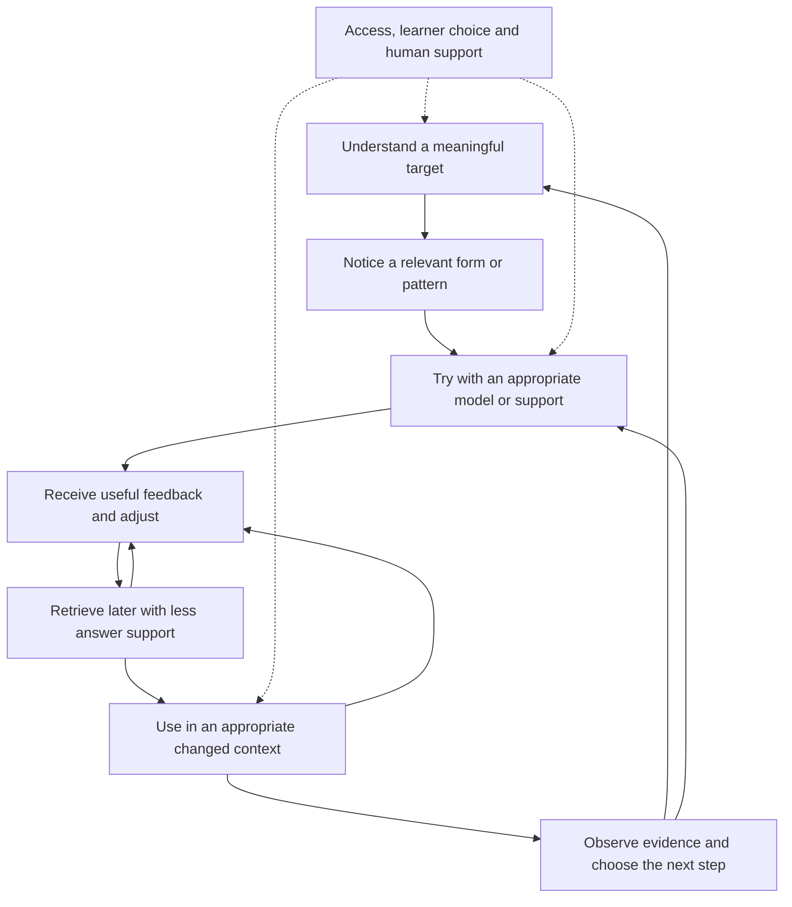

# 02 — How Humans Become Fluent

**Product:** Tigrinya learning platform  
**Document:** `02-How-Humans-Learn.md`  
**Version:** DRAFT_V1 — research synthesis and proposed learning model  
**Research checked:** 20 November 2026  
**Authority:** Derived from the locked [Official Company Vision — FINAL_V1](01-Vision.md). This section does not amend that vision or inherit its approval status.  
**Scope:** Section 2 only. Explains the mechanisms, conditions, teaching responses, and evidence of language and literacy development. Learner archetypes, the detailed curriculum, activity specifications, and repetition algorithm remain for their own sections.

## 1. The central proposition

People become more capable language users when they build meaningful language knowledge, gain increasingly reliable access to that knowledge, and use it successfully across appropriate situations. Language input, purposeful action, feedback, memory, literacy, social experience, and learner agency must work together. None of them is a complete method by itself.

This document proposes an integrated educational model for the company. It combines research findings with explicit product decisions. It is not a newly validated scientific theory, a guarantee of fluency, or evidence that the current app already produces the outcomes described.

For this product, the immediate application is early Tigrinya literacy for children ages 4–8, initially prioritising beginners in Fidäl who understand some everyday spoken Tigrinya. Broader communication is the destination established in Section 1. Describing that destination does not expand the first release into a complete speaking course or advanced curriculum.

### 1.1 Define fluency before trying to produce it

Everyday speech often uses “fluent” to mean generally proficient. Research also uses a narrower sense involving the timing and flow of language performance. The 2026 review by Kahng distinguishes fluency frameworks and highlights measurement problems; a fast response is not a complete proficiency measure. [R1 — Kahng, 2026](https://onlinelibrary.wiley.com/doi/10.1002/tesq.70117)

Our operational definition is **increasingly independent, understandable, appropriately accurate language use that meets a meaningful purpose under the demands of the particular task**. This is a product definition, not a universal research consensus. The demands differ between reading a word, following a short message, writing an idea, and participating in conversation.

A 2025 meta-analysis treats fluency, intelligibility, comprehensibility, and accentedness as related but distinguishable dimensions. We therefore refuse to equate effective communication with accent elimination. [R2 — Chau and Huensch, 2025](https://doi.org/10.1017/S0272263125000014)

### 1.2 Keep separate dimensions visible

| Dimension | What the learner is developing | What it must not be confused with |
| --- | --- | --- |
| Understanding | Accessing intended meaning in speech or text. | Recognising a familiar picture or interface layout. |
| Language knowledge | Useful sound patterns, vocabulary, word forms, constructions, and contextual conventions. | Being able to explain a grammar term. |
| Reading | Interpreting written language through the script and relevant language knowledge. | Reciting a character chart or guessing from pictures. |
| Writing | Producing appropriate written forms and meaningful language with suitable tools. | Tracing precisely on a touchscreen. |
| Spoken expression | Expressing an intended meaning understandably. | Repeating a recording immediately or matching a prestige accent. |
| Interaction | Following another person's contribution, responding, and repairing misunderstanding. | Delivering a memorised monologue. |
| Efficient access | Using familiar knowledge with less disruptive effort. | Racing, tapping faster, or using fewer accessibility supports. |
| Transfer | Using learning under a specified changed condition. | Broad mastery inferred from one successful task. |

This is the company's reporting model. It describes capabilities rather than a single developmental ladder. A heritage learner may have strong oral understanding and little script knowledge; another learner may recognise written forms without understanding their associated language.

## 2. How to interpret the research

### 2.1 Evidence has boundaries

This is a targeted synthesis, not a systematic review of every study. Searches covered language acquisition, language fluency, retrieval and spacing, multilingual literacy, abugidas, cognition, feedback, and motivation. Recent 2024–2026 research was sought alongside relevant foundational syntheses. Sources were checked on publisher, research-archive, or evidence-agency pages. No post-cutoff publication is used.

Meta-analyses summarise included studies rather than prove that a method works for every age, language, outcome, or comparison. Review conclusions can overlap because they include some of the same primary studies. Effect sizes from different reviews are not a ranking of methods and are not predicted gains for this app.

Some available pages provide publisher abstracts rather than full articles. Claims from those sources are restricted to the accessible abstract; no uninspected subgroup result or intervention detail is treated as established. Section 21 identifies the access basis.

### 2.2 Three labels govern this model

**Research finding:** A bounded statement supported by a cited study or synthesis.

**Design decision:** A company choice informed by evidence, learner needs, and FINAL_V1. Its exact implementation may still fail and require revision.

**Validation question:** An unresolved question requiring qualified Tigrinya input, intended-learner observation, or an appropriately designed evaluation.

The remainder uses these distinctions. Sections describing the integrated loop, evidence states, adaptation, and task examples are design proposals, not claims that researchers validated this exact system.

### 2.3 The research most relevant to our decisions

| Research area | Finding used here | Boundary that matters |
| --- | --- | --- |
| Fluency | Recent reviews distinguish processing, observable performance, and listener judgments. [R1](https://onlinelibrary.wiley.com/doi/10.1002/tesq.70117) | Timing alone does not establish communication or literacy. |
| Interaction | Input, output, negotiation, and interlocutor/task conditions matter in instructed language learning. [R3](https://doi.org/10.1017/S0261444818000125) | A fixed-response activity is not equivalent to a responsive partner. |
| Automatization | A 2025 synthesis examines how practice supports more efficient language processing. [R4](https://doi.org/10.1017/S026144482500059X) | Research tasks do not justify a timer or a brain-derived app score. |
| Spacing | L2 research supports distributed practice, with outcomes varying by schedule and learning conditions. [R5](https://onlinelibrary.wiley.com/doi/abs/10.1111/lang.12479) | There is no single research-prescribed interval schedule for this course. |
| Classroom memory strategies | A 2026 synthesis finds average benefits alongside important moderators. [R6](https://link.springer.com/article/10.1007/s10648-026-10225-5) | General classroom findings do not validate preschool Tigrinya instruction. |
| Retrieval versus elaboration | A 2025 review finds that relative benefits depend on the comparison activity. [R7](https://link.springer.com/article/10.1007/s10648-025-10076-6) | Retrieval does not make meaningful explanation or elaboration obsolete. |
| Multilingual reading | A 2024 synthesis includes oral language, sound awareness, decoding/reading fluency, and comprehension. [R8](https://doi.org/10.1007/s10648-024-09942-6) | Primarily U.S. K–5 English-reading contexts; not a Tigrinya sequence. |
| Abugida literacy | A 2024 review addresses Indic and Ethiopic scripts and multilingual/biscriptal contexts. [R9](https://ila.onlinelibrary.wiley.com/doi/10.1002/rrq.555) | Broad script comparison does not approve a particular Tigrinya mapping. |
| Corrective feedback | Classroom L2 evidence supports a role for oral feedback. [R10](https://doi.org/10.1017/S0272263109990520) | No universal correction style follows for every child or error. |
| Motivation | A 2026 synthesis reports associations between motivation types and L2 achievement. [R11](https://doi.org/10.1017/S0272263126101958) | Correlation does not prove that a reward or interface causes learning. |
| Word memory | A 2024 review examines consolidation and integration of lexical experience. [R12](https://pmc.ncbi.nlm.nih.gov/articles/PMC11607850/) | No sleep tracking, sleep-learning claim, or biological score follows. |
| Cognitive science in education | EEF reviews classroom applications and their practical limitations. [R13](https://educationendowmentfoundation.org.uk/education-evidence/evidence-reviews/cognitive-science-approaches-in-the-classroom) | Translating a mechanism into instruction still requires evaluation. |
| Early literacy and relationships | EEF emphasises language-rich adult–child interaction in early education. [R14](https://educationendowmentfoundation.org.uk/education-evidence/guidance-reports/literacy-early-years) | App independence is not the same as learning without human relationships. |

## 3. The integrated learning model

The company's model has five interacting components. They operate together; they are not five age stages or five separate courses.

| Component | Educational responsibility | Typical failure if neglected |
| --- | --- | --- |
| Meaningful language knowledge | Connect forms to understandable meanings, patterns, and purposes. | Accurate imitation without understanding. |
| Attention and access | Make the relevant information perceptible and the task understandable. | Interface failure is misread as language failure. |
| Memory and retrieval | Make learning accessible beyond immediate exposure. | Success vanishes when the model disappears. |
| Practice and communication | Develop appropriate independent use under varied demands. | Familiar exercises succeed; changed tasks fail. |
| Agency and social support | Sustain willing participation and useful human connection. | Completion depends on pressure or constant adult rescue. |

Literacy connects all five. It requires appropriate script knowledge, language understanding, supported and independent practice, and interpretation of what the learner actually demonstrates.

The diagram is a teaching-and-evidence loop, not a mechanistic diagram of the brain. A learner can enter at a later point when prior knowledge is established, request a model, or return to an earlier step. An inaccessible or unsupported task exits without being interpreted as a language failure.

## 4. Begin with what the learner brings

### 4.1 Determine relevant starting knowledge

Before interpreting difficulty, establish enough about the learner's understanding of the target meaning, familiarity with its spoken form, script experience, and ability to use the interaction. Use brief supported observations rather than a long placement exam.

The literacy design draws on the multilingual-reading review's attention to both language and reading skills. Its English-oriented evidence informs the distinction, not the exact Tigrinya tasks. [R8](https://doi.org/10.1007/s10648-024-09942-6)

**Design decision:** Keep oral understanding, script familiarity, activity familiarity, and input support separate. A child who can answer through pointing but not dragging needs a different interaction, not necessarily easier language. Someone who reads another script may bring useful experience, but the app must not assume the same form–sound relationships transfer.

### 4.2 Route support without permanent labels

| Observation | Initial teaching response | Interpretation to avoid |
| --- | --- | --- |
| Understands spoken target; unfamiliar with Fidäl. | Connect known meaning and reviewed sound to written forms. | Treating all language knowledge as beginner-level. |
| Does not understand the target meaning. | Establish meaning through an appropriate reviewed explanation or context. | Calling a later reading error a decoding deficit. |
| Understands task after demonstration. | Continue with that model available. | Assuming the original unaided failure measured language. |
| Can recognise but cannot produce. | Offer supported production and later an appropriate independent attempt. | Reporting recognition as expressive ability. |
| Needs another input or presentation method. | Change access while preserving the target where possible. | Equating motor, hearing, vision, or speech differences with low potential. |
| Declines or becomes distressed. | Pause, offer a choice or different activity, or stop. | Recording refusal as evidence of inability. |

These are provisional teaching responses, not diagnoses. Persistent needs may warrant discussion with an educator or caregiver; the app must not diagnose a learning, language, or developmental condition.

## 5. Make language understandable and worth attending to

### 5.1 Meaning precedes interpretable testing

A target needs a referent, situation, or explanation that the learner can understand. An illustration may clarify a concrete meaning but may also support several interpretations. A recording may be accurate yet incomprehensible to a particular beginner.

**Design decision:** Review the association between the prompt, media, and intended meaning. When the meaning is uncertain, teach or clarify it before claiming the response measures reading, listening, or memory. Avoid assuming that an English translation helps a child who cannot read English.

### 5.2 Input is necessary but exposure is not an achievement claim

The interaction research reviewed by Loewen and Sato includes input, negotiation of meaning, and output, with effectiveness depending on task and interlocutor conditions. This supports connecting comprehensible models with responsive use rather than treating passive exposure as sufficient instruction. [R3](https://doi.org/10.1017/S0261444818000125)

**Design decision:** Distinguish “encountered” from “understood.” After a model, use a small relevant action or response to check interpretation. A video completing or an audio file playing proves delivery, not attention or comprehension.

### 5.3 Direct attention selectively

Highlight the contrast or relationship relevant to the goal. In a Fidäl activity this might be a reviewed relationship between related forms, paired with the appropriate language model. Do not introduce multiple new meanings, an unfamiliar gesture, and a new contrast simultaneously unless the goal requires that combination and it is usable.

**Validation question:** Which visual cues help the intended children notice a meaningful distinction, and which merely teach them to follow a colour or highlight? Recheck the target after answer-revealing cues are removed.

## 6. Build connected language knowledge

### 6.1 A word is more than a label

For the company's teaching model, lexical knowledge includes the spoken form, written form where appropriate, intended sense, useful contextual patterns, and a route to understanding or producing it. Each relationship may develop unevenly.

**Design decision:** Revisit a reviewed item through more than a fixed picture-label pair. Use approved alternate contexts when available. Record which sense was taught and preserve regional or contextual distinctions; one dictionary entry may not support every intended use.

### 6.2 Patterns, constructions, and grammar belong in meaningful use

Learners need opportunities to notice how reviewed language changes or combines. Brief explanations can support an appropriate learner, while repeated meaningful examples and use give the pattern a purpose. No promise is made that explaining a rule automatically creates spontaneous command of it.

The automatization synthesis examines explicit/implicit knowledge, practice, and development across language domains. It supports treating efficient use as a developmental question rather than equating rule explanation with fluent performance. [R4](https://doi.org/10.1017/S026144482500059X)

**Design decision:** For young learners, begin with reviewed models and use, adding a concise explanation only when it helps. Do not require grammar terminology to demonstrate understanding. For adult support views, fuller explanations may be appropriate. All Tigrinya rules, forms, and example variations need qualified review.

### 6.3 Familiar expressions support participation without proving generative skill

A memorised expression can be useful. It does not demonstrate that the learner can change its meaning, interpret a new response, or combine its parts productively.

**Design decision:** When curriculum goals extend beyond a fixed expression, include a suitable reviewed change of detail or context. Preserve a meaningful role for familiar language while distinguishing rehearsal from flexible use. The model does not require beginners to generate unsupported language prematurely.

## 7. Manage cognitive demands

### 7.1 Reduce demands unrelated to the goal

The EEF cognitive-science review discusses translating approaches such as cognitive-load management into classroom practice, including gaps and conditions in the evidence. It supports careful instructional design rather than a universal formula for screen complexity. [R13](https://educationendowmentfoundation.org.uk/education-evidence/evidence-reviews/cognitive-science-approaches-in-the-classroom)

**Design decisions:** Keep the model close to the response when it is needed, demonstrate unfamiliar controls without scoring, use one main next action, avoid irrelevant animation, and let the learner replay. These are interface hypotheses to test, not proven effects of a particular number of buttons.

“One main goal” is a focus for attention. The learner may still coordinate meaning, script, and action within that goal. Reducing every activity to a single isolated feature could destroy the relationship the lesson is meant to teach.

### 7.2 Use visual and auditory information intentionally

Use images to clarify meaning, script to support the relevant reading goal, and reviewed recordings to model or assess sound. More simultaneous information is not automatically more helpful.

**Design decision:** Do not make captions reveal the answer during a listening check or let a picture supply the answer during a reading check. Preserve accessible alternatives with their actual skill labels. Where a recording is unavailable or a modality cannot be accessed, select a different appropriate objective or leave that evidence unassessed.

### 7.3 Support should be available and can change

A learner may need a model now and less support later. Another may continue to need an access accommodation even while becoming highly capable in the language.

**Design decision:** Fade answer-revealing instructional support when evidence warrants it; do not remove necessary access accommodations to manufacture independence. Reintroduce teaching help after difficulty. Separate the two types of support in evaluation.

## 8. Build memory beyond the current screen

### 8.1 Encoding, consolidation, and retrieval are different questions

The product must ask what was understood during teaching, what is accessible after a gap, and what can be used under changed cues. These are educational observations, not direct measurements of brain processes.

Gaskell's 2024 review examines how recent lexical experience and more stable knowledge interact, including consolidation and sleep. The relevant implication here is that immediate word performance is not the complete story of word learning. [R12](https://pmc.ncbi.nlm.nih.gov/articles/PMC11607850/)

**Design decision:** Provide natural stopping points and later revisiting. Do not collect sleep data, prescribe bedtime practice, claim overnight mastery, or offer sleep-learning features on this basis.

### 8.2 Retrieval must require retrieval

A response made while the answer is displayed can be useful supported practice. It is not the same event as attempting to retrieve the target before seeing the model.

The 2026 classroom meta-analysis reports average retrieval benefits but moderator differences in knowledge, assessment format, and outcomes. It argues for context-dependent application. Its school evidence does not establish the same effect for every four-year-old or a Tigrinya app. [R6](https://link.springer.com/article/10.1007/s10648-026-10225-5)

**Design decision:** Make independent attempts brief and low pressure. Let the learner request help; record the attempt as supported if the answer is revealed. After feedback, a correct retry is valuable practice, not a new independent retention result.

### 8.3 Space revisiting; do not sanctify a schedule

Kim and Webb's L2 meta-analysis found benefits of spacing, differences between immediate and delayed outcomes, and no statistically established overall advantage of expanding over equal spacing in its comparison. That does not identify a universal schedule or validate SM-2, FSRS, or a fixed daily routine for this product. [R5](https://onlinelibrary.wiley.com/doi/abs/10.1111/lang.12479)

**Design decision:** Revisit previously taught targets on later opportunities. Adjust recommendations using interpretable performance and support evidence. A return after a long gap prompts a manageable check and model where needed, without deleting prior achievement or presenting a debt. Algorithm details belong in the spaced-repetition section.

### 8.4 Interleave for a reason

Mixing relevant contrasts may help reveal which response fits, but random switching can also introduce unnecessary task demands. The 2026 classroom synthesis found that interleaving outcomes varied with feedback conditions. [R6](https://link.springer.com/article/10.1007/s10648-026-10225-5)

**Design decision:** First establish usable models. Then mix selected familiar distinctions when comparison serves the objective. Do not switch controls, subject, sound contrast, and script family at once merely to claim varied practice.

### 8.5 Retrieval complements meaningful elaboration

A 2025 review comparing retrieval with elaborative encoding found that relative benefits depended on the comparison; retrieval was not uniformly superior to all elaborative tasks. [R7](https://link.springer.com/article/10.1007/s10648-025-10076-6)

**Design decision:** Keep explanation, meaningful association, connected language, and use alongside retrieval. A course composed only of recall prompts can omit the meaning-building that makes recall worthwhile.

## 9. Use output, interaction, and feedback to improve performance

### 9.1 Purposeful output

Give the learner a reason to select, say, write, or act on language. Different responses provide different evidence. An oral response can support a spoken-expression objective; it cannot by itself establish reading, and a selected answer cannot establish pronunciation.

**Design decision:** Accept a response appropriate to the goal and access needs. Do not require microphone use for every activity. Where the product cannot reliably judge an utterance, offer reviewed models and optional comparison or qualified human feedback without inventing automated accuracy.

### 9.2 Interaction has another person's contribution

A genuine communicative task requires attention to another contribution or an information gap. Fixed dialogues can model and rehearse language, but a fixed script alone does not show that a learner can follow an unexpected reply.

**Design decision:** Use approved rehearsal within current scope and optional human participation where feasible. Future interactive evaluation must check understanding, response relevance, and repair. Do not describe a canned response or an unvalidated AI exchange as equivalent to qualified human interaction.

### 9.3 Correct the relevant error

Lyster and Saito's classroom meta-analysis found durable benefits of oral corrective feedback across its included studies, with differences by feedback and measure. This is a foundational finding, not a guarantee that one correction style works best for this app's youngest learners. [R10](https://doi.org/10.1017/S0272263109990520)

**Design decision:** In focused practice, show or explain the relevant distinction promptly, retain the learner's response where useful, and offer an achievable retry. In a meaning-focused exchange, avoid interrupting every minor issue; choose feedback that serves the stated goal. Never reinforce an error because the system cannot assess it reliably—represent uncertainty instead.

### 9.4 Separate correction from subsequent assessment

An immediate imitation of a correction shows participation in repair. Later, use an appropriate independent prompt or parallel task to investigate whether learning is accessible without that correction.

**Validation question:** Does the learner understand the cue, and can they act on it? A kind tone does not rescue incomprehensible feedback. Observe whether the same misunderstanding persists after different forms of support.

## 10. Develop Tigrinya literacy as literacy in an abugida

### 10.1 Connect script, language, and meaning

Lai and colleagues' 2024 review explicitly includes Ethiopic and Indic abugidas and discusses multilingual and biscriptal contexts. It challenges alphabet-centred assumptions, while not supplying an approved Tigrinya teaching sequence or handwriting curriculum. [R9](https://ila.onlinelibrary.wiley.com/doi/10.1002/rrq.555)

**Design decision:** Teach Tigrinya Fidäl in the Ge’ez/Ethiopic script, left to right. Help learners compare related consonant-vowel forms and vowel orders using verified models. Do not assume every family is identical or that a Latin alphabet progression transfers unchanged. Do not infer pronunciation or writing order from Unicode position or font shape.

### 10.2 Develop interacting strands

| Strand | Suitable educational focus | Evidence boundary |
| --- | --- | --- |
| Oral meaning | Understand relevant vocabulary or context. | Spoken understanding is not script reading. |
| Sound awareness | Notice reviewed sound units or distinctions relevant to the target. | Imported English phoneme exercises need not fit Tigrinya. |
| Form–sound relationships | Connect reviewed Fidäl forms with appropriate sounds. | Matching two visual glyphs alone does not assess sound knowledge. |
| Word reading | Interpret suitable written words and connect them with meaning. | A repeated pictured item can conceal guessing. |
| Connected reading | Follow appropriate reviewed phrases or text. | Accurate oral recitation can coexist with weak comprehension. |
| Written production | Form characters and produce meaningful language at an appropriate level. | Copying, tracing, memory writing, and composition are distinct. |

The strands interact and can be developed together. They are not a requirement to finish every sound exercise before encountering a real word or story. A child's oral knowledge can support literacy while literacy adds a new route into language.

### 10.3 Writing is both language and physical production

A model can support shape exploration, but verified stroke order requires reliable teaching evidence and qualified approval. Without it, provide an accurately labelled alternative rather than a persuasive invented animation.

**Design decision:** Offer relevant ways to observe, copy, trace, or write as content permits. Judge shape only within the task's valid scope. Record input mode where it changes interpretation; touchscreen movement, keyboard entry, and paper writing demonstrate different things. Never label an unvalidated geometric similarity score as handwriting mastery.

### 10.4 Apply existing content constraints responsibly

Unit 2 retains the exactly-two-Ethiopic-grapheme candidate rule. Keep the full sourced bank for review, but teach only an appropriate approved sequence. Character count does not establish familiarity, concreteness, frequency, ease of pronunciation, or child suitability.

**Design decision:** Do not manufacture short words or distort a sense to fill the sequence. If no suitable reviewed example exists, use an appropriate form/pattern activity or hold the language-dependent task. Dictionary sourcing, native approval, pedagogical suitability, and media rights remain separate checks.

## 11. Develop efficient use without turning learning into a race

The automatization review describes a transition from controlled, effortful processing toward more efficient use through practice across language domains. It does not justify judging all learners by speed or assuming that repeated tapping creates automatic language access. [R4](https://doi.org/10.1017/S026144482500059X)

**Design decision:** Begin fluency-oriented practice with language the learner can already understand and use with reasonable accuracy. Provide familiar material with a meaningful purpose, then appropriate variation. Observe accuracy, understanding, support, and task completion together. Increased speed with falling comprehension is not the intended gain.

Do not place a countdown on a child's response or use device latency as cognitive evidence. For any later timing-based evaluation, standardise the task, distinguish response planning from input time, consider access accommodations, and establish that the measure is valid for the intended population. For early literacy, timing may be unnecessary.

Use reading, writing, speaking, and interaction evidence separately. A learner may become more efficient at one without an equivalent change in another. A different accent or a deliberate pause is not automatically a breakdown in communication.

## 12. Support motivation, agency, and relationships

### 12.1 Create conditions for willing participation

Jiang and colleagues' 2026 meta-analysis reports positive associations between L2 achievement and intrinsic or autonomous forms of motivation, while controlled dimensions were not significantly associated in the pooled analysis. These are associations, not proof that a particular interface causes achievement. [R11](https://doi.org/10.1017/S0272263126101958)

**Design decision:** Make progress understandable, offer manageable choices, preserve the ability to stop, and give help without penalty. Use meaningful challenge, curiosity, stories, and expression where they support learning. Avoid treating coercion, consecutive-day pressure, or screen time as instructional mechanisms.

### 12.2 Preserve human participation

EEF's early-years literacy guidance emphasises high-quality adult–child interaction and varied language activity. Its focus includes ages three to five and informs, rather than validates, this product's use by older children. [R14](https://educationendowmentfoundation.org.uk/education-evidence/guidance-reports/literacy-early-years)

**Design decision:** Independent navigation is useful, but shared reading or conversation can be a successful learning outcome. Offer feasible family participation without requiring a fluent adult to repair every activity. Basic access must not assume a particular family structure, uninterrupted adult availability, or a willingness to record a child.

### 12.3 Treat emotional and access signals carefully

A pause, refusal, repeated help request, or changed pace may signal many things. Do not infer motivation, anxiety, attention disorder, or learning capacity from such events alone.

**Design decision:** Offer a pause, replay, alternative, or end. Ask caregivers for contextual input only where useful and appropriate. Do not introduce emotion recognition, biometric monitoring, or covert inference to make the model appear adaptive.

## 13. The complete teaching-and-evidence loop

This is the proposed default loop for a target. It is flexible across sessions and must not become a compulsory seven-screen template.

| Step | Teaching responsibility | Learner opportunity | What can be recorded or inferred |
| --- | --- | --- | --- |
| Establish meaning | Provide appropriate reviewed context and models. | Understand or request clarification. | Exposure and a bounded comprehension observation. |
| Focus the target | Make the relevant form or relationship clear. | Notice or compare it. | Supported discrimination, not broad mastery. |
| Model and guide | Demonstrate the response or interaction. | Try with help. | Practice with the support identified. |
| Respond and repair | Give specific feedback and adjust support. | Compare, retry, or stop. | Correction participation; retries remain supported. |
| Retrieve later | Ask before displaying the answer. | Attempt independently or request help. | Evidence tied to prompt, gap, and support. |
| Apply appropriately | Change a relevant condition while controlling new demands. | Use or interpret the learning. | Transfer evidence bounded to the changed task. |
| Choose the next step | Interpret the evidence and access context. | Continue, revisit, explore, or finish. | A recommendation with uncertainty, not a fixed ability label. |

An established learner can skip an unnecessary introduction through a suitable check. A beginner should not be forced into repeated unsupported guessing. A content or media failure stops the affected inference; it is not an incorrect answer.

## 14. Diagnose the task before diagnosing the learner

The following matrix defines educational hypotheses to investigate. It is not automated clinical diagnosis and should not create permanent learner labels.

| Observed difficulty | Plausible explanations | Useful response | Evidence to seek next |
| --- | --- | --- | --- |
| Correct only while the model is visible. | Support dependence or incomplete initial understanding. | Re-model the key relation; later reduce one cue. | A separate attempt before the model appears. |
| Confuses related forms. | Visual contrast, font size, sound mapping, or instruction ambiguity. | Use a reviewed comparison and check rendering. | Relevant distinction without colour-position cues. |
| Can read aloud but cannot show meaning. | Recitation, unfamiliar vocabulary, or comprehension demand. | Establish meaning and use another suitable response. | Comprehension without requiring the same recitation. |
| Understands meaning but cannot read the word. | Missing script mapping or unfamiliar written form. | Connect the known language to reviewed forms. | Appropriate word/form task without picture guessing. |
| Successful immediately, difficult after a gap. | Weak access, insufficient practice, changed context, or original cue dependence. | Refresh, then provide a manageable later check. | Repeated appropriately spaced observations. |
| Successful in practice, difficult in a changed task. | Narrow learning or extra unlearned demands in the transfer task. | Inspect both teaching and task equivalence. | A better controlled parallel task. |
| Struggles only with tracing or dragging. | Input or motor demands, not necessarily language. | Change response method where the goal allows. | Language evidence through an accessible response. |
| No response or repeated random selections. | Unclear task, fatigue, disinterest, access barriers, or uncertainty. | Demonstrate, offer help, pause, or stop. | Voluntary participation in a comprehensible task. |

A useful adaptive system first asks whether it delivered a fair learning opportunity. It should not intensify repetition based solely on an error count.

## 15. Represent learning evidence without fake precision

### 15.1 Track a capability in a context

The conceptual unit is a **specific objective in a particular skill**, not a universal score for a word or learner. An item can be familiar in listening and still unassessed in writing. A single answer may inform several hypotheses, but it must not automatically update unrelated skills.

For eligible saved evidence, the minimum interpretation needs the objective and content version, task type, modality, timing of the attempt, interval since relevant learning, first response, support used, feedback/retry status, and access conditions that materially affect interpretation. These are conceptual requirements, not permission to persist every interaction. Storage remains optional and minimal under FINAL_V1.

### 15.2 Use descriptive evidence states

| State | Meaning | Suitable next response |
| --- | --- | --- |
| Not assessed | No interpretable evidence for this skill. | Offer a model or appropriate optional check. |
| Encountered | Material was presented. | Check meaning and provide guided practice. |
| Practising with support | Evidence depends on a model or answer help. | Continue teaching and later reduce instructional cues. |
| Demonstrated independently | A suitable unaided task succeeded. | Revisit after a gap and vary context appropriately. |
| Demonstrated after a delay | A later independent task succeeded under recorded conditions. | Consolidate and investigate suitable use elsewhere. |
| Demonstrated in a changed context | A reviewed parallel task succeeded. | Extend the capability without claiming unlimited transfer. |

These are evidence descriptions, not mutually exclusive lifetime ranks. Maintain recency and conditions. A later difficulty can prompt review without erasing an earlier genuine achievement. No fixed mastery percentage, predicted retention probability, or stage threshold is scientifically established here.

### 15.3 The recommendation logic

1. Confirm that content, language models, and the interaction are valid for the objective.
2. If access or task comprehension is uncertain, address that uncertainty before interpreting language performance.
3. If meaning is unfamiliar, establish it before assessing another capability through it.
4. If instructional support was used, recommend appropriate practice rather than inflating independence.
5. If independent evidence exists, choose a manageable delayed or parallel opportunity where relevant.
6. After difficulty, inspect likely causes, offer a useful model, and avoid repeated unsupported failure.
7. Respect stopping, topic choices, and reasonable caregiver context. Leave unsupported evidence unassessed.

This is an explainable decision policy. It does not authorise profiling a child's intelligence, emotion, or future potential.

## 16. Organise time around a coherent learning purpose

A short session should make progress on a small goal and end cleanly. It need not contain every part of the model. Delayed retrieval, by definition, often belongs to a later session.

**Design decision:** A first encounter can focus on meaning, a model, and supported participation. A later encounter can start with a brief independent attempt, then correction and use. A more experienced learner may begin with connected material and investigate a particular gap. No fixed percentage allocation or session length is prescribed by the research cited here.

Retain the existing approximate 3–5 minute lesson design target, without countdowns or a mandatory daily dosage. Allow flexible pacing and quiet exits. Do not pack several demanding skills into a short lesson merely to demonstrate a complete feature catalogue.

A session conclusion should say what was practised, what help was available or used where relevant, and one sensible optional next step. Celebrations and completion badges remain distinct from learning judgments.

## 17. Assess retention, transfer, and real use fairly

### 17.1 Design the evidence before setting success claims

Define the capability, suitable response, acceptable support, approved content, task conditions, and interpretation limits before release. For later evaluations, define criteria before looking at results. Do not tune thresholds until the course appears successful.

Use baseline, immediate, and delayed evidence where the evaluation question requires them. The 7- and 30-day follow-ups in the existing product specification are candidate evaluation intervals, not universal memory milestones. Justify the actual intervals against the capability and intended use.

### 17.2 A parallel task must be fair

Change a condition relevant to the transfer question while keeping other demands appropriately controlled. A changed font can test robustness of form recognition; an unfamiliar sentence may also introduce untaught grammar and vocabulary. Those tasks do not support the same inference.

**Design decision:** Have qualified reviewers inspect equivalence and the required language knowledge. Use multiple appropriate observations rather than one trick item. Where novelty itself is the target, state exactly what prerequisite knowledge makes the task interpretable.

### 17.3 Control obvious cue and measurement problems

Check answer position, picture availability, repeated layouts, transliteration, captions, audio cues, immediate model exposure, and caregiver assistance. Control them where necessary without removing access accommodations.

Do not score a media outage, interruption, refusal, or missing follow-up as an incorrect language response. Report follow-up participation and denominators; analyse missingness rather than silently counting it as success or failure. Distinguish learning under independent, supported, and shared conditions.

### 17.4 Separate learning evaluation from causal claims

A child's improvement may reflect the app, family interaction, other teaching, growing familiarity with tasks, or several factors together. A before-and-after result is useful but does not by itself establish attribution.

A causal or comparative claim needs a suitable design, comparator, sample planning, outcome measures, and ethical data plan. Qualified evaluation expertise should determine the details. A small usability round cannot establish effectiveness or a universally appropriate age range.

## 18. A worked application without invented Tigrinya

This example demonstrates the proposed model through content roles. It is not an authored lesson and supplies no new Tigrinya word, sound, spelling, or stroke order.

**Objective:** Connect a previously understood spoken word with its approved two-grapheme written form, then investigate later reading under controlled cues.

**Required material:** An approved dictionary sense, child-suitable reviewed meaning, appropriate image/context, licensed native recording, approved written form and segmentation, suitable contrasts, and a reviewer-approved parallel task. If any essential material is unavailable, the dependent step remains blocked.

| Encounter | Learning action | Evidence interpretation |
| --- | --- | --- |
| Establish oral meaning | Present an appropriate model/context and check understanding through an accessible action. | Bounded meaning evidence; not reading. |
| Connect writing | Show the approved written word with its spoken model, with a relevant form relationship highlighted if reviewed. | Exposure and supported form–sound association. |
| Practise | Offer reviewed comparisons and feedback; let the learner replay. | Practice; model use remains visible in interpretation. |
| First independent reading check | Present suitable written choices or a production task before replay, controlling picture and position cues. | Recognition or production evidence according to the actual task. |
| Later revisit | Ask again after a justified gap; offer help on request. | Retention evidence only if conditions support that inference. |
| Parallel use | Use an appropriate changed presentation or reviewed context with controlled language demands. | Specific transfer evidence, not general fluency. |
| Optional writing | Offer copying or another reviewed writing task if suitable models exist. | Separate writing evidence; reading success does not approve handwriting. |

If the child answers correctly only with the picture present, preserve that success as supported association. Teach the written connection more clearly rather than reporting independent reading. If the later task fails because its vocabulary is unfamiliar, revise the task rather than concluding that the original word was forgotten.

## 19. Common mistakes this model rejects

| Mistake | Why it undermines interpretation or teaching | Required alternative |
| --- | --- | --- |
| Exposure totals equal vocabulary learned. | Presentation does not show comprehension or access. | Use appropriately bounded response evidence. |
| One score represents all skills. | Recognition, writing, listening, and speaking differ. | Report the assessed capability and conditions. |
| Two characters means an easy word. | Length omits meaning, familiarity, and usage demands. | Review suitability and teach a deliberate subset. |
| Every error requires more identical practice. | The cause may be instruction, access, or content. | Inspect the learning opportunity and change support. |
| Spacing software creates fluency. | Scheduling does not supply meaning or communicative use. | Connect review to accurate teaching and relevant application. |
| Independent use means no adult role. | Navigation independence and human language interaction differ. | Reduce rescue work while supporting meaningful shared use. |
| Native-like accent is the goal for everyone. | Accent and effective communication are not interchangeable. | Use purpose-appropriate, reviewed communication criteria. |
| Tracing or speech AI gives objective mastery. | A numerical output may lack population and task validity. | Use scoped descriptive or qualified human evidence. |
| A preferred modality fixes a learner's teaching style. | Preference is not proof of what instruction produces learning. | Choose modalities by target and access; evaluate outcomes. |
| A brain analogy validates a feature. | Biological plausibility is not product effectiveness evidence. | Test the educational claim directly. |
| Calm design must remove challenge. | Easy recognition can conceal shallow learning. | Offer manageable effort with useful help and recovery. |
| More time always means more learning. | Time includes confusion, repetition, and burden. | Inspect worthwhile participation and later capability. |

These are company guardrails for claims and design. They are not a diagnosis of individual learners or a claim that one activity format is inherently ineffective.

## 20. What must be validated for this product

| Open question | Appropriate investigation | Decision consequence |
| --- | --- | --- |
| Can intended children understand prompts and controls? | Observed formative use across relevant readiness and access needs. | Redesign before claiming independent use. |
| Does meaning remain clear without an adult explaining each item? | Reviewed associations plus observation of interpretation. | Clarify context or add appropriate teaching support. |
| Which Fidäl contrasts and sequence are appropriate? | Qualified Tigrinya educators, sources, and learner evaluation. | Set the curriculum from evidence and expertise, not chart order. |
| Does reduced support preserve successful performance? | Appropriate cue-controlled independent attempts. | Adjust teaching before raising independence claims. |
| Does learning remain accessible later? | Predefined delayed evaluation with suitable tasks and missing-data reporting. | Change teaching or revisiting if gains are narrow or transient. |
| Does it extend to a meaningful changed condition? | Reviewer-approved parallel tasks controlling new demands. | Improve generalisation without disguising new teaching as transfer. |
| Do writing judgments reflect the intended skill? | Verified models, input-mode checks, and qualified scoring agreement. | Keep feedback descriptive where validity is absent. |
| Is participation comfortable and practically useful? | Child observation, optional family feedback, burden and access investigation. | Change the approach or stop an unsuitable task. |
| Is the system sustainable to teach and maintain? | Review/media/correction effort and operational evidence. | Narrow scope before weakening quality. |

No exact Tigrinya curriculum, fully verified sound inventory, approved native recordings, handwriting stroke library, or validated mastery thresholds are created by this document. Those remain content and evaluation responsibilities. The research does not establish an app-specific fluency timeline or a universal number of repetitions.

Before a learner release, assign responsibility for instructional interpretation, native review, accessibility, technical behaviour, and claims. Before a child learning study, define an appropriate permission, safeguarding, data-minimisation, and analysis process. This section itself enables no data collection or external service.

## 21. Research references and access basis

The entries below identify the sources used, including recent syntheses and older foundational material still relevant to the model. Access descriptions state the basis for this synthesis, not a claim of unrestricted access to every cited study.

| Ref | Source | Publication and contribution | Access basis |
| --- | --- | --- | --- |
| R1 | Kahng, J. — [Fluency](https://onlinelibrary.wiley.com/doi/10.1002/tesq.70117) | TESOL Quarterly, 2026. Contemporary conceptual and measurement overview. | Publisher abstract. |
| R2 | Chau, T., and Huensch, A. — [The relationships among L2 fluency, intelligibility, comprehensibility, and accentedness](https://doi.org/10.1017/S0272263125000014) | Studies in Second Language Acquisition, 2025. Meta-analysis of related pronunciation/performance dimensions. | Publisher article page and abstract. |
| R3 | Loewen, S., and Sato, M. — [Interaction and instructed second language acquisition](https://doi.org/10.1017/S0261444818000125) | Language Teaching, 2018. Research synthesis on interaction and conditions. | Publisher full-text review. |
| R4 | Suzuki, Y., Maie, R., and Hui, B. — [Research timeline: Automatization in second language learning](https://doi.org/10.1017/S026144482500059X) | Language Teaching, 2025. Synthesis connecting processing, practice, and measurement. | Publisher open-access PDF. |
| R5 | Kim, S. K., and Webb, S. — [The Effects of Spaced Practice on Second Language Learning](https://onlinelibrary.wiley.com/doi/abs/10.1111/lang.12479) | Language Learning, 2022. Meta-analysis of L2 practice distribution. | Publisher abstract. |
| R6 | Ruitenburg, S. K., et al. — [Effectiveness and Boundary Conditions of Retrieval, Distributed, and Interleaved Practice in Authentic School Classrooms](https://link.springer.com/article/10.1007/s10648-026-10225-5) | Educational Psychology Review, 29 October 2026. Meta-analysis of 53 studies; implementation moderators. | Publisher open-access full text. |
| R7 | [Retrieval Practice Versus Elaborative Encoding: A Systematic and Meta-analytic Review](https://link.springer.com/article/10.1007/s10648-025-10076-6) | Educational Psychology Review, 2025. Active comparison conditions and limits to superiority claims. | Publisher article page and abstract. |
| R8 | Kittle, J. M., Amendum, S. J., and Budde, C. M. — [What Does Research Say About the Science of Reading for K-5 Multilingual Learners?](https://doi.org/10.1007/s10648-024-09942-6) | Educational Psychology Review, 2024. Systematic review of 30 systematic reviews. | Full-text author/institutional PDF through University of Delaware. |
| R9 | Lai, J., Quinonez-Beltran, J. F., and Joshi, R. M. — [A Bigger Picture of Early Literacy and Biliteracy Acquisition in Abugidas](https://ila.onlinelibrary.wiley.com/doi/10.1002/rrq.555) | Reading Research Quarterly, 2024. Review including Indic and Ethiopic scripts. | Publisher open-access text. |
| R10 | Lyster, R., and Saito, K. — [Oral Feedback in Classroom SLA](https://doi.org/10.1017/S0272263109990520) | Studies in Second Language Acquisition, 2010. Foundational classroom feedback meta-analysis. | Publisher abstract. |
| R11 | Jiang, Y., Wang, X., and Oga-Baldwin, W. L. Q. — [The relationship between self-determination theory–based L2 motivation and L2 achievement](https://doi.org/10.1017/S0272263126101958) | Studies in Second Language Acquisition, 29 September 2026. Multilevel correlational meta-analysis. | Publisher open-access full text. |
| R12 | Gaskell, M. G. — [An integrated framework for the learning, recognition and interpretation of words](https://pmc.ncbi.nlm.nih.gov/articles/PMC11607850/) | Quarterly Journal of Experimental Psychology, 2024. Review and theoretical account of lexical learning/consolidation. | Full-text article in PubMed Central. |
| R13 | Education Endowment Foundation — [Cognitive science approaches in the classroom](https://educationendowmentfoundation.org.uk/education-evidence/evidence-reviews/cognitive-science-approaches-in-the-classroom) | 2021 evidence review, with subsequent linked materials. Classroom translation and limitations. | Agency page and review-summary PDF. |
| R14 | Education Endowment Foundation — [Preparing for Literacy](https://educationendowmentfoundation.org.uk/education-evidence/guidance-reports/literacy-early-years) | 2018 evidence-based early-years guidance. Language-rich interaction and literacy preparation. | Agency overview and recommendations summary. |

The learning model remains subject to review. Approval of this document, if later requested, would approve the company's educational commitments and validation responsibilities; it would not convert research-informed hypotheses into demonstrated Tigrinya learning outcomes.
