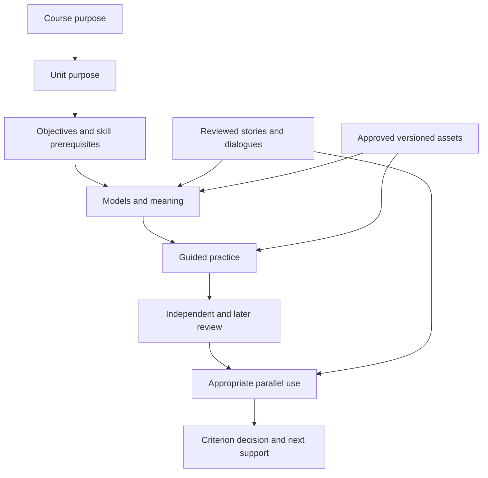

# 05 — Curriculum Framework

**Version:** DRAFT_V1 — complete specification for whole-Bible review  
**Date:** 20 November 2026  
**Authority:** [Vision FINAL_V1](01-Vision.md), approved and unchanged. All other sections are working specifications awaiting owner approval.  
**Primary dependencies:** Sections 02–04; forward contracts to 06 objective graph, 09 story system, 14 review, 15 content versions, and 18 MVP.  
**Context:** All existing sections 01–04 read before this section was written. Later references are forward contracts reconciled in the whole-Bible review.  
**Evidence:** [Learning model and research](02-How-Humans-Learn.md); [source register](RESEARCH-REGISTER.md). Numerical targets, budgets, and thresholds below are design hypotheses unless explicitly sourced. No new Tigrinya teaching content or native approval is supplied.

## 1. Curriculum is a connected teaching system

Organise content around observable objectives and meaningful purposes. Do not equate a large collection of dictionary entries or generated lessons with a curriculum. Each authoring assignment must say what it teaches, which prior language is understood, how it models the target, what practice is useful, what later evidence is needed, and which approved assets make it deliverable.

The complete architecture covers all eight Section 04 stages. Only a bounded reviewed slice is a launch commitment. The existing 224 assignments in `docs/product/curriculum.json` are authoring specifications, not 224 released Tigrinya lessons. This Bible does not silently approve or replace that material.

## 2. The hierarchy and reusable relationships

| Object | Responsibility | Boundary |
| --- | --- | --- |
| Course | A coherent learner goal and target profile across skills. | Not every language or audience in one compulsory path. |
| Stage | Section 04 capability/demand contract. | Not an age rank or automatic CEFR label. |
| Unit | Meaningful purpose connecting a small set of objectives. | Not an arbitrary equal word count. |
| Module | Related teaching sequence within a unit. | Does not duplicate language content for every presentation. |
| Lesson | A manageable encounter with one main goal. | Can span visits; no forced timer. |
| Activity | A task instance serving an objective. | Task format alone does not define the assessed skill. |
| Story/dialogue | Connected input/use with segment and reference structure. | Can support several lessons without being copied. |
| Review opportunity | Revisiting a specific objective and skill. | Not a second curriculum or a required backlog. |
| Assessment | Valid task(s), rubric/key, conditions, and interpretation. | Not merely a quiz score. |
| Project/challenge | Purposeful integration and revision. | Does not merge evidence into unearned global mastery. |
| Checkpoint | A decision about particular criteria and next support. | Never substitutes attendance for capability. |

## 3. Whole-course scope by stage

| Stage | Unit purposes for authoring | Module pattern | Evidence/project destination |
| --- | --- | --- | --- |
| PL | Understand selected meanings; participate; explore print and sound. | Context → model → supported action → optional return. | An interpretable comprehension/action observation. |
| ER | Fidäl relationships; selected known words; beginning writing. | Known meaning → form/sound relation → guided comparison → independent revisit. | A small reviewed reading/writing portfolio with modalities distinct. |
| BG | Familiar exchanges; short meaningful messages; basic connected input. | Scenario → model → use → changed detail. | A brief exchange or message with appropriate independence. |
| EL | Everyday sequences; simple narratives; connected personal meaning. | Input → target pattern → rehearsal → connected response. | An illustrated/recorded/written account with help labelled. |
| IN | Explain experiences; solve a familiar problem; compare information. | Longer input → analysis → exchange → revision. | A purposeful project assessed by separate criteria. |
| UI | Compare sources; justify a choice; adapt audience/register. | Competing input → planning → production → response. | A source-aware explanation and follow-up. |
| AD | Interpret nuanced texts; sustain argument; revise extended discourse. | Authentic input → inquiry → extended performance → analytic revision. | A multi-task portfolio and independent interpretation. |
| PR | Bounded work communication with explicit domain. | Domain briefing → language model → realistic rehearsal → questions/revision. | A domain-reviewed presentation/message/task, without professional certification. |

These are complete programme categories and progression contracts, not fabricated Tigrinya text or a claim that every topic is available. The content team fills the framework using actual sources and qualified approval.

## 4. Initial two-unit mapping

**Unit 1 — Fidäl Foundations:** Teach reviewed relationships among selected forms and associated sounds/meanings where models exist. Provide reference access to the wider library without making every form a first lesson. Shape exploration has its own honest goal when sounds or stroke data are absent.

**Unit 2 — First Words:** Maintain the exact two-Ethiopic-grapheme rule for candidates. Start from the full sourced bank, then choose a child-suitable subset with senses, visual associations, recordings, and use reviewed together. Do not import every candidate into the child path merely to satisfy catalogue completeness.

The first release boundary is one complete reviewed foundation sequence, not every future course or every current prototype form. Selection must balance source validity, meaning, visual clarity, pronunciation model availability, and teachable contrasts. Record why candidates are withheld rather than silently losing source data.

## 5. Required lesson authoring contract

For every lesson, provide: objective ID and skill; intended learner/readiness; understood target meaning or meaning-teaching plan; prerequisite IDs; exact content revisions; model and prompt; planned support; practice purpose; feedback; an independent opportunity; a delayed/parallel opportunity where required; stopping/recovery; access alternatives; rights and review scopes; and a release owner.

A lesson may not fit all opportunities in three minutes. Keep the first encounter compact, and schedule later evidence separately. “One main goal” does not mean never use connected language. A picture-first child introduction can still require a later text-only reading check to avoid picture guessing.

## 6. Stories, dialogues, and projects

Stories carry meaning across segments. Each story has target objectives, necessary background, linguistic demands, text/audio/illustration relationships, and age/context suitability. A story may serve comprehension even before the learner can decode it; record listening rather than independent reading in that mode.

Dialogues model purposes, roles, turns, and repair. Rehearsal and live interaction are different evidence. Never provide an apparently responsive partner that only pretends to evaluate the learner.

Projects integrate taught skills: a picture sequence with a reviewed response, a short message, a retelling, a comparison, or a professional briefing as stage-appropriate. Projects can allow reference tools and revision. Record those conditions; reserve independent criteria for tasks that genuinely provide that opportunity.

## 7. Progression logic

1. Select a meaningful goal compatible with the learner's current evidence and access.
2. Satisfy hard prerequisites for an independent assessed task; use missing prerequisites as teaching targets rather than permanent content locks.
3. Resolve approved content/model dependencies before displaying the activity.
4. Teach meaning and relevant forms; demonstrate any unfamiliar interaction.
5. Offer supported practice, specific correction, and help without penalty.
6. Collect an eligible independent attempt when appropriate, and later delayed evidence.
7. Offer a reviewed parallel task that changes a relevant condition without introducing uncontrolled language.
8. Recommend extension, consolidation, support, or stopping based on criterion evidence.

Exploration can bypass a recommendation but not make an invalid assessment valid. A learner choosing an advanced text can view it with support while the product correctly leaves prerequisite claims unassessed.

## 8. Assessment and checkpoint design

Each checkpoint references a blueprint: objectives, evidence modes, item/rubric coverage, acceptable support, recency, delayed conditions, parallel-task conditions, rater responsibility, and the decision rule. An example operational proposal is one later independent criterion plus an appropriate changed-context criterion for each critical target; Section 14 supplies the shared evidence rule. Piloting determines suitability before promotion becomes consequential.

Do not infer spoken accuracy from a multiple-choice question, handwriting from text entry, or comprehension from oral recitation. Declining, missing follow-up, inaccessible input, and an unavailable recording are not incorrect language answers. A result must permit “not assessed” and a safe next step.

## 9. Content production and capacity

Use the sequence source discovery → candidate record → teaching draft → model/media preparation → language/teaching/rights/access review → revision → approval of exact revision → release bundle → observed use → correction. Authoring and independent approval remain separate. A founder, developer, writer, and designer do not automatically provide all native, domain, or access expertise.

Budget complete objectives, not word counts. Track how often an approved asset is reused, which review scopes need renewal after a change, and how long corrections take. A spelling or sound change can affect dependent activities and assessments; Section 15 defines revision lineage, and Section 14 defines treatment of old evidence.

## 10. Coverage and acceptance

Maintain a matrix of stage × skill × objective × model × activity × later evidence × parallel task × approvals. A blank cell is an authoring/release gap, not an invitation to invent material. Before a unit is advertised as complete, confirm the stated objective coverage, functioning required media, appropriate assessment conditions, access/recovery, and the validity of every learner-facing language association.

Validate sequencing with qualified Tigrinya educators and intended learners. Check whether examples teach the intended relation, whether difficulty comes from meaning or interaction, and whether later performance survives removed cues. Expansion follows capability and delivery capacity, not an arbitrary deadline.
