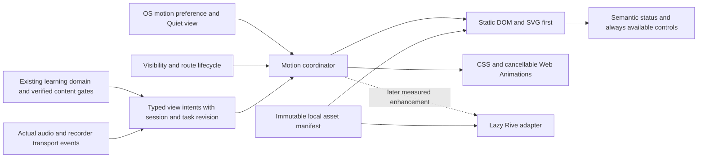
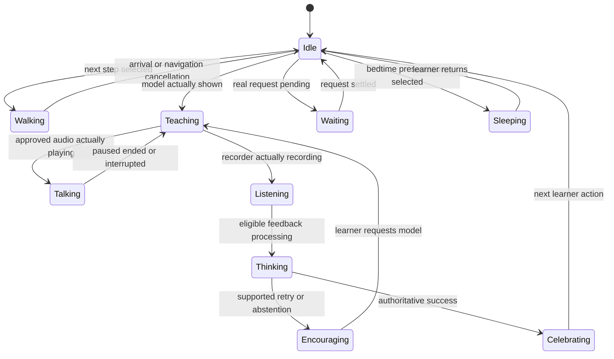

# Tigrinya animation system

**Proposed design and tested reference code · 25 November 2026 · baseline `491719f`.** Motion should make a relationship clearer, acknowledge an action or explain a system state. The recommended first implementation is CSS/SVG plus the Web Animations API, with no new animation dependency. Add Rive only after authored assets and device measurements justify its runtime.

This specification defines **Mele**, the next identity for the existing original bear. The live app still calls that bear Neri; this package does not silently rename the shipped screens, rewrite either unit or enable unreviewed teaching media. The reference lab reuses the original project artwork and identifies it as a Mele pose study. It is a design instrument, not a language lesson or a finished Rive character.

The [locked vision](../../Product-Bible/01-Vision.md), [Design Bible](../../Design-Bible.md), [existing mascot](../../MASCOT.md), [Fidäl writing contract](../../FIDAL_WRITING.md) and [production blueprint](../production/README.md) govern adoption. All 293 current writing/audio records remain pending; the current pronunciation scorer is unavailable. The example `ውሻ` has no reviewed match in the repository search and is not admitted as verified Tigrinya. No meaning, pronunciation or replacement is guessed.

Detailed contracts: [Animation catalogue](CATALOG.md), [Mele and Rive](MELE_AND_RIVE.md), [Learning sequences](LEARNING_SEQUENCES.md), [Performance and access](PERFORMANCE_AND_ACCESS.md), [motion tokens](motion-tokens.json), [reference code](reference/README.md), and [validation](VALIDATION.md).

## 1 Animation architecture



Animation observes learning state. It cannot award correctness, update scheduling, unlock lessons, write XP, upload a recording or approve content. ASP.NET Core/PostgreSQL remain authoritative where they already are; account-free practice retains its current local semantics. Native recording, content review, consent and progress persistence remain separate systems.

Use one coordinator per active lesson/reader, not a global event bus that retains old task events. The view adapter accepts a session ID, exact task revision and event ID, rejects stale callbacks, and keeps a bounded duplicate cache. Durable idempotency remains the domain/service responsibility. Replace obsolete attention cues rather than building a celebration queue. Audio, demonstrations and text remain usable if the animation engine fails.

The static screen is the final semantic state from the first render. Enhancement may interpolate its appearance; an `animationend` callback must never be necessary for enabling Continue or applying completion. Backgrounding, changing target, changing preferences, losing audio focus or unmounting cancels pending visual work. Returning to a tab does not replay old cheers or invent media playback.

## 2 State machine design

Mele has the ten requested acting states, with orthogonal motion policy and lifecycle. [MELE_AND_RIVE.md](MELE_AND_RIVE.md) specifies every trigger, transition, duration and Rive property.



The diagram is a common journey, not an exclusion of every alternate branch. The transition table and tested reducer define allowed intent handling, priority and cancellation. A learner can stop from every state. Missing media produces a still teaching pose and honest message. `Talking` never means guessed phonemes; visible articulation requires its own reviewed timing and exact media gate.

## 3 Motion design system

Use an original **settle, connect, reveal** vocabulary: a small purposeful arrival, a clear relationship highlight, then a stable place to act. Warm paper, existing green/violet accents, the bear's cinnamon palette and readable Fidäl preserve visual continuity. Do not bounce the script, distort character forms, shake mistakes, rotate the camera, flash, scatter full-screen confetti or play surprise sounds.

Timing tokens are product hypotheses, not universal cognitive constants: press 80 ms; feedback 140 ms; arrival 180 ms; exit 140 ms; connection/progress 280 ms; one celebration 480 ms. Gentle motion uses a decelerating curve; exit uses a short accelerating curve; reversible changes use an in/out curve. No overshoot on glyphs or essential controls. A guide's stroke duration comes from reviewed teaching data and selected speed, not from these decorative UI timings.

Every catalogue item identifies trigger, learning/interaction purpose, duration, cancellation, performance cost and non-motion equivalent. At most one attention-bearing visual sequence runs at once. During recording, a waveform can use that slot; Mele remains still. During reading, all decorative actors settle. Short successes never postpone a usable next action. [motion-tokens.json](motion-tokens.json) is the reference source; its CSS export is checked for drift.

The product goal is easier orientation, useful practice and voluntary return. Dopamine is not inferred from a tap, smile or frame rate. Retention and course completion are evaluated through approved independent/delayed tasks and usable completion denominators; engagement improvements must not worsen learning, fatigue, access or family effort. Optional adult calendar acknowledgements do not introduce child streak pressure or rewrite the locked vision.

## 4 Animation library selection

| Technology | Fit | Important costs and limits | Decision |
| --- | --- | --- | --- |
| CSS, SVG, Web Animations API | Controls, reveals, path links, one-shot pose transitions and verified strokes | Careful cleanup, paint cost for path strokes; unsupported API needs a static fallback | **MVP default.** Existing architecture can support it with no new vendor runtime |
| Motion for React, formerly Framer Motion | Declarative React entry/exit and measured layout interpolation | Client JS, hydration and feature payload; does not serve the standalone HTML app automatically | Consider one lazy feature boundary only when CSS/WAAPI becomes costly to maintain. Use reduced-motion controls and measure the actual built chunk |
| GSAP | Complex authored SVG timelines and precise multi-object sequencing | Another imperative lifecycle; leaks/stale callbacks if teardown is incomplete; powerful timelines do not verify language or geometry | Reserve for an evidenced complex sequence. Do not install alongside Motion for routine buttons |
| Lottie | Designer-authored fixed one-shot illustrations | Renderer/node/asset cost; interactive pedagogy and branching still need app logic; external assets/expressions need control | Optional later completion vignette. Not the speech, stroke-order or game state engine |
| Rive | Stateful character rigs reusable across supported web/native runtimes | JS/WASM, renderer/canvas/GPU memory, authoring workflow, version compatibility and access fallback | V2 candidate for Mele after a real `.riv` rig, feature matrix and low-end device tests exist |

Motion supports lazy feature loading and a reduced-motion hook; its advertised sizes are not a measurement of this app. GSAP provides scoped context/revert. Rive now recommends Data Binding for new work while retaining legacy inputs/events. Lottie offers SVG/canvas/HTML renderers with different feature costs. Pin the chosen version and audit its licence/assets at adoption; do not load `latest` scripts or runtime WASM from third-party CDNs in an offline child app. [Motion lazy loading](https://motion.dev/docs/react-lazy-motion), [Motion reduced motion](https://motion.dev/docs/react-use-reduced-motion), [GSAP context](https://gsap.com/docs/v3/GSAP/gsap.context()/), [Rive migration guidance](https://rive.app/docs/editor/data-binding/migration-guide), [Lottie maintainers](https://github.com/airbnb/lottie-web)

**RECOMMENDATION:** CSS/SVG/WAAPI first. **WHY:** it fits both existing clients and avoids a new mandatory runtime. **RISKS:** lifecycle errors, SVG paint load and missing approved teaching data remain real. **BETTER ALTERNATIVE:** a lazy Rive character adapter only when authored rig/device evidence makes it better; Motion for React only for measured layout complexity. **NEXT ACTION:** adopt the reference boundary and content/access gates before integrating individual catalogue sequences.

## 5 Asset pipeline

Keep editable source, immutable exports and review records separate. A reviewed manifest binds asset ID, semantic purpose, source/version, licence, SHA-256, dimensions, poster, renderer version, supported targets, motion budget and dependencies. Language-bearing assets also bind target/version, Tigrinya variety and relevant native/phonetics/teaching approvals. Do not treat an approved bear illustration as approval of its name, voice or articulation.

Pipeline: storyboard educational purpose → still pose/sequence review → author minimal vector rig or verified stroke points → sanitize/export → generate poster/reduced-motion alternative → verify hashes/dependencies/rights → technical and linguistic review as applicable → device/access validation → immutable local bundle. Any served geometry, timing, language, transcription or audio change invalidates the affected approval. Reject SVG scripts, event attributes, foreignObject, remote references and unapproved embedded media. No learner input is interpolated into SVG markup.

Bundle only the active lesson/story plus shared small posters. Load an optional rig on demand; cache its exact pinned local WASM/runtime dependencies in the versioned mobile/offline bundle. Build assets at development/release time, not by fetching an authoring cloud during a lesson. Keep font licences and Ethiopic glyph coverage explicit. Never convert printed glyph contours into supposed handwriting stroke order.

## 6 Component hierarchy

```text
LessonOrStoryShell (existing domain state)
  MotionBoundary (policy, lifecycle, cancellation scope)
    StatusText (semantic, persistent, independent of animation)
    MeleStage (poster -> SVG/WAAPI -> optional Rive adapter)
    LearningTarget (real lang=ti dir=ltr text)
      ReviewedTeacherTrace / StillStrokeSteps
      ApprovedAudioPlayer / TranscriptAndPlayFallback
      ReviewedSegmentHighlight
    PracticeSurface (existing game, writing or response controls)
    EvidenceFeedback (kind correction or valid completion)
    ContinueAction (never animation-gated)
    OptionalProgressConnection
```

Keep Next.js pages/server rendering intact. Adopt small client boundaries at interactive surfaces; do not mark the entire application client-only to animate a bear. Use stable asset dimensions and semantic DOM text to avoid layout shift and missing content before hydration. Native Capacitor/WebView and standalone HTML use the same intents/tokens but their existing media/capture adapters. Tailwind utilities can reference the same CSS variables; tokens are not duplicated as independent durations in each component.

## 7 Performance strategy

Target a 60 Hz presentation on the selected low-end Android and iPhone matrix: about 16.7 ms total frame time. That is a target requiring physical measurement, not a guarantee from transform/opacity or desktop emulation. Favor compositor-friendly transforms/opacity; verified SVG stroke drawing and waveforms have explicit bounded paint budgets. Do not animate layout, large blur/shadows, every visible skill node or hundreds of Fidäl glyphs at once. [Browser performance guidance](https://web.dev/articles/animations-guide)

Proposed incremental budgets: shared motion coordinator/tokens at most 10 KiB gzip; shared initial posters at most 30 KiB gzip total; optional rig plus its runtime under a separately approved 500 KiB transfer budget; no rig in the initial lesson chunk; one active canvas at capped device-pixel ratio. These are go/no-go targets, not measurements or claims about vendor packages. If Rive cannot meet them, retain SVG. [PERFORMANCE_AND_ACCESS.md](PERFORMANCE_AND_ACCESS.md) defines the exact measurement and downgrade plan.

Measure interaction-to-next-paint, frame intervals/dropped frames, long tasks, transfer/decode time and memory trend over repeated navigation. Record device/OS/browser/build/thermal/network settings and percentiles. Do not equate average FPS with responsiveness. Frame timings are local QA by default, not new child analytics. Backend cost/consent/evidence rules in the production blueprint remain unchanged.

## 8 Accessibility strategy

Honor the live OS preference plus an in-app Still view; Quiet view hides optional character art. Apply policy to CSS, WAAPI, timers, SVG, canvas and future Rive, including a mid-animation change. Stop on background/unmount. Static content, visible labels, replay/stop, keyboard operation and Continue remain available without any motion library.

Target WCAG 2.2 AA and voluntarily support disabling nonessential interaction animation under SC 2.3.3, which is **AAA**. For movement/auto-updating content covered by SC 2.2.2, provide pause/stop/hide; this design avoids indefinite decorative loops altogether. No flashing reward or color-only correctness. Use large touch targets, stable focus, named controls and restrained `aria-live` updates for results, never every animation frame. [Animation from interactions](https://www.w3.org/WAI/WCAG22/Understanding/animation-from-interactions.html), [Pause Stop Hide](https://www.w3.org/WAI/WCAG22/Understanding/pause-stop-hide.html)

Fidäl stays selectable DOM text with `lang="ti"`, `dir="ltr"`, reviewed Unicode/grapheme handling, appropriate font fallbacks and sufficient line height. An SVG/canvas letter animation does not replace its textual equivalent. Static numbered verified stroke panels substitute for automatic tracing; access alternatives record their actual task/support meaning. A transcript-supported response is not unaided listening evidence.

## 9 Example code

The [reference package](reference/README.md) contains a typed session-scoped reducer, cancellable WAAPI player, React Mele stage, reviewed media-segment selector, generated motion-token CSS, unit/component tests and a local browser lab. It adds no dependency to the app and is not imported by production routes. The lab has no microphone capture, synthetic voice, score, XP account or external request.

```tsx
// React view boundary after a real application event; no learning writes here.
<MeleStage snapshot={snapshot} posters={posters} status={feedbackText} />
// An approved audio adapter sends model-playing only on actual playback.
// The coordinator checks session, exact revision and model capability.
// Final feedback and Continue render immediately, even when WAAPI is absent.
```

The code implements the general motion boundary. Rive rig authoring, authenticated content review, all verified teaching paths, production pronunciation confidence and the complete learning-sequence orchestration are separate gated work. Passing reference tests cannot supply those assets or validate learning effects.

## 10 MVP roadmap

| Work | Purpose, impact and simplest implementation | Effort / risk | Exit evidence |
| --- | --- | --- | --- |
| Adopt policy/tokens | High clarity/access impact; CSS variables, existing controls, bounded WAAPI | Small / low technical, medium content | No Next action waits on motion; preference/lifecycle/rapid-tap tests pass |
| Mele identity migration | Coherent warm guide; use the requested Mele name, review cultural suitability/captions and migrate all old references together | Medium / medium brand/content | No stale Neri labels in the adopted migration; character/name suitability reviewed; all posters/fallbacks work |
| Feedback and progress | Specific correction, gentle success and prerequisite visibility | Medium / medium evidence | Real domain receipts drive states; no duplicate awards; no mastery inference from practice reward |
| Verified demonstrations | High learning potential; existing SVG teacher/audio gates and still steps | Content-dependent / high authenticity | Licensed native strokes/audio/directions reviewed for released targets; blocked targets retain honest alternatives |
| Device/access acceptance | Protect low-end performance and independent use | Medium / medium | Physical-device budget matrix, access audit and formative learner observation pass |

No streak-loss animation, daily-pressure notification, decorative idle loop, public child leaderboard or forced reward interstitial enters MVP. The useful endpoint is a short understandable learning step with a natural place to stop.

## 11 Version 2 roadmap

Add a Mele Rive rig only if cross-screen maintenance/expressiveness improves at the measured cost. Complete walking and teaching gestures without impersonating human articulation. Integrate reviewed normal/slow model timing, verified stroke step controls, bounded interactive story actors and active-node path links. Add pronunciation recording visualization through the existing permission/capture lifecycle, with static timing/status fallback.

Each feature needs a content, lifecycle, offline and access owner. Compare static/limited/full-motion variants with equivalent teaching content and prespecified outcomes: understanding the next action, independent/delayed task performance, voluntary return, discomfort and caregiver effort. Do not adopt a busier variant solely because it raises taps or session length.

## 12 Premium version roadmap

Treat premium as optional production polish and, only after business approval, adult-selected cosmetic/theme or licensed story-production packs. Extra gestures and authored interactive story scenes must retain the same teaching/correction/review access, quiet mode and static alternative. No paid streak rescue, lootbox, surprise variable reward, stronger scoring claim or paywall on accessibility.

Higher-cost motion requires measured preference and sustained margin after asset/reviewer/QA costs. Do not add an animation catalogue nobody can keep reviewed. A small, distinctive, well-tested repertoire is the first premium quality bar; a larger runtime is not a business model.
