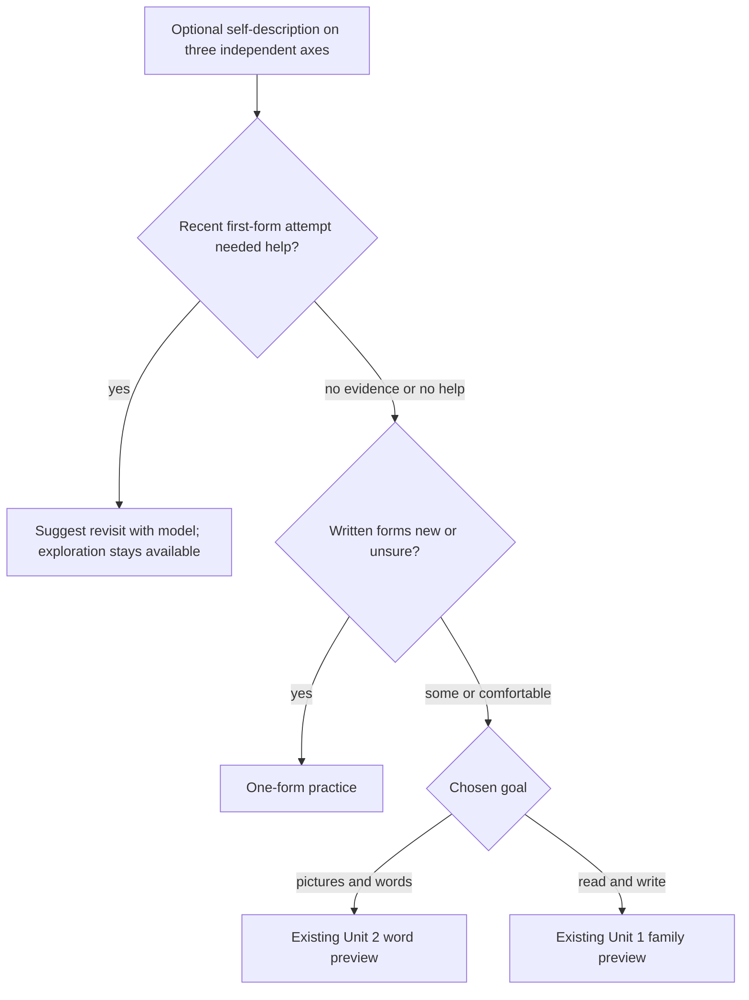
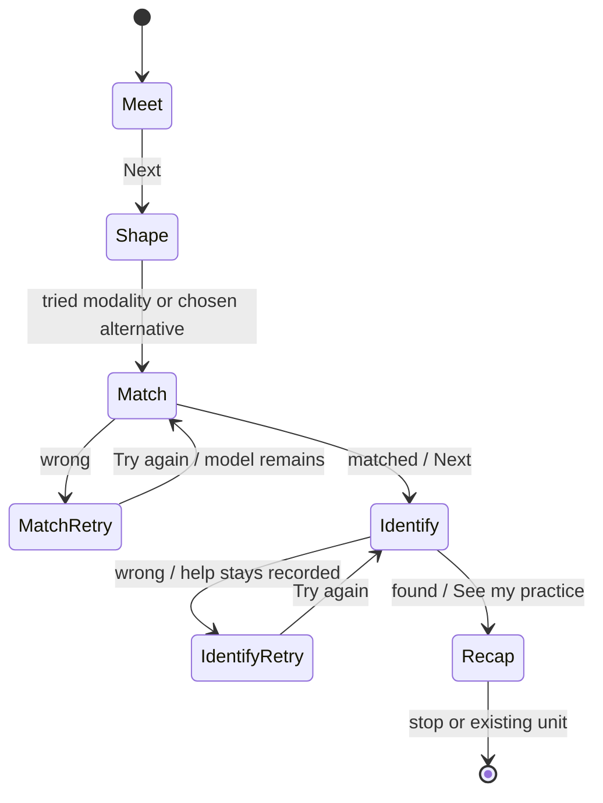

# A useful first step, a personal starting point and a trustworthy companion

**Runtime increment and product specification · 25 November 2026 · baseline `c1b716c`.** This package implements four connected systems in the existing Next.js application and ASP.NET Core API. It follows the [locked vision](../../Product-Bible/01-Vision.md), [learning model](../../Product-Bible/02-How-Humans-Learn.md), [archetypes](../../Product-Bible/03-User-Archetypes.md), [Design Bible](../../Design-Bible.md), [content review contract](../../shared/content-review/CONTENT_REVIEW.md) and [production blueprint](../production/README.md). The owner's explicit implementation request authorizes this scoped increment; it does not revise the frozen vision or approve pending curriculum.

**Use now:** `/first-lesson`, `/onboarding`, `/parents`. These routes work without an account or running API. Optional account actions use the existing authenticated service. Unit 1, Unit 2, their standalone assets, review statuses and scheduling logic are preserved. See [validation](VALIDATION.md) for actual tests and remaining device/release work.

| System | Implemented | Boundary that remains |
| --- | --- | --- |
| First small lesson | Model → drawing/text/shape alternative → matching → model-hidden identification → truthful recap; pause and correction | Visual preview. Reviewed native audio and spoken directions are absent. This is not yet the requested independent pronunciation lesson. |
| Heritage starting plan | Separate listening/speaking/reading choices, optional questions, useful recommendations, response to recent help | No calibrated placement test or proficiency level; self-description is not assessment. |
| Mele relationship | Existing original bear, bounded supportive dialogue, pace/quiet choices, explicit optional account memory, forget controls | No sentient companion, open chat, inferred emotion, speech assessment or fabricated long-term recollection. |
| Parent experience | This-visit observations; protected rolling seven-day summary from existing account evidence | Live account configuration, consent operations and real-family evaluation remain release gates. No scheduled email or notification service added. |

## 1. Product vision

Give a learner one understandable action, useful feedback and a safe place to stop. Give their family a truthful explanation of what was tried and what to revisit. A heritage listener should be welcomed for existing understanding without being assumed able to read; a fluent speaker should be able to explore the existing written material without a beginner gate.

The durable product advantage is accurate Tigrinya teaching and reliable follow-up, not a mascot's apparent attachment. Mele explains the task and accepts breaks. A minute is a design target, never a deadline, score, fluency promise or automatic success criterion. Matching a printed form is a narrower achievement than reading a syllable, producing its sound or remembering it next week.

**Decision:** build a deterministic, inspectable starting system with the existing React/.NET/PostgreSQL stack. No new dependency, cloud identity, AI service, child tracker or reward economy. The alternative—voice placement and a conversational AI companion before reviewed media and assessment evidence—would increase cost and risk without establishing learning value.

The model → supported attempt → retrieval attempt → correction → later revisit sequence is a design application of evidence for retrieval and spaced study, not a claim that this particular Tigrinya activity has demonstrated retention. The [IES practice guide](https://ies.ed.gov/ncee/wwc/PracticeGuide/1) supports spacing and re-exposure through quizzing; learner studies must test transfer to this age group, script and task.

## 2. UX flows

### First lesson

Home → **Try the first small lesson** → see the existing first form `በ` → hear reviewed audio when available → try its printed shape → match with model visible → identify after model is hidden → recap → existing unit, grown-up view or stop. The three options come directly from the first three existing Unit 1 records. Their order changes between the two checks. No new transliteration or pronunciation is supplied.

Proposed pacing for observation: meet roughly 10 seconds; shape roughly 20; matching roughly 10; identification roughly 10; recap roughly 10. These are unvalidated planning estimates. Reading, motor access and choosing help may require longer. There is no countdown or hidden time-based grading.

An incorrect answer reveals the model and a specific comparison instruction. Choices pause until **Try again**; the next answer remains supported. **Show the model** is always available during the model-hidden check. **Pause** stops audio and resumes the same step; marks are not retained when the writing component unmounts. Leaving never creates an account or writes course completion. The recap distinguishes drawing, text and a visual alternative.

### Heritage onboarding and recommendations

Direct first practice is always available. Optional plan: listening → speaking → Fidäl familiarity → goal and pace → recommendation. Every question can be skipped; Back preserves choices. Never ask for ethnicity, ancestry, accent, immigration history or age to infer skill.



Background labels (`starting_fresh`, `heritage_listener`, `heritage_speaker`, `literate_speaker`, `mixed_or_unsure`) are internal descriptions derived from answers, not stored ethnic categories or graded tracks. `assessed` is always false. They change the invitation, never unlocks or ability. A learner who self-reports comfortable reading can explore that material, but no mastery credit is awarded. Recent support can suggest a revisit, not demote the learner.

### Mele and family

**Choose how we go** → one step / exploration / optional break. Quiet hides the bear without removing instructions. **What Mele remembers** → explanation before explicit Save / Load / Forget. **Show a grown-up** → same-visit summary. **Linked account · last 7 days** → authentication → verified linked learner → actual evidence summary, or an understandable empty/error state. There is no automatic account fetch on default entry to these systems.

## 3. Screen specifications and wireframes

All screens use semantic HTML, a large primary action and ordinary document scrolling. No swipe-only navigation, drag-only answer or modal onboarding wall.

```text
FIRST PRACTICE                     STARTING PLAN
Tigrinya        Leave practice     Tigrinya        Leave practice
Step 1 of 5                        When you hear Tigrinya…
Meet one form                      [ It is new to me          ]
[Mele + one short instruction]     [ I understand some        ]
             በ                    [ I understand comfortably ]
[Hear, only with reviewed audio]   [ I’m not sure             ]
[       Try the shape       ]      [ Next ] [ Skip ]
Pause                             Start without questions
For grown-ups ▸                    What Mele remembers ▸

PARENT VISIT                       MODEL-HIDDEN CHECK
Small steps you can see.           Which form did you see?
[This visit] [Linked account]      [Mele: Try once. Help is here.]
What was tried                    [ ቢ ] [ ቡ ] [ በ ]
What to revisit                   Show the model
One useful next action            [kind correction / confirmation]
[ Revisit the first form ]        [ Next / Try again ]
What Mele remembers ▸
```

| Screen/state | Primary action and feedback | Empty, failure or access behavior |
| --- | --- | --- |
| Meet | Large source form, sound only when eligible, Try the shape | Pending sound is stated visibly; absent source gives alternative activity link. No misleading speaker control. |
| Shape | Printed SVG model and pointer marks; Undo/Clear; text comparison or visual alternative | Pointer cancellation discards unfinished stroke; zero-sized geometry is ignored; no motor/handwriting grade. |
| Match | Model visible; three large form choices | Wrong tap shows model, specific instruction and retry. Correct answer cannot be counted repeatedly. |
| Identify | Model hidden, optional help; same source forms | Any answer reveal/help makes this supported. Assistive technology can choose help; no separate ability claim. |
| Recap | Describes actual modality and sound transport; next / grown-up / stop | No XP, streak, timer, forced celebration or “mastered” badge. |
| Plan | One question at a time; reversible answers; three concrete recommendations | Skipped answers remain unsure. Choices work despite authentication/network failures. |
| Memory | Explicit actions with pending status and conflict recovery | A delayed load cannot overwrite newer visit choices. Aborted unmounted requests do not apply results. |
| Parent | Two small cards and one next step | No practice produces an honest empty state. Unauthorized, revoked or failed account fetches hide cached results. |

## 4. Information architecture and component hierarchy

Home links to first practice and starting plan. Learn retains existing unit navigation and adds those entry points. Focused entry routes show **Leave practice** instead of the full navigation. Parents is available in the normal footer and first-practice recap. Existing `/profile`, games, Stories, progress, review, content tools and standalone unit routes remain available.

```text
RootLayout → Providers → LearningJourneyProvider → Shell
  /first-lesson → server firstLessonContent() → FirstLesson
    MeleCompanion → BearCompanion
    TracePad / match / recall / recap
  /onboarding → StartingPlanPage → recommendation + PlanMemoryControls
  /parents → ParentExperience
    default visitSummary(records)
    explicit LinkedFamily → SharedSummary(verified subject)
    PlanMemoryControls
```

Content stays in the canonical review JSON. UI intentions are pure TypeScript transitions. Visit data stays in React memory. Optional persistence uses the existing API client/token flow. There is no new global event bus, learner graph database or AI orchestration layer.

## 5. Database schema and memory model

The additive EF migration `20261125132652_LearningStartPreferences` adds one table; it does not edit unit content, existing evidence or scheduler state. The generated idempotent [migration SQL](../../infrastructure/database/migrations.sql) is for the normal reviewed deployment process, not an instruction to run it against a live database during this task.

| `LearningStarts` field | Storage | Meaning |
| --- | --- | --- |
| LearnerId | UUID PK/FK → Learners, cascade on account deletion | Existing account owner; request body cannot select another learner |
| Listening / Speaking / Reading | varchar(20) each | Allowlist `new`, `some`, `comfortable`, `unsure`; self-report only |
| Goal | varchar(20) | `reading` or `words` |
| Pace | varchar(20) | `step` or `explore`, guide preference |
| Quiet | boolean | Companion visibility preference |
| Revision | UUID concurrency token | Conflict detection; identical retries return the same revision |
| UpdatedAt | bigint UTC epoch milliseconds | Existing repository timestamp convention |

Existing `Relationships`, `ReviewAttempts`, published `Content` revisions and `LearningStates` supply authorized summaries. No new copy of these sensitive histories or materialized parent dashboard is stored.

Anonymous memory contains the current plan and at most ten completed practice observations: session UUID, source revision, target, finish timestamp, actual writing modality, playback/answer/help flags. These are local visit bookkeeping, not a persistent identifier or language profile. React reload clears them. Strokes stay in the writing component, bounded to 40 paths × 512 points plus 20 undo snapshots; they are never uploaded. Clearing the visit does not delete saved account choices or existing course history. Forgetting saved choices does not delete the learner.

Long-term memory is deliberately limited to the explicit preferences row. It has no birthday, relationship duration, mood, family facts, voice, dialogue transcript, “bond” score or inferred attachment. Full-account deletion/export and a disclosed retention schedule must follow the platform's privacy operations before child-cloud release; a new FK cascade alone is not that complete operational system.

## 6. API design and privacy boundaries

All new endpoints return `Cache-Control: no-store`. They use existing JWT validation/scope policy, cancellation, problem responses and EF concurrency handling. No local authorization bypass or client-declared adult/parent status is introduced.

| Endpoint | Authorization and response |
| --- | --- |
| `GET /api/users/me/learning-start` | Current learner scope only. Own preferences or literal JSON `null`; never a selected subject. |
| `PUT /api/users/me/learning-start` | Explicit save; allowlisted fields, unknown authority fields rejected. Own learner only; new learner retains child-safe/no-analytics defaults. `revision` required to update a different existing value; stale version → 409. Identical retry is idempotent. |
| `DELETE /api/users/me/learning-start` | Own preferences only. `If-Match: "<revision>"` required when a row exists → 428 if missing; stale → 409; absent/already deleted → 204. Course evidence retained. |
| `GET /api/parents/learners/{subject}/summary` | Existing learner scope **and** Parent role **and** current verified parent relationship. Role alone is insufficient; revoked relationship → 403. |

Example save body (preferences, not content or consent):

```json
{"listening":"comfortable","speaking":"some","reading":"new","goal":"reading","pace":"step","quiet":true,"revision":null}
```

Weekly summaries cover server UTC now minus seven days through now. Exclude future events, another learner, drafts, archived content and evidence against a different current published revision. Return check counts, correct with/without answer help, latest item/skill checks to revisit, at most three published topic titles and a bounded next-action suggestion. These are practice records, not assessed reading proficiency.

The query examines at most 5,000 newest attempts; `partial: true` tells the UI to label a bounded sample rather than complete weekly totals. Existing delayed-check totals are separately marked **all time**, not relabelled weekly retention. Overall ability is `not_assessed`; study time is null. Parent fetch failures, refetching or revocation suppress old displayed summaries; cached data is discarded when the view unmounts. The existing authorized learner-list endpoint supplies selectable subjects; visible options use generic learner numbers rather than displaying raw identity-provider subjects. Selection creates no relationship.

## 7. State machines, personality and dialogue



Pause is an orthogonal view flag: capture the current lesson step, stop media, show one Continue action and restore that step. It is not a completed activity. `heard` means an actual HTML media `playing` event, not human perception or accurate sound production. `drawing` records only the chosen interaction, not pen quality. Retry never erases help. The pure reducer ignores repeated accepted answers and unavailable transitions.

Plan state: question 0 → 1 → 2 → goal → recommendation, with reversible Back, Skip and Change. Memory state: idle → pending → saved/loaded/forgotten/error; single in-flight action, cancellable requests, revision conflicts, newer visit edits preserved. Parent state: local visit → explicitly requested list → verified selection → pending → summary/empty/forbidden/error.

**Personality:** patient timing; calm corrections; warm invitations; humble uncertainty; never claims “I know how you feel.” First-name familiarity does not imply a person or confidential relationship. Mele explicitly identifies as an app guide in the memory explanation. No secret keeping, affection bargaining, “I missed you,” disappointment, attendance debt or push notifications.

| Intent | Current response | Functional consequence |
| --- | --- | --- |
| Meet | “Look first. We can take one small step.” | Model before challenge |
| Need support | “Here is the model. Have another look, then try again.” | Correct model and retry; evidence stays supported |
| Slower pace | “We can take one step at a time.” | Changes explicit pace preference |
| Explore | “You can explore, and return to a model whenever you want.” | Preference changes; units remain available |
| Break | “Your practice can wait.” | Pauses current practice and audio |
| Finish | “You tried a small practice. You can stop here.” | Actual recap and a natural exit |
| Missing audio | “Reviewed sound isn’t available yet. Try the shape preview.” | No invented sound or failed sound-based assessment |

The relationship architecture is intent → vetted English UI line → existing bear pose → accessible caption → optional action, not generated conversation. Current poses use encouraging, kind, celebrating and resting states. Quiet retains captions; reduced motion retains meaning. Web-facing name is Mele; the unchanged standalone previews/asset filenames remain Neri. No Rive rig or phonetic mouth timing is claimed.

Milestones acknowledge a completed attempt or supported return, never a bond, rank or IQ/fluency estimate. The current implemented milestone is this visit's completed first practice. Later milestones may reference verified longitudinal evidence only after account privacy and evaluation gates; they must never say “you learned” merely because a card was opened. After a year, the app should remember chosen preferences and explain actual evidence, not pretend to remember conversations it never stored.

## 8. Analytics strategy and event contract

**Implemented default: no analytics SDK, identifier, event upload or new analytics endpoint calls.** Reducer inputs and React observations power feedback/recap in memory only. Existing account assessment records retain their established service contract. Operational request logs are not exempt from privacy review merely because product analytics are disabled.

The following is a **future opt-in research contract**, not an installed collector. Each event would need schema/retention/consent approval, minimal properties and a clear purpose. Do not send full text, strokes, voices, subject IDs, heritage labels, emotion or free-form dialogue to an analytics service.

| Proposed event | Trigger / bounded properties | Decision it can inform |
| --- | --- | --- |
| `first_practice_started` | User enters; UI/content revision, media availability | Is the first action understandable? |
| `first_model_playing` / `first_media_failed` | Transport event, bounded failure class | Is reviewed media actually usable? Not “heard correctly.” |
| `first_shape_tried` | drawn / text / alternative | Are accessible routes usable? Not motor ability. |
| `first_answer_checked` | step, supported flag, correct boolean | Does correction work? No proficiency inference. |
| `first_practice_finished` / `paused` | Actual transition, UI revision | Where is the natural stopping point? Never penalize pauses. |
| `starting_plan_changed` | Version and axis changed; avoid raw background label | Are recommendations useful and reversible? |
| `companion_preference_changed` | Quiet/pace selection | Is the guide comfortable? No attachment score. |
| `parent_summary_requested` / `unavailable` | view type, bounded error class | Can an authorized caregiver reach an accurate summary? |

No research event can silently become scheduling evidence. Default anonymous visits intentionally cannot supply cross-day retention or cohort funnels. Use consented, purpose-limited research sessions for longitudinal evaluation. Aggregate small samples carefully; a few unusual heritage profiles may still be identifiable.

## 9. Accessibility and parent privacy strategy

Target [WCAG 2.2 AA](https://www.w3.org/TR/WCAG22/); this implementation is not a certification. Requirements: keyboard-operable native controls, visible focus, focused heading on step changes, named groups/inputs, text feedback via polite status, large targets, color-independent progress, normal zoom/reflow, explicit media action, no autoplay, undo, drawing alternatives and no speed-based gating. Quiet and OS reduced motion remove animation without deleting the task.

Tigrinya is **left to right**, in the Ethiopic abugida. Form containers/input use `lang="ti"`, `dir="ltr"`, Unicode isolation and the existing Ethiopic font stack. No RTL override or Latin-letter assumption is introduced. Text comparison normalizes NFC; native input and Insert are supported. Screen-reader pronunciation of an unreviewed form is not a substitute for the native model; the visual alternative makes no speech assessment claim. Physical IME, switch access, zoom, VoiceOver/TalkBack and young-learner independent use need separate validation.

The parent default has no child selected, named or inferred. Same-visit data on a shared device belongs to that visit, not an authenticated child; the UI says so. Account summaries require a current verified relationship on every request. No downloaded reports, scheduled email, public leaderboard, tracking pixel, targeted ad, voice upload or hidden profile is added. Household sign-in sharing cannot safely distinguish children; use separate verified links.

**GDPR:** define controller/processors, purpose and lawful basis, clear notices, minimum retention, access/export/deletion, security, transfer arrangements and a child-risk assessment before live child-account operation. Where consent is the basis for the relevant online service, the applicable child threshold varies by EU member state between 13 and 16; use an appropriate verified parent process and clear child-facing language. The [European Commission guidance](https://commission.europa.eu/law/law-topic/data-protection/information-business-and-organisations/legal-grounds-processing-data/are-there-any-specific-safeguards-data-about-children_en) is a starting point, not a substitute for jurisdiction-specific review. A JWT Parent role or a database link alone is not legal proof of consent.

**COPPA:** child-directed services may need verifiable parental consent before collecting covered personal information from under-13s, with notice, access/deletion, security and purpose-limited retention. The amended rule makes minimization/retention important operating duties; see the [FTC FAQ](https://www.ftc.gov/business-guidance/resources/complying-coppa-frequently-asked-questions). This increment avoids anonymous collection; it does not implement or certify a complete consent program. Owner and qualified privacy review must settle the account workflow, actual data map and retention/deletion operations before rollout.

## 10. Mobile-first design system

Reuse paper `#fcfaf4`, ink `#263b3b`, green `#17634f`, existing rounded cards, bear artwork and shared buttons. New styles are scoped to entry screens; no standalone unit restyle. Content width caps at 740px. Primary controls are at least 48px high; answer choices are larger. A three-column form choice set stays readable on a phone. Parent cards become one column below 600px. Focused phone headers keep brand and one exit on the same line; tracing is bounded rather than filling several screens.

Keep one teaching goal per screen. Detailed review/privacy explanations stay in native disclosures. The visible unavailable-audio notice is necessary teaching information. Larger fonts, wrapped instructions and input fallbacks may scroll; do not shrink text or trap a sticky action over content to force a one-screen lesson. Use normal scrolling and preserve zoom. Respect existing reduced-motion styles and static SVG fallback. No new animation runtime or font download is required.

## 11. MVP roadmap

| Priority | Work / simplest implementation | Impact, effort and risk | Acceptance gate |
| --- | --- | --- | --- |
| MVP implemented | First visual practice, independent skill choices, bounded Mele guide, this-visit parent recap | High clarity; moderate scoped code; low storage risk | Executable transitions, error recovery and regression checks |
| MVP implemented | Optional versioned preferences + verified parent summary | Useful account continuity; moderate service/privacy risk | Owner-only access, revocation, no-store, additive migration, real PostgreSQL tests |
| MVP release gate | Native review of the first forms, licensed recorded model and brief directions | Essential for authentic pronunciation/independent child use; reviewer-dependent | Named qualified reviewer, exact revision, speaker/variety/rights, asset hash and device media QA |
| MVP release gate | Physical phone, AT and child/caregiver testing; consent/retention operations | Essential; modest implementation but substantial validation | Correct task interpretation, safe exits, no unsupported learning claims |

Do not add extra characters, full placement exams or a chat service until this first step works for real learners. Register only genuine qualified media decisions in the existing review source. `scripts/build_first_lesson.py` derives a source-bound manifest; it validates language/direction, required native provenance, allowlisted local path and SHA-256 bytes. A changed record with a stale manifest fails closed. It does not judge pronunciation quality or manufacture approval.

## 12. V2 roadmap

| Work | Purpose and evidence required | Simplest next implementation |
| --- | --- | --- |
| Reviewed multidimensional placement | Short reading/listening/communication probes with expert rubrics; validated on all four backgrounds | Small source-backed task bank, skip/retry, uncertain result and human review; never ancestry-based ability |
| Delayed follow-up | Evaluate what is remembered after meaningful delay | Existing reviewed scheduler/evidence pipeline, optional account; never convert this preview into language mastery |
| Reviewed writing instruction | Teach authentic stroke sequence when reliable teaching material exists | Existing Fidäl contract with verified steps and static alternative; no invented pen order |
| Parent weekly continuity | Clear trends and actual examples without overload | On-demand evidence summaries first; no email/push until explicitly opted in and necessary |
| Mele continuity | Respect changed preferences and real reviewed milestones | Versioned deterministic dialogue/localization, no transcript/emotion database or attachment incentives |

Each feature needs a content owner, access/device check, privacy purpose and measurable learning question. Explicit business approval is needed before any paid service; no premium-only correction or accessibility.

## 13. Risk analysis

| Risk | Consequence | Control / remaining owner action |
| --- | --- | --- |
| “Perfect” interpreted as a universal 60-second guarantee | Rush, shame or false efficacy | Untimed practice, alternatives, observable outcomes; study with target learners |
| Missing native audio/directions | Cannot teach/verify pronunciation or guarantee independent use | Visible pending state; qualified native production and phone QA required |
| Printed tracing confused with handwriting instruction | Incorrect stroke pedagogy or assessment | Explicit ungraded printed model, no stroke order/score; expert teaching data gate |
| Oral heritage familiarity treated as literacy | Misplacement and identity harm | Independent axes, optional self-report, no assessed rank, exploration remains open |
| Same-visit success called retention | False parent confidence | Source/help/modality-aware recap, explicit delay distinction |
| Adult sees another child's account | Privacy harm | Existing auth + current verified relation + uncached response; test revocation |
| Shared-device visit assumed to identify a child | Misleading or exposed summary | No inferred identity, visible scope, reload/clear; account links for individual history |
| Companion encourages dependence | Emotional manipulation | App-guide disclosure, finite dialogue, easy hide/pause, no simulated feelings or attendance debt |
| Preference updates race | Surprising overwrite | Revision token, idempotent retry, abort on unmount, newer edits preserved |
| Large histories / stale evidence | Expensive or misleading summaries | Recent bounded query, partial label, exact published revisions, at most three titles |
| Local cache or motion regression | Phone discomfort/unusable activity | No new persistent anonymous storage, reduced motion, viewport and keyboard tests |
| Claiming software checks equal child safety/compliance | Unreviewed release | Separate native, usability, privacy and physical-device release gates; no deployment in this task |

## 14. Learning-outcome metrics

The primary outcome is **successful, supported and later reusable language action**, not daily opens. The current slice measures only practice interaction. No reported impact or baseline is invented.

| Question | Measure and denominator for a consented study | Interpretation limit |
| --- | --- | --- |
| Can a learner start? | Learners reaching the intended first action without adult directions / observed starters; record help and access needs | Usability, not language gain |
| Can they distinguish the shown form? | Correct first model-hidden selections / learners offered that check; separately report model/answer help | Three-choice chance and same-visit familiarity remain; not reading fluency |
| Does it last? | Correct form/sound retrieval after prespecified 1/7/30-day follow-up / eligible contacted learners, with attrition reported | Not measurable from anonymous in-memory preview; reviewed content and consent needed |
| Can it transfer? | Source-backed novel syllable/word tasks, separately scored by skill and assistance | Cannot be inferred from this isolated shape exercise |
| Does placement fit? | Learner-rated starting-point usefulness plus subsequent performance, separately by self-described skill axis | No pass/fail ethnicity or “heritage advantage” score |
| Does the parent understand? | Caregivers who accurately explain tried vs remembered, assistance and the next action / observed caregivers | Dashboard opens are not comprehension |
| Is it emotionally comfortable? | Voluntary pause/help use and explicit comfort feedback in moderated sessions | Never infer emotion from taps, face, microphone or session length |

Pre-register questions and comparison conditions before experiments. Compare equal content with/without extra companion help, not a polished lesson against an empty control. Report confidence/uncertainty, differences by relevant access needs, adverse experiences and missing follow-ups. Small heritage cohorts need qualitative evidence and privacy care before numerical conclusions.

## 15. Success criteria and release decision

**Engineering acceptance for this increment:** account-free routes work; no new anonymous API/localStorage activity; useful correction/help/pause; real drawing/text alternatives; source-bound media gating; explicit self-report recommendations; bounded memory with deletion/concurrency behavior; parent authorization/revocation; existing unit regression checks; production build and relevant tests pass. Actual results belong in [VALIDATION.md](VALIDATION.md).

**Proposed pilot targets, not achieved results:** at least 90% of observed learners understand the next action with the access modality they use; at least 90% of caregivers distinguish immediate practice from delayed memory; every observed learner can exit or use help without penalty; zero known critical access/privacy issues before pilot. Set sampling and age/access groups with a learning researcher, report sample size and uncertainty, and revise targets from the baseline. Never optimize the one-minute target by hiding help or excluding slower learners.

**Language release acceptance remains blocked** until qualified first-form/audio/direction review and physical-device/accessibility/child-usability checks. Accurate pronunciation, multi-year retention, calibrated placement and universal independent use are not established by this code. Do not market those as completed. The next useful investment is reviewed teaching media and observed learner use, not more screens.
