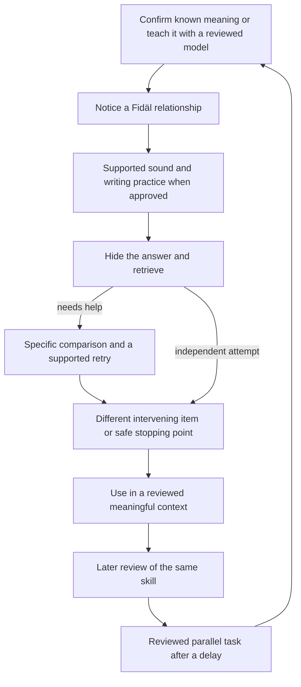
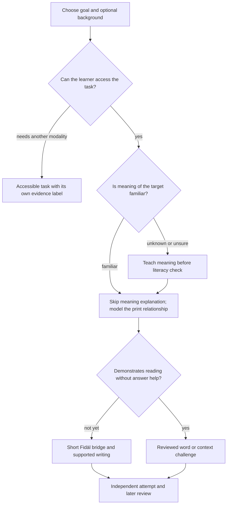

# Tigrinya learning path audit and outcome design

**Design proposal · 26 November 2026 · audited code baseline `adf5d79`.**

The highest-value next step is a complete, reviewed oral-to-literacy pilot, using the existing visual path and review engine. Adding more games before native sound, writing models and connected meanings are available would increase activity without completing the learning experience.

This proposal preserves the [locked vision](../../Product-Bible/01-Vision.md), Unit 1, the current lesson order and learner records. It does not adopt the draft Product Bible, approve language assets or change runtime gating. The [lesson recommendations](LESSONS.md) cover all 31 current Unit 2-onward nodes. The generated [coverage inventory](coverage.json) maps all 293 source forms in 42 groups to a reusable six-mode design; it is an audit artifact, not a new lesson manifest. [Validation](VALIDATION.md) records the checks performed on this package.

## Audit and ratings

Higher scores mean more complete **instructional capability and release readiness**, not a larger deficit. These are provisional design judgments, not learner results: 0 absent; 1–2 outline, draft or blocked capability; 3–4 partial working experience; 5–6 coherent implemented subsystem with substantial validation/content limits; 7–8 reviewed content and observed usability/outcomes; 9–10 sustained, independently evaluated outcomes. Do not average the scores into a claim of course quality.

| Requested category | Readiness / 10 | Observed capability | Most important missing capability |
| --- | --- | --- | --- |
| Learning modes | 4 | Early word introductions now use Look → Build → Read → Recall; Unit 3 adds form location, family relationships and input. Twenty games provide distinct interactions. | A connected cycle covering meaning, actual sound, independent writing and contextual use. Many games still measure visual manipulation rather than a different language skill. |
| Review activities | 6 | Skill-specific review, bounded mixed queues, support tracking, elapsed-time and lesson-gap scheduling, and delayed-evidence protections. | Observed confusion pairs, targeted comparison lessons, reviewed transfer tasks and a validated interpretation of longer-term performance. |
| Heritage support | 3 | Independent listening/speaking/reading self-reports, optional starting recommendation and exploration. No proficiency claim from self-report. | A usable oral-knowledge-to-print sequence, familiarity checks, reviewed placement probes and a route that skips already-known meanings without skipping literacy teaching. |
| Listening | 1 | Audio metadata and blocked activity outlines exist; UI distinguishes unavailable sound. | Approved native models and directions, licensed files, listening-first tasks, meaningful comprehension checks and real-device audio validation. |
| Writing | 4 | Printed-model drawing, text entry, Fidäl keys, copying and picture-cued entry work. | Verified teacher stroke sequences, copy-to-memory instruction, descriptive human rubrics and delayed writing samples. Current tracing is not verified stroke instruction. |
| Real-world applications | 1 | Two message/reply outlines; word/picture activities connect forms to meanings. | Reviewed messages, signs and purposeful responses with accepted answers and parallel transfer tasks. A picture-market game is not restaurant communication. |
| Cultural content | 2 | Twenty original Tigrinya story drafts and original illustrations exist in a separate preview. | Qualified language/cultural review, explicit learning targets, contextual variants and story tasks. Fiction does not itself establish authentic Eritrean cultural teaching. |

### Current activity map

“Implemented” here describes software. Every source Fidäl form and all 31 path word candidates remain pending qualified native review. All 20 Stories drafts also remain pending. Preview access does not satisfy learner release gates.

| Current activity | What the learner does or remembers | Evidence actually available | Status and repetition |
| --- | --- | --- | --- |
| First small lesson | See one source form, explore its shape, match, then identify without model | Supported shape exploration and a narrow visual identification attempt | Implemented; sound absent; no course mastery credit |
| Unit 1 family practice/reference | Compare forms and related source order positions | Shape recognition and noticing family relationships | Implemented; preserve sequence; no general sound inference |
| Unit 1 writing workshop | Draw against printed glyph, use text/keys, replay own marks | Exploration/copy/input, with modality distinguished | Implemented; replay is the learner's marks, not teacher stroke order |
| All 16 Unit 2 introductions | Model → visible-model construction → written word to picture → picture-cued Ethiopic input | Exposure, supported construction, receptive reading practice and cued text recall | Implemented in `word-routine.js`; 4–12 routine steps for 1–3 new targets, plus bounded due review |
| Five Unit 2 checkpoints and introduction checks | Select a written word from a picture | Visual recognition under recorded support conditions | Implemented; early unlock checks still rely on this response type; no automatic writing inference |
| Unit 3 six lessons | Locate first/last, relate sourced family forms, copy, read, recall and combine | More varied written tasks on already taught words | Implemented; still limited to the sourced picture-word set |
| Unit 1 games | Match, sort families, sequence, remember card positions, assemble glyph pieces, route through forms, continue patterns, draw, classify, locate a form | Some recognition/segmentation practice; some spatial or interface skill | Twenty-game system implemented across both units; spatial success is not pronunciation or reading comprehension |
| Unit 2 games | Deliver labels, construct, choose a picture set, locate forms, repair a displayed model, search, chain shared forms, copy, find overlap, reveal/self-check | Visual mapping, construction, copying, comparison and self-reported recall | Useful optional practice; repeated tapping remains prominent across different game names |
| Manual/embedded review | Retrieve previously encountered targets through task-specific prompts | Recognition, reading, entry, construction and locating histories; supported/delayed distinctions | Implemented; no current confusion-pair teaching loop |
| Pronunciation cards | Inspect/rehearse through existing preview and recording affordances where available | A recording or self-check cannot establish phonetic correctness | Native models/scoring rubric remain content-blocked; no reliable automatic pronunciation grade |
| Unit 4 listening/saying | Planned native sound and rehearsal | No completed listening/speaking assessment | Both nodes unavailable in canonical curriculum |
| Unit 5 message/reply | Planned connected exchange | No sentence/grammar evidence | Both nodes unavailable; no reviewed sentence inventory |
| Stories | Read draft Tigrinya paragraphs, navigate and optionally save reading position/bookmarks | Reading exposure and reader preferences; marked-read is not comprehension | 20 drafts / 160 paragraphs, no approved narration or integrated comprehension/speaking tasks |

Source anchors: [Fidäl review data](../../shared/content-review/fidal-writing.json), [canonical path](../../unit-02-first-words/path-curriculum.json), [word routine](../../unit-02-first-words/src/word-routine.js), [game mechanics](../../shared/game-garden-core.js), [review engine](../../unit-02-first-words/src/path-srs.js), [starting plan](../../apps/web/lib/learning-start.ts), [story text](../../stories/content/collection.json) and [story review](../../stories/STORY_REVIEW.md).

The path selects 31 of the review bank's 32 picture candidates. Its existing exclusion retains a same-picture alternative in the source bank while awaiting a native usage distinction. This design preserves that exclusion and does not claim the path covers every dictionary candidate.

## Learning model and competitor benchmark

Duolingo publicly describes interactive scaffolding, short sessions and personalized practice. Those are useful design patterns, not proof that every exercise or reward transfers to Tigrinya literacy. Borrow the progression and feedback principles; retain this app's identity and calm approach. Our proposed differentiation is source-reviewed Fidäl writing, oral-to-print heritage teaching and honest skill-specific follow-up. That is a product hypothesis until evaluated. [Duolingo teaching method](https://blog.duolingo.com/duolingo-teaching-method/)

Spacing, alternating models with attempts, retrieval and connecting concrete representations with explanations inform this design. These general recommendations do not specify a Tigrinya family order or the ideal number of repetitions. English-oriented foundational-reading guidance supports connecting word recognition/writing with meaningful text in its setting; a Tigrinya educator must determine the actual script and language sequence. [IES learning guide](https://ies.ed.gov/ncee/wwc/PracticeGuide/1), [IES foundational reading guide](https://ies.ed.gov/ncee/wwc/PracticeGuide/21)

Repeated retrieval needs separation, rather than endlessly repeating an answer immediately after seeing it. An experimental spacing study found an advantage for greater total spacing without establishing one universally superior expanding/equal/contracting schedule. Preserve the existing scheduler until an evaluated alternative warrants migration. [Karpicke and Bauernschmidt, 2011](https://learninglab.psych.purdue.edu/downloads/2011/2011_Karpicke_Bauernschmidt_JEPLMC.pdf)

“Train multiple parts of the brain” is not an operational success criterion. **Connect perception, meaning and production, then test what remains available after a delay.** Recognition, recall, listening, reading, writing and usage belong to a concept's learning cycle across visits. Requiring all six in every short lesson would create unnecessary switching and could penalize learners with access needs. A tracing task is one kind of supported writing; it cannot establish independent writing or meaning.

### The proposed cycle

This is an instructional dependency map, not a six-screen compulsory session. The interface shows **Continue**, **Review** and **Explore**; the recommendation names one next task and its reason. Keep exposure, supported practice, independent attempts and delayed evidence distinct. A blocked sound/usage stage stays unassessed and does not prevent access to an honestly labeled visual practice alternative.

### Coherent progression from the current app

| Stage | Intended change in capability | Entry and exit evidence | Content boundary |
| --- | --- | --- | --- |
| Entry | Learner understands the task and can select a suitable starting point | Optional background questions plus brief accessible demonstrations; no ancestry/age ability inference | Keep current first-form lesson and Unit 1 intact |
| Fidäl bridge | Relate a few source forms to known sounds/meanings, then read and begin writing them | Supported comparison followed by separate form, sound and written attempts | Additive branch using approved records; broad library remains reference, not mandatory first-session load |
| Unit 2 First Words | Connect two-grapheme word forms with meaning in both directions | Existing routine plus later reading/entry checks on taught targets; speech separately assessed | Preserve exact two-Ethiopic-grapheme candidate rule; current 31 candidates require review |
| Unit 3 Read and Write | Locate and reuse forms across words, copy and retrieve | Separate segmentation, reading, text-entry and handwriting evidence | Do not generalize text-key success to handwriting quality |
| Unit 4 Listen and Respond | Understand familiar words without written answer cues; voluntarily rehearse | Audio-first meaning response; optional human-scored spoken task | Retain blocked state until native models, directions, rights and rubrics exist |
| Unit 5 First Connected Meanings | Read and respond to one short meaningful message | Reviewer-authored comprehension and accepted response criteria | No sentences or grammar rules generated by joining dictionary words |
| Story and mission branches | Carry taught relationships into connected language and useful action | Reviewed comprehension, transfer and optional production tasks | Attach to actual prerequisites, not an invented fixed Unit 6/7 curriculum |
| Return visits | Reconstruct and use previously taught relationships | First responses after meaningful delays, with help and revisions recorded | Review supports learning; it is never a prerequisite waiting period |

## Fidäl learning design for every source form

Use [coverage.json](coverage.json) to find every current character, its source family/order, review state and context references. It covers 293 forms, including the actual nonuniform source groups; do not manufacture seven records for every group. Only 45 forms currently have any source context candidate, totaling 62 context references. The other 248 require context research or an honestly scoped pattern activity. Existing contexts are candidates, not approval.

For each target, a reusable **F1** blueprint specifies the following modes. A qualified educator chooses a small starter set and appropriate contrasts from the actual data; neither this proposal nor Unicode order supplies a validated teaching sequence.

| Mode | Model → learner action | Helpful recovery | What can be claimed and what blocks release |
| --- | --- | --- | --- |
| Recognition | Show the target and a visible comparison; then remove model and identify it among sourced forms | Reveal both selected and target forms; point to a verified visible distinction; retry with positions varied | Visual identification under recorded conditions. Reviewed contrast/labels required; never assert a sound distinction from shape |
| Listening | Play an approved native model on request; hide its transcription; choose the corresponding taught form or meaning | Replay; optionally reveal the matched form; subsequent retry is supported | Sound-to-form or sound-to-meaning evidence, separately. Missing/failed media gives a different visual task, not listening credit |
| Reading | Demonstrate the reviewed form in a familiar source word; then identify meaning from print with picture answer cue removed | Restore the existing model and relevant family/order reference | Familiar-word interpretation, not universal decoding. Whole-word pronunciation/segmentation must be reviewed; two graphemes do not imply two freely concatenated sound files |
| Writing | Show verified teacher strokes with start/direction and replay; trace, copy beside the model, then reproduce without guide | Replay/slow the teacher model, undo, compare own marks with it; paper/text alternative | Trace/copy/memory are separate records. Stroke instruction and correction remain blocked until source, teaching style, rights and qualified review exist |
| Recall | Cue a known meaning or approved sound and ask for the form/word without the answer | Allow help, explain exactly which model returned, retry after another item | Cued text/form production. Form keys are access support; if they expose the answer, record that condition |
| Usage | Find or produce the target inside an already understood, reviewed word/context | Highlight target in the approved model, reread/relisten, try the parallel context | Contextual reading/use under that rubric. No natural reviewed context means pattern practice, not invented vocabulary |

The user-supplied `ሀ` and contrast `ሐ` can be looked up as source candidates; the app must not assert that their sounds, usage or confusion relationship are established by that example. The matrix points to source records without adding transliteration or phonetic rules.

### Family and vowel-order teaching

Keep the family's source forms visible in an optional reference. Teach a manageable pair or subset, demonstrate what changes visually, then apply it to an existing reviewed word. Expand the comparison when the learner can handle it; do not require memorizing a full grid before meaningful reading. A reviewer must approve spoken models, labels, regional treatment and any claimed pronunciation relationship. Avoid treating each printed form as an independent Latin letter or assuming an order always yields the same isolated sound in every word.

### Writing progression and assessment

1. **Observe:** inspect a verified teacher model, static numbered alternative and optional slow replay. Until verification exists, offer printed-shape exploration with no starting-point claim.
2. **Trace:** follow that model; marks and guide remain visible. Feedback describes completion of practice, not neatness or phonetic knowledge.
3. **Copy:** write beside the model, then compare. Permit a stylus, finger, mouse or paper; do not compare motor performance across devices.
4. **Memory:** hide the model; cue a previously understood target; write before reveal. Self-comparison is a self-report until a qualified rubric is applied.
5. **Apply:** write a taught word, then a reviewed purposeful message at a later stage. Text entry and handwriting remain different outcomes.
6. **Revisit:** another-day sample before guide access; a teacher reviews legibility/form identity against a documented style and accepted variants. Stroke correction additionally requires that the stroke data actually support the claim.

Automatic handwriting or pronunciation scores are **Future**, after representative consented data, qualified labeling, rater agreement, calibration, error analysis and access fairness checks. Font outlines are not teacher strokes. A microphone waveform measures signal, not linguistic accuracy; text speech recognition is not a pronunciation rubric.

Speed recognition and speed writing are optional **Future** fluency exercises, never unlock criteria or a correction for an access barrier. This request supplies the direction for designing optional speed practice; the current no-countdown child runtime remains unchanged. Teach accuracy first, offer learner-controlled timing with an untimed equivalent, and apply no deadline penalty. Compare only comparable tasks/input conditions; normal hearing/typing/motor differences are not language deficits. [W3C timing guidance](https://www.w3.org/WAI/WCAG22/Understanding/timing-adjustable)

## Heritage literacy path

Heritage experience is uneven across listening, speaking, reading and writing. Keep those axes independent and revisable. Self-description chooses an invitation; task evidence determines the narrow capability demonstrated. This follows the need for context-sensitive heritage assessment, rather than a single inherited-proficiency label. [CAL heritage assessment module](https://www.cal.org/projects/heritage-language-assessment-module/)

### Entry and placement

Do not force an oral speaker through repeated beginner-vocabulary quizzes. Offer “I know this meaning” plus a short task where appropriate, then teach its written form. Do not say “you already know these words” merely because the learner selected heritage speaker. Keep uncertainty visible; a picture interpretation error may be a picture problem. A literate speaker can demonstrate familiar material and explore ahead without gaining fabricated history. A complete beginner receives meaning and spoken-language support first.

### Listening first, once the media is approved

The bridge runs **native audio → meaning response → reveal written word → notice its forms/family relationships → supported entry or writing → later independent reading**. The first response has no transcript, written answer hint or lip animation that supplies the correct answer. After it, synchronized text/meaning supports teaching. A transcript or replay that reveals the answer changes the support record, not the learner's dignity.

For a heritage listener with limited speech, start with comprehension and print, offer voluntary rehearsal and keep speaking unassessed. For a fluent oral speaker, allow familiar meanings to be bypassed and spend time on print/copy/memory. For a literate speaker, use reviewed transfer probes before suggesting review. Route names describe goals (“Read familiar words”), not identity ranks. No version of this placement is currently validated; default onboarding remains self-report.

Without reviewed audio, retain the existing visual preview and show the sound gap. Do not label a visual familiarity question an oral assessment. Deaf learners and those choosing silent access receive a meaningful literacy route without invented listening credit.

## Adaptive review and error recovery

### Build on the existing engine

The standalone path already stores distinct recognition, reading, entry, construction and locating evidence. Its current intervals are 1/3/7/14/30/60 days, lesson gaps 2/4/7/11, at most two mixed items and one supported corrective revisit. Same-visit repeats cannot manufacture delayed success. Preserve these protections. The server scheduler and the TypeScript FSRS adapter are separate implementations, not interchangeable validated models; this design does not migrate either.

Use a small deterministic session planner around that evidence, rather than a new AI tutor. It selects reviewed, previously encountered targets; respects availability, current modality, support needs and session budget; and gives one reason for its recommendation. Never use absent attempts as wrong answers, or a due date as proof of forgetting.

| Internal interpretation | Learner-facing meaning | Next action |
| --- | --- | --- |
| Unassessed / content-blocked | This skill has not been checked | Another available skill or an honest media notice |
| Encountered recently | You met this today | A different target or a supported activity, then stop if desired |
| Practising / needs support | Let's look at this together | Model and bounded correction, followed by another item |
| Due for review | See what you remember | First attempt before answer-revealing help |
| Remembered after delay | You remembered this on a later visit | Longer spacing for this task; another skill stays separate |
| Difficulty after delay | This needs a fresh look | Re-teach the specific relationship and arrange a later retry |

“Mastered” must name a skill, target revision, rubric and conditions. A global mastered-concept badge would obscure uncertainty. “Forgotten” requires failed delayed retrieval evidence and should still be phrased gently in the child UI. Missing days produce no shame and no pile of overdue tasks.

### Focused confusion lessons

Current path events retain outcome, support, task kind and timing, but not the identity of the incorrect option. Pair-specific correction therefore requires a small future event extension, not an assumption that every wrong answer confuses two particular sounds.

Proposed minimal record: exact target ID/revision, selected existing option ID when applicable, task skill, help status, encounter ID and time. Do not retain arbitrary wrong typed strings or a child's voice to construct the pair. A keyboard typo, unfamiliar picture or cancelled recording is not automatically a linguistic confusion. Keep anonymous visit information in memory; longer-term pair history requires the existing explicit saving/account and privacy rules.

**Candidate trigger, to evaluate:** the same target/selected-option pair recurs in two separate eligible encounters in the same skill. First check content/review and access. Then:

1. Compare only the two reviewed forms or meanings involved. Model the actual approved difference. A sound comparison requires both audio models and an approved contrast.
2. Offer one supported side-by-side task, with the relevant distinction explained.
3. Try another target or stop; do not immediately repeat the revealed answer as an independent success.
4. Retest the pair in a changed position/context, record support, and schedule a later revisit.
5. If difficulty continues, reduce the demand or offer adult/teacher support. Limit the loop; no infinite remediation or demotion of unrelated skills.

This trigger is a hypothesis, not an empirically calibrated threshold. Answer positions can vary between tasks; within a retry, retain orientation so feedback remains understandable. A retest that still shows the answer is supported practice. Developer Preview remains read-only and never generates pair history or review eligibility.

### Useful return sessions

Offer a small due reading/entry set, one appropriate contrast when warranted, and an optional meaningful-context revisit. A proposed 2–4-minute review is a planning target, not a deadline. On a large backlog, select a manageable sample; don't hide unfinished work behind a falsely perfect score. On no eligible items, offer voluntary practice or a positive stopping point, without manufacturing review credit. Use the existing pause/resume contract; changing a content revision invalidates stale answer keys and prompts a model refresh.

## Stories that teach and transfer

The current 20 Tigrinya drafts are substantial content to review, not an approved graded-reading curriculum. Each has eight paragraphs; length alone does not establish beginner suitability. Native reviewers should assess linguistic quality before an educator selects an excerpt or rewrites a graded version. Do not turn English editorial titles into certified translations.

| Story phase | Purpose and action | Required content / evidence |
| --- | --- | --- |
| Prepare | Establish a familiar situation and a small number of taught targets | Reviewed vocabulary/prerequisites and an understandable illustration |
| Listen | Play a short native passage without its transcript; respond to a meaning question | Approved narration, spoken direction, question, distractors and answer rationale |
| Read | Reveal the same passage, allow replay and targeted reference; then read a reviewed parallel detail | Accurate text/audio alignment; typography and wording reviewed together |
| Respond | Choose a meaning, sequence events or give a short meaningful reply | Human-reviewed answer set, including acceptable variation; ordering alone cannot prove production |
| Speak, optionally | Rehearse or respond to an approved prompt; replay locally if recording is chosen | Reviewed model and human rubric before scoring; a skipped mic does not block reading |
| Revisit | Reuse the target in a different approved passage after a delay | Exact target lineage and task-specific evidence; bookmarks/marked-read remain separate |

Each story needs an authoring record: target IDs/revisions, assumed oral knowledge, new forms, vocabulary/syntax load, narration assets, comprehension prompts/rationales, possible response rubrics, illustration meaning, cultural/context notes, rights and qualified decisions. No arbitrary known-word percentage should certify readability. Review unknown syntax as well as vocabulary, then observe whether intended learners can make meaning.

Eritrean contexts can be selected with qualified contributors and families. Label who/where a convention concerns; do not present one community, religion or household as universal. Contemporary diaspora life also belongs. Magical animal stories can be enjoyable without being treated as cultural evidence. Start with one fully reviewed story sequence, not twenty unreviewed comprehension quizzes.

## Real-world missions

These are **English authoring briefs, not Tigrinya teaching content**. No mission is learner-ready until a qualified author supplies the actual text, meaning, context, media, rights and accepted answers. Use fictional sanitized examples; never upload a real family message, child's address or private invitation.

| Mission | Prerequisite and specific objective | Teaching and independent action | Release evidence |
| --- | --- | --- | --- |
| Family message | Reviewed short message pattern and target meanings; find what action is requested | Model one message; interpret another with one reviewed changed detail; choose or compose an appropriate reply | Author-reviewed intent and accepted responses, with no personal contact information |
| Menu choice | Taught food meanings and reviewed menu conventions; identify an available item | Demonstrate reading a small owned menu; select the item that matches a stated need | Approved labels/context; no inference about ordering or dietary safety from word matching |
| Invitation | Reviewed event/time/place language; extract a relevant detail | Work through a fictional invitation; interpret a parallel one | Appropriate cultural/register review; introduce date/time concepts before assessing them |
| Community announcement | Reviewed connected text; identify what matters for participation | Model a short announcement; find a changed event detail | Context-sensitive review; a church version is optional with a secular alternative |
| Bus or destination sign | Reviewed place/sign conventions; distinguish a destination label | Demonstrate a fictional sign; identify the destination in a parallel image | Reviewed place names and sign text; frame as reading practice, not live travel/navigation guidance |

A mission is complete when its stated meaning/action criterion is demonstrated under recorded support. It never certifies safe travel, general conversation or cultural belonging. Later expansion beyond Unit 2's two-grapheme inventory belongs in an explicitly reviewed later curriculum, not a silent alteration of that unit's rule.

## Presentation, accessibility and Mele

| Learner preference | Presentation | Teaching remains |
| --- | --- | --- |
| More guided / child-friendly | One visible task, large model/image, brief reviewed spoken direction, small target set, clear pause | Teach, practise, retrieve and revisit; no compulsory speed or motor precision |
| More explanation / adult-friendly | Optional reference, explicit rationale, faster demonstrated skip, quiet companion | Same authentic language and evidence standards; age is not proficiency |
| Familiar spoken language | Confirm meaning/familiarity, minimize redundant oral-vocabulary instruction, emphasize print/writing | Comprehension, speaking and literacy kept separate |

Mele appears to **explain** the current task, **guide** one correction, **encourage** help/breaks, or **acknowledge** a specific achievement. No unrelated dialogue, attachment score or interruptions. English UI examples, pending localization review: “Look at the first form”; “Here is the model. Try again”; “You entered this word without the model”; “We can stop here.” The same instruction remains when Mele is hidden or motion is reduced. The existing standalone character name/assets and Unit 1 stay unchanged.

Use Tigrinya `lang="ti"`, **left-to-right** direction and Unicode isolation for mixed-language references. Retain NFC normalization and grapheme-aware deletion/comparison; do not divide words by bytes, assume all groups have seven members, or split recorded words into guessed syllables. Test Ethiopic font coverage, zoom, input composition, line wrapping and search with actual source strings. Transliteration is optional reviewed support, never a substitute for a Fidäl-reading answer.

Use semantic controls, persistent labels, visible focus, polite feedback announcements, targets at least 48px where practical and no color-only result. After a wrong response, keep the selected answer understandable, show the correct model and offer Try again. Drawing has a keyboard/text/paper alternative with its own skill label; choosing the alternative does not count as handwriting. A transcript changes listening evidence. Motion has pause/static alternatives, media never auto-advances the answer, and missing sound offers recovery rather than silent success. Real VoiceOver/TalkBack, IME, stylus and child co-use checks remain required.

## Priorities and implementation decisions

The following are proposed work packages, not claims that the runtime now implements them. Impact estimates are design judgments. Effort includes qualified content work, not just code. “World-class” describes an evidence standard and operational goal, not a release label.

| Stage / recommendation | WHY and expected impact | Effort and RISKS | BETTER ALTERNATIVE / simplest implementation | NEXT ACTION and acceptance |
| --- | --- | --- | --- | --- |
| Immediate / MVP: fund one reviewed oral-to-literacy slice | Highest impact: complete the actual first promise instead of expanding breadth | Medium engineering, high contributor dependency; wrong models would teach errors | One educator-selected family subset, three approved source words and directions, rather than all 293 forms | Owner selects qualified reviewer/teaching variety; approve exact records, sense/pictures, recordings and rights; run the complete cycle |
| Immediate / MVP: make evidence gaps visible | High trust: separate current recognition checks from entry/writing/listening | Low–medium; changing labels may expose how narrow current evidence is | Add precise recap/review labels without changing old progress or gates | Validate supported, independent, delayed and unassessed states; no migration of taps to mastery |
| Immediate / MVP: heritage bridge on known meanings | High relevance to approved starting audience | Medium; self-report can overestimate task familiarity | Reuse existing onboarding and source-linked adapters; no autonomous placement model | Pilot meaning confirmation → print model → reading/input; unknown meaning gets support |
| MVP: licensed audio-first listening plus directions | Essential for hearing and independent child task access | Medium code/high content; playback failure and variety mismatch | Extend source-bound audio contract; block absent assets; no synthetic replacement | Native approval, hash/rights, phone/offline QA and accessible alternative; no false listening credit |
| MVP: verified trace → copy → memory pilot | High literacy value if models and feedback are accurate | Medium/high content; motor barriers and unvalidated scores | Approved static teacher model plus optional SVG replay and self-comparison; human rubric | Verify teaching source/style, demonstrate pause/slow/static, observe attempts; no automatic grade |
| MVP: first-response/delayed review loop | High retention value; existing engine supplies much of it | Low–medium; hint exposure/retries can inflate success | Existing scheduler and budgets plus honest skill reports; no new algorithm | Tests for same-day help, later failed recall, revision change and partial resume; consented follow-ups |
| V1: focused confusion lesson | Medium–high when a real repeated error is observed | Medium; access or picture errors misclassified as linguistic | Minimal option-ID evidence and deterministic reviewed contrast templates | Trigger only on applicable repeated evidence; bounded retry and later retest |
| V1: one graded story and one message mission | High transfer value; extends beyond picture words | Medium/high authoring; draft text may exceed learner knowledge | Review one appropriate story excerpt and one authored exchange first | Verify prerequisites, questions/rationales, accepted answers, culture/rights and delayed parallel task |
| V2: expand the reviewed literacy graph and contextual branches | Broadens capability while preserving usable next steps | High review/maintenance cost; forced coverage can dilute sequence | Expand by reviewed objectives and observed needs, not catalogue size | Track form/mode/context gaps, correction turnaround and educator capacity; evaluate each increment |
| V2: calibrated placement and richer heritage routes | Reduces unnecessary instruction without hidden gaps | High validation effort; unequal familiarity and access | Small human-reviewed probes per skill, uncertain results and manual choice | Validate against qualified judgments across oral/literacy backgrounds and access conditions |
| Future: speed practice and automated handwriting/pronunciation support | Potential fluency/support benefit only after accurate instruction | Very high validity, privacy and fairness risk | Optional learner-controlled timing with untimed equivalent; qualified human feedback before automated scores | Test timed access separately from language accuracy; representative calibration and independent error analysis before scores |
| World-class evidence program / V2 onward | Establishes durable outcomes and any comparative advantage | Sustained research and contributor operations; attrition and novelty confounds | Independent evaluation of a bounded promise before broad claims | Pre-register outcomes and analysis; evaluate retention/transfer with an appropriate comparator |

**RECOMMENDATION:** implement the first six MVP packages as one complete pilot, with native content work first. **WHY:** the visual teaching and review foundations already exist. **RISKS:** release scope can expand faster than review and assessment capacity. **BETTER ALTERNATIVE:** reduce target breadth while preserving every approval and learning step. **NEXT ACTION:** obtain the qualified content/recording decisions, then explicitly scope the runtime increment; this design does not bypass the repository's documentation adoption gate.

## Learning outcomes and success criteria

| Desired outcome | Suitable observation | Does not establish it |
| --- | --- | --- |
| Hear and distinguish a taught target | Approved audio-first identification/meaning task before transcript help | A speaker-button tap or visible answer |
| Recognize it | Model-hidden form identification with reviewed distractors | Matching while the target is visible |
| Read it | Meaning from a taught written target, then a reviewed parallel context | Picture-only guessing or position memory |
| Write it | Independent text production and, separately, human-reviewed handwriting sample | Tracing, copying or tapping revealed keys alone |
| Use it | Appropriate response/action in a reviewed short message or context | Rearranging a displayed answer without interpreting it |
| Remember it a week later | First appropriate attempt after roughly seven days, before answer-revealing help | Same-day retries, due-date calculations or a saved completion flag |

Define the pilot's exact target set, accepted variants, rubric, planned assessment windows (candidate 1, 7 and 30 days), help coding and missing-data policy before recruitment. Collect only justified evaluation data with appropriate adult permission/child assent; ordinary practice remains private and untracked by default. Log outside exposure only where justified and proportionate. Do not count a missed follow-up as forgetting or omit struggling learners to improve the report.

Report delayed independent performance per skill with sample size/uncertainty, help rates, successful correction followed by later retrieval, transfer to reviewed parallel tasks, access failures, family orchestration burden and learner comfort. Interface completion and return visits are useful usability signals, not language-acquisition metrics. Proposed acceptance criteria must be set by educators/research leads before results; there is no defensible universal 80% or two-success mastery cutoff supplied by this audit.

For a claim of being stronger than Duolingo, specify the exact shared outcome and a fair comparator first. Match prior skill, instruction time, access and tested content; use qualified blinded scoring and parallel unseen tasks; predefine a meaningful superiority margin and assess delayed retention/transfer, not points or taps. If an equivalent Tigrinya comparator is unavailable, compare against an explicit credible Tigrinya teaching baseline and disclose that it cannot prove superiority over another app's unrelated language course. Report attrition and outcomes across relevant oral/literacy and access profiles. Replicate before broad “best in the world” claims.

## Decisions and content still needed

The owner needs to choose a qualified Tigrinya educator/reviewer, intended teaching variety and licensed native recording contributors; choose the initial age/readiness and heritage pilot cohort; and confirm the instruction languages and starter targets with that educator. Native contributors must verify spellings/senses, picture associations, family/order teaching, spoken models, handwriting source/style, story language and cultural/register context. No reviewer identity, pronunciation, rights approval or cultural authority is inferred here.

The documentation/adoption and native-content gates remain separate. Later timed practice needs access/usability validation; cloud assessment data or automated scoring need separately scoped data and assessment decisions. They are not prerequisites for the first usable pilot. No app deployment, new service, account collection, database operation or learner-data change is part of this design package.
