# Engineering and content operations specification

## Architecture and implementation boundary

MVP preserves standalone HTML/CSS/JavaScript, reusable JSON content and local assets. A language-pack adapter supplies BCP 47 language metadata, script, text direction, grapheme segmentation, form relationships, search normalisation, answer equivalence and approved media. Tigrinya uses Ethiopic Unicode, NFC, LTR and reviewed family/order metadata; an alphabet, abugida or other script model is selected by the pack rather than assumed by the renderer.

Versioned JSON files remain the authoring source; immutable static bundles are the delivery format. Optional learner persistence remains local. V1 can introduce IndexedDB behind a storage interface only when multiple profiles, offline packs and evidence volume justify it. Migration copies the existing device-only key into an unnamed local profile after an explicit explanation, verifies counts and a checksum, and retains the original key until the learner chooses cleanup. Failure leaves the old app working. The current key contains no raw speech or free text and must not be silently uploaded.

V2 supervised/cloud features use a modular monolith with a relational database, object storage for approved media and explicit account/permission endpoints. Choose PostgreSQL as the target relational engine, with schema migrations and server-enforced authorisation; no deployment is provisioned here. The supplied SQLite `schema.sql` is a runnable relational contract for constraints and transaction tests, not a PostgreSQL migration. Adapt data types, row-level policies, migrations and operational backups before server release. No framework rewrite is required to consume a future API through a small repository interface.

The runtime interfaces are `ContentRepository.getApprovedVersion(id)`, `EvidenceRepository.append(event)`, `Scheduler.reduce(state,event)`, `QueuePlanner.plan(profile,budget)` and `MediaResolver.resolve(approvedAssetVersion)`. These interfaces separate verified teaching data from interaction state and network availability. The tested reference scheduler in `reference/scheduler.cjs` is not imported by the current app. Runtime integration must first add cold review screens and migrate evidence semantics; visual re-teaching results cannot be converted into cold retention events.

## Database contract

`schema.sql` defines users, local-capable learner profiles, parents, teachers, classes, enrolments, consents, content identities and immutable versions, words, phrases, sentences, Fidäl forms, grammar patterns, stories, dialogues, lessons, audio, images, videos, sources, reviewers, approvals, curriculum nodes, dependencies, version relationships, assessments, attempts, review state, progress, achievements, collections, subscriptions, AI interactions, releases and audit records. Typed tables reference version identities; new language packs do not require new tables.

```mermaid
erDiagram
    USERS ||--o{ LEARNERS : owns
    USERS ||--o{ PARENTS : acts_as
    USERS ||--o{ TEACHERS : acts_as
    PARENTS ||--o{ GUARDIAN_LINKS : authorises
    LEARNERS ||--o{ GUARDIAN_LINKS : linked_to
    TEACHERS ||--o{ CLASSES : leads
    CLASSES ||--o{ ENROLMENTS : contains
    LEARNERS ||--o{ ENROLMENTS : joins
    LANGUAGES ||--o{ CONTENT : categorises
    CONTENT ||--o{ CONTENT_VERSIONS : versions
    CONTENT_VERSIONS ||--o{ CONTENT_LINKS : references
    CONTENT_VERSIONS ||--o{ APPROVALS : receives
    REVIEWERS ||--o{ APPROVALS : signs
    CONTENT_VERSIONS ||--o| WORDS : specialises
    CONTENT_VERSIONS ||--o| PHRASES : specialises
    CONTENT_VERSIONS ||--o| SENTENCES : specialises
    CONTENT_VERSIONS ||--o| STORIES : specialises
    CONTENT_VERSIONS ||--o| DIALOGUES : specialises
    CONTENT_VERSIONS ||--o| AUDIO : specialises
    CONTENT_VERSIONS ||--o| IMAGES : specialises
    CONTENT_VERSIONS ||--o| VIDEOS : specialises
    CONTENT_VERSIONS ||--o| ASSESSMENTS : specialises
    LEARNERS ||--o{ ATTEMPTS : produces
    CONTENT_VERSIONS ||--o{ ATTEMPTS : assessed_by
    ATTEMPTS }o--o| REVIEW_STATES : updates
    LEARNERS ||--o{ PROGRESS : demonstrates
    LEARNERS ||--o{ COLLECTIONS : chooses
    USERS ||--o{ SUBSCRIPTIONS : may_own
    LEARNERS ||--o{ AI_INTERACTIONS : may_request
    RELEASES ||--o{ RELEASE_ITEMS : contains
    CONTENT_VERSIONS ||--o{ RELEASE_ITEMS : ships
```

The relationship diagram describes the target data model; the SQL and service rules are authoritative about composite keys and constraints. Content links connect a lesson/story/dialogue to word senses, media and assessments; immutable IDs avoid silently changing historical evidence when a spelling or rubric is corrected.

### JSON contracts

`schemas/platform.schema.json` uses JSON Schema 2020-12 definitions for language packs, content versions, words, phrases, sentences, narratives, dialogues, lessons, media, assessments, approvals, learners, parents, teachers, review states, attempts, progress, achievements, subscriptions and AI interactions. No example approval is presented as a real reviewer decision. Examples are draft records or synthetic metadata without invented Tigrinya sentences.

Schema validation establishes structure, not linguistic truth. A release validator additionally resolves every reference, checks graph cycles, verifies exact version/hash approvals, confirms rights, rejects missing assets and checks modality suitability. A service transaction verifies an authorised reviewer is independent of the author before recording approval. JSON `approved` alone never grants release eligibility.

### Indexing and queries

Primary learner queries use `(tenant_id, learner_id, due_at)` for review, `(tenant_id, learner_id, occurred_at)` for evidence, and `(learner_id, skill, objective_id)` for progress. Content lookups use unique `(content_id, revision)` and `(language_tag, stable_key)`. Release lookups use `(release_id, content_version_id)` and approvals use `(content_version_id, scope, decision)`. Class access uses `(class_id, learner_id)` with an active, verified enrolment. Event IDs enforce retry idempotency.

Do not partition initially. Measure index size and query plans first. If attempts become a dominant very large table, use monthly time partitions with an explicit global event-deduplication table, because a partitioned primary key may need its partition key. Add tenant scoping to every evidence query; do not shard content by learner. The current static app needs neither partitions nor a server. [PostgreSQL partitioning](https://www.postgresql.org/docs/current/ddl-partitioning.html)

Search uses per-language normalised keys generated by the same tested pack adapter as the app. Exact script and prefix search are primary; Latin transliteration and translated meaning are separate fields. Never remove Ethiopic marks or conflate distinct Fidäl forms. At scale, precomputed language-aware tokens can feed a PostgreSQL index; generic English stemming is disabled for Tigrinya. A new external search service is not required.

### Authorisation and privacy

A learner can read only their own evidence. A verified guardian can access explicitly linked child profiles. A teacher can access only active class enrolments and only work assigned/shared for that class; unrelated journal entries remain private. A language reviewer can access draft teaching content and their review queue, not learner recordings. Billing roles cannot read learner writing or speaking evidence. Parent and teacher are relationships, not authority inferred from an email address.

The production application uses a non-owner database role, explicit tenant filters and row-level security where appropriate. Row-level security alone does not protect operations performed by privileged owner/bypass roles, so policy tests run with the deployed application role. [PostgreSQL row security](https://www.postgresql.org/docs/current/ddl-rowsecurity.html)

No exact date of birth is collected for local learning; an optional age band selects suitable content. Raw recordings/free writing stay local unless deliberately submitted for a defined assessment. Future cloud submissions have visible recipients and retention settings. Default cloud deletion policy, if this service is activated, is 30 days after assessment return for raw media, 90 days for diagnostic metadata and until account deletion or consent withdrawal for chosen portfolios. These are product defaults, subject to jurisdictional review before cloud launch. The deletion service transaction removes dependent private records before the learner row, then verifies no private orphan remains; immutable non-identifying teaching approvals remain. No billing information or full AI transcript belongs in browser logs.

### Future endpoint contract

| Endpoint | Authorised caller and effect | Required failure/retry behaviour |
| --- | --- | --- |
| GET /v1/releases/{language}/{release} | Anyone with pack access receives approved manifest only | Version/ETag cache; revoked release returns replacement metadata |
| POST /v1/attempts | Learner or explicitly authorised assessor appends evidence | Idempotency key returns same attempt; invalid versions return 409 with remediation |
| GET /v1/learners/{id}/review | Learner/linked guardian obtains eligible queue | Never includes unavailable or revoked content; stable pagination |
| POST /v1/reviews/{version}/decisions | Qualified content reviewer records a scoped decision | Author self-approval denied; stale hash returns 409 |
| POST /v1/submissions | Learner deliberately shares selected work with named assessor/class | Recipient authorisation rechecked at submit; no implicit whole-portfolio sharing |
| GET /v1/classes/{id}/report | Active authorised teacher reads assignment evidence | Revoked access returns 403; no journal or unrelated learner data |
| POST /v1/ai/turns | Separately enabled adult/approved supervised use requests a bounded task | Schema-validated response, timeout fallback, usage cap and no credential exposure |
| POST /v1/exports | Learner/verified guardian requests their permitted records | Authenticated short-lived download; no other class/profile data |

Account, billing and external AI endpoints remain unimplemented until separately scoped. Subscription records reserve adult ownership, status, external opaque customer ID and entitlement metadata; no card data, prices or purchase prompts are introduced by this design.

## AI contracts

MVP and V1 use reviewed templates and deterministic selection. No language model, ASR or TTS is active. V2 introduces provider-neutral adapters only after evaluation. The initial model decision is to use no unverified model for authoritative Tigrinya feedback. A provider/model version is pinned only when it meets the task gate below; model upgrades rerun the benchmark and require a new model-policy version. This avoids treating marketing claims of language support as evidence of teaching quality.

| System | Input | Output contract | Model and fallback | Safety and human workflow |
| --- | --- | --- | --- | --- |
| Tutor | Approved content IDs, objective, learner question, optional language of explanation | Explanation, referenced approved IDs, uncertainty/fallback reason | Retrieval-constrained text model; approved explanation fallback | No new authoritative translations; unresolved claims enter reviewer queue |
| Lesson generator | Reviewed objective inventory, allowed senses, age band, template | Draft lesson JSON and provenance links | Text generation for author tooling only | Draft cannot ship without all content/media approvals |
| Reviewer assistant | Draft version, sources, checks and review scope | Potential issues with locators and severity | Rule checks plus optional text-model suggestions | Never writes APPROVED or invents reviewer identity |
| Pronunciation coach | Consented audio, reviewed prompt, variety/context | Intelligibility observation, one suggested action, confidence/abstention | Evaluated speech model only; local playback fallback | No accent ranking; uncertain score withheld; human rubric reference |
| Conversation partner | Approved scenario, roles, allowed level/functions, bounded recent context | Relevant turn, objective coverage, flags and exit condition | Evaluated dialogue model; fixed reviewed branching dialogue fallback | No assessment authority; optional adult use first; no open child bot |
| Adaptive scheduler | Structured evidence and eligible content | Ranked target IDs with explanation codes | Deterministic reference scheduler | No raw learner content required; reproducible and auditable |
| Writing assistant | Deliberately supplied text, goal, reviewed pattern inventory | Suggested revision with rationale and uncertainty | Evaluated text model; rubric/examples fallback | Original retained; no disclosure required; human reviews nuanced correctness |
| Listening coach | Approved recording/transcript and learner task evidence | Replay segment IDs, approved glosses and new task selection | Deterministic retrieval first | Never generates an unreviewed transcript or rewrites the recording |

Before a generative model is activated, a held-out set of at least 200 reviewer-authored age/level/variety-balanced cases must reach 95% source-grounded factual correctness and no critical child-safety or privacy failures. A pronunciation scorer additionally needs at least 100 consented evaluation samples with human intelligibility labels, at least 90% pass/fail agreement and no more than 5% false passes, reported per covered variety where sample sizes support it. These are initial internal gates, not proof of general validity; a failing subgroup remains unsupported. Dataset rights, participant consent and representativeness must be reviewed before collection.

Treat uploaded text, retrieved pages and learner messages as untrusted data. They cannot change system instructions, request credentials, send messages, invoke tools or approve content. The AI proxy has no payment, publication or arbitrary browsing tools. It enforces output schemas, request size, turn limits, cost caps and timeout fallback. Secrets stay server-side. Inputs are minimised; provider data handling must be reviewed before any real learner text/audio leaves the device. Human override and error reporting remain available. No AI integration is incidentally authorised by this specification.

## Content operations

### Daily production workflow

A content creator claims an objective from the manifest, checks its prerequisites and opens a draft version. The draft contains intended meaning/function, age suitability, variety, usage/register notes, source locators, rights and acceptable answers. A reviewer may request changes but cannot edit an already approved version in place. Each resubmission has a new payload hash; prior decisions remain in history.

A qualified language reviewer checks spelling, meaning, naturalness, pronunciation plan and acceptable variants. A teaching reviewer checks progression, cognitive load, ambiguity and transfer. A context reviewer checks cultural material and represented variation. One qualified person may cover more than one scope when competent, but the author cannot be the sole approving reviewer. Approval records identify the exact version, scope, reviewer, decision, date and evidence notes.

After text approval, the audio coordinator supplies a native-speaker brief with approved script, variety, pacing and file naming. Recording metadata includes speaker consent/rights, transcript version, recording date and review status. Audio is checked for clipping, background interference, segmentation and pronunciation by a qualified reviewer. A normal take is required; a slow take is optional and separately reviewed. Replacement audio creates a new version and invalidates dependent release checks.

Illustration briefs specify subject, meaning, viewpoint and culturally suitable details without adding unverified language. The visual reviewer checks whether the image identifies the intended sense and could be confused with an alternative. An image can be reused across versions only when the association has been approved. Decorative art does not require a vocabulary meaning but still requires rights and age suitability. Stroke guides require their own source, style, ordered path data and direction approval; font outlines or learner marks are not accepted as teacher evidence.

At the daily handoff, the creator sees blocked objectives, reviews awaiting response and approved assets ready for assembly. The reviewer sees only pending versions within their qualification scope, sorted by dependency impact then submission time. The developer sees missing-file, schema, link and bundle failures. This work queue contains content tasks, never inferred learner diagnoses.

### State transitions and publication

| Transition | Actor | Mandatory guard | Rejection result |
| --- | --- | --- | --- |
| draft → submitted | Author | Required fields, sources and author identity | Remains draft with precise missing fields |
| submitted → changes_requested | Qualified reviewer | Version/hash match; actionable issue notes | Author gets a new revision task |
| submitted → approved scope | Independent qualified reviewer | Scope-specific checklist and exact hash | No global approval inferred from one scope |
| all scopes → release_candidate | Release assembler | Rights, accessibility, language, teaching and any cultural/audio/stroke requirements satisfied | Bundle build fails with dependency chain |
| release_candidate → published | Authorised release owner | Automated QA, native review evidence, preview acceptance and explicit publication authorisation | Previous release remains active |
| published → revoked | Authorised content owner | Reason, affected versions and replacement/withdrawal plan | New sessions exclude content; evidence remains historically linked |

Content versions are immutable. A release is an immutable manifest of exact version IDs and asset hashes. Material changes create a new content revision and require relevant scopes again; a typo in an answer key cannot retain the old assessment approval. Harmless metadata corrections can retain unrelated scopes only through an explicit reviewer-signed carry-forward record identifying both hashes. No automatic approval copying is allowed.

The bundle builder checks references, dependency cycles, source attribution, rights, script metadata, Unicode, media presence, cold-check answer validity and age suitability. It does not establish linguistic truth. A qualified preview reviewer walks the complete lesson in its actual UI before release. Approved releases can be staged privately; publishing still requires the owner's explicit instruction. The current hosted site is unchanged by this package.

Offline packs verify all hashes before becoming active. A failed download retains the previous complete pack. Revocations are checked when online and applied to future sessions; an offline client cannot know about a new revocation until it reconnects, so settings show the last policy check. A known revoked target is replaced or omitted without changing historical learner answers.

## QA and implementation work orders

| Order | Concrete implementation | Owner | Completion gate |
| --- | --- | --- | --- |
| MVP 1 | Curate and approve a small sequence from existing Fidäl/word sources | Content creator + native reviewer | Exact spellings, associations, recordings and spoken prompts approved |
| MVP 2 | Add cold-review screen and typed attempt records behind existing static architecture | Developer + designer | Independent/supported evidence separation and deterministic scheduler tests pass |
| MVP 3 | Add storage adapter with explicit local-profile selection and legacy-key copy | Developer | Corrupt/blocked storage, crash recovery, no overwrite and profile-isolation tests pass |
| MVP 4 | Observe first-use flow, keyboard, phone and assistive technology | Designer + developer | Usability target met; critical access defects fixed |
| V1 1 | Produce connected phrases, beginner stories/dialogues and writing rubrics | Content team | Target/prerequisite coverage and transfer tasks reviewed |
| V1 2 | Add local audio rehearsal, typed writing and independent modality reports | Developer | Permission denial, cancel, playback and no-upload tests pass |
| V1 3 | Implement approved offline pack installation and revocation-aware update | Developer | Missing/modified asset cannot activate a partial pack |
| V2 1 | Add scoped accounts, class assignment and human assessment service | Developer | Role/tenant/relationship tests, backups, deletion and audit verification pass |
| V2 2 | Expand graded material and validated placement through advanced domains | Content team | Stage rubrics and assessor agreement calibrated in pilot |
| V2 3 | Evaluate optional AI adapters and subscriptions separately | Product owner + reviewers | Task-specific quality/privacy gates and commercial decision met |

Every runtime change runs `scripts/check_all.py` and package-specific checks. New review tests cover duplicate events, same-session hints, delayed attempts, clock rollback, variant answers, wrong versions and unavailable media. Text tests cover NFC, marks, IME composition, search, wrapping, direction and font fallback. Accessibility checks combine automated structure with keyboard, VoiceOver and mobile observations. No existing dictionary headword, source licence, pending review record, drawing or saved learner history is deleted as part of implementing the new design.

## Technical acceptance evidence

The specification package can be checked without a service or account: parse the curriculum and JSON schemas, resolve all local references, verify the dependency graph, instantiate the relational schema in memory, test foreign-key/uniqueness constraints and exercise the reference scheduler. These checks establish contract consistency. PostgreSQL migrations, deployed authentication, full standards-validator compatibility, real model behaviour, learning effectiveness and human content approvals remain separate release requirements.

[JSON Schema 2020-12](https://json-schema.org/draft/2020-12/json-schema-core) defines the schema dialect. Repository checks validate the supported contract subset and example records; production authoring CI must also run a standards-conformant validator with format checking and the release validator described above.
