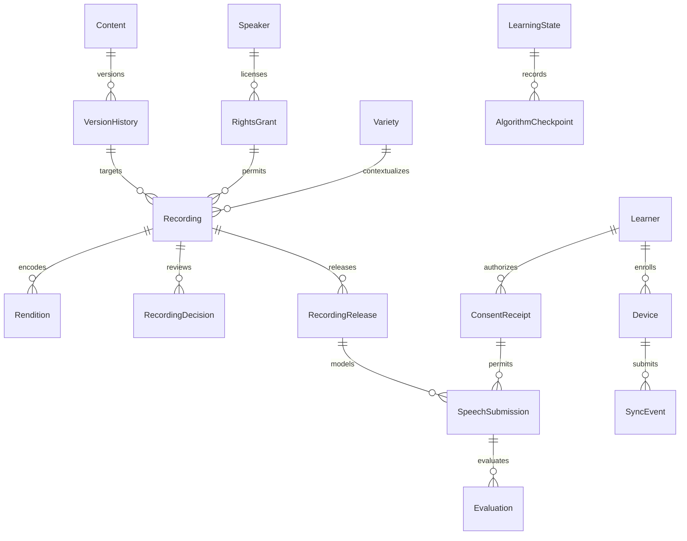

# Additive PostgreSQL design

**Proposed, not a runtime migration.** [schema.sql](schema.sql) is executable PostgreSQL 16 DDL for the new storage boundary. It is not registered with EF or applied to a development/production database. The accompanying isolated check applies the repository's real base migrations before this design. Adopting it requires application commands, EF mappings, authorization, backfills, transactional invariants and a reviewed migration.

## Existing foundations and identifiers

Reuse `public."Content"` and `public."VersionHistory"`. A target version is the UUID primary key of VersionHistory, not a display title or a UUID invented independently of the content history. Resolve its parent/revision/payload hash and current publication/recall status at command time. Keep the existing `"Learners"."Subject"` identity and current verified `"Relationships"` authorization. New learner-owned rows reference the existing learner UUID; derive that UUID from the authenticated subject.

The new `production` schema is a logical boundary in the same database, not a microservice database. Names deliberately avoid colliding with current EF tables. Existing time fields are Unix milliseconds in bigint; new times are `timestamptz`. Convert explicitly at application boundaries with UTC round-trip tests. Never reinterpret existing integers as seconds. No existing column or learner data is removed.

Current LearningState uniqueness is learner subject/content/revision/skill. The proposed task-type/variety distinction must not silently alias that key. Before separate memory buckets ship, add a versioned identity extension and backfill only educator-approved equivalences; preserve a compatible reader for legacy rows and migrate the unique index with concurrency tests. The new checkpoint table alone does not perform that migration. Until then, keep existing scheduling authoritative and store task/variety as evidence context without claiming separately calibrated buckets.

All IDs are supplied as UUIDs by trusted application commands; there is no database extension requirement. SHA-256 strings are lowercase 64-character hex. JSON fields hold versioned typed value objects validated against a registered schema; JSONB is not permission to accept arbitrary client telemetry or question answer keys. Limit document depth/bytes before SQL execution.

## Aggregate and table map

Diagram names are domain labels; exact SQL identifiers and cardinality constraints are in the DDL. Application transactions enforce the additional cross-aggregate approval/consent invariants below.

| Aggregate | Tables | Contract and access |
| --- | --- | --- |
| Native varieties | `variety` | Reviewed Tigrinya variety name/context/provenance; no nation-to-pronunciation inference |
| Contributor rights | `speaker`, `speaker_private`, `rights_grant` | Public pseudonym separate from encrypted private evidence; adult contributor attestation and purpose-specific licences |
| Teaching recording | `recording`, `rendition`, `quality_check` | Immutable target/transcript/variety/speaker/rights binding; technical metrics are not language approval |
| Recording approval | `recording_decision`, `recording_release` | Qualified exact-digest decisions and unique manifest; publication transaction also checks the core content scopes and native quorum |
| Optional speech | `consent_receipt`, `speech_submission`, `evaluation` | Private expiring objects and purpose/version-bound decisions; no raw audio in JSON, CDN or ordinary backups |
| Placement | `assessment_blueprint`, `placement_item`, `placement_session`, `placement_response`, `placement_result` | Calibrated immutable bank, response history and skill posteriors; background is separate from ability |
| Memory model | `algorithm_checkpoint` | References the existing LearningState; complete versioned state and source-event range, not competing due-date authority |
| Downloads and sync | `bundle`, `device`, `sync_event` | Signed immutable manifests, enrolled device keys, per-learner idempotent event receipts with bounded client caches |
| Progress reporting | `activity_summary` | Authorized service projection by date/skill/policy; optional child analytics remain disabled |
| Culture and scenarios | `culture_link`, `scenario_graph` | Link reviewed core versions; bounded typed graphs without generated language or a second corpus |
| Reliable jobs | `outbox` | Minimal non-content envelope, unique business key, bounded lease/retry/dead-letter state |

Foreign keys prevent dangling parents, not unauthorized access. Queries use the caller's learner/role/verified relationship scope. Publication and evaluation commands must load current rights, consent, qualifications and recalls inside the same transaction that grants the capability. A stale JWT role alone cannot satisfy those checks.

## Invariants beyond row checks

Some rules span rows and existing aggregates; a CHECK constraint cannot enforce them safely:

1. **Publish:** lock recording and core content publication rows; verify exact target and approval digests; require all core scopes plus two distinct qualified native audio reviewers independent of the author; block unresolved rejection; verify every rendition and rights lease; insert release/outbox atomically. Application runtime roles cannot directly insert release rows outside this command boundary. A qualification snapshot supports audit, but current qualification/revocation is rechecked.
2. **Immutable revisions:** lock submitted media metadata. A changed transcript, target, rights, variety or served rendition creates a successor, not an UPDATE preserving old approvals. Superseding decisions are append-only. Revoke releases explicitly and stop delivery without deleting evidence of a safety action.
3. **Evaluate:** validate submission ownership, purpose, active consent, target/rubric/calibration and engine eligibility before processing and before exposing a result. `not_assessed` has no correctness label or numeric pronunciation score. Qualitative feedback references reviewed feedback IDs; never accept free model text as child instruction by default.
4. **Placement:** bank calibration and band boundaries must be approved before creating a scored session. Session item selection and posterior updates pin versions. Responses reference an item from that blueprint, are not exposed/reused, and are graded by the service. A skipped skill remains unassessed.
5. **Sync/review:** verify canonical payload hash/device authorization, then append receipt/attempt/exposure, update the existing LearningState with optimistic concurrency, and enqueue outbox delivery in one transaction. Same event ID plus different bytes is a conflict. No mutable client mastery or due date is imported.
6. **Deletion:** deny new writes for tombstoned principals; cancel leased jobs and processor callbacks; revoke private object access; remove personal rows under the approved schedule. RESTRICT foreign keys force an explicit ordered deletion workflow; they do not justify retaining a child indefinitely. Keep only authorized non-content audit evidence. Apply tombstones during backup restore.

## Indexes, concurrency and scale

Use existing due-state and unique content-version indexes. New indexes cover private expiry sweeps, target/variety catalogue lookup, review queue, per-learner session/result lookup, worker due jobs and event stream sequence. Partial predicates avoid scanning completed jobs or revoked releases. Keep index entries free of transcripts, encrypted evidence and full JSON.

For an interactive command, use a transaction plus a row lock or a verified concurrency revision. Return an ETag/412 on stale reviewable edits; use unique event/business keys for retries. Claim worker jobs with `FOR UPDATE SKIP LOCKED`, set a bounded lease, and reconcile uncertain billable calls before retry. A worker may finish twice; the business outcome must remain unique.

Do not partition at the initial volume. Before event-ledger partitioning, account for global uniqueness across partitions, FK support, purge policy and query plans. Benchmark real due-queue, guardian-summary, publication and sync transactions at declared concurrency. Read replicas cannot authorize recently revoked relationships or consent without a defined staleness policy; use the primary for sensitive gates.

## Retention and deletion decisions

Proposed learner cloud clips expire after at most 24 hours; shorter processing/feedback windows are preferred. This is a design default requiring policy/vendor confirmation, not a live retention setting. Local clips remain ephemeral unless separately opted into saving. Result/evidence retention needs a purpose-specific guardian/learner policy; do not inherit an unlimited audit period. Adult contributor masters have licence-dependent retention and withdrawal handling.

Temporary voice storage must disable unintended long-lived versions/soft-delete retention or document the real erasure period honestly. Store processor deletion receipts and object hashes without retaining the audio. Expiry jobs use indexed timestamps and idempotent object deletion; failed deletions raise an operational incident, not a false success.

## Adoption and rollback sequence

1. Obtain owner/privacy/curriculum decisions; choose actual release scope. Snapshot schema/version baselines and test a restore in an isolated environment.
2. Add the nullable/new tables through a reviewed EF migration under a separate migration identity. Preserve current web/mobile contracts and authoritative scheduler.
3. Backfill only mappings supported by real provenance. Unknown variety, consent, native approval or calibration stays missing/unavailable; do not manufacture records to satisfy constraints.
4. Implement domain/application commands and scoped API handlers with concurrency, deletion and malformed-input tests. Validate all JSON value objects server-side.
5. Run dual-read/shadow comparisons where meaningful; default features off. Verify production database plans, permissions, backups, cost ceilings and deletion operations before opening a cohort.
6. Roll back by disabling the new capability and reverting application reads. Preserve additive tables/evidence for reconciliation. A destructive down migration is not the normal rollback for learner data.

This DDL is a storage specification. Passing SQL checks does not establish service authorization, language correctness, data residency, encryption configuration, production migration safety or learning efficacy.
