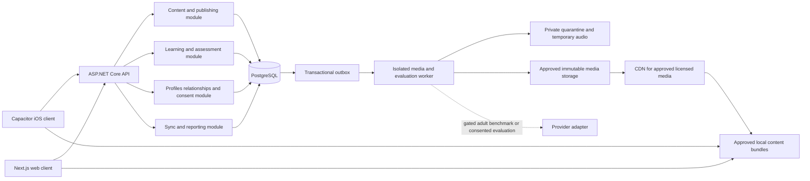
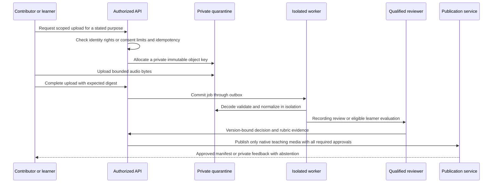

# Tigrinya production platform blueprint

**Status:** Proposed architecture and product decisions, 25 November 2026. **Baseline:** repository commit `48c0b21`. This package fulfills the twenty requested design deliverables. It does not declare the current app production-ready, approve language content, adopt a new company vision, activate services or implement the proposed APIs.

The approved [FINAL_V1 vision](../../Product-Bible/01-Vision.md) governs this plan. The existing [Product Bible approval register](../../Product-Bible/README.md), [Technical Bible](../../Technical-Bible.md), [Design Bible](../../Design-Bible.md) and [product specifications](../product/README.md) remain intact. Proposed operational detail below supplements them; a substantive change to the locked vision still requires its explicit successor process.

Detailed contracts: [Pronunciation and assessment](PRONUNCIATION_AND_ASSESSMENT.md), [Learning, analytics and culture](LEARNING_AND_EXPERIENCE.md), [Offline, security and operations](OFFLINE_AND_OPERATIONS.md), [Database design](DATABASE.md), [API specification](API.md), [cost model and sources](COSTS_AND_SOURCES.md), and [verification](VERIFICATION.md). The [requirements register](requirements.json) maps every requested capability to a concrete design and acceptance condition.

## 1 Executive Summary

Build a trustworthy, complete foundation course before a broad platform launch. The first customer situation remains a child aged 4–8 beginning Fidäl literacy with some oral Tigrinya, supported by a caregiver where needed. Adult beginners and heritage learners remain welcome; they do not silently become a different MVP curriculum.

Retain Next.js/React/TypeScript, the ASP.NET Core modular monolith, PostgreSQL and the isolated Capacitor target. Add a separately scalable media worker only when audio processing is implemented. Use approved native recordings for teaching and private self-comparison for first-release speaking practice. Do not advertise automated Tigrinya pronunciation scoring until language support, child/dialect performance and feedback calibration pass the explicit release gate.

Three product assumptions need correction. Recognition is not spontaneous pronunciation or reading fluency. Heritage background is not an ordinal proficiency level. Usage streaks are not retention evidence. The platform measures each separately and offers an honest next step when evidence or provider support is insufficient.

### Current implementation boundary

| Area | Verified repository capability | Production gap |
| --- | --- | --- |
| Learning | Two standalone units; 293 Fidäl forms; visual word path; writing/input; twenty games and twenty Stories | Qualified approval, reviewed teaching audio and a validated bounded course sequence |
| Audio | Pronunciation cards gate playback on reviewed local assets; normal/slow model slots; recording fallback; separate native eight-second recorder | Local review records have no approved native recording or reviewed lip timeline; no live pronunciation evaluator |
| Content operations | Versioned generic content, immutable history, scoped qualified approvals, author independence, protected upload and publication | Specialized recording/variety metadata, independent native-audio quorum, audio QA and takedown operations |
| Review | API uses `sm2-v1`; TypeScript has a real `ts-fsrs@6.0.0` FSRS-7 adapter | Server FSRS persistence, migration and calibration; no silent algorithm switch |
| Identity and parents | Entra adapters, role checks and verified relationship checks | Real tenant configuration and jurisdiction-specific child consent/guardian verification operations |
| Offline | Bundled mobile practice and partial web shell caching | Authenticated offline evidence, deletion/revocation reconciliation and entitlement-aware downloads |
| AI | Interfaces in `Polyglot.Domain/AI/Contracts.cs` | No registered provider implementation or validated Tigrinya scoring system |
| Hosting | Azure infrastructure and manual deployment workflow are described | No live environment, quota, bill or service availability is established by source inspection |

## 2 Product Vision

Make a learner's next useful Tigrinya action clear: hear or understand a reviewed model, try with support, retrieve later, and use the material in a meaningful context. Teach Tigrinya Fidäl as a left-to-right Ethiopic abugida. Preserve character families, vowel orders and context-dependent readings; never substitute Amharic because it shares the script.

The durable advantage is a rights-cleared, versioned, community-reviewed corpus linked to tested teaching and trustworthy evidence. The moat is not private child voice data, an oversized feature catalogue or a proprietary scheduler with no comparative evaluation.

Commercial value must follow useful learning and manageable family effort. Test voluntary return, delayed independent performance and caregiver willingness to pay or sponsor access. Do not optimize daily opens at the expense of learning, shame learners for absences, or sell child data. These constraints preserve the locked vision while addressing revenue sustainability.

## 3 Architecture Diagrams

Raw learner recordings never enter the publishing path or CDN. Modules share a transactional database initially, with separate code ownership and explicit application ports. A queue worker is an execution boundary, not a reason to deploy every domain as a microservice. Extract a service only for measured scaling, failure isolation, data jurisdiction or independent team ownership that outweighs distributed-system costs.

## 4 Domain Model

Keep the existing ContentItem aggregate and immutable VersionHistory. Extend it with Recording, Rendition, LanguageVariety, SpeakerConsentGrant and RecordingRelease. Every teaching recording identifies a content version, target/context, transcript, variety, speaker, rights and exact served-byte hashes.

Keep Learner, verified Relationship, LearningState, ReviewAttempt and LearningExposure. Add purpose-specific ConsentReceipt, LearnerSpeechSubmission, Evaluation, AssessmentBlueprint, PlacementSession, DeviceEnrollment, BundleManifest, SyncReceipt and ActivitySummary. These are proposed domain additions, not existing endpoints or populated data.

Four invariants are universal: the server determines authorization and permitted evidence; publication requires exact-version approvals; assisted exposure cannot become delayed recall; and a child's service progress is not permission for research analytics, marketing or provider training. Proposed contributions use capabilities rather than granting a broad reviewer role unrestricted access to learner speech.

## 5 Database Design

Use PostgreSQL 16 compatible types, UUID keys, immutable version references, foreign keys, unique idempotency constraints, optimistic concurrency and purpose-bounded indexes. Retain the current `public."Content"`, `"VersionHistory"`, `"Learners"`, `"LearningStates"`, `"Attempts"`, `"Exposures"` and `"Relationships"` foundations.

The [database design](DATABASE.md) specifies the additive tables, key constraints, private-data boundaries, indexes and expand/contract migration order. Core content payload hashes remain authoritative. Specialized tables do not create a second independent publication truth. A content edit preserves its previously published version until an approved successor is released or an explicit revocation withdraws it.

Native speaker private contact/consent evidence is separated from public display metadata. Learner speech uses expiring private object references, not permanent byte columns. Review events are append-only; mutable queue state is a rebuildable projection. A model-version change records a migration checkpoint rather than overwriting historical evidence.

## 6 API Specifications

Retain current `/api/*` routes. New contracts are versioned under `/api/v1`; [API.md](API.md) defines resource shapes, actions, errors and authorization. Client-generated event IDs support idempotency, never client-authored correctness. A retry with the same ID and different payload returns a conflict. Mutations of reviewable resources require an ETag; completed evaluation results bind the target, rubric and engine revisions.

Every personal endpoint derives the caller from the validated token. Parent/teacher queries additionally require a current verified relationship. Contributor roles cannot access learner recordings. Feature-capability responses distinguish `available`, `unsupported`, `approval_pending` and `consent_required`; unavailable speech assessment produces no invented result.

An API returning an accepted job ID has accepted processing, not confirmed learning or publication. Upload completion, processing, review, delivery and deletion each have explicit states and retry semantics.

## 7 UI and UX Flows

Learner: continue or choose a short activity → encounter a reviewed model → practise → receive specific feedback → retrieve without the model when appropriate → see a calm recap and next step. A failed or unsupported audio operation leaves a readable/transcript-based activity and does not mark an answer wrong.

Pronunciation: choose reviewed target/variety → listen normally or slowly → optional record → compare with explicit local privacy notice → retry or stop. Only validated human/automated evaluation adds `Correct`, `Close` or `Needs improvement`; otherwise show `Not assessed` and a useful model. A waveform shows amplitude over time, not articulation correctness.

Placement: choose goals and optional background → short skill-specific tasks → provisional profile with uncertainty → recommended starting material → optional later retest. Speaking can remain unassessed while reading starts. A learner can challenge placement, skip microphone use and revisit foundations without penalty.

Parent: verify relationship → see taught material, assistance, later independent evidence and a practical shared activity → manage saving, optional processing, access and deletion. Purchases and consent live behind an adult boundary. No child leaderboard or deficit label is introduced.

Target WCAG 2.2 AA plus 44–48 CSS-pixel primary controls, keyboard/switch access, meaningful focus, VoiceOver checks, high contrast, reduced motion and captions/transcripts. The project target is deliberately larger than WCAG's minimum pointer target. Accessibility alternatives must remain available, while the evidence records which skill was actually assessed. [WCAG 2.2](https://www.w3.org/TR/WCAG22/)

## 8 Security Architecture

Use Entra public clients, API audience/issuer/scope validation, managed identities, private database/storage networking, least-privilege runtime/migration roles, short-lived scoped upload capabilities and server-generated object keys. Native sign-in uses a proper native public-client/system-browser design; the mobile web preview does not inherit the SPA redirect URI or acquire a client secret.

Quarantine all uploads. Sniff format, bound decoding time/memory/duration, reject polyglots, remove unneeded metadata, scan malware and transcode without network access. Do not fetch client-supplied remote audio URLs. Store secrets in server-side secret management, never in Next public configuration, a mobile bundle or logs.

Require explicit jurisdictional review before child accounts/cloud speech. Where COPPA applies, verifiable parental consent, notice, access/deletion and retention controls matter; the narrow transient-voice exception must not be assumed to cover a scoring platform. Where EU processing relies on child consent for information-society services, the threshold varies between 13 and 16 by Member State. This is a design control set requiring legal validation, not a compliance certificate. [FTC rule update](https://www.ftc.gov/news-events/news/press-releases/2025/01/ftc-finalizes-changes-childrens-privacy-rule-limiting-companies-ability-monetize-kids-data), [European Commission child-data guidance](https://commission.europa.eu/law/law-topic/data-protection/information-business-and-organisations/legal-grounds-processing-data/are-there-any-specific-safeguards-data-about-children_en)

## 9 Testing Strategy

Use domain tests for publication quorum, assistance/evidence, scheduler versions, branch graphs, consent withdrawal, authorization and idempotency. Test schema migrations and concurrent transactions in an isolated PostgreSQL test database before runtime adoption. Exercise media decoders with malformed, oversized, silent, clipped and interrupted files; no test fixture is a native language approval.

Contract tests must cover every API's authentication, relationship scope, revision conflict, validation, rate limit and empty/error state. Browser/device tests cover model playback, speed, bounded repeat, interrupted recording, offline downloads/sync, keyboard/VoiceOver, narrow layouts and storage pressure. Do not count mocked native transport as physical microphone validation.

Learning and speech evaluation need separate held-out participants/items, native-rater agreement and subgroup checks. Proposed AI release criteria include one-sided error-rate confidence bounds and abstention, not a mean score from convenient adult recordings. Product tests use small consented formative studies before a powered learning-outcome study. Report accessibility alternatives and missing skill evidence instead of excluding those learners from success statistics.

## 10 Telemetry Strategy

Separate operational health, necessary learning evidence and optional research/product analytics. Default optional analytics off; retain the current child-analytics prohibition. Do not add raw speech, typed answers, full text, tokens or child identifiers to Application Insights. Learner-facing reports are authorized service projections, not permission to export a behavioral dataset.

Define listen/replay events after real playback starts; attempts, model exposure, independent recall and qualified assessment have separate types. Record study time only through an adopted, purpose-specific foreground-session policy with idle caps; do not infer learning from an open tab. [LEARNING_AND_EXPERIENCE.md](LEARNING_AND_EXPERIENCE.md) defines denominators, confidence, the requested heatmap/trajectory/skill tree, and optional nonpunitive calendar counts.

## 11 Scalability Strategy

Start with the modular monolith and a bounded asynchronous worker. Scale audio delivery through immutable hashes/CDN, API instances through stateless authorization and per-principal rate limits, and workers through queue depth and decoder CPU budgets. Limit one active evaluation per learner and a global provider spend/concurrency ceiling. Use cursor pagination and due-state indexes before partitioning.

Do not deploy a separate SRS, placement, culture or analytics microservice at MVP. Extraction thresholds require sustained measured bottlenecks, an owner/on-call boundary, outbox/event contracts, a replay/backfill plan and evidence that database/query optimization is insufficient. Large-file processing is the earliest plausible extraction because its failure and resource profile differ from interactive requests.

## 12 Cost Estimates

The [reproducible cost model](COSTS_AND_SOURCES.md) separates checked public provider rates from unquoted hosting/labor assumptions, and models prerecorded, human-review and gated AI scenarios at 1,000 and 10,000 active learners. No Azure region, contract, GPU benchmark, tax treatment or family willingness to pay is assumed to be known.

Current public GPT-Realtime-2.1 audio rates are $32 per million input tokens and $64 per million output tokens; Whisper's deprecated hosted model lists $0.006 per minute. These prices do not establish Tigrinya assessment support. Azure rates require the selected service, region and offer. Human review and rights-cleared native content are operating costs, not optional launch extras. [OpenAI pricing](https://developers.openai.com/api/docs/pricing), [Whisper model](https://developers.openai.com/api/docs/models/whisper-1), [Azure Speech pricing](https://azure.microsoft.com/en-us/pricing/details/speech/)

Revenue hypotheses are parent/adult subscriptions, institutional licences and sponsored access. Test price and demand with adults; no paid voice processing or purchase pressure is placed in a child activity. Contribution margin subtracts platform/payment fees, hosting, review, support and measured variable media/AI costs. Owner-approved budgets and stop limits precede any provider activation.

## 13 Implementation Roadmap

| Phase | Exit evidence | Dependencies and decision |
| --- | --- | --- |
| P0 Adoption and corpus | Owner adopts operational decisions; qualified educator selects a bounded sequence; rights/native review roster and real media plan exist | Preserve FINAL_V1; no feature breadth expansion before the sequence is teachable |
| P1 Reviewed audio delivery | Versioned native recording/rendition pipeline, scoped review quorum, tap/slow/repeat fallback and takedown tests pass | Approved transcripts/varieties/speakers and final served files; no AI scoring |
| P2 Foundation pilot | Usable reviewed sequence, independent/delayed evidence, accessibility/device QA and local review work | Consent and evaluation protocol; change teaching if only supported performance improves |
| P3 Account/offline operations | Verified guardian relationships, deletion/export, signed bundles, conservative offline sync and restore drill pass | Real Entra/Azure configuration, purpose/retention decisions and operational funding |
| P4 Expanded assessment | Calibrated placement, rules-based scenarios, human feedback and explicit FSRS server migration pass | Approved item banks/rubrics, native review capacity and held-out evaluation |
| P5 Gated automation | Provider language support, subgroup calibration, abstention and cost/privacy gates pass | Fail closed if Tigrinya remains unsupported; a human/self-comparison product remains viable |

Estimate P0–P2 as **12–20 weeks of planning capacity after staffing and content access**, not a delivery promise. P3–P5 require re-estimation from observed corpus throughput, learning results and vendor feasibility. Content/native-review bottlenecks can dominate engineering time. Do not put an unverified release date on the roadmap.

## 14 Technical Risks

| Risk | Mitigation and stop condition |
| --- | --- |
| ASR emits convincing but wrong text | No transcript-as-pronunciation grade; capability gate, native benchmark and abstention |
| Review throughput is below authoring speed | Publish smaller complete sequences; pay/recruit qualified reviewers; never lower quorum silently |
| Offline clock/model tampering | Preserve provisional evidence, server replay/revalidation and live cold follow-up; no certification claim |
| Raw voice leaks through media/logging | Separate private namespaces, expiry/deletion tests, no raw data telemetry, no CDN for learner voice |
| New model or rendition invalidates old results | Exact target/engine/rubric hashes and supersession; no score carryover by display text |
| Algorithm migration changes due dates unexpectedly | Shadow replay and explicit opt-in cohort; keep old scheduler authoritative until acceptance |
| Mobile builds cannot be reproduced | Pinned dependencies and separate target; actual platform/signing/device validation still required |

## 15 Product Risks

Breadth can conceal missing teaching, and polished feedback can create false confidence. Heritage learners can be misclassified if background becomes ability. English-heavy child instructions can undermine independent use. A generic phonetic score may penalize legitimate varieties or young voices. Parent dashboards can become surveillance or pressure. Rights disputes and unpaid reviewer overload can erode community trust.

Counter these with a bounded course, reviewed oral instructions, variety-aware rubrics, voluntary practice, transparent uncertainty, caregiver controls and contributor payment/appeal processes. Do not fix weak learning results by increasing streak pressure or adding more AI-generated material.

## 16 Team Requirements

For P0–P2, budget one accountable product/learning lead, one senior full-stack engineer, one additional web/mobile or backend engineer, a part-time accessibility/QA specialist, a qualified Tigrinya curriculum lead, and at least two independent qualified native reviewers/recording collaborators. Obtain fractional privacy/legal and security review before child cloud data is enabled.

These are responsibilities and capacity assumptions, not invented hires. One person can cover compatible roles, but an author cannot supply their own independent approval. Give a named owner to corpus quality, learner evidence, privacy/deletion, incidents and cost limits. An administrator is not automatically a linguist, native reviewer or authorized guardian.

## 17 MVP Definition

A release-worthy MVP is a **small, fully reviewed foundation sequence**, not every existing screen. It includes accurate native audio, clear visual/recorded instructions, sound–form–meaning practice, accessible reading/writing alternatives, normal/slow/repeat playback, private optional self-comparison, a sensible next activity and later review. Keep the existing app intact while choosing the actual reviewed release set.

Use the current server SM-2 behavior for account review, local opt-in practice where appropriate, culture inside the taught contexts and a minimal caregiver explanation of evidence. An approved static/native bundle can work offline; authenticated offline evidence sync is a later release. No automated pronunciation grade, uncalibrated placement band, open LLM conversation, child analytics or payment flow is required to prove the MVP's value.

Acceptance requires all linked teaching assets approved, the complete learner flow tested, supported versus independent evidence distinguishable, no critical accessibility/privacy defects, and a predefined delayed/parallel-task learning evaluation. Screen count, lines of code and repeated matching success are not release criteria.

## 18 Version 2 Definition

Add broader reviewed objectives, calibrated skill-profile placement, bounded rules-based conversations for the requested contexts, native contributor operations, scoped human speaking feedback, guardian-controlled account progress and authenticated offline reconciliation. Introduce FSRS server scheduling only after state persistence, shadow comparison and migration acceptance.

Ship optional adult calendar/heatmap goals and caregiver summaries only with accurate denominators and appropriate privacy policy. Record culture context throughout the released curriculum. Expansion must improve learning or access; it cannot merely increase activity counts.

## 19 Version 3 Definition

Consider validated automated pronunciation feedback and constrained LLM assistance after provider/language/data gates, including age and variety performance, are met. Scale contributor moderation and licensed cultural media; develop advanced communication pathways with actual qualified curriculum and assessment material.

If automation cannot meet the gates, retain native models, self-comparison and human evaluation. Do not brand an unsupported model as Tigrinya-capable. Multiple languages, new microservices and mass institutional distribution require their own business/privacy/operational evidence rather than being automatic features of Version 3.

## 20 Success Metrics

| Outcome | Definition and decision use |
| --- | --- |
| Useful learning | Change on approved, independent parallel tasks after a prespecified delay, with uncertainty, assistance and attrition reported |
| Voluntary return | Eligible learners returning to a useful activity within 7/28 days; no reminder pressure or coerced-completion exclusions |
| Accessible completion | Completion and observed barriers by supported access mode; an alternative is not mislabelled as a test of an inaccessible skill |
| Native trust | Defect/retraction rate per released asset, reviewer agreement, time to correction and contributor payment/appeal completion |
| Speaking feedback | Correct-label and false-correction error bounds plus abstention on held-out native-rated speech, separately by relevant subgroup |
| Review quality | Eligible delayed correct/attempts with denominator and calibration; lower workload at comparable observed recall before changing scheduler |
| Family value | Caregiver orchestration burden and adult willingness to pay/sponsor, measured through an approved evaluation rather than guessed revenue |
| Operating viability | Cost per approved objective and active family, support/deletion response performance, gross/contribution margin assumptions made explicit |

Set study thresholds and analysis before looking at results. Do not claim superiority over Anki, SuperMemo, Duolingo or another course without a fair, independently interpretable comparison. The ambition is an enduring learning company; the near-term proof is a small sequence that people can trust and use.
